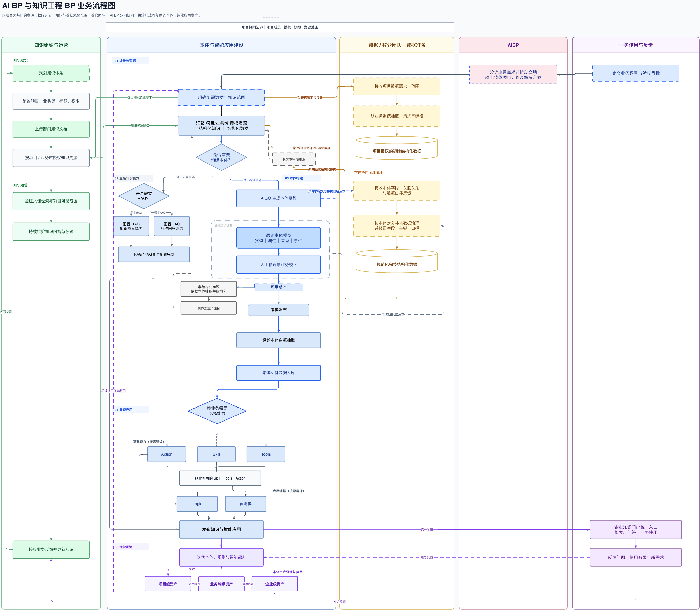

# 前言——产品架构与阅读路径

使用本平台的主线是：**从业务目标出发，准备并授权资源，在项目中建设所需能力，交付业务使用，再根据反馈维护和复用成果。**

图中展示了知识组织与运营、本体与智能应用建设、数据准备、AI BP 协同以及业务使用之间的关系。各方围绕同一业务目标协作，但不必由同一人员完成所有环节。

组织负责接入和管理文档、数据表等资源，确定资源归属、管理责任与访问范围；项目负责知识库、本体和智能应用建设。项目通过申请获得组织资源的使用授权，资源归属不随之改变。建设过程中，业务人员确认需求与验收目标，知识工程人员组织模型和能力，数据团队准备符合业务口径的数据，AI BP 协助明确方案并推动协同。

建设成果交付后，用户通过知识门户或相应应用检索、问答和处理业务。使用中发现的问题与新增需求，返回知识维护、数据准备和能力建设环节持续修正；可复用的成果按管理要求发布回部门、业务域或企业级部门，供其他项目申请使用。

阅读本手册时，先用第一章明确目标和建设路径，再按需要查阅资源、项目、建设与使用章节。下图是理解平台协作关系的总览；各条场景的完整路径和具体操作，以后续章节为准。

图 0-1 平台业务流程总览（沿用 v3.4 总览图，待按 v4.0 重绘，见本章「待确认」）

## 平台入口速览（v4.0）

v4.0 中，组织、资源、项目和标签的日常操作集中在**知识门户**，建设类操作在**业务知识**、**本体建模**、**业务逻辑**、**业务行为**、**本体洞察**五组建设菜单中完成。门户顶部菜单与本手册章节的对应关系如下：

| 知识门户菜单 | 主要用途 | 对应章节 |
|---|---|---|
| 首页 | 知识检索、智能问答，项目轮播、智能体与热词推荐、我的审批待办 | 第十章、2.3 |
| 工作台 | 我的审批（我提交的 / 我审批的）、我的收藏、最近使用 | 2.3、第十章 |
| 资源 | 部门组织目录、部门详情（成员、角色与权限、审批机制），文档、数据表、智能体、本体、回收站 | 第二章、第三章 |
| 项目 | 按部门查看与新建项目，管理项目成员，申请与查看项目资源 | 第四章 |
| 标签 | 标签类型、标签子集、标签的维护与启停用 | 2.4 |
| 运营 | 运行看板等运营数据查看 | 第十一章 |

建设菜单分组如下，均从左侧菜单进入：

| 分组 | 菜单 |
|---|---|
| 业务知识 | 知识库 |
| 本体建模 | 自动建模、对话式建模、业务本体、知识抽取 |
| 业务逻辑 | 业务流程 |
| 业务行为 | 智能体、业务行动、平台工具、Skill |
| 本体洞察 | 实体看板、知识推演 |

说明：v3.4 中的「空间管理」在 v4.0 门户界面中改名为「资源」，部门组织目录、部门详情等配置均在资源页完成。全书正文统一用「部门」，不用「空间」（界面原文「个人空间」「默认企业空间」「全部有权空间」除外）。

## 手册目录说明

第一章从业务目标出发，明确要解决的问题、所需材料和建设路径。第二章确定资源的组织管理范围、成员角色、权限、审批和标签。第三章接入并管理文档、结构化数据及门户 FAQ。需要建设知识库、本体或应用时，再按第四章确定项目范围，申请并获得所需资源的使用授权。

完成准备后，根据业务需要进入建设环节。第五章说明如何构建文档知识库和数据知识库；第六章说明如何构建本体，处理数据并配置 Action、Logic 和规则；第七章说明 Tools、Skill 与 MCP 等通用能力；第八章说明如何组合所需知识与能力，建设和调试 Agent。这些章节按选定路径使用，不要求逐章完成所有建设内容。

第九章说明如何通过 API 等方式向外部系统开放能力。第十章说明用户如何依据组织资源权限，在企业知识门户中检索和问答；门户使用不以创建项目为前提。第十一章承接使用反馈，说明日常维护、成果回流复用与运营查看，让业务使用中发现的问题重新进入更新和建设过程。

## 版本说明

- 本手册依据测试环境（平台版本 v4.1.2，含 1030 / 1106 版本功能）编写，步骤与截图以环境实际为准。
- 标注【1130 版本】的小节为计划于 1130 版本上线的功能，截图取自产品原型，图注注明「原型示意，以上线版本为准」。
- 仍标注【规划】【待升级】的小节，表示环境与原型中暂未提供，保留 v3.4 原文供参考。

---

## 本章变更说明（v3.4 → v4.0）

- 修改：总述中资源范围由「文档、数据等」明确为「文档、数据表等」；成果复用由「回流到…范围」改为「发布回部门、业务域或企业级部门，供其他项目申请使用」，与 v4.0 资源发布/申请机制一致。
- 新增：「平台入口速览（v4.0）」，按环境列出顶部六个菜单（首页、工作台、资源、项目、标签、运营）与章节对应关系，并补充建设菜单五个分组（业务知识、本体建模、业务逻辑、业务行为、本体洞察）；原 v3.4 的「我的」「项目管理」「标签管理」菜单名按环境改为「工作台」「项目」「标签」，「本体管理」不再是一级菜单，改为五组建设菜单，其中自动建模、对话式建模、业务本体、知识抽取归入「本体建模」组。
- 修正：「平台入口速览」原说明句因替换误写为「「部门」统一显示为「部门」」，改为「部门管理」在 v4.0 中显示为「资源」，并明确全书用「部门」不用「空间」。
- 新增：「版本说明」，说明环境、【1130 版本】与【规划】标签的含义。
- 修改：「手册目录说明」第二章范围补充「成员角色、权限」。
- 未变：平台使用主线、阅读路径与各章定位。

## 待确认

1. 图 0-1 平台业务流程总览沿用 v3.4 原图（`_ref/v3.4-media/media/image1.png`），v4.0 资源类型（数据表、本体、智能体资源）和发布/申请关系是否需要重绘，需产品确认；定稿转 Word 时替换图片路径。
