# 二、配置组织资源管理

本章配置资源的组织管理范围、成员角色与数据权限、审批机制和标签体系。项目建设环境在第四章单独准备；资源归属与建设环境分别管理。

> 称谓说明：v4.0 知识门户界面中，原「部门管理」菜单改为「资源」，部门组织目录、部门详情、部门角色等配置均在资源页完成。本章正文统一称「部门」，与 v3.4 含义相同。

## 2.1 组织管理：配置资源部门管理范围（企业、业务域、部门）

用于配置资源的组织管理范围，按照**企业、业务域、部门**等组织层级划分和管理资源，实现不同组织范围内资源的隔离、归属和统一管理。

### 2.1.1 查看、创建与同步部门

**目标：** 基于企业现有组织架构形成部门目录，使企业、业务域、部门等组织节点与平台资源部门保持一致；需要更细的管理范围时，在已有部门下新建下级部门。

**前置条件与入口：** UUMS 已创建企业组织；进入 `知识门户 > 资源`，左侧为「部门组织目录」。

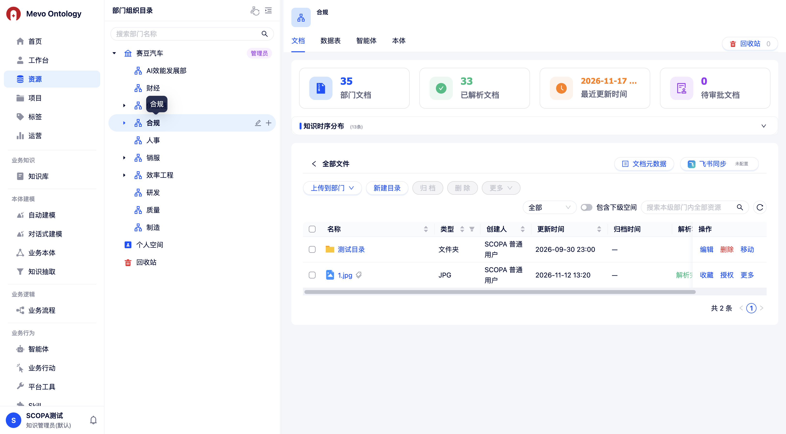

图 2-1 部门组织目录（鼠标悬停在「合规」节点上，显示编辑与「+」按钮）

**操作：**

1. 进入 `知识门户 > 资源`，在左侧「部门组织目录」查看企业、业务域、部门层级。节点右侧标签显示当前用户在该部门的角色（如「管理员」「普通成员」）；目录底部为「个人空间」和「回收站」。可在顶部搜索框按部门名称查找，或用目录右上角按钮全部展开 / 收起。
2. 点击某个部门，右侧显示该部门的资源概况和文档列表（资源管理操作见第三章）。
3. **新建下级部门：** 鼠标悬停在部门节点上，点击节点右侧的「+」，在「新建部门」弹窗中填写「部门名称」（必填）和描述，「上级部门」自动带出为当前节点；在「指定部门管理员」中按所属部门或工号/姓名查找并勾选管理员，点击「确认」。
4. **同步组织架构：** 企业已有统一组织架构数据时，由有权限的管理员点击「部门组织目录」右上角第一个图标按钮「部门同步」，从 UUMS 获取组织信息并生成或更新对应部门。

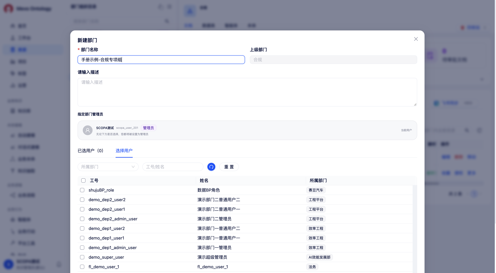

图 2-2 新建部门

**说明：**

- 部门节点右侧的编辑（笔形，悬停提示「编辑」）按钮用于打开「部门详情」，配置成员、角色与权限、审批机制（见 2.2）。
- 上层部门管理员默认拥有下层部门管理员的全部管理权限，包括新建下级部门、设置审批链路和编辑人员。
- 部门成员数据取自 UUMS；新建部门并保存后，后续用户、文档、数据表等资源按所属部门进行管理与权限控制。

## 2.2 组织权限：配置资源管理职责

本节在「部门详情」中完成。部门详情包含三个页签：**概览与成员**、**角色与权限**、**审批机制**。

**入口：** `知识门户 > 资源 >` 在部门组织目录中悬停目标部门 `>` 点击节点右侧编辑按钮，打开「部门详情 · 部门名称」抽屉。只有该部门（或上级部门）的管理员可以修改其中的配置。

### 2.2.1 部门成员配置

**目标：**

- 让需要使用该部门资源的人能查看、检索和按规则上传，并避免无关人员获得访问范围。
- 明确部门的管理责任人，管理员负责维护资源、授权成员与日常管理，避免管理职责悬空或范围过大。

**前置条件与入口：** 管理员名单已确认；打开目标部门的「部门详情」，进入「概览与成员」页签。

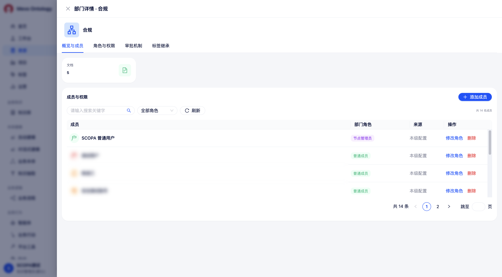

图 2-3 部门详情：概览与成员

**操作：**

1. 在「概览与成员」页签查看部门文档数量和「成员与权限」列表。列表显示成员、部门角色、来源（如「本级配置」）和操作；可按关键字搜索、按角色筛选，点击「刷新」更新列表。
2. 点击「添加成员」，在弹窗的「选择用户」页签按所属部门或工号/姓名查找并勾选用户，在下方「部门角色」中选择角色（「节点管理员」「普通成员」或 2.2.2 中定义的自定义角色），点击「确认」。一次添加的用户使用同一角色；「已选用户」页签可核对本次选择。
3. 需要调整角色时，点击成员行的「修改角色」，在弹窗中选择新的部门角色后点击「保存」。
4. 需要移除成员时，点击成员行的「删除」。

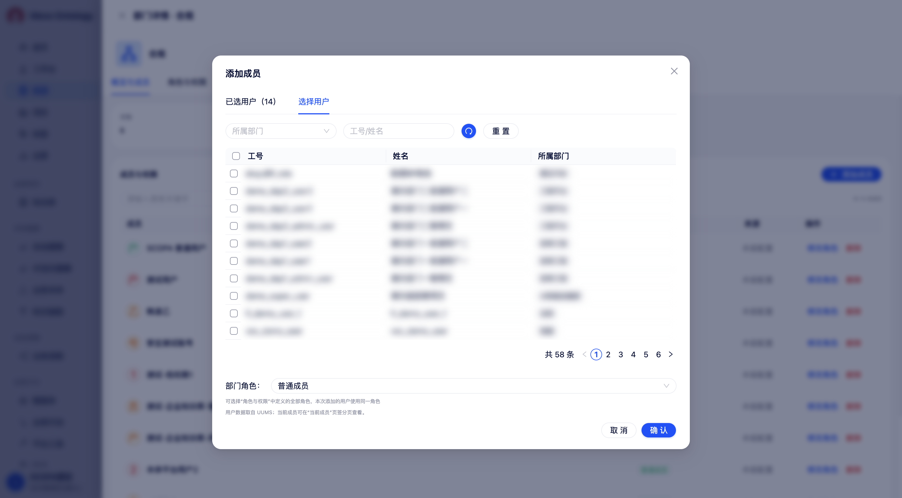

图 2-4 添加成员并选择部门角色

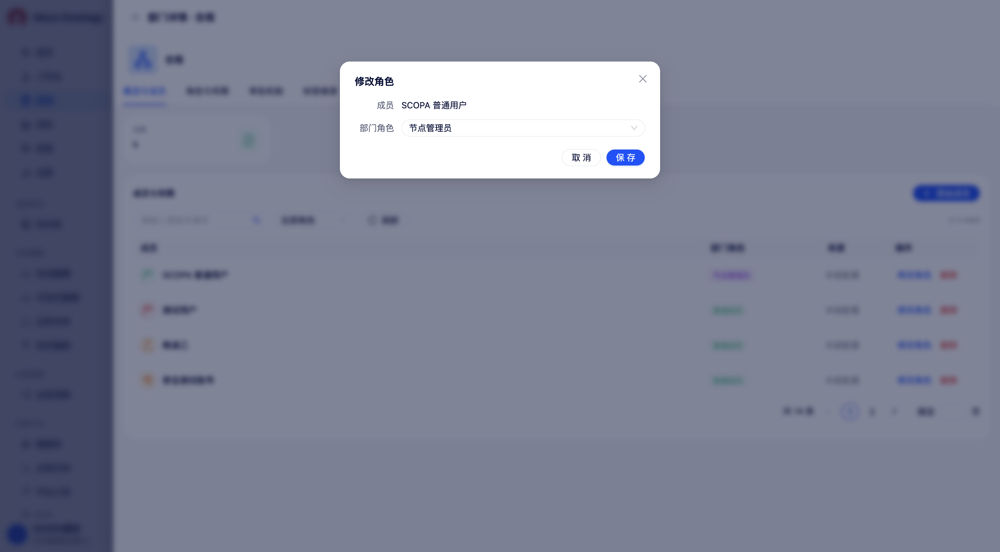

图 2-5 修改成员角色

**完成检查与下一步：** 使用其他部门成员账号验证能进入部门并执行授权范围内的操作。

### 2.2.2 角色与权限：自定义部门角色与默认数据权限

**目标：** 在默认角色之外，为部门定义符合业务分工的自定义角色，并配置角色的默认数据权限，让同一角色的成员自动获得一致的文档、数据表访问范围。

**前置条件与入口：** 打开目标部门的「部门详情」，进入「角色与权限」页签。

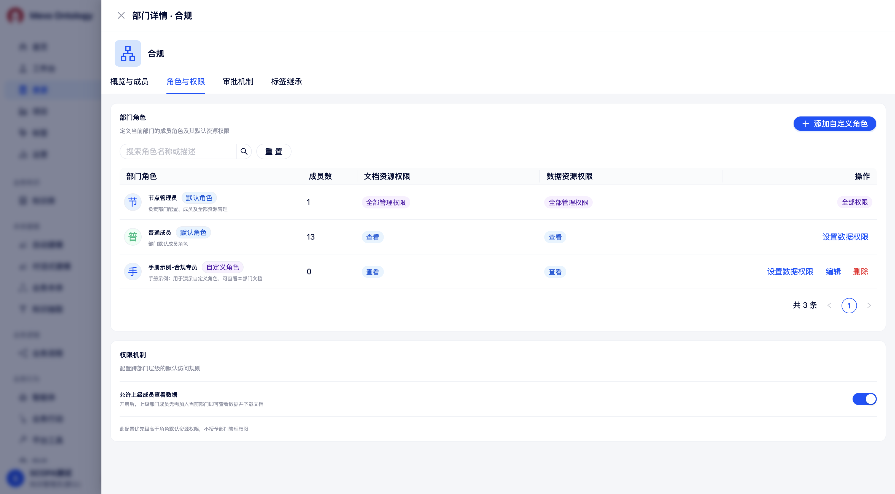

图 2-6 角色与权限页签

**操作：**

1. 在「部门角色」列表查看当前角色、成员数、文档资源权限和数据资源权限。系统默认提供两个角色：
   - **节点管理员**（默认角色）：负责部门配置、成员及全部资源管理，文档和数据资源均为「全部管理权限」。
   - **普通成员**（默认角色）：部门默认成员角色，文档和数据资源默认为「查看」。
2. 点击「添加自定义角色」，填写「角色名称」（必填，最多 50 字）和「角色描述」（最多 200 字），点击「保存」。保存后角色出现在列表中，标记为「自定义角色」，成员数为 0。
3. 点击角色行的「设置数据权限」，在「文档资源权限」中选择该角色对部门文档的默认浏览与下载范围，点击「保存权限」：
   - **查看**：可浏览部门全部文档。
   - **浏览 + 下载全部**：可浏览并下载部门全部文档。
   - **按管理员分配**：默认仅可查看列表，内容与下载权限按文档单独分配。
4. 节点管理员固定为「全部权限」，不可修改；普通成员和自定义角色均可「设置数据权限」。自定义角色还可「编辑」或「删除」，默认角色不可删除。设置保存后对该角色的全部成员生效。
5. 回到「概览与成员」，在「添加成员」或「修改角色」时即可选择自定义角色。

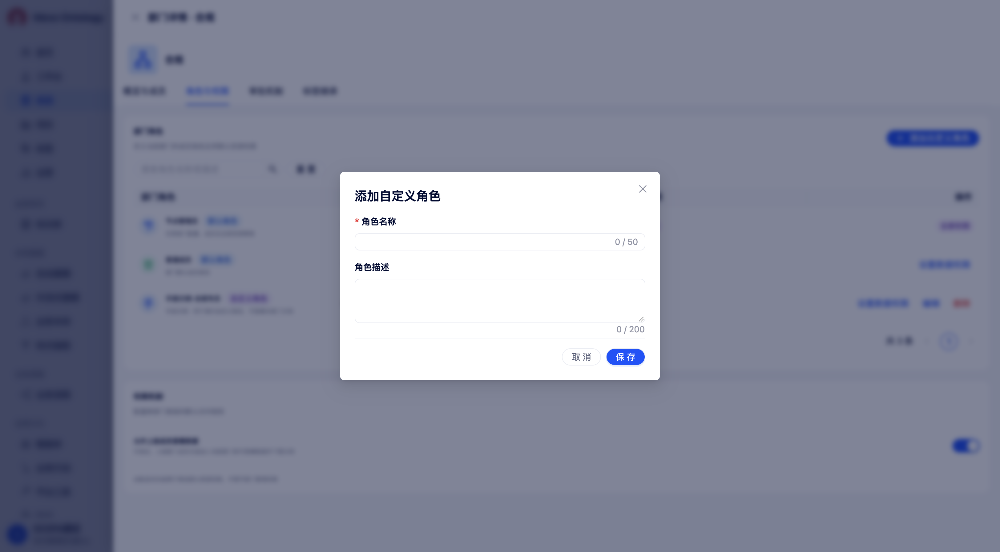

图 2-7 添加自定义角色

图 2-8 新增的自定义角色

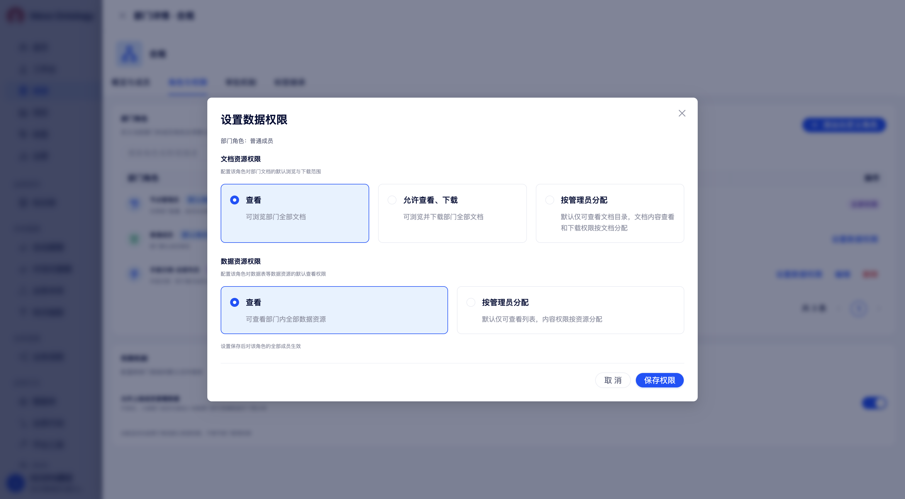

图 2-9 设置角色的文档资源权限

**说明：** 角色默认权限之外的单个文档、数据表授权，在资源列表中通过「授权」完成，见第三章。

### 2.2.3 资源部门审批配置

本节说明部门内两类审批配置：**资源发布到此部门**、**项目申请部门资源**。

**前置条件与入口：** 打开目标部门的「部门详情」，进入「审批机制」页签。

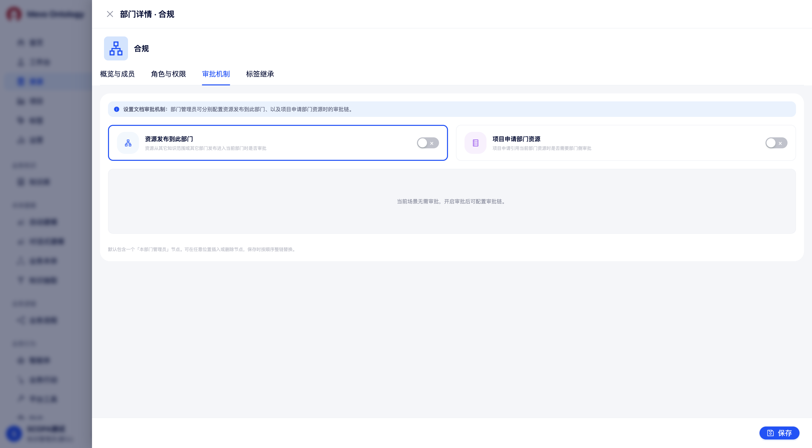

图 2-10 审批机制页签（两类审批均未开启）

**（一）资源发布到此部门**

**目标：** 部门成员或其他部门、个人空间将资源发布到本部门时执行审批，避免部门中存在未经审批的资源。

**操作：**

1. 点击「资源发布到此部门」卡片，打开右侧开关。开关关闭时提示「当前场景无需审批，开启审批后可配置审批链」。
2. 开启后，下方显示「文档发布到此部门 · 审批链」，默认包含一个「本部门管理员」节点（任意人审批）。
3. 点击节点，在「配置审批节点」弹窗中设置：
   - **多人节点通过规则**：「任意人员审批」（节点配置多人时，任意一人通过即可完成本节点）或「同时审批」（每一位审批人都通过才完成本节点）。
   - **审批人员来源**：「本部门管理员」「上一级部门管理员」或「指定成员」。选择「指定成员」时，在「选择成员」页签勾选审批人，在「已选成员」页签核对。
   点击「确认」保存节点。
4. 点击节点前后的「+」可在任意位置插入审批节点，也可删除节点；审批按节点顺序依次进行，保存时按当前顺序整链替换原审批链。
5. 配置完成后点击页面右下角「保存」。未保存直接关闭抽屉时，系统弹出「审批设置尚未保存」提示，点击「取消」返回继续编辑，点击「放弃修改并关闭」则丢弃本次修改。

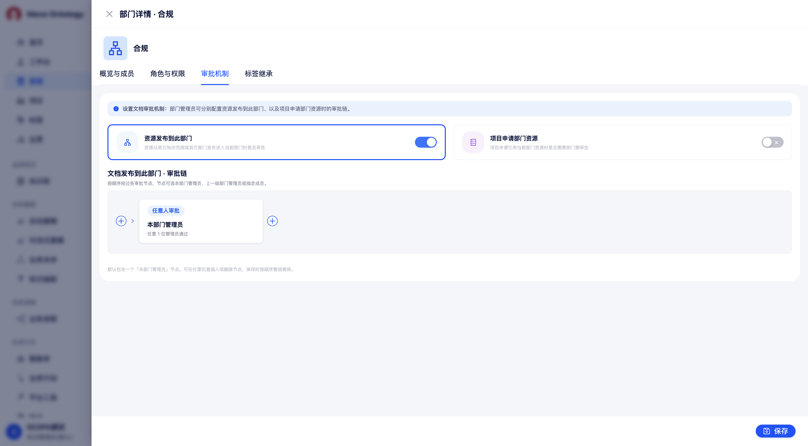

图 2-11 开启资源发布审批后的审批链

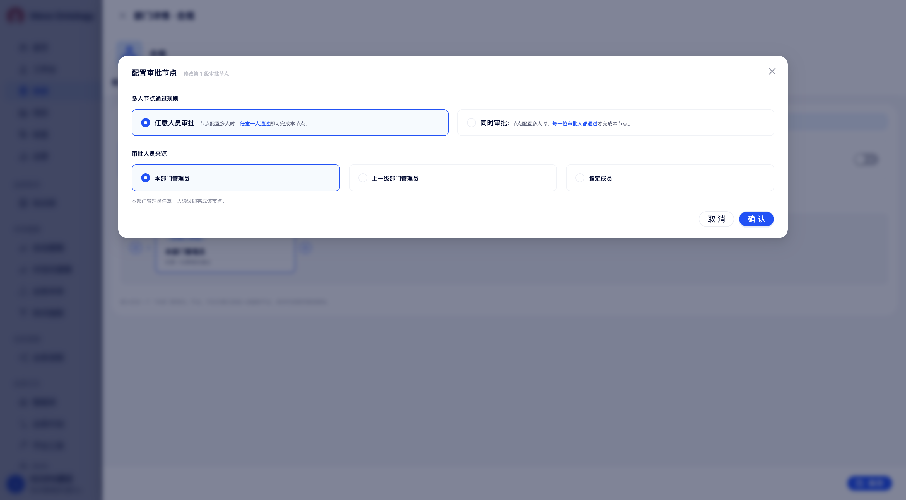

图 2-12 配置审批节点

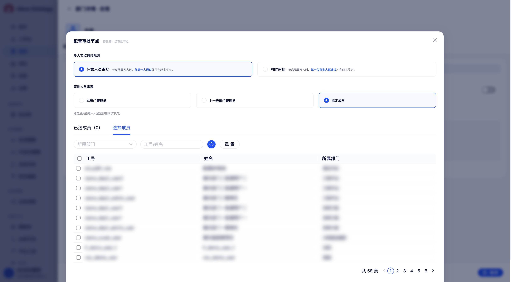

图 2-13 审批人员来源选择「指定成员」，在「选择成员」页签勾选审批人

**（二）项目申请部门资源**

**目标：** 项目申请引用本部门资源时，执行部门侧审批，完成项目的资源申请工作。

**操作：**

1. 点击「项目申请部门资源」卡片，打开右侧开关，下方显示「项目申请文档资源 · 审批链」。
2. 节点配置方法与「资源发布到此部门」相同：点击节点设置通过规则和审批人员来源，点击「+」增加节点。
3. 点击右下角「保存」。

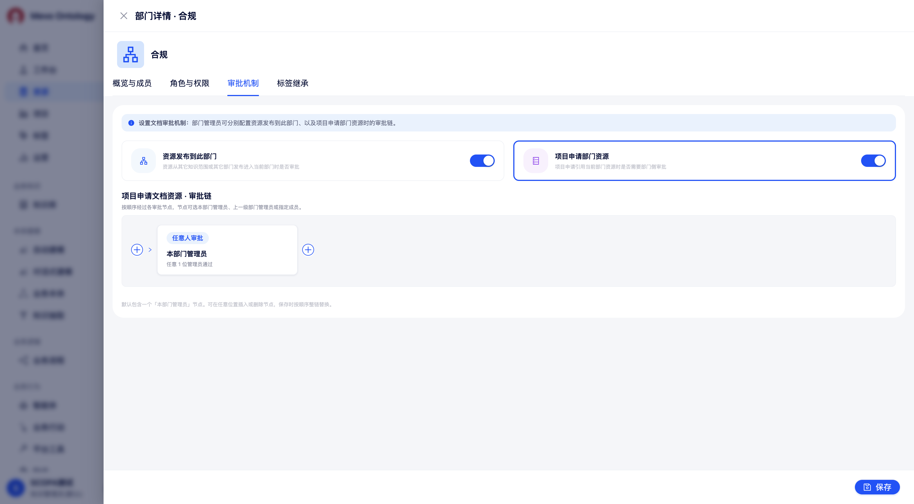

图 2-14 项目申请部门资源审批链

**说明：**

- 未开启「项目申请部门资源」审批的部门，项目申请其资源时提示「该部门无需审批，提交后直接生效」（见 4.3.2）。
- 审批人与提交人为同一人时，该节点自动通过，审批记录中意见显示「提交人自动跳过」。

### 2.2.4 权限机制：上级部门成员访问规则

**目标：** 决定上级部门的成员是否无需加入本部门即可查看本部门数据，适用于需要上级统一查看下级资料的管理场景。

**前置条件与入口：** 打开目标部门的「部门详情」，进入「角色与权限」页签，页面下方「权限机制」区域（见图 2-6）。

**操作：**

1. 找到「允许上级成员查看数据」开关。开启后，上级部门成员无需加入当前部门即可查看数据并下载文档。
2. 按管理要求打开或关闭开关。

**说明：** 此配置优先级高于角色默认资源权限，但不授予部门管理权限。

### 2.2.5 资源授权与向上级移交（参见第三章）

部门管理员对单个文档、数据表进行授权（可授权给全企业用户，或本部门及下级部门的角色），以及将本部门资源向上级部门移交、移交后原授权关系保持不变等操作，均在 `知识门户 > 资源` 的资源列表中完成，操作步骤见第三章。

## 2.3 知识门户：审批待办与记录

### 2.3.1 处理审批

**目标：** 按适用审批机制完成资源发布 / 项目申请的审核；通过后资源正式加入部门或项目。

**前置条件与入口：** `知识门户 > 工作台 > 我的审批 > 我审批的`；也可从首页「我的审批待办」点击「进入审批」（见 2.3.3）。

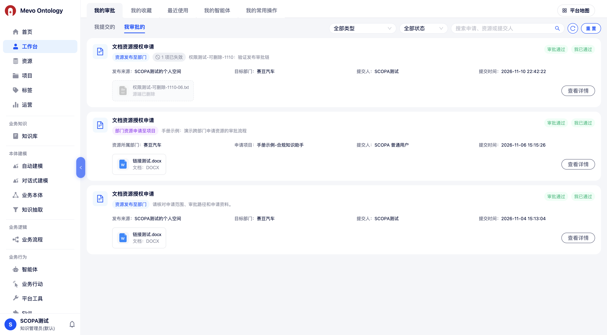

图 2-15 我审批的

**操作：**

1. 在「我审批的」中查看需要本人审批的记录。每条记录显示审批名称（如「文档资源授权申请」）、审批类型、资源类型、来源、目标部门或申请项目、提交人、提交时间、申请资料和当前状态。
2. 按需筛选：「全部类型」可选「资源发布至部门」「部门资源申请至项目」；「全部状态」可选「审批中」「审批通过」「审批驳回」；也可在搜索框按申请、资源或提交人检索，点击「重置」清空条件。
3. 点击「查看详情」，在「审批详情」弹窗中核对审批类型、申请人、来源、目标部门（或申请项目）、审批说明、申请资料（点击可跳转预览文档）和审批链各节点的处理情况。
4. 按审批流程选择通过或驳回；最终通过后完成资源发布或项目授权。

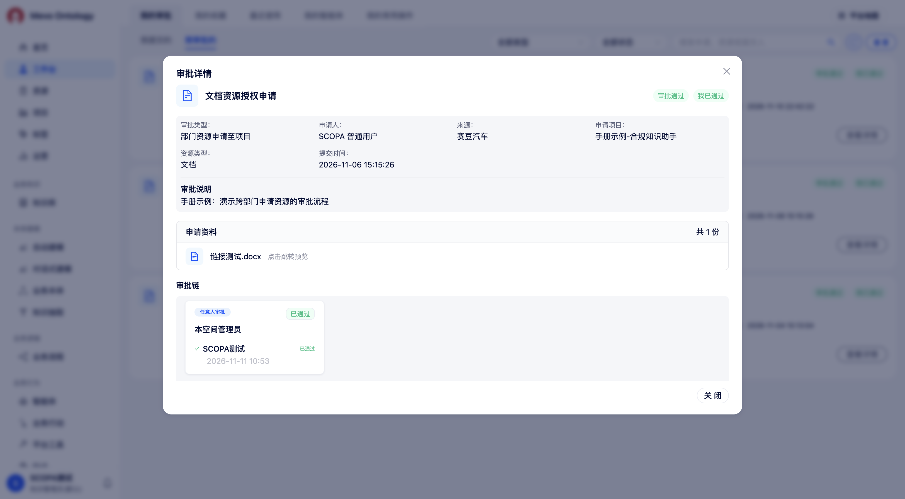

图 2-16 审批详情

**完成检查与下一步：** 需要审批的文档通过后才在部门中展示并可被检索；项目申请通过后资源出现在项目「资源列表」中。

**异常或限制：** 「我审批的」无数据表示当前没有待处理记录；审批状态不更新或入口不可见时，由平台实施与支持团队检查账号和流程配置。

### 2.3.2 查看审批记录

**目标：** 提交人跟踪自己提交内容的审批进度；审批人留存审批处理痕迹。

**操作：**

1. 查看提交记录：进入 `知识门户 > 工作台 > 我的审批 > 我提交的`，查看自己提交的资源发布和项目资源申请的进度与结果。状态为「审批中」时，可点击「查看详情」查看当前待处理的节点和审批人；被驳回时按意见修改后重新提交。
2. 查看审批记录：进入「我审批的」，按状态筛选「审批通过」「审批驳回」回查历史审批；记录右上角同时显示整体状态和本人处理结果（如「审批通过」「我已通过」）。

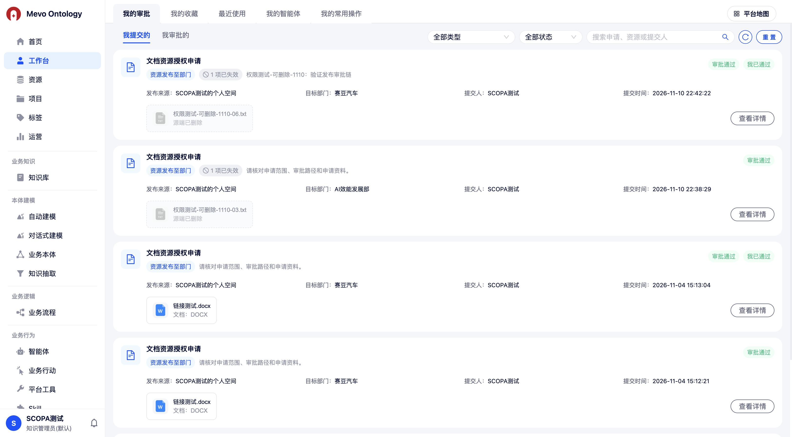

图 2-17 我提交的

### 2.3.3 首页审批待办入口

**目标：** 审批人在门户首页即可看到待办，及时处理。

**入口：** `知识门户 > 首页`，页面下方「最近使用」右侧的「我的审批待办」卡片。

**操作：**

1. 在首页下方查看「我的审批待办」卡片中的待处理事项；无待办时显示「暂无数据」。
2. 点击卡片右上角「进入审批」，跳转到 `知识门户 > 工作台 > 我的审批` 处理（见 2.3.1）。

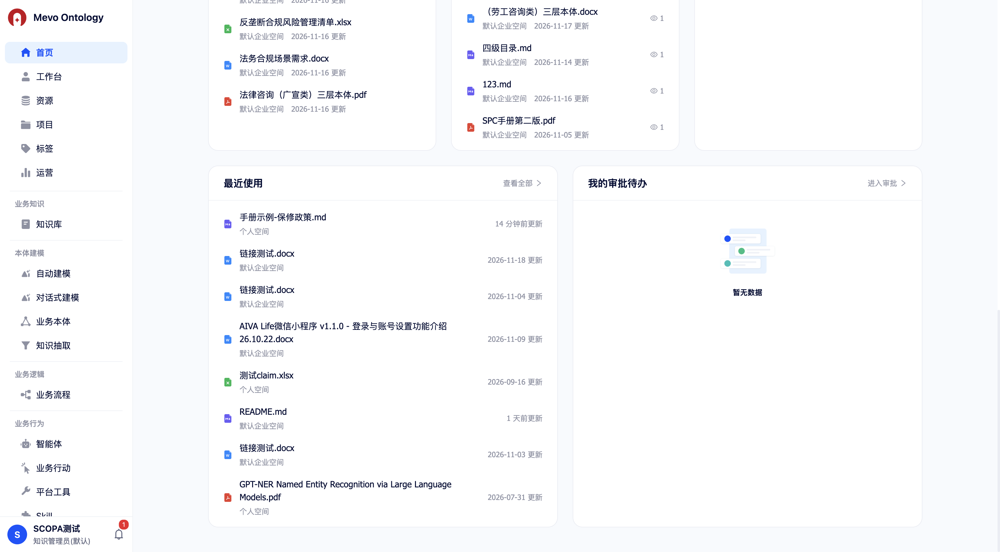

图 2-18 首页「最近使用」与「我的审批待办」

## 2.4 知识门户：标签管理

### 2.4.1 创建与维护标签

**目标：** 为全平台构建统一的标签体系，包括标签类型、标签子集、标签三级架构，用于文档等资源的分类标记与筛选。

**入口：** `知识门户 > 标签`。左侧为「标签树图」（显示子集数和标签数，可按关键词搜索），右侧为标签列表和操作区。

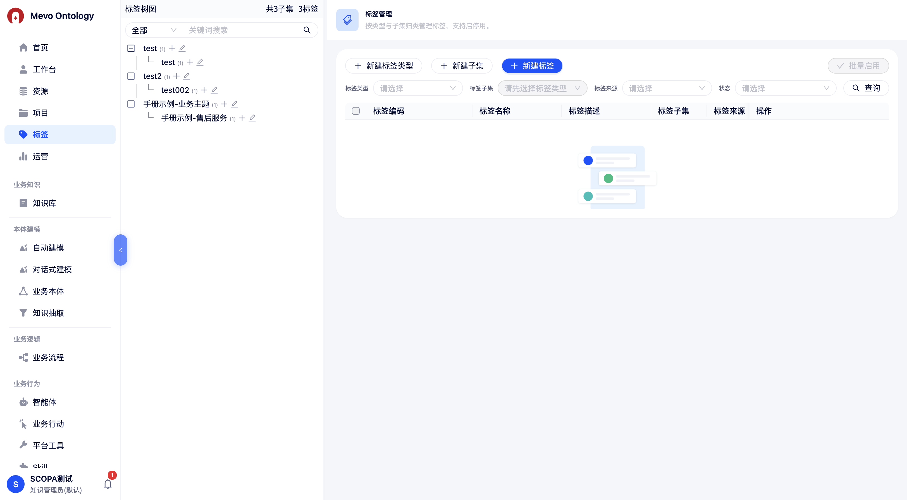

图 2-19 标签管理

**操作：**

1. **新建标签类型：** 点击「新建标签类型」，填写「标签类型名称」（必填）和「类型描述」（必填），「类型编码」保存后由系统分配，点击「确认」。
2. **新建标签子集：** 点击「新建子集」（或在标签树中点击标签类型右侧的「+」），选择「标签类型」，填写「标签子集名称」（2–128 个字符）。点击「添加一行」可一次新增多个子集；展开「已有子集」可查看该类型下已存在的子集。在「子集维护权限」中选择「继承标签类型管理员」「仅平台管理员」或「指定用户」，该设置应用于本次新增的全部子集。点击「创建 N 个子集」。
3. **新建标签：** 点击「新建标签」，在「标签基本信息」中选择「标签类型」「标签子集」，填写「标签名称」和「标签描述」（均必填）；在「标签管理信息」中选择「标签来源」（「系统标签」「人工创建」「模型生成」），点击「确定」。
4. **查看与维护：** 在标签树中点击标签子集，右侧列出该子集下的标签，显示标签名称、描述、子集、来源、提交人、状态和创建时间。可按标签类型、子集、来源、状态筛选后点击「查询」；对单个标签可「查看详情」「编辑」「删除」；勾选多个标签后可「批量启用」。

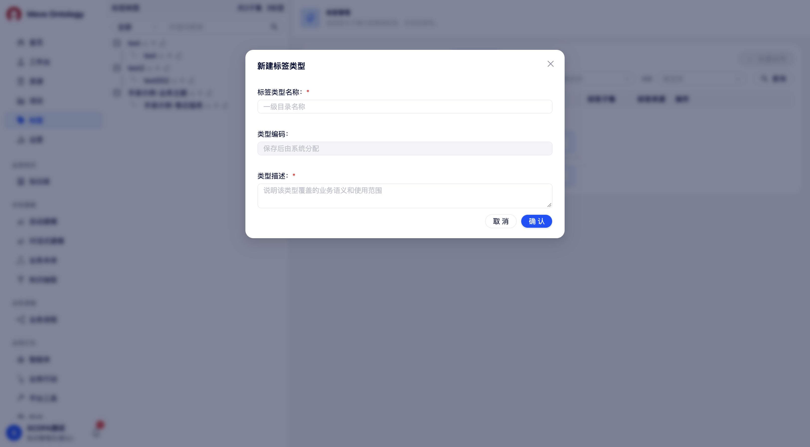

图 2-20 新建标签类型

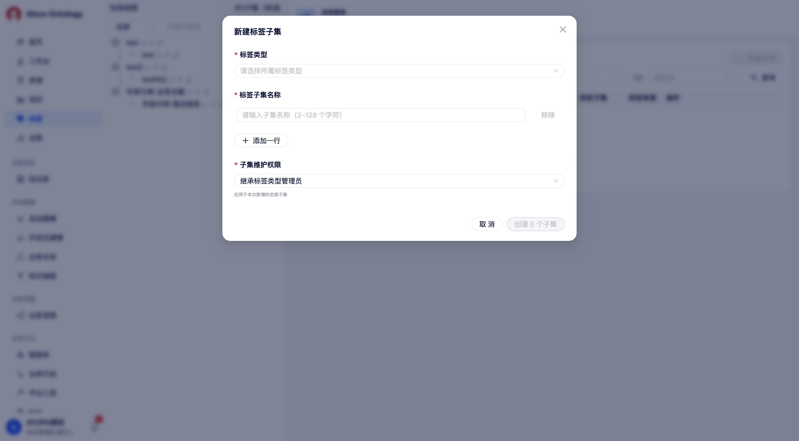

图 2-21 新建标签子集

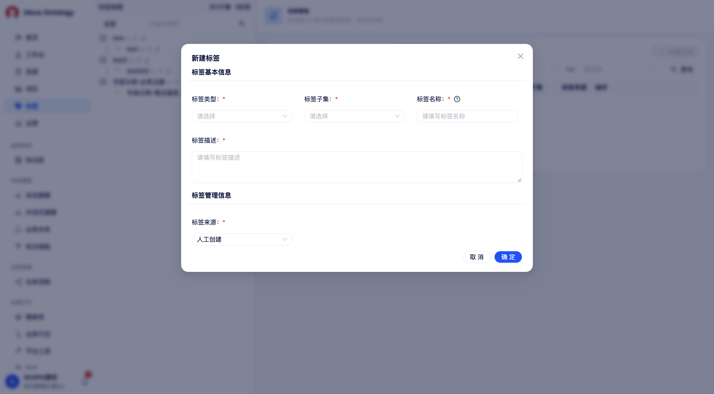

图 2-22 新建标签

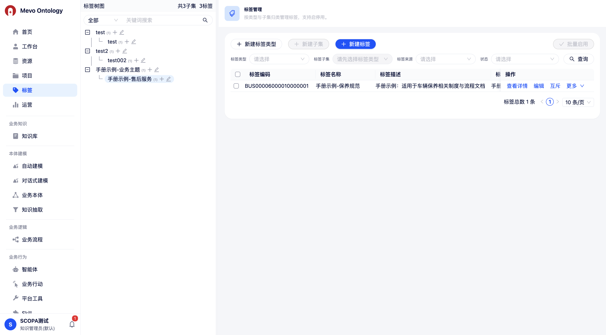

图 2-23 标签树与标签列表

### 2.4.2 标签授权【1130 版本】

**目标：** 标签类型、标签子集和标签分别授权，控制谁可以在打标时使用标签、谁可以编辑标签，避免标签被随意新增或修改。

**入口：** `知识门户 > 标签`，标签树中类型/子集节点或标签列表行的「授权」。

**操作（以原型为准）：**

1. 点击目标标签类型、子集或标签的「授权」，打开「标签授权」弹窗。新建的标签默认仅创建者可见、可用。
2. 「查看已授权信息」页签列出已授权的用户及权限；创建者的默认权限不可取消。
3. 切换到「新增授权」页签，按所属部门或工号/姓名查找并勾选用户，在「权限类型」中选择：
   - **使用权限**：可在标签管理中查看，并在资源打标时选择使用。
   - **管理权限**：可查看、使用并编辑此标签。
4. 点击「确认授权」。

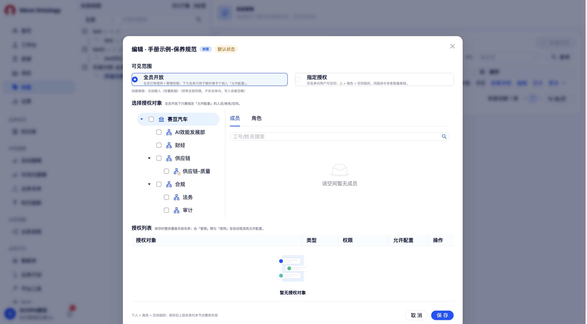

图 2-24 标签授权（原型示意，以上线版本为准）

### 2.4.3 文档自动打标【1130 版本】

**目标：** 基于企业统一标签体系，依据文档标题、正文和元数据为文档推荐标准标签，减少人工打标工作量；同时支持按部门继承标签。

**说明：** 原型中由部门管理员在资源列表的管理员操作中发起「文档自动打标」：选择标签范围与策略后点击「开始自动打标」，系统创建自动打标任务并生成推荐结果。具体入口、参数和结果确认方式以 1130 上线版本为准，暂无截图。

---

## 本章变更说明（v3.4 → v4.0）

- 全章：入口由「知识门户 → 部门管理」改为 `知识门户 > 资源`，部门配置在「部门详情」抽屉的三个页签中完成；界面菜单「部门管理」改为「资源」，正文统一称「部门」。所有截图按测试环境重截。
- 修改 2.3、2.4 入口：菜单名按环境改写，「我的」改为「工作台」，「标签管理」改为「标签」（页面内标题仍为「标签管理」）。
- 修改 2.1.1：标题由「创建/同步资源部门【待升级】」改为「查看、创建与同步部门」，去掉【待升级】标签；按环境改写为节点「+」新建下级部门、目录右上角「部门同步」。v3.4 2.2.1 开头关于「部门同步」和上层管理员权限的说明移入本节。
- 修改 2.2.1：入口改为「部门详情 > 概览与成员」；角色选项更新为「节点管理员」「普通成员」及自定义角色；补充删除成员、按角色筛选。
- 新增 2.2.2：角色与权限——自定义部门角色、设置角色默认文档资源权限（1030 版本功能）。
- 修改 2.2.3：开关式开启审批、默认「本部门管理员」节点、通过规则「任意人员审批 / 同时审批」、审批人来源「本部门管理员 / 上一级部门管理员 / 指定成员」、底部统一保存；补充未保存关闭时的「放弃修改并关闭」提示、无需审批和提交人自动跳过的说明。
- 新增 2.2.4：权限机制「允许上级成员查看数据」（1030 版本功能）。
- 新增 2.2.5：资源授权与向上级移交，指向第三章。
- 修改 2.3（标题改为「审批待办与记录」）：入口改为 `知识门户 > 工作台 > 我的审批`；2.3.1 补充类型/状态筛选和审批详情内容；2.3.2 补充「审批中」查看当前节点。
- 新增 2.3.3：首页「我的审批待办」入口。
- 修改 2.4.1：按环境更新标签类型、子集（批量新增、子集维护权限）、标签（标签来源）的字段，以及标签列表的筛选、启用和维护操作。
- 新增 2.4.2：标签授权【1130 版本】（原型截图）。
- 新增 2.4.3：文档自动打标【1130 版本】（无截图）。
- 删除：无。

## 待确认

1. **部门同步**：本账号可见「部门同步」按钮，但为避免改动真实组织数据未点击执行，同步的确认步骤、同步范围和权限要求（v3.4 写为「顶级部门管理员」）未验证。
2. **审批通过 / 驳回操作界面**：本账号「我审批的」中没有待处理记录（唯一一条为提交人自动跳过的已通过记录），「通过」「驳回」按钮、审批意见填写及驳回后重新提交的流程需用审批人账号补截。本章测试中提交的「部门资源申请至项目」（申请链接测试.docx，待测试账号 SCOPA测试 审批）可用于补截。
3. **数据表资源审批**：版本功能清单（1106）写明审批人可在审批详情中缩减数据表范围、筛选字段范围，本账号无数据表审批记录，未能验证和截图。
4. **角色的数据资源默认权限**：角色列表有「数据资源权限」列（默认角色显示「查看」），但「设置数据权限」弹窗中只看到「文档资源权限」选项，数据表默认权限的配置方式需确认。
5. 「审批机制」页签顶部提示为「设置文档审批机制」，审批链标题为「文档发布到此部门」「项目申请文档资源」，数据表资源是否共用这套审批链需确认。
6. 2.4.3 文档自动打标在原型中未找到可直接打开的入口，仅有代码中的弹窗定义，无截图；部门继承标签的方式未见原型。
7. 测试中新建的数据（均带前缀「手册示例-」）保留在环境中：合规部门自定义角色「手册示例-合规专员」；标签类型「手册示例-业务主题」、子集「手册示例-售后服务」、标签「手册示例-保养规范」。合规部门的审批开关测试后已恢复为关闭，未保存（2026-11-06 核查时再次打开开关截取图 2-13，随后关闭并「放弃修改并关闭」，未保存）。新建部门「手册示例-合规专项组」仅填写表单截图，未提交。
8. 界面称谓不统一：部门审批链节点显示「本部门管理员」，审批详情中的同一节点显示「本部门管理员」，项目申请资源弹窗中显示「部门管理员」。手册按「本部门管理员」表述，需产品确认是否统一界面文案。
9. 2.4.2 标签授权：2026-11-06 核对环境，标签列表操作列只有「查看详情」「编辑」「删除」，标签树节点仅有「+」，未见「授权」入口，维持【1130 版本】原型示意。
