# 三、接入与管理资源

本章说明如何把企业资源接入平台并纳入部门管理。文档（含飞书文档）、数仓与数据库中的结构化数据表，以及在平台构建的本体、知识库、智能体等资产，都可以作为资源按企业—部门—个人空间统一挂载、授权和管控。

建设方在项目中申请资源的操作详见第四章。

**【重要说明】**

在 v4.0 中，文档和数据表都在知识门户「资源」中按部门组织目录统一管理：文档支持上传审批、发布、授权、历史版本、移交和回收站，数据表支持本地上传、查看、发布到部门和授权（2026-11-23 起在环境中核对）。数据库、数仓等数据源的在线接入暂无入口，3.2.7 以原型示意；原「数据资产」模块已不在左侧菜单。门户的「智能体」「本体」页签仍属后续版本规划，这两类资产在各自模块构建和授权。

## 3.1 资源管理：查看资源并纳入部门管理

**目标：**在一个入口查看本人可见的部门资源和个人资源，按部门组织目录找到资源所在位置，并完成上传、整理和授权。

**入口：**`知识门户 > 资源`

**操作步骤：**

1. 进入知识门户，点击左侧导航「资源」。
2. 在左侧「部门组织目录」中查看企业的部门树。每个部门节点右侧显示本人在该部门的身份（如「普通成员」「管理员」）；可在顶部搜索框按部门名称查找，或用右上角图标展开 / 收起全部节点。具备组织管理权限的用户可看到「部门同步」图标和节点上的编辑、新增图标，部门维护方法见第二章。
3. 点击某个部门，右侧显示该部门的资源。顶部页签为「文档」「数据表」「智能体」「本体」，本手册第三章按「文档」和「数据表」两类资源展开；「回收站」单独列在目录树底部，不占页签。
4. 「文档」页签上方是统计卡片：部门文档、已解析文档、最近更新时间、待审批文档；展开「知识时序分布」可查看文档按时间的分布情况。
5. 下方列表展示部门文档和目录，列包括名称（含标签图标）、类型、创建人、更新时间、归档时间、解析状态、大小和操作。可用「全部」下拉筛选，并勾选「包含下级空间」一并查看下级部门的资源。
6. 点击目录树底部的「个人空间」，查看本人上传的全部资源；点击「回收站」，查看已删除的资源（见 3.3.5）。

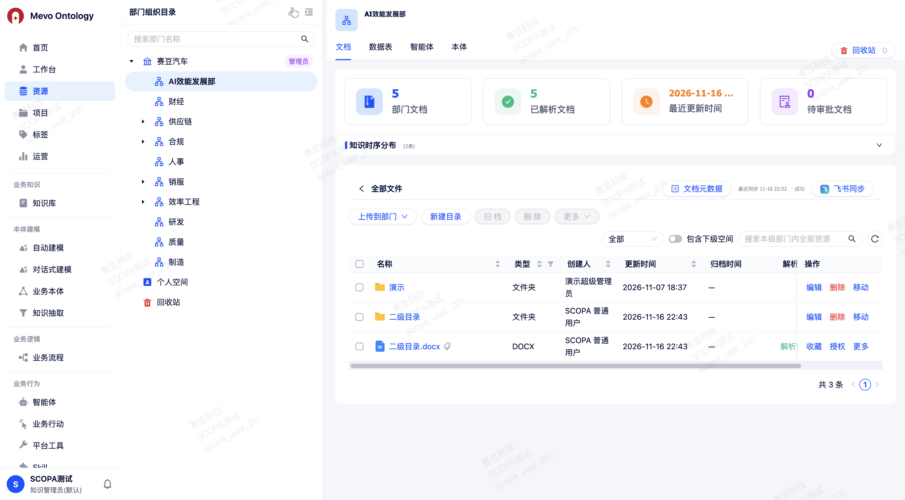

图 3-1 部门文档列表

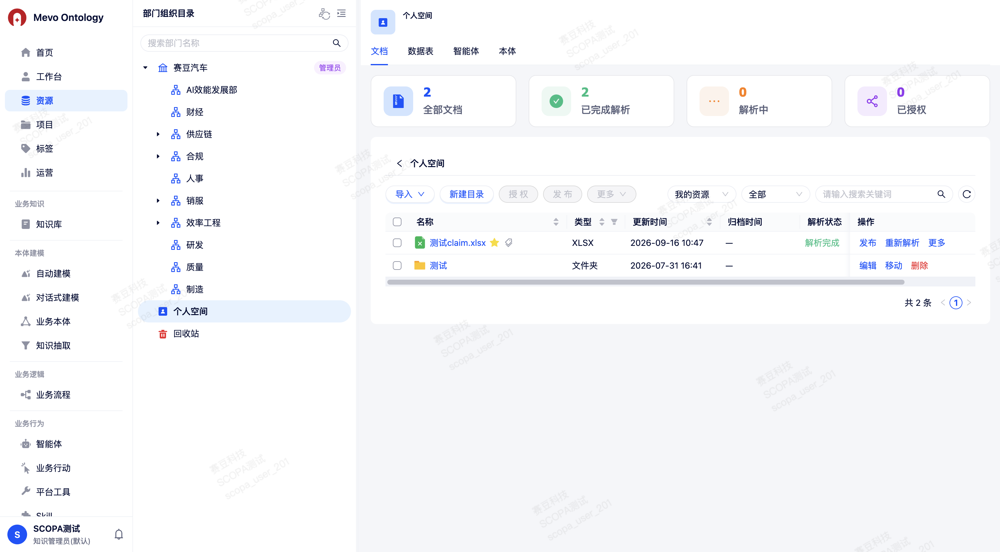

图 3-2 个人空间

**说明：**

- 部门内可执行的操作随身份不同：部门管理员可上传到部门、新建目录、归档、删除、移交和授权；普通成员按授权查看和下载。
- 个人空间的统计卡片为全部文档、已完成解析、解析中、已授权；工具栏为「导入」「新建目录」「授权」「发布」「更多」，可按「我的资源」和解析状态筛选。
- 智能体、本体资源在门户中的展示、移交与授权属于后续版本规划，当前在各自模块管理。

## 3.2 数据表：结构化数据接入与管理

结构化数据在知识门户的「资源」中接入和管理：选择部门或个人空间，切换到「数据表」页签即可上传、查看、发布和授权数据表。目前在环境中可直接操作的接入方式是上传本地 Excel / CSV 文件。数据表先存放在个人空间或指定部门，发布到部门并经审批后由目标部门管理员统一管理，项目使用时按 4.2、4.3 申请。

数据库、数仓等数据源的在线接入，在环境中暂未提供入口，见 3.2.7。

### 3.2.1 查看部门与个人空间的数据表

**目标：**了解各部门、个人空间下有哪些数据表，数据来自哪里。

**入口：**`知识门户 > 资源`，在左侧「部门组织目录」选择部门（个人数据选底部的「个人空间」），再切换到「数据表」页签。

**操作步骤：**

1. 页面顶部有三张统计卡片：「数据表」显示数量，「已接入资源」显示数据来源数量（同一个 Excel 文件上传的多张表算一个来源），「最近同步」显示最近一次数据变更时间。
2. 下方列表的列包括：名称、中文名、类型、数据源名称、数据源类型、数据量、创建人、更新时间、操作。本地上传的数据表，类型为「本地文件」，数据源名称为 `upload_file`，数据源类型为「Excel」。目录以「文件夹」类型显示。
3. 列表上方的工具栏包括「上传到部门」「新建目录」，以及需要先勾选数据表才能使用的批量按钮：部门下为「授权」「移动」「删除」，个人空间下为「发布」「授权」「更多」（更多中有「移动」「删除」）。右侧可在搜索框输入关键字，检索本级部门内的全部资源，并用刷新按钮重新加载。
4. 每行右侧的操作列：数据表为「发布」「移动」「更多」（更多中有「授权」「删除」），目录为「编辑」「移动」「删除」。

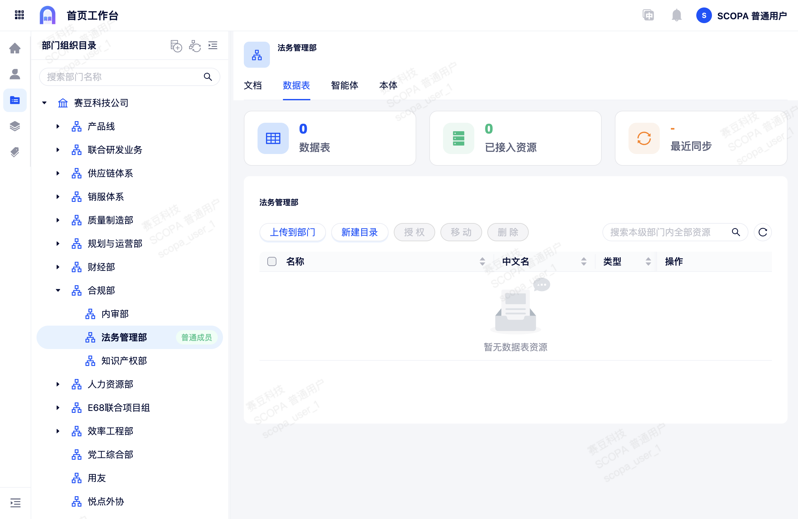

图 3-3 部门的数据表页签

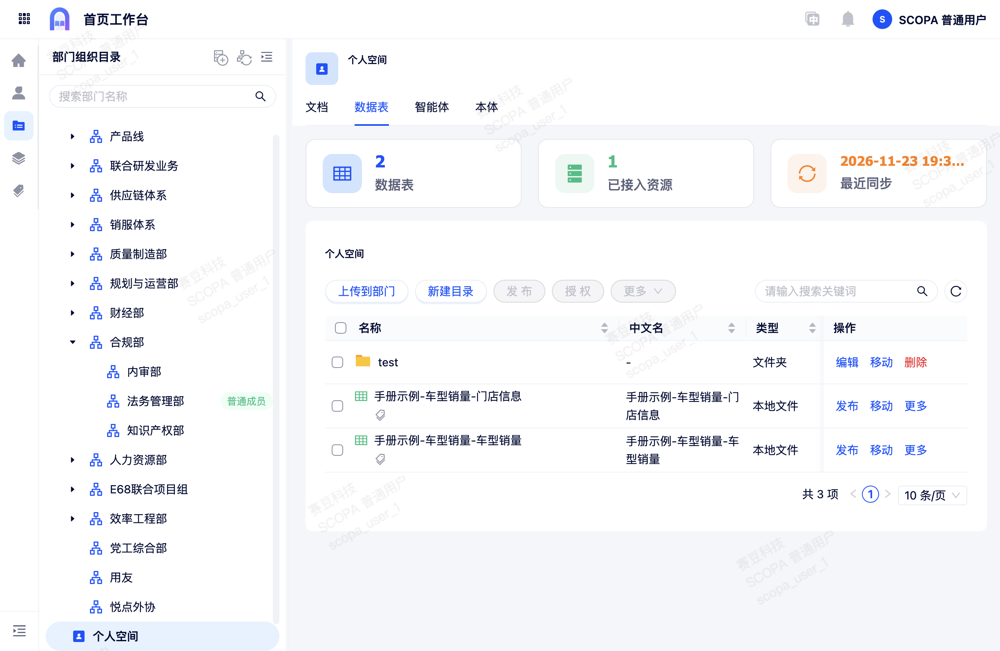

图 3-4 个人空间的数据表列表

**说明：**普通成员在部门下通常只能查看；上传、授权、移动、删除等管理操作以所在部门的角色权限为准（见 2.2）。

### 3.2.2 上传本地数据

**目标：**把本地 Excel、CSV 文件接入为数据表，保存到个人空间或部门。

**入口：**`知识门户 > 资源 > 数据表`，点击「上传到部门」，打开「本地数据上传」向导，共四步。

**操作步骤：**

1. **选择文件：**点击上传区域或把文件拖入，支持 .xlsx、.xls、.csv，可批量上传，最多 20 个文件。选好后点击「下一步」。
2. **选择数据表：**左侧「离线文件」列出已选文件及已选 Sheet 数（如 2/2），右侧按 Sheet 列出可导入的数据表，默认全选，可取消不需要的。数据表名称默认为「文件名-Sheet 名」，右侧标签是自动生成的英文名（如「车型销量」生成 `cxxl`）。
3. **预览编辑：**顶部按 Sheet 切换数据表，点击表名旁的铅笔图标可修改表名。「表内数据设置为表头」开关默认打开，首行作为字段名；每个列头显示字段类型（如 Str.）和铅笔图标，可修改字段名称与类型。需要换文件时点击「重新上传」。
4. **选择部门目录：**在左侧「配置」卡中勾选要保存的数据表，在右侧目录树点击保存位置（部门、部门下的目录或个人空间），点击「添加」生成一条配置；不同的表要存到不同位置时，继续添加多条配置，也可「清空设置」或「删除」配置。下方的「审批链」显示所选位置的审批要求，选择个人空间时提示「个人空间无需审批，创建后直接生效」。确认后点击「提交」，出现「提交成功」提示。
5. 回到目标位置的「数据表」页签，确认新表已经生成。

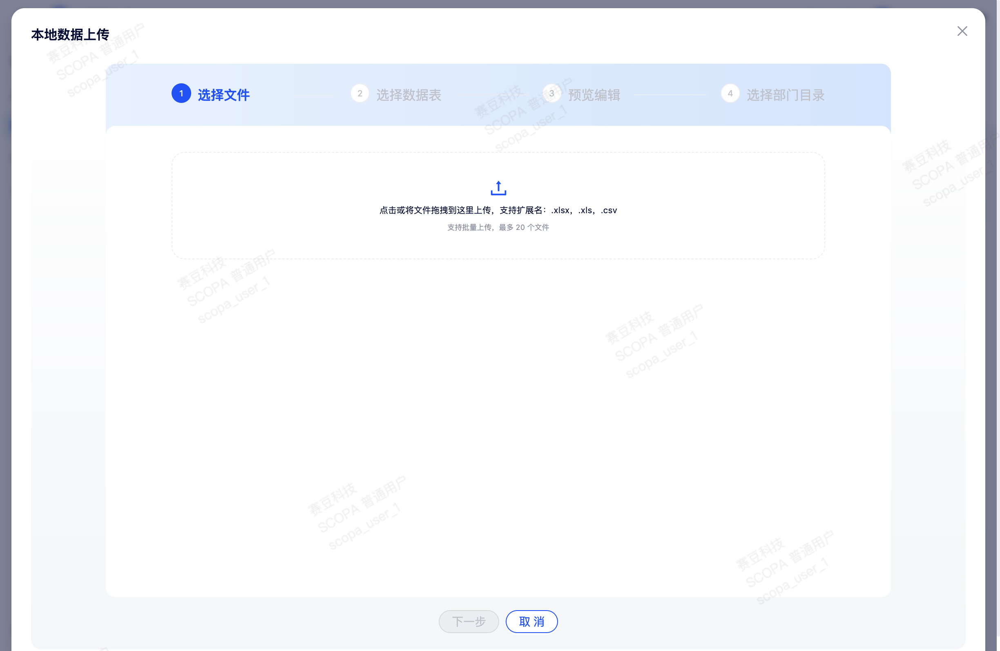

图 3-5 本地数据上传：选择文件

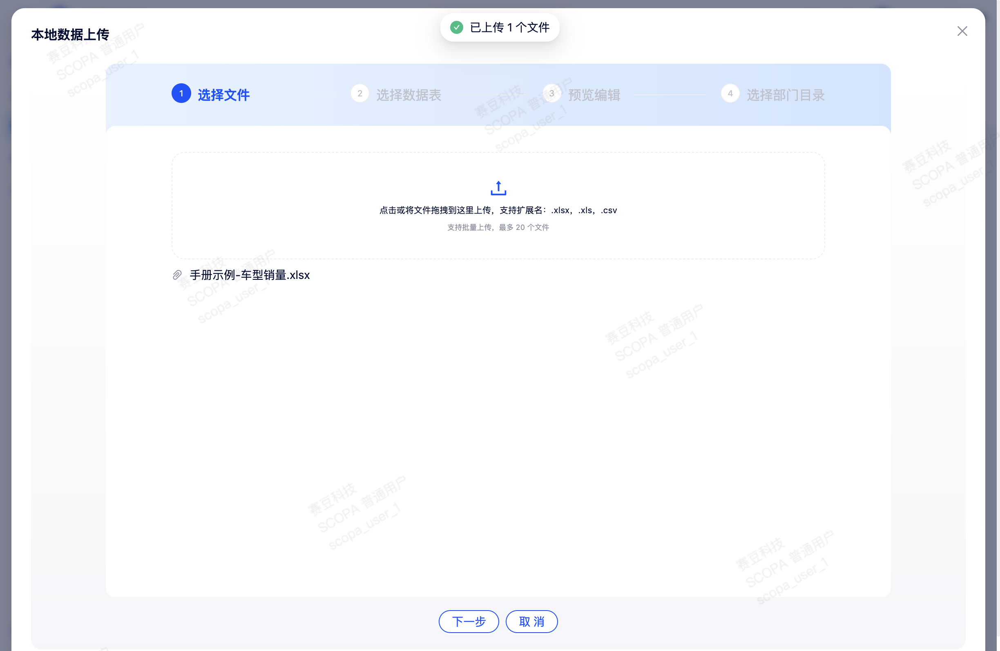

图 3-6 已选择的文件

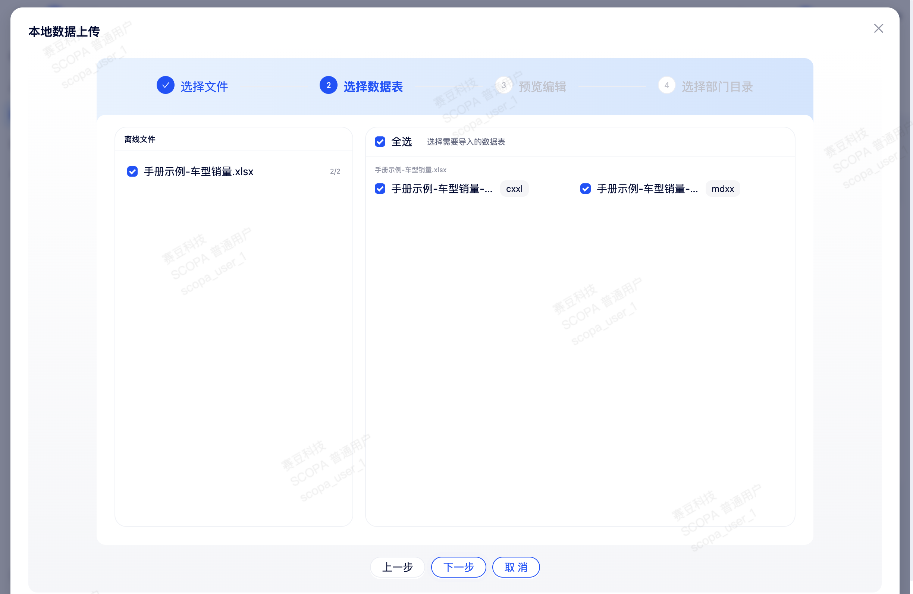

图 3-7 选择需要导入的数据表

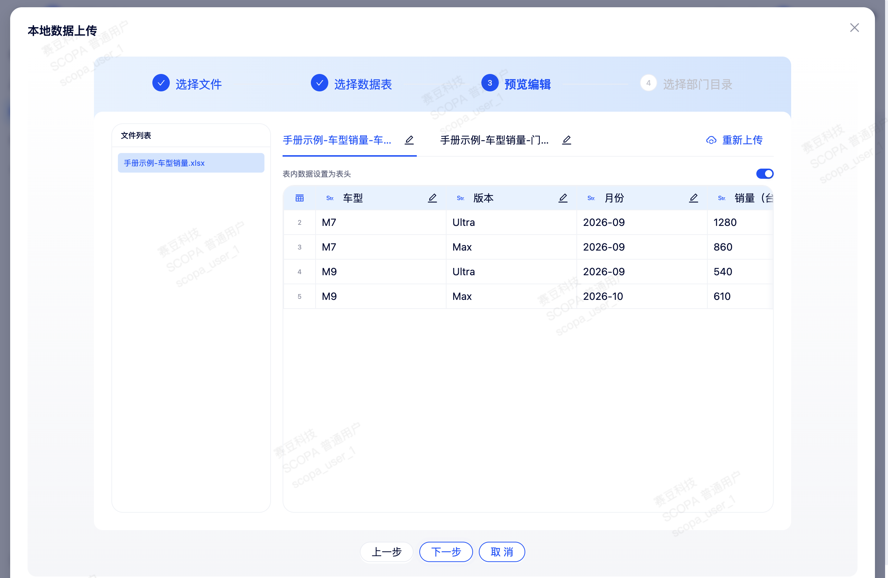

图 3-8 预览数据并设置表头与字段

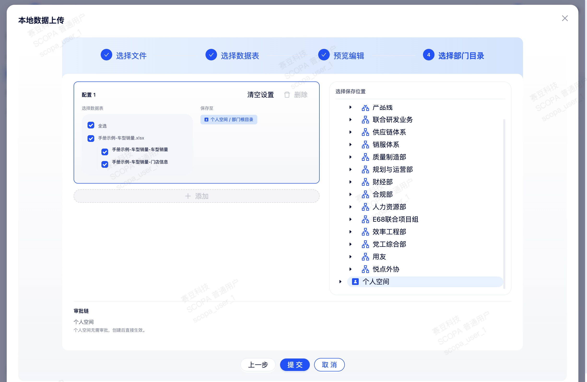

图 3-9 选择保存位置并查看审批链

**说明：**

- 上传后字段类型默认按文本处理（包括销量等数值列），日期、金额等字段建议在预览步骤确认类型。
- 字段英文名自动生成（如「车型」为 `cx`），后续本体映射会引用表名与字段名，命名保持稳定。
- 保存到部门时按该部门的审批链处理，审批通过后数据表才在部门下生效；保存到个人空间无需审批。

### 3.2.3 查看数据表与字段

**目标：**确认数据表的字段、类型和内容正确，作为 6.6.1 数据映射的前提。

**入口：**`知识门户 > 资源 > 数据表`，点击列表中的表名，打开「资源详情」。

**操作步骤：**

1. 在详情上方查看基本信息：数据表名称（可点击「添加标签」打标签）、所属数据源、所属数据库（本地上传的为「本地上传文件」）、表类型（本地上传的为「本地数据」）、授权字段 / 字段总数量（如 5/5 表示 5 个字段全部可见）、数据量、创建人、创建时间、更新时间；点击「展开」可看到更多信息。
2. 在「数据预览」页签查看表内数据，可点击「获取最新数据」刷新，并通过「字段设置」调整显示的字段。
3. 在「关联数据项」页签核对字段：序号、字段中文名、字段英文名、字段类型、是否为空、主键、是否索引、索引类型。

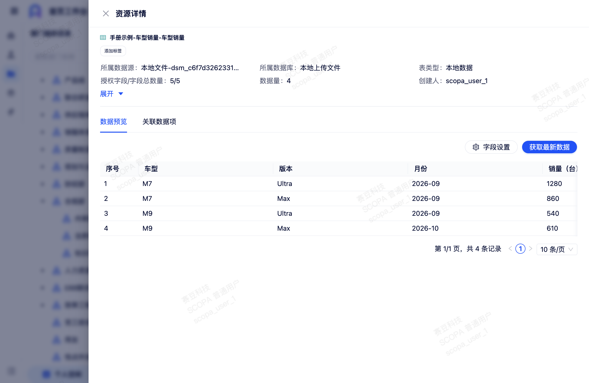

图 3-10 数据表详情：数据预览

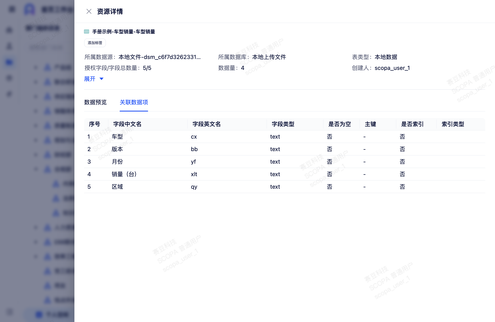

图 3-11 数据表详情：关联数据项

### 3.2.4 发布数据表到部门

**目标：**把个人空间里的数据表发布到部门，纳入部门统一管理，供项目申请使用。

**入口：**`知识门户 > 资源 > 个人空间 > 数据表`，点击数据表行的「发布」，或勾选多张表后点击工具栏的「发布」。

**操作步骤：**

1. 在「发布到部门」弹窗的「目标部门」中选择一个部门，可在搜索框按部门名称查找。只能选择一个目标部门，审批通过后由目标部门管理员管理，右侧「已选目标部门」显示当前选择。
2. 选择「发布时间」：「立即发布」或「定时发布」。
3. 在「授权说明」中填写发布说明（最多 512 字），点击「发布」提交审批。
4. 审批人处理见 2.3，审批通过后数据表出现在目标部门的「数据表」页签下。

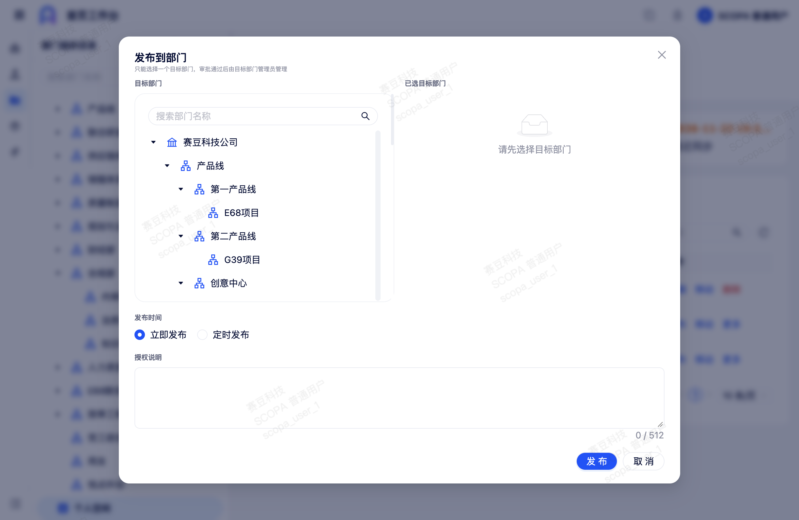

图 3-12 发布数据表到部门

**说明：**数据表发布与文档发布（3.3.4）的流程一致。

### 3.2.5 数据表授权

**目标：**控制哪些用户可以查看数据表，以及可以看到哪些字段。

**入口：**`知识门户 > 资源 > 数据表`，点击数据表行「更多 > 授权」，或勾选数据表后点击工具栏的「授权」。

**操作步骤：**

1. 在「数据表授权」弹窗的「新增授权」页签，左侧「授权对象」列表按所属部门筛选，或输入工号 / 姓名检索，勾选需要授权的用户，底部显示「已选择 N 个授权对象」。
2. 在右侧「授权范围」选择「整表授权」（可查看表内全部字段）或「按字段授权」（仅可查看所选字段，主键可取消）。
3. 「权限类型」为「查看」；「有效期」可选「长期有效」「7 天」「30 天」「90 天」或「自定义」起止时间；「说明」中可填写授权原因（最多 200 字）。
4. 点击「确认授权」生效。
5. 在「查看已授权信息」页签核对已有授权，页签旁的数字是授权条数。

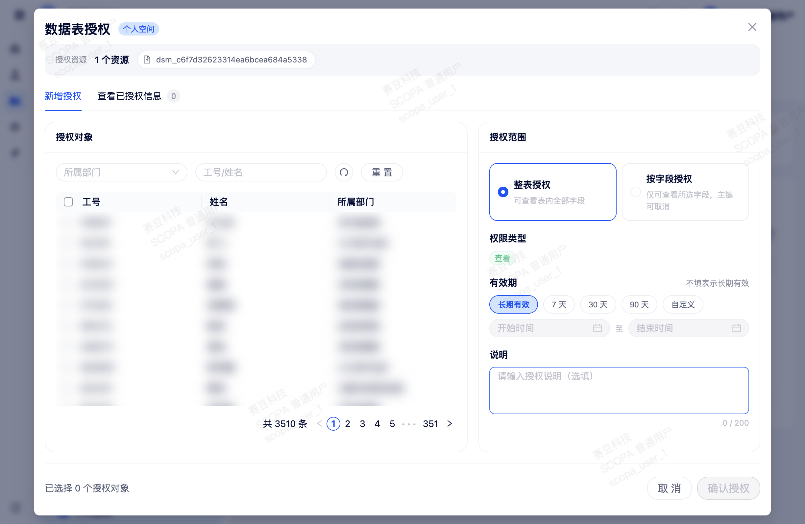

图 3-13 数据表授权（授权对象列表中的人员信息已做模糊处理）

### 3.2.6 数据表行权限【1130 版本】

**目标：**按数据行控制谁能查看数据表，满足敏感数据的最小授权要求。

**入口：**在 3.2.5 的「数据表授权」弹窗中切换到「行权限授权」页签（原型）。

**操作步骤（以原型为准）：**

1. 在「表单配置」中用 AND / OR 组合「+ 条件」「+ 条件组」，条件由用户属性（含角色）、数据表字段和输入值组成；也可在「脚本配置」中直接编写。
2. 下方「生成脚本」显示最终规则，点击「保存行权限」生效。

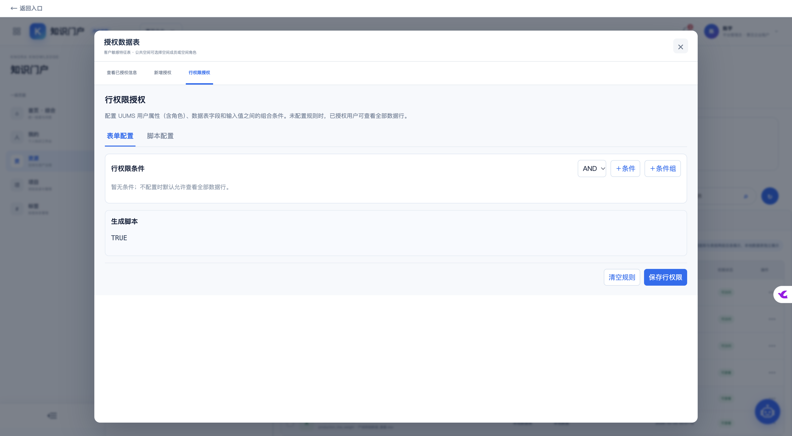

图 3-14 行权限授权（原型示意，以上线版本为准）

**说明：**未配置行权限规则时，已授权用户可查看全部数据行。环境中的授权弹窗目前只有「新增授权」和「查看已授权信息」两个页签，尚无「行权限授权」。

### 3.2.7 接入数据库与数仓数据源【1130 版本】

**目标：**在知识门户的部门资源中直接连接业务数据库或数仓，选择需要的表分配到部门，与文档资源统一管理。

**入口：**`知识门户 > 资源 > 数据表`，点击目录顶部的「新增数据源」（原型）。

**操作步骤（以原型为准）：**

1. 点击「新增数据源」，打开「数据源接入与管理」。左侧为已连接数据源（显示类型、库名、地址、连接状态和同步频率），右侧选择数据源类型新建连接，按「选择类型 → 基本信息 → 连接与分配」三步完成，最后选择要分配的部门。
2. 已连接数据源可单独编辑、分发、同步和删除，互不影响。
3. 接入后，数据库按「数据库—数据表」两级显示在「数据表」页签，可按字段把数据表分发到部门（字段级表分发）。

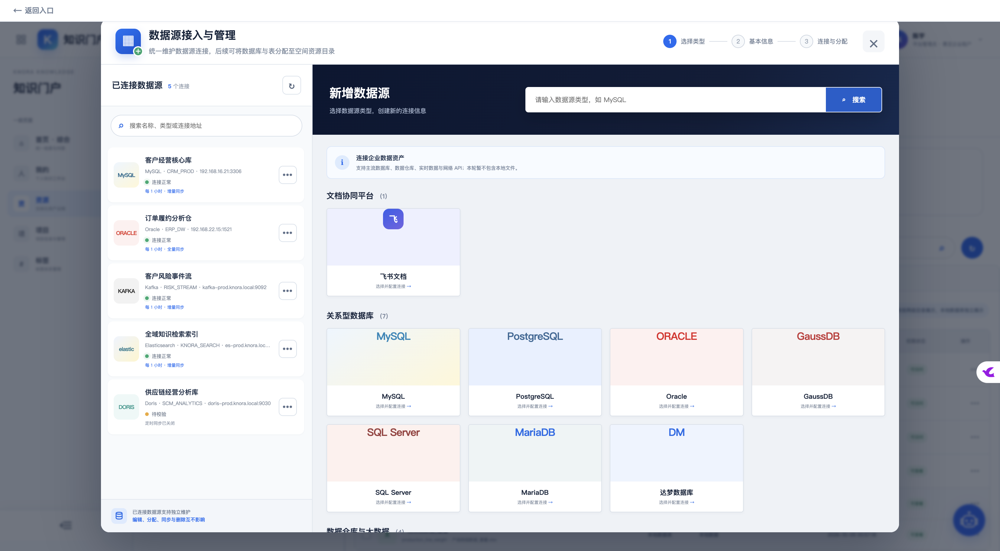

图 3-15 数据源接入与管理（原型示意，以上线版本为准）

**说明：**环境的「数据表」页签目前没有「新增数据源」入口，左侧菜单中也不再显示原来的「数据资产」模块，不建议通过直接访问地址的方式接入数据源，具体接入方式请以上线版本为准。

## 3.3 文档管理：本地与飞书非结构化资源接入

非结构化文档在知识门户「资源」页接入，可直接上传到部门，也可先上传到个人空间再发布到部门。上传与审批联动见第二章；接入后的文档按第十章参与门户检索问答。

### 3.3.1 上传本地文档

**目标：**把 PDF、Word、PPT、TXT 等文档上传到目标部门或个人空间，设置发布时间和解析方式。

**入口：**

- 上传到部门：`知识门户 > 资源 > 部门组织目录 > 目标部门 > 文档`，点击「上传到部门」。
- 上传到个人空间：`知识门户 > 资源 > 个人空间`，点击工具栏「导入」，在下拉中选择「上传文件」或「上传文件夹」。个人空间列表的列为名称、类型、更新时间、归档时间、解析状态、大小和操作，可按「我的资源」和解析状态筛选。

**操作步骤（上传到部门）：**

1. 在部门文档列表点击「上传到部门」，打开「上传到部门（部门名）」弹窗。
2. 拖拽或点击上传文件。支持 .txt、.pdf、.docx、.doc、.xlsx、.xls、.csv、.pptx、.ppt、.html、.htm、.md、.jpg、.jpeg、.png、.gif、.bmp、.webp、.tif、.svg。
3. 查看「当前部门审批链」，确认审批节点（如「任意人审批 · 部门管理员」，任一管理员通过即可）。
4. 选择发布时间：「立即发布」或「定时发布」；定时发布需选择日期，审批通过后按设定时间发布。
5. 设置「上传后自动解析」。开启时选择解析模式；关闭后可在列表中手动发起解析。
6. 点击「上传」。页面提示「上传成功，请等待审批」，文档进入解析流程。

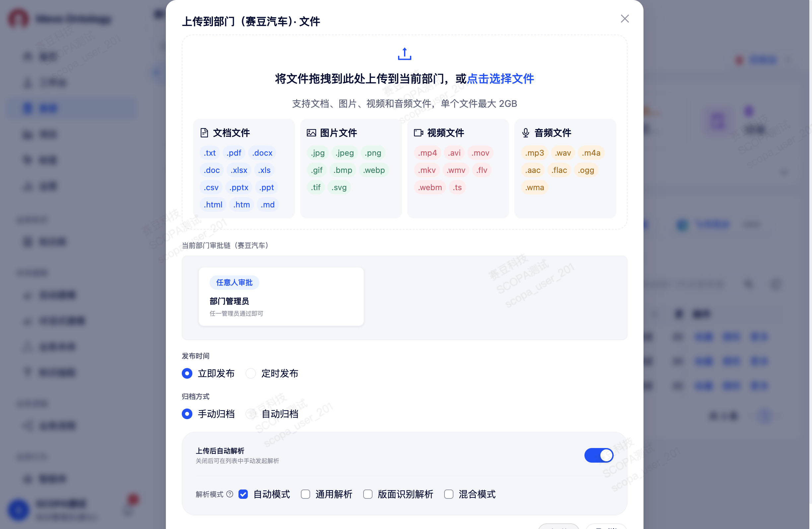

图 3-16 上传到部门

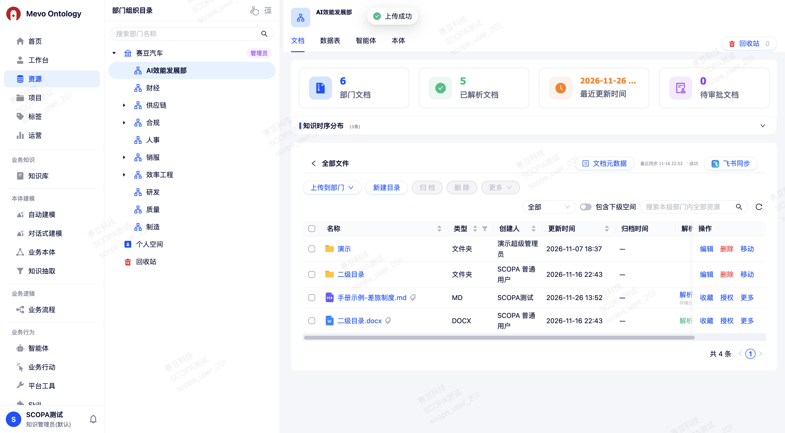

图 3-17 上传成功，等待审批

**操作步骤（上传到个人空间）：**

1. 在个人空间工具栏点击「导入」，下拉中选择「上传文件」或「上传文件夹」。
2. 在「导入 · 文件」弹窗上传文件，选择「目标目录」（默认个人空间根目录）。
3. 如需同时发布，在「同时发布到部门」中选择部门，并选择立即发布或定时发布；不选部门时仅保存在个人空间。
4. 设置自动解析与解析模式，点击「确认导入」。

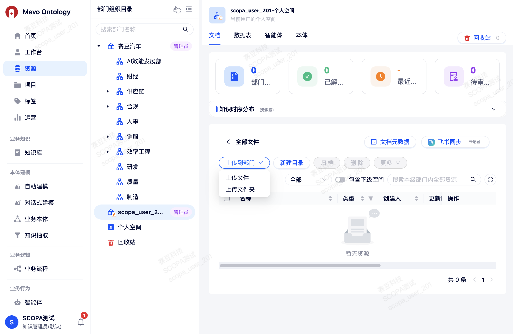

图 3-18 个人空间上传菜单

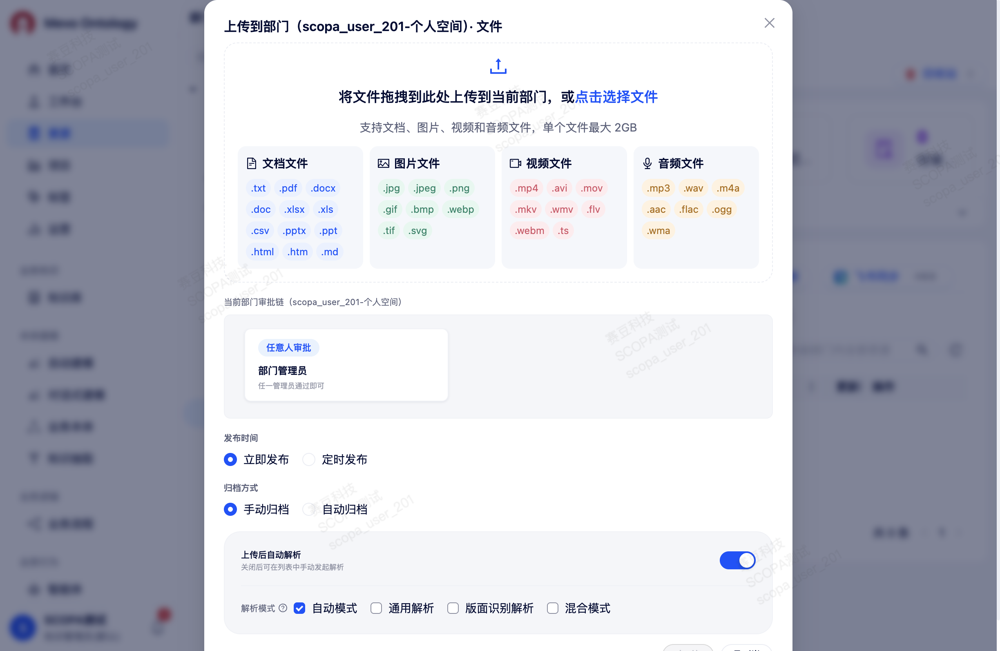

图 3-19 导入文件到个人空间

**说明：**

- 解析模式说明：
  - 自动模式：根据文档格式自动选择解析模式。
  - 通用解析：适用于文字可直接选取的常规文档，处理较快；扫描页或截图内容可能无法完整识别。
  - 版面识别解析：按页面呈现识别文字、标题、图片和表格，适用于扫描件、截图或复杂排版。
  - 混合模式：逐页优先使用通用解析，无法提取内容的页面自动切换为版面识别解析。
- 同一文档已有他人上传时，优先申请引用（第四章）或由部门管理员确认后用历史版本更新（3.3.6），避免重复上传。
- 上传者为部门管理员时，文档提交后直接进入部门列表；普通成员上传的审批过程见「待确认」。

### 3.3.2 同步飞书文档

**目标：**将飞书知识库中当前组织下有权限的文档接入平台，并保持平台侧可见范围与飞书源权限一致。

**入口：**`知识门户 > 资源 > 部门组织目录 > 目标部门 > 文档`，点击工具栏「飞书同步」，打开右侧「飞书同步」抽屉；抽屉分「同步记录」「同步设置」两个页签。

**操作步骤：**

1. 首次配置在「同步设置」页签完成：填写飞书应用的 App ID、App Secret，点击「修改密钥」更新密钥，按提示到飞书开放平台核对应用权限与开放平台地址，点击「测试连接」确认连通。
2. 设置「同步范围」：可只同步当前节点，也可勾选「父子联动」随目录变化一并同步；缩小范围不会撤回已同步的文档。
3. 「同步目标目录」为只读，取值来自「在文档页进入某个文件夹，再点『飞书同步』→『立即同步』」时所在的目录，定时同步沿用它；同时选择文档归属人。
4. 打开「启用同步」开关并「保存」。停用后定时任务不再执行，也不能手动触发，已同步的文档保留。
5. 需要立即拉取时，在「同步记录」页签点击「立即同步」，或对失败的批次点击「巡检重试」；页面显示最近一次同步的开始时间、处理进度（已处理 N/M 篇）、成功入库 / 跳过 / 失败数量和同步到的部门目录。
6. 在「同步历史」中按时间核对历次同步的状态；同步完成的文档在目标部门列表中，来源显示为「飞书同步」。

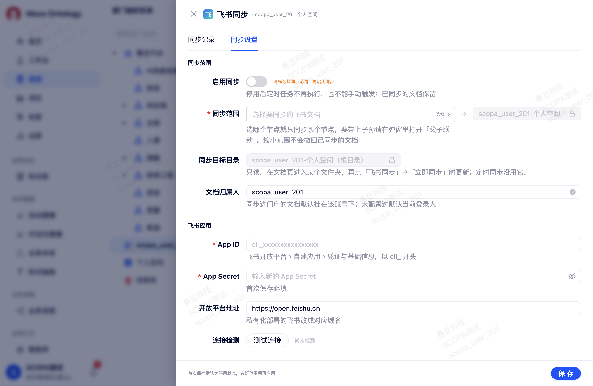

图 3-20 飞书同步设置

**注意事项：**文档同步需要一定时间，发起同步不代表文档已全部接入。每位用户只能同步自己有权限访问的内容，平台侧的文档访问遵循飞书源权限；权限变更后的同步机制与生效时间见「待确认」。个人空间不提供飞书同步，入口只在部门文档页。

### 3.3.3 配置文档权限

**目标：**按用户或角色授予文档的查看或下载权限，并设置有效期。

**入口：**`知识门户 > 资源 > 目标部门 > 文档`，在文档行点击「授权」；个人空间可勾选文档后点击工具栏「授权」。

**操作步骤：**

1. 打开「文档授权（部门名）」弹窗，确认上方显示的授权资源。
2. 在「新增授权」页签选择授权对象：「用户」页签可按所属部门、工号 / 姓名筛选后勾选；「角色」页签按角色授权。
3. 在「授权设置」中设置有效期（不填表示长期有效），选择权限类型「查看」或「查看 + 下载」，按需填写说明（最多 512 字）。
4. 点击「确认授权」。
5. 切换到「查看已授权信息」页签核对结果。列表显示文件名称、被授权对象、对象类型、权限、有效期（未设置时为「长期有效」）和操作，可按对象类型筛选或搜索被授权对象；需要调整时点击「编辑」，需要收回时点击「取消授权」。

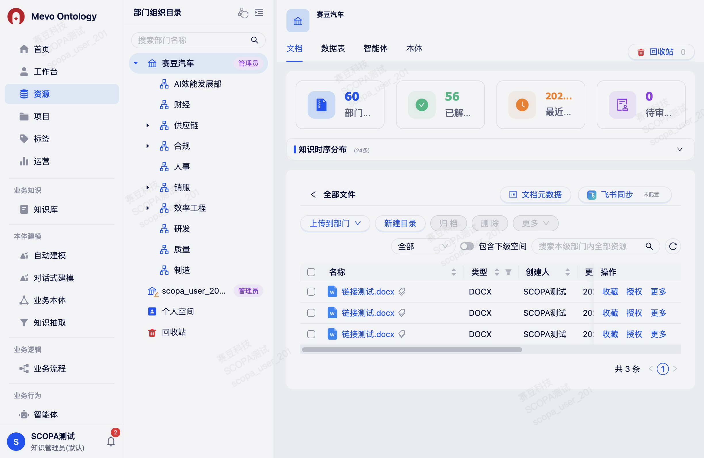

图 3-21 文档授权

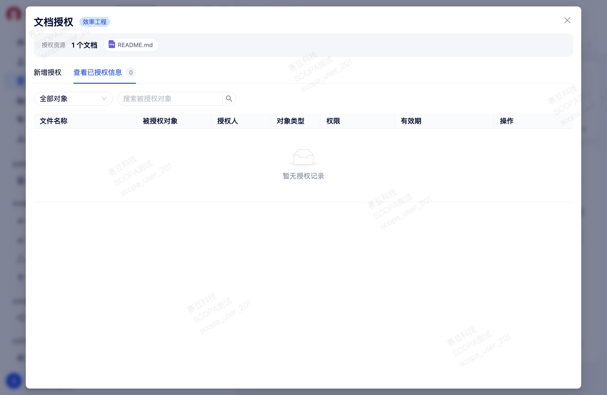

图 3-22 查看已授权信息

**说明：**

- 部门内的默认浏览与下载范围按角色配置（见第二章）；文档授权用于在默认范围之外单独开放。
- 授权会让对方获得文档访问权，敏感文档授权前请与部门管理员确认。飞书来源的文档在平台内如何再授权，见「待确认」中的飞书同步项。

### 3.3.4 发布个人文档到部门

**目标：**把个人空间中整理好的文档发布到部门，经审批后成为部门资源。

**入口：**`知识门户 > 资源 > 个人空间`，在文档行点击「发布」；或勾选多个文档后点击工具栏「发布」。

**操作步骤：**

1. 在「发布到部门」弹窗的「目标部门」树中选择部门，可用搜索框查找；右侧「目标文件夹」在选定部门后才可选取。
2. 选择发布时间：「立即发布」或「定时发布」。
3. 选择「归档方式」：「手动归档」或「自动归档」。
4. 填写授权说明（最多 512 字），点击「发布」。页面提示「发布申请已提交，请等待审批」。
5. 审批通过后，文档出现在目标部门的文档列表中；个人空间中该文档的操作变为「授权」「收藏」。

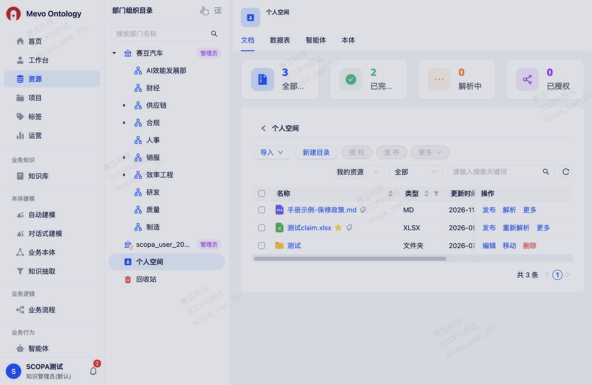

图 3-23 发布到部门

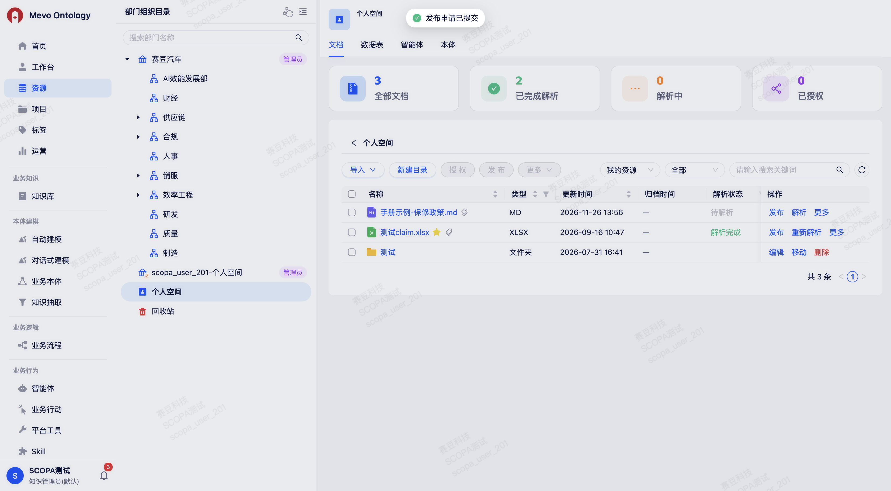

图 3-24 发布申请已提交

**说明：**审批通过后按设定的发布时间生效；审批人收到的待办与审批页面见第二章。

### 3.3.5 整理部门文档：目录、移动、归档与回收站

**目标：**用目录组织部门文档，归档过期文档，误删时从回收站恢复。

**入口：**`知识门户 > 资源 > 目标部门 > 文档`

**操作步骤：**

1. **新建目录：**点击「新建目录」，填写目录名称（必填）和目录描述，点击「确定」。目录在列表中显示为文件夹，可编辑、删除、移动。
2. **文档操作：**在文档行点击「更多」，可选择重新解析、下载、归档、历史版本、删除、移动、移交、审批链路。勾选多个文档后，也可用工具栏的「归档」「删除」「更多」批量处理。
3. **归档：**归档后的文档可用列表上方的「已归档」筛选查看。
4. **删除与恢复：**删除的资源移入回收站。点击目录树底部的「回收站」，页面只有「文档」一个页签，列为名称、类型、更新时间、解析状态、大小和操作，顶部工具栏为「彻底删除」「恢复」；列表为空时显示「暂无资源」和「共 0 条」。回收站没有搜索框，也没有按类型筛选，需要定位时按更新时间逐条查找，选中后「恢复」找回，或「彻底删除」永久清除。

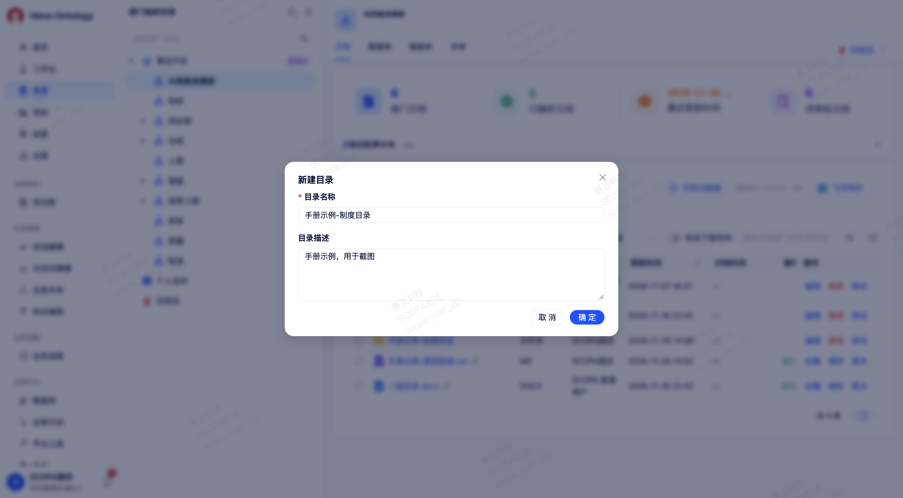

图 3-25 新建目录

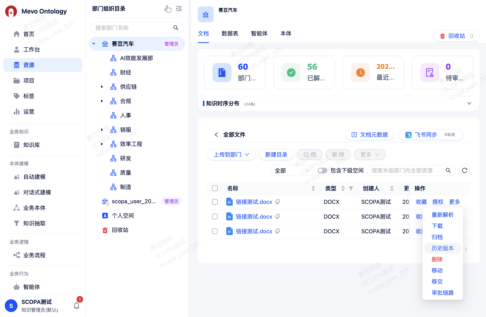

图 3-26 文档「更多」菜单

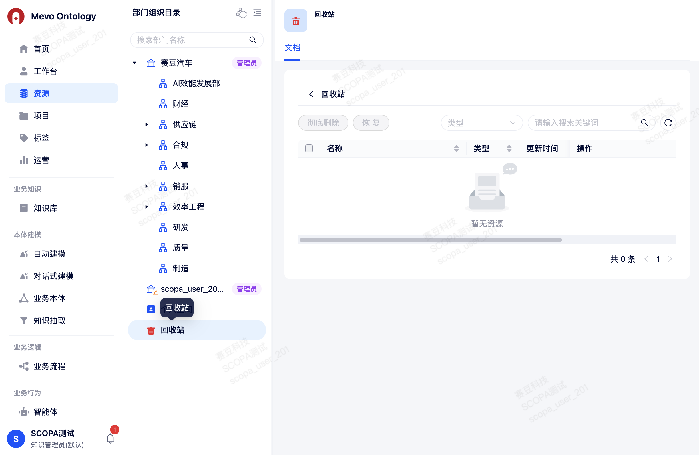

图 3-27 回收站

**说明：**彻底删除后无法恢复，操作前请确认。部门回收站（按部门查看和恢复）列在 1130 版本需求中，以上线版本为准。

### 3.3.6 管理文档历史版本

**目标：**文档内容更新时保留历史版本，发布新版本后自动替换生效版本，可追溯每次变更。

**入口：**`知识门户 > 资源 > 目标部门 > 文档`，在文档行点击「更多 > 历史版本」。

**操作步骤：**

1. 在「历史版本 · 文件名」抽屉中查看版本列表：版本号、状态（生效 / 草稿）、创建人、创建时间、变更说明和操作。
2. 点击「+ 新建版本」，选择创建方式：「从历史版本创建草稿」（再选择基准版本，默认当前生效版本）或「本地上传」更新文件；填写变更说明（最多 512 字），点击「提交」。新版本为草稿状态，发布后生效。
3. 在草稿版本行点击「发布」，弹出「发布版本确认」，提示「发布后 V2 立即生效，当前生效版本 V1 将变为历史版本」，点击「确定」后生效。
4. 发布后，新版本状态变为「生效」，原生效版本转为历史版本，需要时可重新发布或删除。点击「查看」可查看任一版本内容。

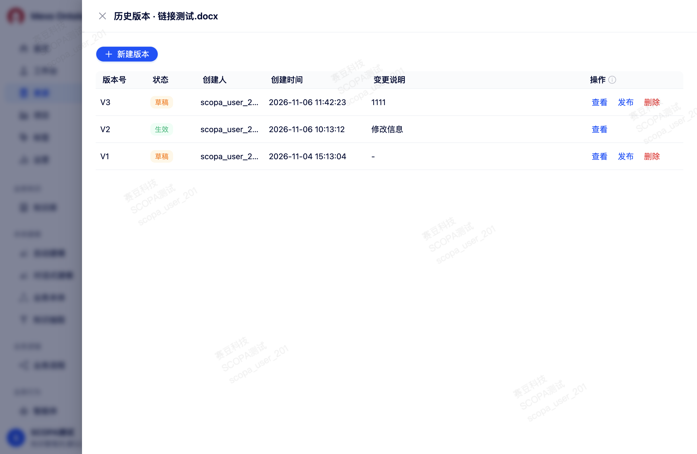

图 3-28 历史版本列表

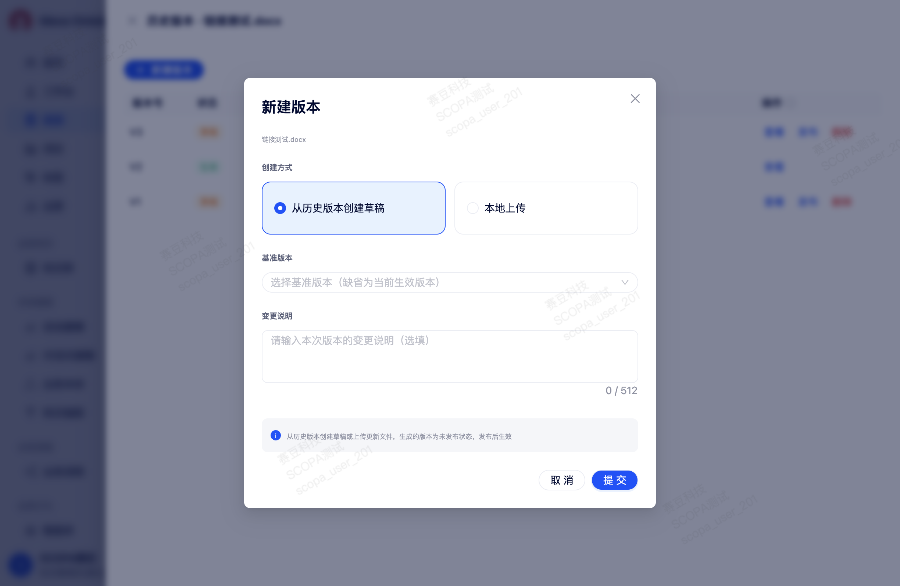

图 3-29 新建版本

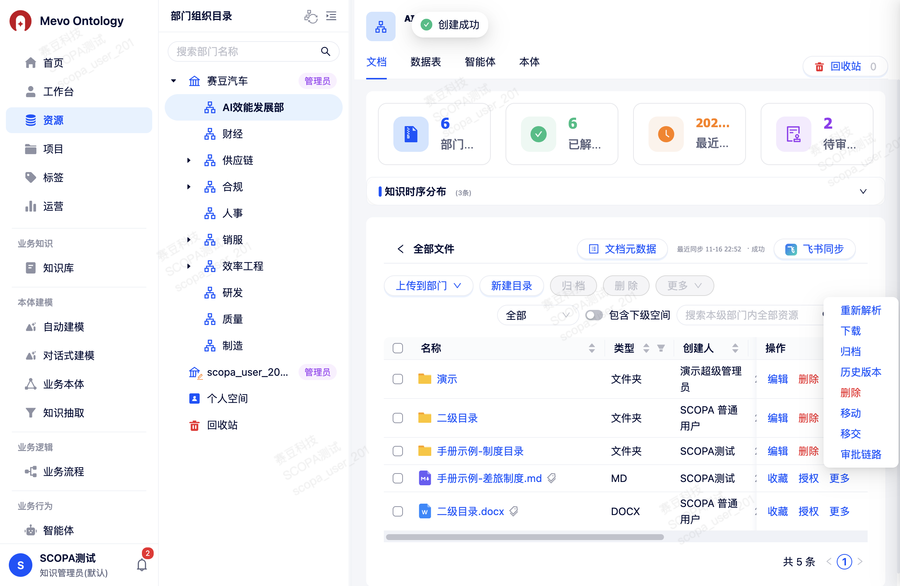

图 3-30 发布版本确认

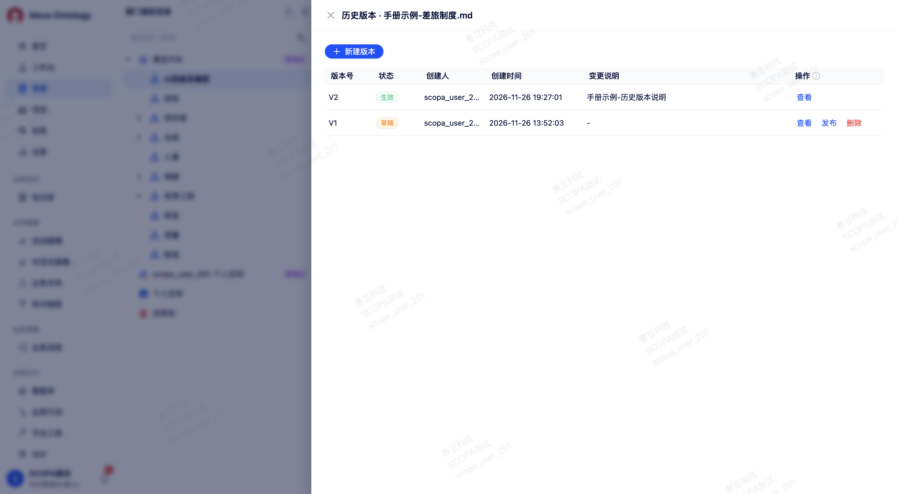

图 3-31 新版本发布后的版本列表

**说明：**「操作」列提示：生效版本仅支持查看，未生效版本可发布或删除。草稿版本不参与检索问答，发布后才替换生效内容。变更说明建议写清来源（哪次会议、哪一版制度），便于追溯。

### 3.3.7 移交文档到上级部门

**目标：**把本部门的文档移交给上级部门统一管理，例如子部门的制度文件上收到公司级。

**入口：**`知识门户 > 资源 > 目标部门 > 文档`，在文档行点击「更多 > 移交」。

**操作步骤：**

1. 在「移交到上级部门」弹窗顶部确认本次移交的资源数量，提示为「本次将移交 1 个资源，提交后进入审批，通过后移入所选部门」。
2. 在「选择目标部门（当前部门的上级或祖辈）」中选择上级或祖辈部门。
3. 填写移交说明（最多 512 字），点击「移交」。
4. 移交申请进入审批，通过后资源移入所选部门。

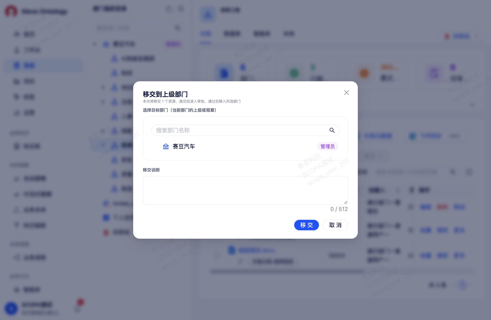

图 3-32 移交到上级部门

**说明：**移交只能选择上级或祖辈部门。审批通过后的结果见「待确认」。

## 3.4 FAQ 配置与管理（待升级）

FAQ 是专门用于**门户智能搜**的标准问答资源，适用于问题范围明确、答案相对固定、需要统一答复口径的场景。本节说明 FAQ 的接入、配置与维护，日常查询见第十章。

**FAQ 与数据知识库的区别在于使用范围：**FAQ 在门户智能搜中使用；数据知识库在项目中建设，用于维护供应用查询的结构化问答记录，见 5.2。两者分别管理，不默认相互同步；在门户配置 FAQ，不等于已建立可供应用调用的数据知识库。

### 3.4.1 新增与编辑 FAQ

**目标：**对口径固定的高频问题维护标准问答，使智能搜优先返回统一答案。

**前置条件与入口**：问题清单与标准答案已确认；进入门户 FAQ 管理入口（菜单命名以当前版本为准）。

**操作**：

1. 新增 FAQ：填写标准问题与答案；同类问法可整理为主要问题加变体，提升命中率。
2. 编辑与删除：口径变化时先更新答案再观察命中情况；废弃问答及时下线，避免返回过期口径。
3. 定期维护检查：核对答案时效（制度更新、组织调整后重点复查），形成维护记录。

**完成检查与下一步**：用智能搜输入标准问题与常见变体，确认返回新答案（见第十章）。

### 3.4.2 导入与导出 FAQ

**目标：**用 Excel 模板批量维护问答，支持初始化导入与定期导出核对。

**操作**：

1. 按模板整理标准问题、答案与适用范围，批量导入；导入后抽查几条确认格式与内容正确。
2. 导出现有 FAQ 用于线下核对与批量修改；修改后再导入覆盖，注意保留生效状态字段。
3. 导入与导出不改变审批与生效规则；导入的问答即时按当前生效规则参与查询。

### 3.4.3 FAQ 权限配置【待设计】

**目的与结果（目标）**：控制谁能维护 FAQ、哪些范围的用户可查询到对应问答，与资源组织架构权限（第二章）一致。（功能待设计）

## 本章变更说明（v3.4 → v4.0）

**修改：**

- 章首【重要说明】：改为 v4.0 现状。文档与数据表都在门户「资源」按部门管理；本体、智能体页签内容以环境为准。
- 3.1 资源管理：去掉【规划】，按环境改写为「资源」页的部门组织目录、部门文档列表、个人空间和回收站。
- 3.2 整节重写（2026-11-23，对照知识门户「资源 > 数据表」）：原按「数据资产」模块写的数仓连接、本地上传、数据表查看均不再适用。改为「数据表」页签下的三项操作：3.2.1 查看部门与个人空间的数据表，3.2.2 上传本地数据（四步向导：选择文件 → 选择数据表 → 预览编辑 → 选择部门目录），3.2.3 查看数据表与字段（资源详情）。
- 3.3.1 上传本地文档：改为「上传到部门」和个人空间「导入」两条路径，补充支持格式、审批链、立即 / 定时发布、自动解析和四种解析模式。
- 3.3.2 同步飞书文档：去掉【待上线】，按 2026-11-26 环境改写为部门文档页「飞书同步」抽屉的同步设置与同步记录，删除三张原型截图，换为环境截图（图 3-20）。
- 3.3.3 配置文档权限：去掉【待升级】，按环境改写为文档授权弹窗（用户 / 角色、有效期、查看 / 查看 + 下载）。
- 3.3.3 补充「查看已授权信息」步骤和截图（图 3-22），图 3-21 重截，授权对象改为测试账号，去除真实员工姓名与工号。
- 3.3.4 发布个人文档到部门：按弹窗现状补充「目标文件夹」和「归档方式」（手动 / 自动），图 3-23 重截。
- 3.3.5 回收站：按环境改为单一「文档」页签、名称 / 类型 / 更新时间 / 解析状态 / 大小 / 操作列和「彻底删除」「恢复」工具栏，删除「按类型筛选或搜索」；「更多」菜单补「审批链路」。
- 3.3.6 发布版本确认：按弹窗原文改写确认提示（V2 立即生效、V1 转为历史版本），图 3-30 重截。
- 3.3.7 移交：按弹窗原文补充数量提示和「选择目标部门（当前部门的上级或祖辈）」。
- 3.1 图 3-2 重截（原图有提示框遮挡目录树）。
- 3.1 页签说明改为「文档 / 数据表 / 智能体 / 本体」+ 目录树底部「回收站」，文档列表列补「归档时间」。
- 3.3.1 个人空间：按环境改写入口与列表列，「导入」下拉图换为环境截图（图 3-18）。
- 全章图号连续重排为图 3-1 至图 3-32。
- 3.4 交叉引用改为第十章（门户检索问答）和第二章（组织权限）。

**新增：**

- 3.2.4 发布数据表到部门、3.2.5 数据表授权（弹窗含整表 / 按字段授权、有效期、说明），均已在环境核对。
- 3.2.6 数据表行权限【1130 版本】、3.2.7 接入数据库与数仓数据源【1130 版本】（原型示意）。
- 3.3.4 发布个人文档到部门。
- 3.3.5 整理部门文档：目录、移动、归档与回收站。
- 3.3.6 管理文档历史版本。
- 3.3.7 移交文档到上级部门。

**删除：**

- 3.3.1 中「平台暂无在线编辑与自动版本管理」的表述（已有历史版本功能，见 3.3.6）。
- 3.2.1—3.2.3 中按数据资产模块写的连接数据库、数据源详情、数据目录等内容及全部截图。
- 3.3.2 的三张飞书同步原型截图（ch03-31/32/33-…-proto.png）及「测试环境未提供该功能」的说明。
- v3.4 全部旧截图，按环境和原型重截。3.4 FAQ 因环境未找到对应功能，暂无截图。

**未变：**

- 3.4 FAQ 配置与管理（待升级）及 3.4.1—3.4.3：环境与原型均未找到 FAQ 管理功能，保留 v3.4 原文和标签。

## 待确认

1. **数据库 / 数仓数据源接入（3.2.7）：**环境的「数据表」页签没有「新增数据源」入口，左侧菜单也不再显示「数据资产」（资产中心地址仍可直接打开，里面还有旧的数据源与数据表）。需确认数据库、数仓接入方式是否取消、挪到后台或排在 1130 版本，以及资产中心里已有的数据表和门户数据表的关系。
2. **数据表发布与授权的结果（3.2.4、3.2.5）：**发布弹窗和授权弹窗均只打开截图，没有提交；发布审批通过后的展示、授权后的访问效果未实测。普通成员在部门下上传数据表时的审批流程也未实测（只选了「个人空间」，无需审批）。
3. **字段类型修改（3.2.2）：**预览步骤中的类型铅笔图标可选类型范围未逐项核对；上传后的字段类型默认均为文本。
4. **普通成员上传 / 发布的审批过程：**测试账号是审计部门管理员，上传与发布提交后直接进入部门列表（待审批文档为 0），未能看到普通成员提交后「待审批」状态在列表中的显示，以及审批人的审批界面。
5. **移交审批结果（3.3.7）：**为避免向其他部门管理员发起真实审批，移交只截到弹窗填写，未提交；移交申请的审批流程和通过后的展示需确认。
6. **定时发布的生效规则：**定时发布与审批的先后关系（审批通过晚于设定时间时如何处理）需确认。
7. **飞书同步的权限与定时规则（3.3.2）：**界面已上线并可在部门文档页配置，但未实际发起同步，以下需确认：同步批次处理失败（本次为「跳过 2 篇、成功入库 0」）的判定口径；飞书侧权限变更后平台文档的可见范围如何跟随、多久生效；定时同步的执行频率；「同步目标目录」与「父子联动」在目录调整后的取值。
8. **FAQ 配置与管理（3.4）：**2026-11-26 复查新菜单（首页、工作台、资源、项目、标签、运营及各业务分组）与资源页的文档 / 数据表 / 智能体 / 本体页签，仍无 FAQ 管理入口；第八章 8.3.3 FAQ 配置为【规划】，仅有原型示意。需确认 v4.0 是否保留该功能及其菜单位置，保留则补充操作与截图。
9. **1130 版本其他资源能力：**字段级表分发、部门回收站、视频挂载、自定义 MCP 服务作为资源、本体资源的展示 / 移交 / 授权，本章仅作说明，入口与界面以上线版本为准。
