# 四、准备项目与申请资源

本章说明场景建设人员如何创建项目、管理项目成员，并在项目中申请组织资源，以完成项目中的工作（如构建知识库、构建本体、构建智能体应用等）。

准备开展工作时，建设人员应先确定项目的工作范围，再在部门下创建项目并申请使用部门中的相关资源，最终在项目中使用申请到的资源进行建设。

**【版本说明】**

- 当前环境已支持：在部门下创建项目、管理项目成员；项目申请所属部门及其上级路径、下级部门的**文档、数据表、本体**资源，按资源所属部门的审批机制审批，通过后在项目「资源列表」中查看。
- 本体、知识库、智能体等建设模块按项目使用资源，进入建设模块后切换到对应项目即可使用项目已获得的资源（见第五、六章）。

## 4.1 项目

建设人员确定要建设一个项目时，首先需要确定项目范围，包括项目挂载的部门、可使用的资源以及项目成员。项目创建者可在其有权限的部门下创建项目。项目可申请其所属部门、全部下级部门及上级路径中的资源，并使用这些资源进行场景构建，如创建知识库、构建本体、创建智能体等。

### 4.1.1 创建项目

**目的：** 根据场景建设需要构建项目，并将项目挂载到部门。

**入口：** `知识门户 > 项目`。

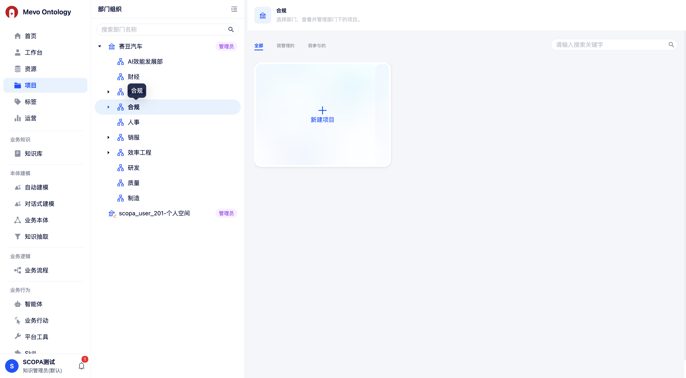

图 4-1 项目

**操作：**

1. 进入 `知识门户 > 项目`，左侧为「部门组织」目录。点击任意部门，右侧显示该部门下的项目卡片，可按「全部」「我管理的」「我参与的」切换，也可按关键字搜索。只有用户作为成员的项目会在此处显示。
2. 在目标部门下点击「新建项目」卡片。
3. 在「新建项目」弹窗中填写「项目名称」（必填）和「项目描述」；「当前挂载组织」默认为左侧选中的部门，可下拉调整。
4. 在「指定项目管理员」中按所属部门或工号/姓名查找并勾选一名或多名用户，可在「已选用户」页签核对。
5. 点击「确认」完成创建，系统进入项目详情页。

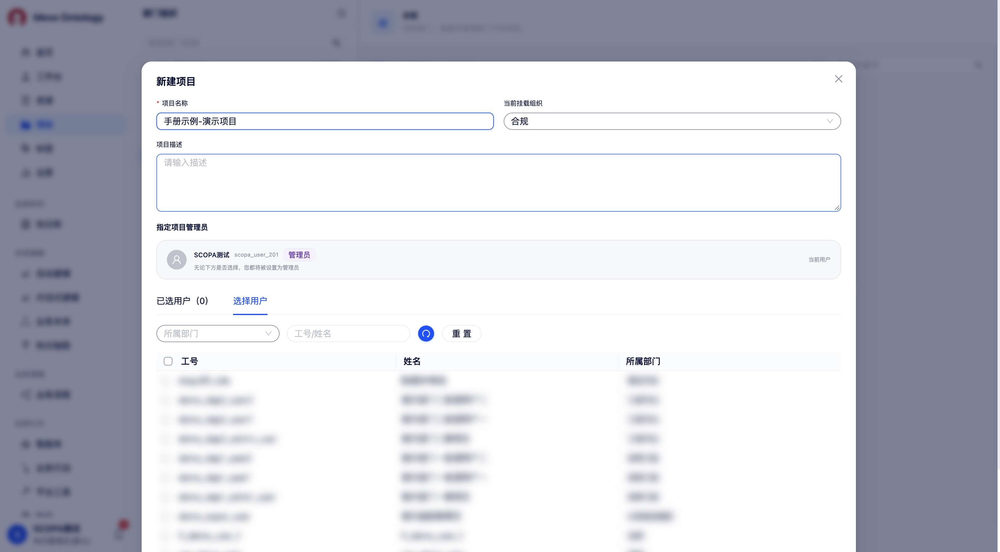

图 4-2 新建项目

完成创建后，项目管理员可添加成员、修改成员角色以及编辑项目信息。所有项目成员均可在知识库、本体等建设模块中进入本项目进行场景构建。

### 4.1.2 管理项目信息及成员

**目的：** 为项目添加成员，编辑和维护项目信息。

**入口：** `知识门户 > 项目 >` 点击项目卡片，进入项目详情页。

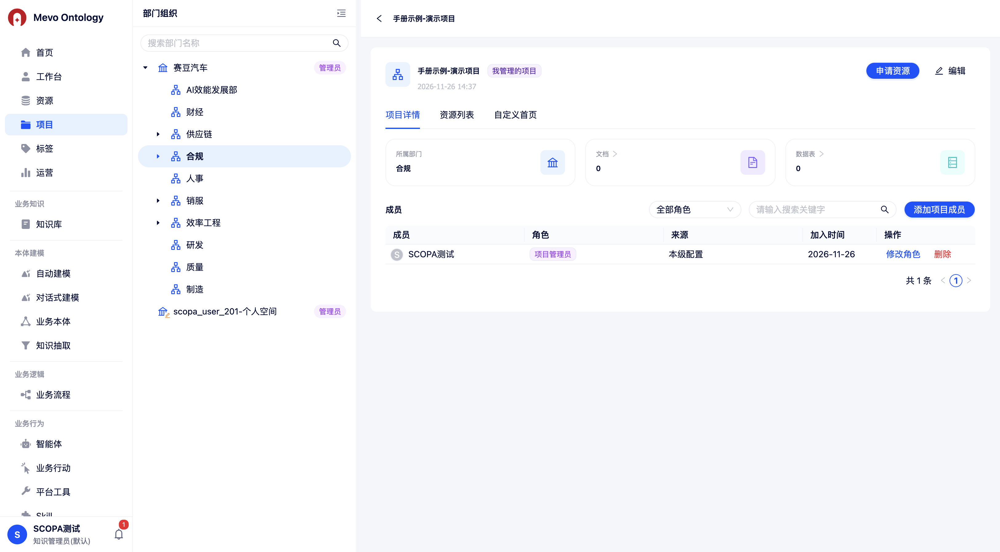

图 4-3 项目详情

**操作：**

1. 在项目详情页顶部查看项目名称、本人角色标签（如「我管理的项目」）、创建时间和描述；「项目详情」页签显示所属部门、文档数量、数据表数量和成员列表。项目详情页另有「资源列表」「自定义首页」两个页签。
2. **编辑项目信息：** 点击右上角「编辑」，在「编辑项目信息」弹窗中修改「项目名称」和「项目描述」，点击「确定」。
3. **添加项目成员：** 点击「添加项目成员」，在弹窗中按所属部门或工号/姓名查找并勾选用户，在下方角色选项（界面标签为「部门角色」）中选择「项目管理员」或「项目成员」，点击「确认」。
4. **修改角色 / 删除成员：** 在成员列表中点击「修改角色」调整角色，点击「删除」移出项目。成员列表可按角色筛选、按关键字搜索。

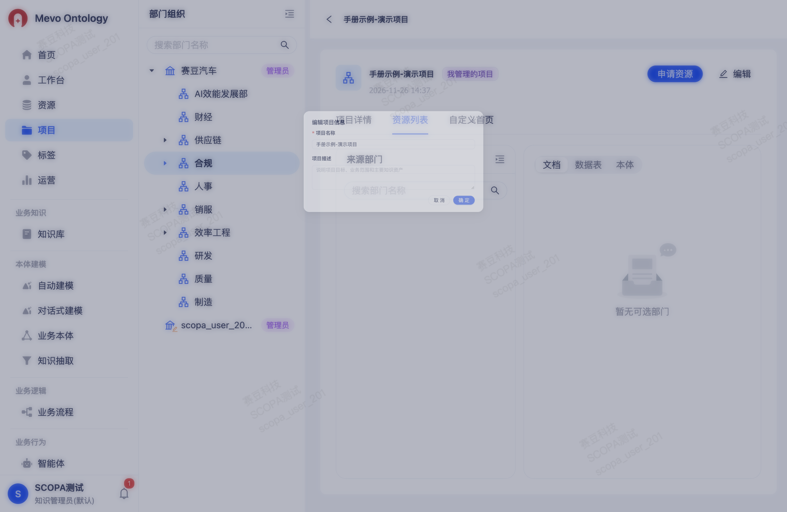

图 4-4 编辑项目信息

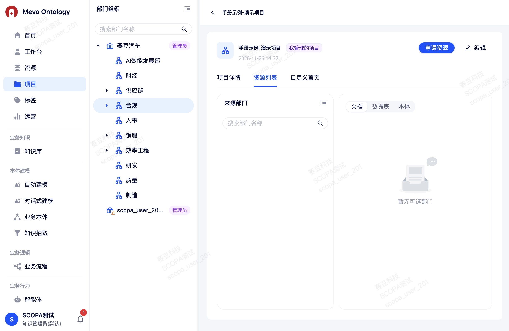

图 4-5 添加项目成员

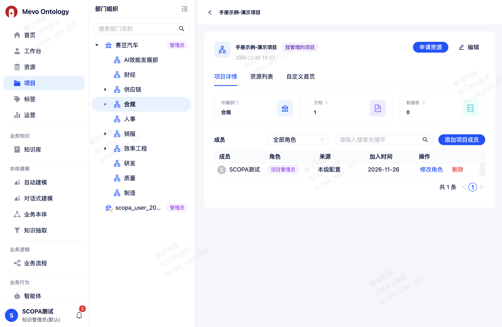

图 4-6 项目成员列表

**说明：** 只有项目成员才可在本体构建、知识库构建时进入此项目进行场景构建。

## 4.2 项目：查看项目资源

**目的：** 查看项目已获得的资源，确认可用于建设的资料范围。

**入口：** 项目详情页 `>` 「资源列表」页签。

**操作：**

1. 进入「资源列表」页签，左侧「来源部门」按部门目录展示项目可申请资源的部门范围（项目所属部门、其上级路径和下级部门，含「默认企业空间」）；可搜索部门名称、全部展开 / 收起。
2. 点击某个来源部门，右侧通过「文档」「数据表」「本体」页签切换资源类型。文档列表显示名称、类型、创建人、更新时间、授权状态、大小和操作；数据表列表显示名称、中文名、类型、数据源名称、数据源类型、数据量、创建人、授权状态和更新时间；本体列表显示名称、类型、来源项目、负责人和更新时间。表格较宽时左右拖动滚动条查看后几列。可按关键词搜索，并可用「是否授权」筛选。
3. 勾选「包含下级空间」可一并查看下级部门获得的资源。
4. 对不再需要的资源，点击行内「更多」中的操作将其移出项目。尚未获得时，各页签分别显示「暂无文档资源」「暂无数据表资源」「暂无本体资源」。

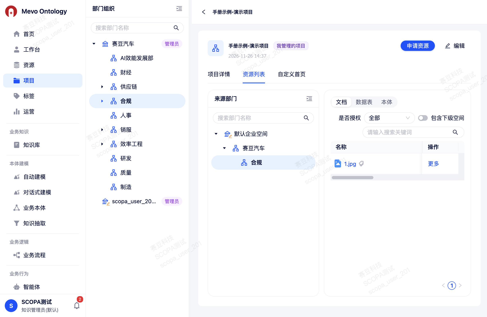

图 4-7 获得资源后的资源列表（按来源部门查看）

## 4.3 项目：申请与获得资源

### 4.3.1 提交资源申请

**目的：** 为项目申请所需的部门资源。

**入口：** 项目详情页右上角「申请资源」。

**操作：**

1. 点击「申请资源」，打开「申请资源」弹窗。
2. 在左侧「来源部门」中选择资源所在部门，右侧通过「文档」「数据表」「本体」页签切换资源类型，列出该部门中可申请的资源；可按关键词搜索，勾选「包含下级空间」可一并列出下级部门的资源。
3. 勾选需要的资源（可跨部门多选），弹窗左下角显示「已选 N 项」，「已选内容」区域可按「全部」「文档」「数据表」「本体」查看已选项。
4. 填写「申请说明」（必填，最多 200 字），说明项目用途和所需资源。
5. 查看「当前部门审批链」：该部门未开启「项目申请部门资源」审批时，显示「该部门无需审批，提交后直接生效」；已开启时显示其审批节点。
6. 点击「提交申请」，系统提示「申请已提交」。

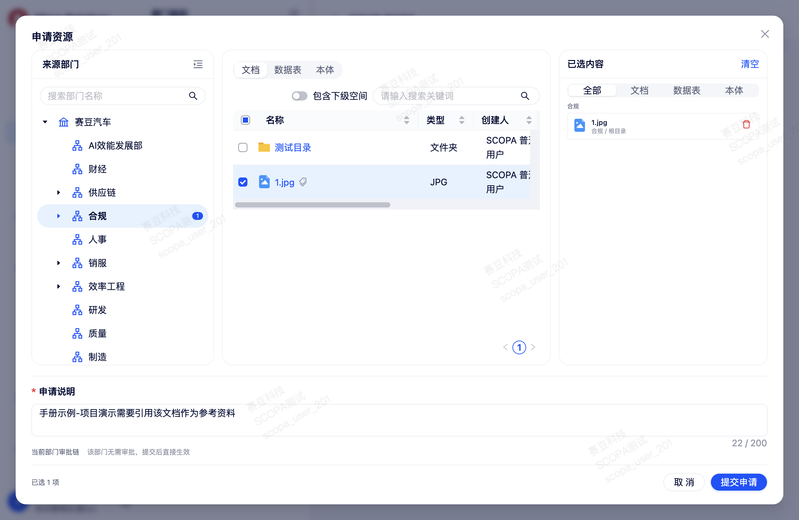

图 4-8 选择资源并填写申请说明（该部门无需审批）

### 4.3.2 审批与获得资源

**目的：** 跟踪申请进度，审批通过后在项目中使用资源。

**操作：**

1. 来源部门未开启项目申请审批时，提交后资源直接进入项目，可在「资源列表」中看到（图 4-7）。
2. 来源部门已开启审批时，申请进入审批流程。申请人在 `知识门户 > 工作台 > 我的审批 > 我提交的` 中查看，类型为「部门资源申请至项目」，状态为「审批中」；点击「查看详情」可看到资源所属部门、申请项目、申请资料和审批链当前待处理的审批人。
3. 审批人在 `知识门户 > 工作台 > 我的审批 > 我审批的` 中处理（见 2.3.1）。全部节点通过后，资源出现在项目「资源列表」中对应来源部门下。

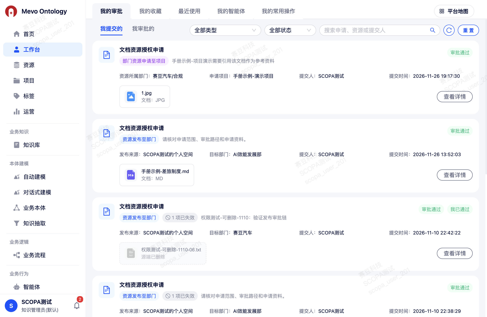

图 4-9 我提交的：项目资源申请记录

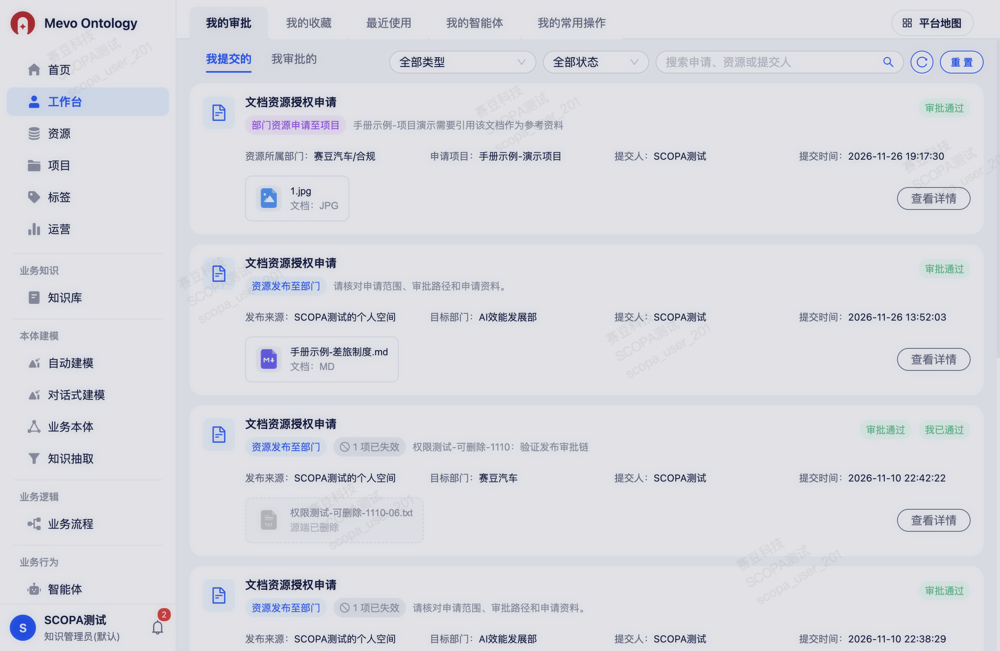

图 4-10 项目资源申请的审批详情

### 4.3.3 申请数据表、本体等资源

**目的：** 项目按需申请文档以外的资源类型，包括数据表和本体资源。

**操作：**

1. 点击「申请资源」，打开「申请资源」弹窗。可申请范围为项目所属部门、全部下级部门，以及上级路径直至企业级部门。
2. 在左侧「来源部门」选择部门，右侧通过页签切换资源类型：「文档」「数据表」「本体」。
3. 选择「数据表」页签时，列出该部门可申请的数据表，显示名称、中文名、类型、数据源名称、数据源类型、数据量、创建人、授权状态和更新时间；暂无数据表时显示「暂无可申请的数据表」。
4. 选择「本体」页签时，可进一步按「全部」「实体」「关系」「事件」筛选，列出可申请的本体资源，显示名称、类型、来源项目、负责人和更新时间；暂无本体资源时显示「暂无可申请的本体资源」。
5. 填写「申请说明」后点击「提交申请」，按来源部门的审批机制审批：
   - 数据表申请：审批人可按表筛选，并可缩减字段范围。
   - 本体申请：按实体、关系、事件等对象审批，不允许缩减属性或参数。

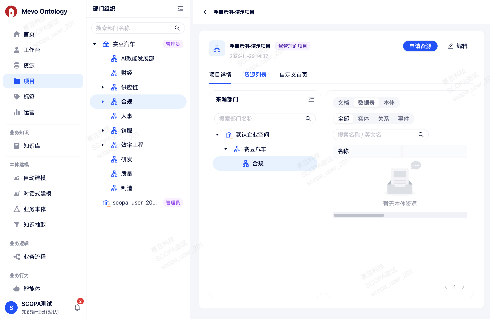

图 4-11 申请资源：数据表页签

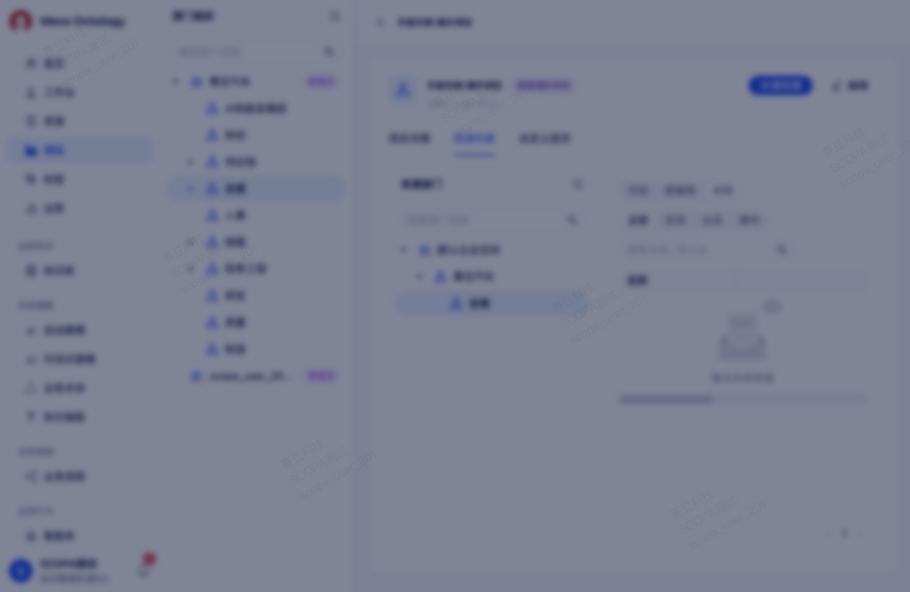

图 4-12 申请资源：本体页签

### 4.3.4 基于部门/目录批量申请资源【1130 版本】

**目的：** 一次申请某个部门或目录下的全部资源，之后该部门/目录中新增的资源自动同步到项目，无需逐个补充申请。

**说明：** 该功能列入 1130 版本计划，当前环境中未见对应界面，具体操作待上线后补充。

---

## 本章变更说明（v3.4 → v4.0）

- 修改章首「重要说明」为「版本说明」：项目可申请资源由文档扩展为文档、数据表、本体。
- 修改 4.1：标题由「项目管理」改为「项目」，入口改为 `知识门户 > 项目`；项目可申请范围由「所属部门及下级部门」改为「所属部门、全部下级部门及上级路径」。
- 修改 4.1.1：补充「全部 / 我管理的 / 我参与的」切换、「当前挂载组织」字段，创建后直接进入项目详情。
- 修改 4.1.2：按环境改写项目详情页（新增「自定义首页」页签和数据表数量）、「编辑项目信息」「添加项目成员」（角色为「项目管理员 / 项目成员」）、修改角色和删除；修正 v3.4 中误设为标题的说明段落。
- 修改 4.2：标题去掉【规划】，改为「查看项目资源」，按环境写「资源列表」页签（文档/数据表/本体三个页签、是否授权筛选、包含下级空间、移除资源）。
- 修改 4.3：标题去掉【规划】，拆分为 4.3.1 提交资源申请、4.3.2 审批与获得资源，入口改为 `知识门户 > 工作台 > 我的审批`，按环境截图（含无需审批直接生效、需审批进入「审批中」两种情况）。
- 修改 4.3.3：去掉【1130 版本】标签，按环境改写为「文档 / 数据表 / 本体」三个页签，替换为环境截图；删除「知识库」「智能体」页签和「展开审批链」步骤。
- 新增 4.3.4：基于部门/目录批量申请资源【1130 版本】（无截图）。
- 删除：v3.4 4.2、4.3 中「当前版本可在知识库构建时查看并申请文档资源，详见 5.1」的过渡说明（项目申请资源已上线）。

## 待确认

1. **审批通过后的界面**：本账号提交的资源申请均落在未开启审批的部门（提交后直接生效），未走到「审批中」状态；审批人视角的「通过」「驳回」按钮、审批意见填写及驳回后重新提交的流程需用审批人账号补截（图 4-9、4-10 为直接生效的记录）。
2. **项目成员权限**：原型说明「项目成员仅可查看及申请项目资源，不可编辑项目、添加成员或调整成员角色」，未用项目成员账号验证环境实际表现。
3. **来源部门范围**：环境中项目挂载在「合规」时，来源部门树显示「默认企业空间 > 赛豆汽车 > 合规」及其下级，与「所属部门、下级部门及上级路径」一致；但未见同级其他部门，跨分支申请是否被禁止需产品确认。
4. **建设模块的项目切换**：版本功能清单中「本体基于项目使用资源」「项目切换」为 1106「进行中」，本章仅作引用，具体以第五、六章为准。
5. 4.3.4 批量申请在原型中未找到对应界面，暂无截图。
6. **数据表 / 本体审批细节**：审批人可缩减数据表字段范围、本体不允许缩减属性，取自版本功能清单，环境中暂无数据表、本体审批记录可验证。
7. 测试中新建的数据保留在环境中：项目「手册示例-演示项目」（挂载「合规」，项目管理员 SCOPA测试），已获得文档「1.jpg」（来自合规，提交后直接生效）；另有一条 2026-11-06 提交的申请记录（申请项目「手册示例-合规知识助手」，已审批通过）。