# 五、构建知识库

企业的规章制度、技术手册以及生产运营中积累的数据记录，都可以整理成知识库。知识库建好后，可在项目中构建 Logic 和智能体时直接引用，让流程或智能体具备检索和问答能力（引用方法见 6.10 与 8.3）。

平台提供两类知识库：

- **文档知识库**：由文档组成，平台对文档做解析、分片和向量化，检索时召回相关文本分片。
- **数据知识库**：由一张结构确定的表格组成，平台对指定字段做向量化，检索时召回最相关的数据行。

**入口：** 在左侧菜单「业务知识」分组中点击「知识库」，进入知识库列表。

图 5-1 左侧菜单「知识库」入口

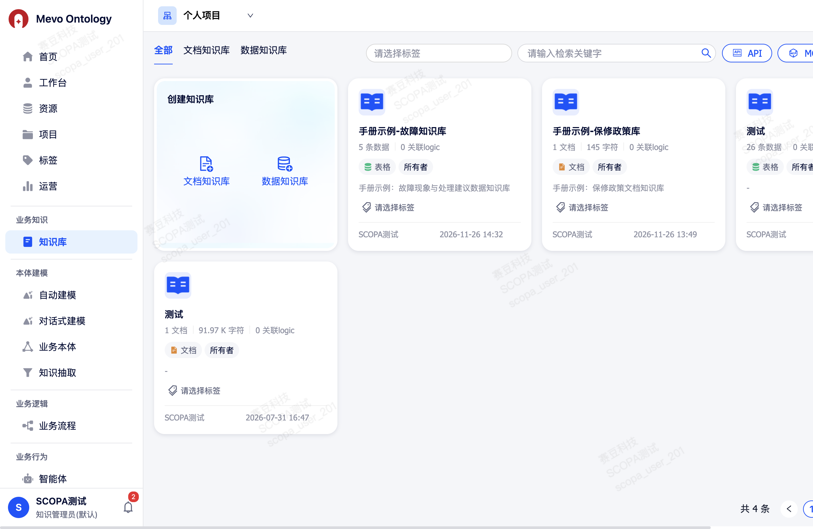

图 5-2 知识库列表

知识库列表顶部可按「全部 / 文档知识库 / 数据知识库」切换，也可按标签筛选或输入关键词搜索。每张知识库卡片显示文档数（或数据量）、字符数、关联 logic 数、类型（文档或表格）、当前用户的角色（如「所有者」）、描述、标签、创建人和创建时间。

**【重要说明】**

知识库按项目管理。首次进入默认处于用户的「个人项目」，无需管理员创建，适合快速搭建和测试。通过列表上方的项目切换器可切换到所属的公共项目，在公共项目中构建知识库时，只能使用已申请到该项目的文档资源（资源申请见第四章）。

v4.0 起，知识库统一从左侧菜单「业务知识 > 知识库」进入；数据集没有独立菜单入口，数据表在「资源 > 数据表」查看。

## 5.1 知识库管理：构建文档知识库

### 5.1.1 创建文档知识库

**目标：** 在目标项目中创建一个由文档组成的知识库，供 Logic 或智能体检索。

**入口：** `知识库 > 创建知识库 > 文档知识库`

**操作：**

1. 在知识库列表上方的项目切换器中选定目标项目。
2. 在「创建知识库」卡片中点击「文档知识库」，弹出创建窗口。
3. 填写以下信息：
   - **图标和名称**：选择知识库图标并填写名称（必填）。
   - **描述**：说明知识库的用途和内容范围。
   - **索引模型**：选择「个性化」或「内置」。「个性化」适配指定的向量引擎和索引，可使用在线或离线模型，检索增强效果更好；「内置」使用平台内置的向量引擎和关键词索引引擎，提供基础的构建和检索能力。
   - **Embedding 模型**：选择用于向量化的模型（如 bge-m3）。
4. 点击「确定」。提示「创建知识库成功，开始上传数据」后，自动进入知识库详情页。

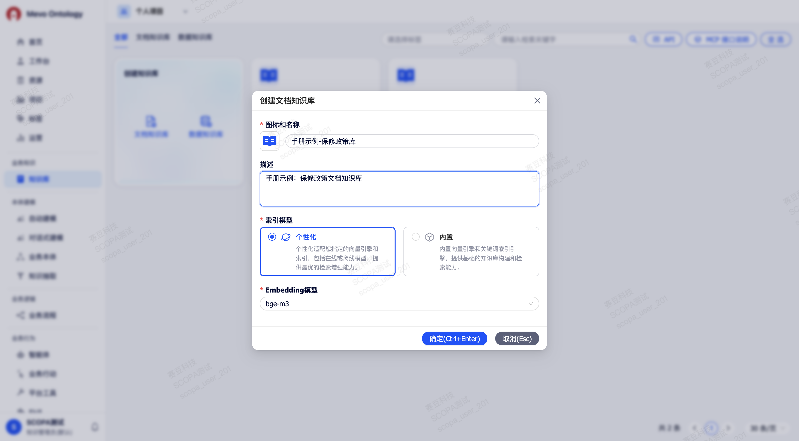

图 5-3 创建文档知识库

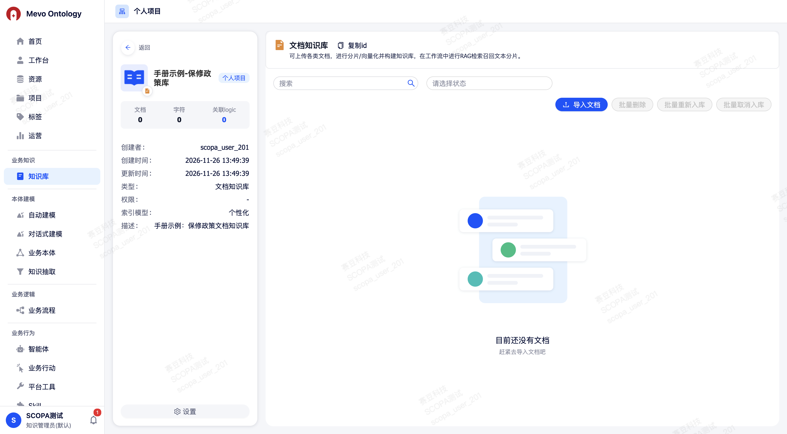

图 5-4 文档知识库详情

**说明：**

- 详情页左侧显示知识库基本信息：文档、字符、关联 logic、创建者、创建时间、更新时间、类型、权限、索引模型和描述；底部「设置」按钮提供「编辑」和「变更模型」（见 5.1.6）。
- 详情页右侧为文档列表，顶部可搜索、按状态筛选，并提供「导入文档」「批量删除」「批量重新入库」「批量取消入库」。

### 5.1.2 导入文档

**目标：** 把文档引入知识库，作为检索资料。

**入口：** `知识库 >` 进入文档知识库详情 `> 导入文档`

**操作：**

1. 在文档知识库详情页点击「导入文档」，打开导入窗口。窗口分「选择文档」和「解析配置」两步；窗口标题随页签变化，「从文档中心上传」页签为「关联知识库文档」，「直接上传」页签为「导入知识库文档」。
2. 在「选择文档」步骤选择文档来源：
   - **从文档中心上传**：窗口提示「可选择个人空间文档；已解析与未解析文档均可纳入」。左侧「部门目录」为「个人空间」；右侧可按「我的资源 / 授权给我的」和「全部目录」过滤，也可按名称搜索，列表显示名称、解析状态和文档类型，已发布到部门的文档会标出所在部门（如「默认企业空间」）。勾选需要的文档，上方显示「已选 N 个文档」，可点击「清空选择」重选。
   - **直接上传**：将本地文件拖入上传区域，或点击上传区域选择文件。支持 txt、pdf、docx、doc、xlsx、xls、csv、pptx、ppt、md，以及 jpg、jpeg、png、gif、bmp、webp、tif、svg 等图片格式。
3. 按需配置「审核配置」（见 5.1.5）。
4. 点击「下一步」，进入解析配置（见 5.1.3）。

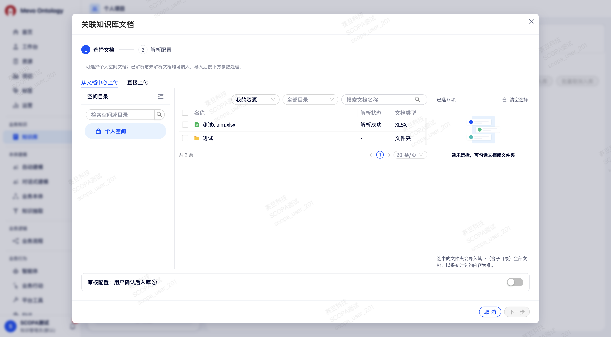

图 5-5 导入文档：从文档中心选择

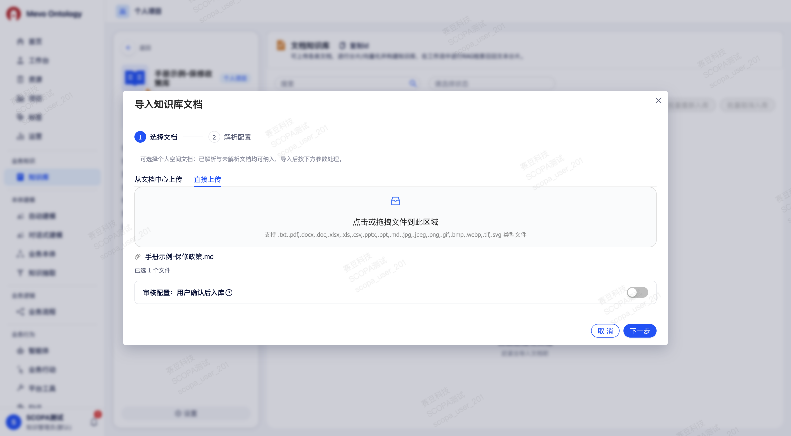

图 5-6 导入文档：直接上传

**说明：**

- 个人项目中的知识库，从个人空间选择文档（含本人已发布到部门的文档和授权给本人的文档），也可直接上传本地文件。
- 公共项目中的知识库，只能选择已申请到该项目的文档资源。缺少资源时，先按 4.2 发起资源申请，审批通过后再导入。

### 5.1.3 配置解析与分片

**目标：** 按文档特点选择解析方式和分片策略，使检索召回符合业务预期。

**入口：** 导入文档窗口 `>` 第二步「解析配置」

**操作：**

1. **选择解析模式：**
   - **自动**：根据文档格式自动选择解析方式。
   - **通用解析**：适用于文字可直接选取的常规文档，处理较快；扫描页或截图中的内容可能无法完整识别。
   - **版面识别解析**：按页面呈现识别文字、标题、图片和表格，适用于扫描件、截图或复杂排版。
   - **混合模式**：逐页优先通用解析，无法提取内容的页面自动切换为版面识别解析。
2. **设置分片模式：**
   - **自动模式**：由系统决定切分方式，可调整「向量切块尺寸」（默认 1024）。
   - **自定义模式**：设置「文本块长度」（默认 1024）、「重叠长度」（默认由系统决定）和「分段标识符」（输入分隔符后回车添加，可配置多个）；开启「生成目录」后，会为没有标题层级的文档自动生成目录结构，已有标题层级的文档不受影响。
   - **表格模式**：按表格结构切分，「表格分片方式」可选「自动解析」「二维表格」「复杂表格」。
3. **设置文本合并：** 「连续文本块合并」默认开启，相邻的短文本块会合并为同一分片；可设置「合并长度上限」（默认 500）。
4. **设置内容增强（可选）：** 开启「自动关键词」或「自动问题」，平台在入库时为每个分片生成关键词或可能的提问，提升召回效果。开启后会额外消耗 Token 并延长处理时间。
5. 点击「保存」开始导入。需要修改文档选择时点击「上一步」。

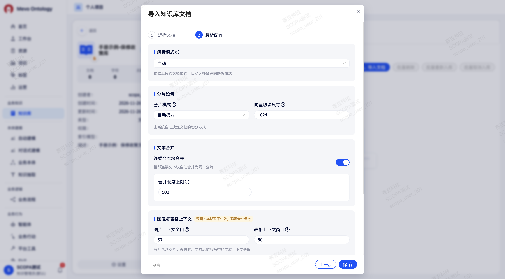

图 5-7 解析配置

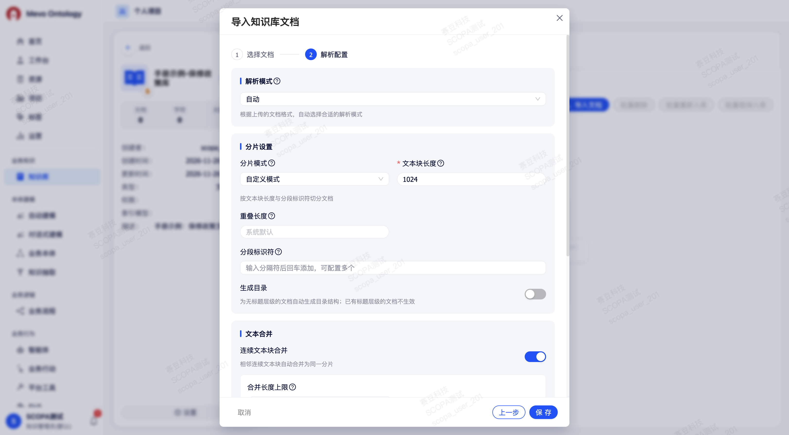

图 5-8 分片设置：自定义模式

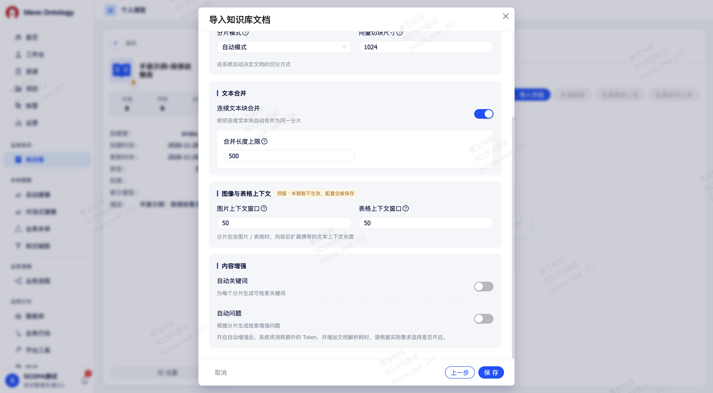

图 5-9 文本合并与内容增强

6. 保存后回到文档列表，可查看每篇文档的大小、分片数量、上传时间和状态。状态从「待处理」「准备中」变为「已入库」即可被检索。

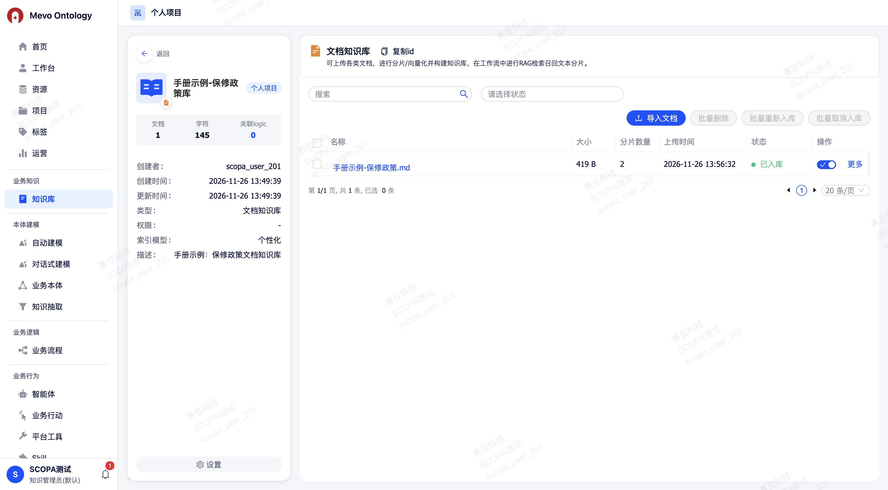

图 5-10 文档列表与入库状态

**说明：**

- 「图像与表格上下文」（图片上下文窗口、表格上下文窗口）为预留配置，本期暂不生效，配置会被保存。
- 文档入库失败时，可在操作列「更多」中点击「重新入库」；勾选多篇文档后可「批量重新入库」或「批量删除」。
- 暂时不希望某篇文档被检索、又不想删除时，关闭该文档的启用开关即可；重新开启后恢复检索。「更多」菜单还提供「下载文档」「Markdown预览」「重新入库」「取消入库」和「删除」。

### 5.1.4 查看解析还原与调整分片

**目标：** 对照原文检查解析和分片结果，必要时修改分片内容，保证知识库数据准确。

**入口：** 文档知识库详情 `>` 点击文档名称，进入文档详情页

**操作：**

1. 文档详情页左侧为「原始文档」预览，右侧提供三个视图：
   - **目录**：显示文档的章节结构，可开关。
   - **解析还原**：按「原文」「图片」「表格」查看解析结果，可开启「Markdown 渲染」，也可搜索解析内容。
   - **分片预览**：按章节列出全部分片，显示分片总数，可搜索章节或分片内容，按分片类型筛选。
2. 开启「跟随滚动」后，右侧滚动时左侧原文同步定位，便于逐段核对。
3. 每张分片卡片显示类型、序号与标题、字数和启用开关，可「展开全文」、定位到原文、查看「详情」或「编辑」。
4. 点击「详情」打开分片详情：显示所在路径、启用状态、位置、层级、页码、字数、父分片和元素 ID，可切换上一分片 / 下一分片。点击「编辑」修改分片文本后「保存」；「更多」菜单提供「改标题」「新增子分片」「删除」等操作。
5. 点击分片上的「内容增强」，可查看原文并维护关键词（输入后回车添加）和问题列表（「新增问题」或删除），完成后「保存」。
6. 某个分片暂时不应被检索时，关闭其启用开关。

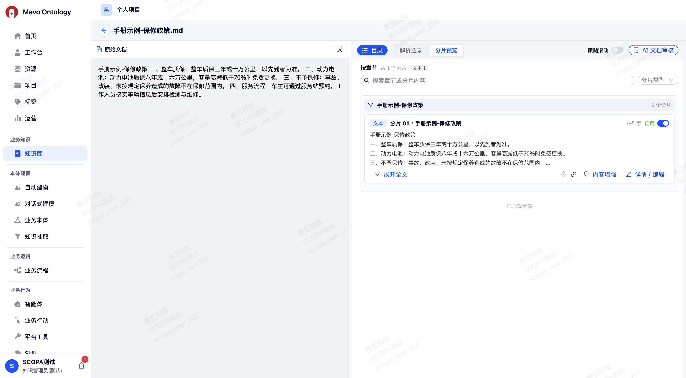

图 5-11 分片预览

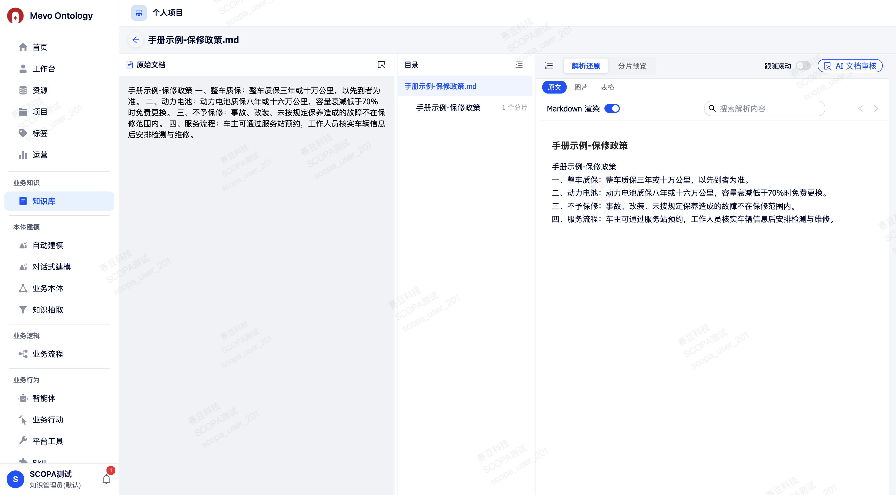

图 5-12 解析还原与目录

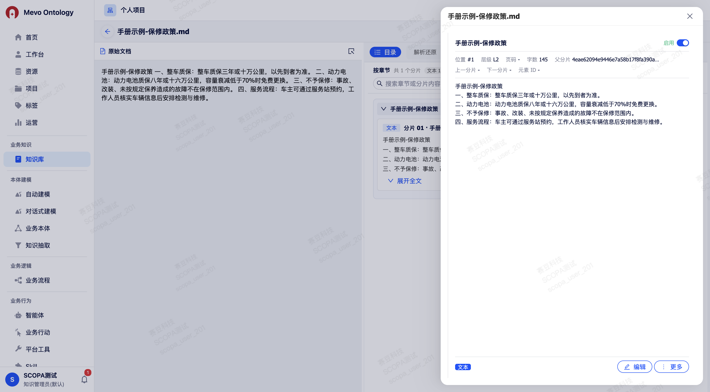

图 5-13 分片详情

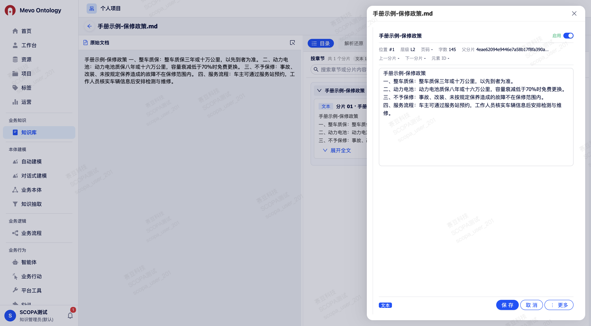

图 5-14 分片编辑

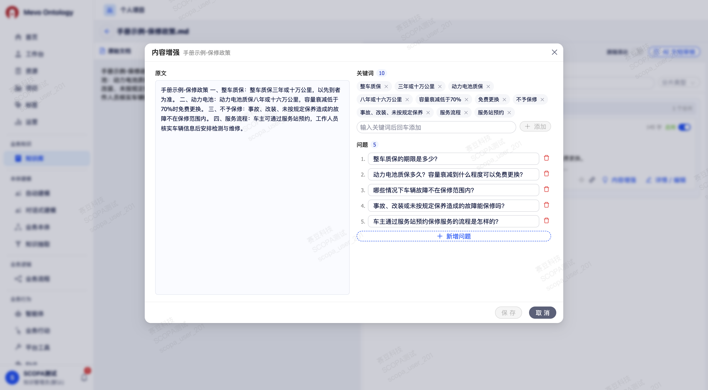

图 5-15 分片内容增强

### 5.1.5 审核入库与 AI 文档审核

**目标：** 对质量要求高的文档，先人工确认或经 AI 检查再入库，避免问题内容进入检索。

**入口：** 导入文档窗口 `>` 「审核配置」；文档详情页 `>` 「AI 文档审核」

**操作：**

1. **开启用户确认后入库：** 在导入文档的「选择文档」步骤，打开「审核配置：用户确认后入库」开关。按界面提示，开启后文档解析完成不直接入库，进入「待确认」状态，由用户在分片详情页人工确认后入库。
2. **解析后立即 AI 审核：** 开启「用户确认后入库」后会出现该选项。开启后，解析完成时自动创建 AI 审核任务，审核发现的问题可在确认入库前查看和处理。

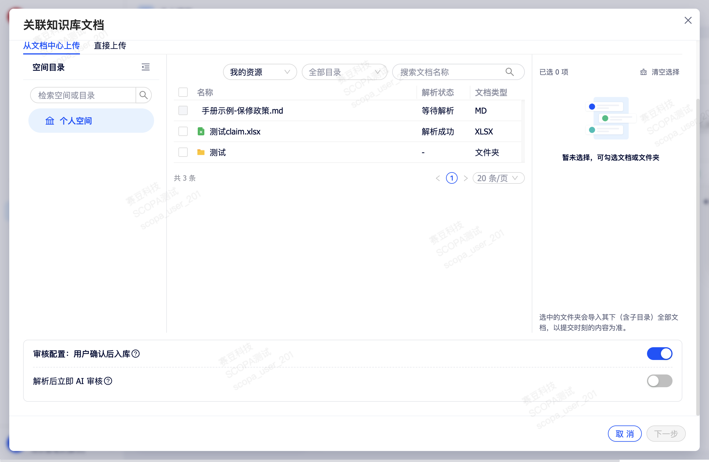

图 5-16 审核配置：用户确认后入库

3. **手动发起 AI 审核：** 在文档详情页点击「AI 文档审核」，打开审核任务列表，点击「新建审核」，选择「审核模型」，按需填写「审核要求」，点击「确定」。
4. 任务列表显示触发方式（如「手动发起」）、审核模型、状态和创建时间。任务完成后点击「查看」，可看到审核模型、问题数和问题明细。AI 审核检查的问题包括文本异常、内容重复、结构异常、编号与标题层级异常等。

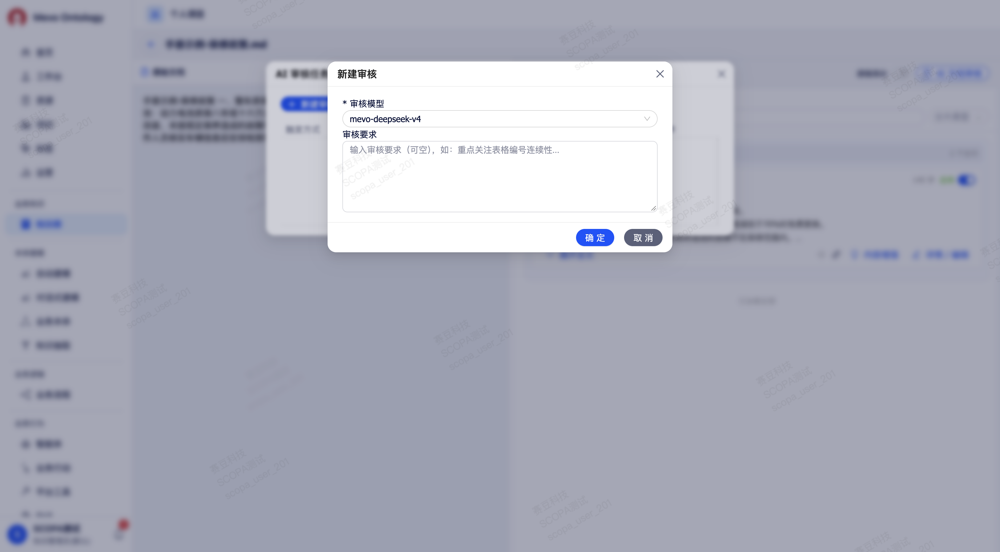

图 5-17 新建 AI 文档审核

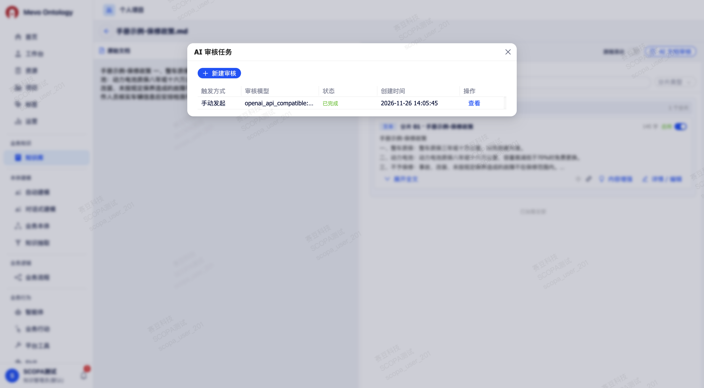

图 5-18 AI 文档审核任务列表

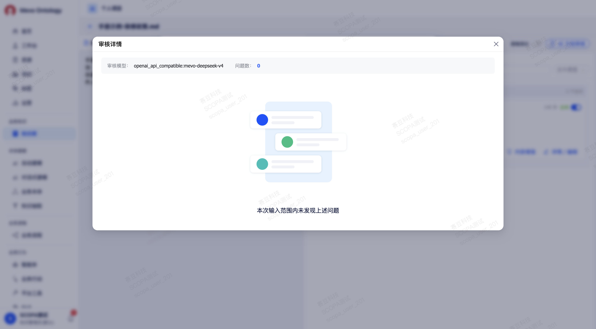

图 5-19 AI 文档审核详情

**说明：** 测试环境中，开启「用户确认后入库」导入的文档仍直接显示为「已入库」，「待确认」状态和确认入库操作暂未验证，详见本章「待确认」。

### 5.1.6 编辑知识库与变更向量模型

**目标：** 调整知识库名称、描述，或在需要时更换向量化模型。

**入口：** 文档知识库详情 `>` 左下角「设置」`>` 「编辑」/「变更模型」

**操作：**

1. 点击详情页左下角「设置」，选择「编辑」可修改知识库图标、名称和描述。
2. 选择「变更模型」，在「变更知识库模型」窗口中重新选择「索引模型」和「Embedding模型」，点击「确定」。
3. 变更后，知识库中的全部文档会自动重新向量化并重新入库，入库完成后文档状态更新。

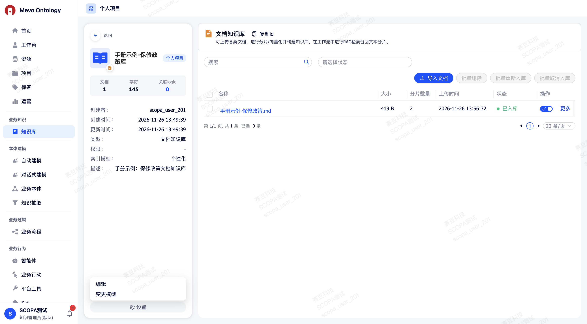

图 5-20 知识库设置菜单

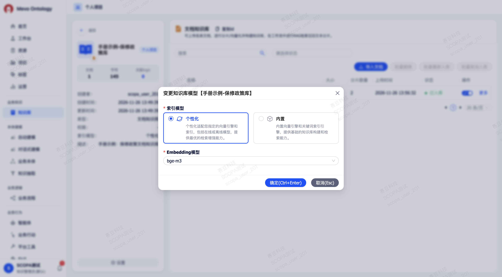

图 5-21 变更知识库模型

**注意：** 重新向量化期间，相关文档可能暂时无法被检索。文档较多的知识库，建议在业务低峰期变更。

## 5.2 知识库管理：构建数据知识库

数据知识库由一张结构确定的表格及其数据组成。平台对指定的一个字段做向量化，每条数据的该字段内容作为一个分片。检索时，平台将用户输入与该字段匹配，召回最相关的若干条数据，并返回命中数据的全部字段。

数据知识库同样可在个人项目或公共项目中构建。由于数据来自本地上传维护的表格，不需要为项目申请资源。

### 5.2.1 创建数据知识库

**目标：** 定义数据知识库的表格结构，为后续导入数据做准备。

**入口：** `知识库 > 创建知识库 > 数据知识库`

**操作：**

1. 在「创建知识库」卡片中点击「数据知识库」，弹出创建窗口。
2. 填写图标和名称、描述，选择索引模型（含义同 5.1.1）。选择「内置」时只出现图标和名称、描述、索引模型和表格配置，使用平台内置向量引擎；选择「个性化」时才出现 Embedding 模型选项。
3. 在「表格配置」中定义字段：填写字段名称，勾选「向量化」或「唯一」，通过「+」「−」增删字段。
4. 已有数据文件时，可点击「上传数据」，从 csv、xlsx、xls 文件的表头直接生成字段结构，无需逐个填写。复制其他数据知识库时，可先导出原知识库数据再在此上传；文件较大时可只保留表头。
5. 点击「确定」，进入数据知识库详情页。

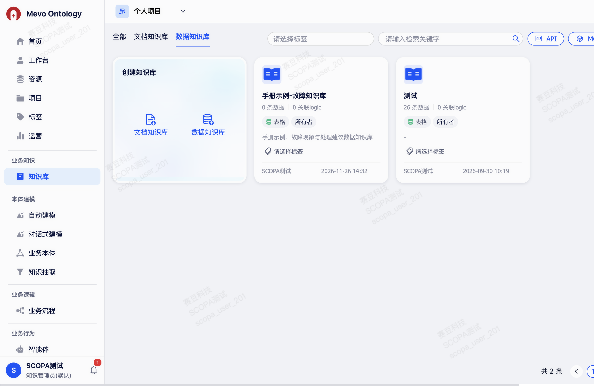

图 5-22 创建数据知识库

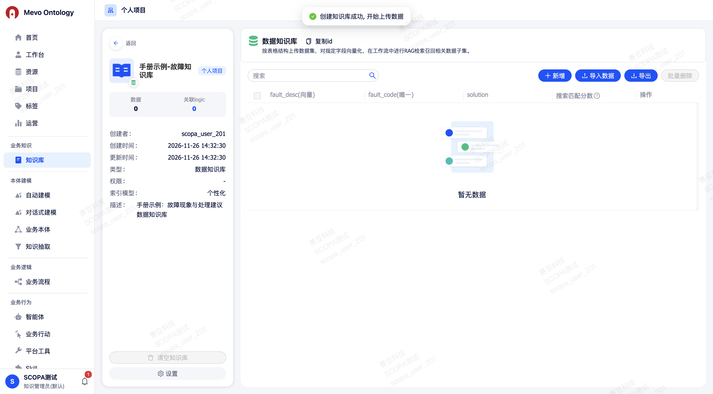

图 5-23 数据知识库详情

**注意：**

- 字段名称只能以字母开头，中文字段名无法保存。
- 必须且只能有一个向量化字段，检索匹配针对该字段进行。
- 详情页左侧显示数据量、关联智能体数等基本信息，底部提供「清空知识库」和「设置」。

### 5.2.2 新增与编辑记录

**目标：** 手动补充或修改单条数据。

**入口：** 数据知识库详情 `> 新增`

**操作：**

1. 点击「新增」，窗口按表格结构为每个字段提供一个输入框，填写后点击「确定」。
2. 新增的数据显示在列表中。列表列为各字段（字段名后标注「唯一」「向量」）、「搜索匹配分数」和操作。
3. 在操作列点击「编辑」修改该条数据，点击「删除」删除该条数据；勾选多条后可「批量删除」。

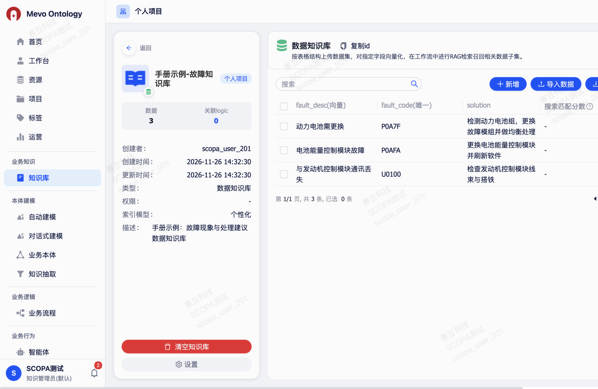

图 5-24 新增数据记录

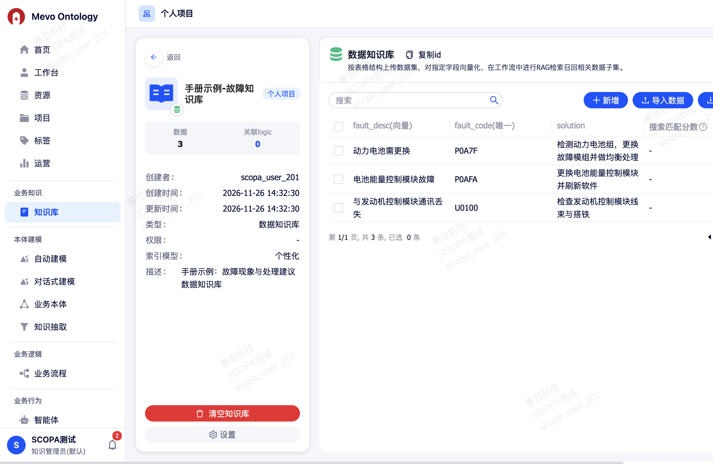

图 5-25 数据记录列表

### 5.2.3 导入记录与检索测试

**目标：** 通过文件批量导入数据，并检验检索匹配效果。

**入口：** 数据知识库详情 `> 导入数据`

**操作：**

1. 点击「导入数据」，在窗口中点击「下载模版」，按模板表头填写多条数据。
2. 将填好的文件拖入上传区域（支持 csv、xlsx、xls，单次 1 个文件，不超过 30MB），点击「确定」。
3. 导入完成后，列表上方显示导入结果（如「成功 2 / 2」），数据出现在列表中。
4. 需要导出数据时点击「导出」。需要定期全量更新时，可先点击左侧「清空知识库」，再重新导入。
5. **检索测试：** 在列表上方的搜索框输入查询内容并回车，列表按匹配度从高到低排序，「搜索匹配分数」列显示相似度。

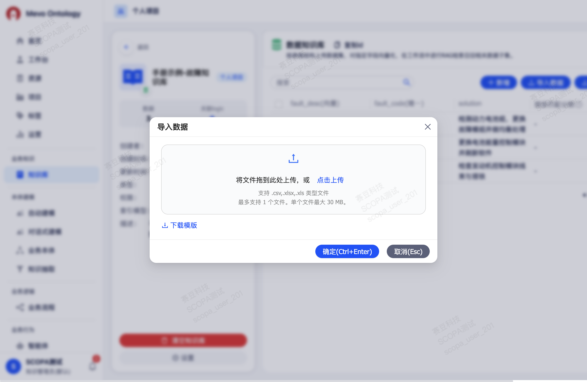

图 5-26 导入数据

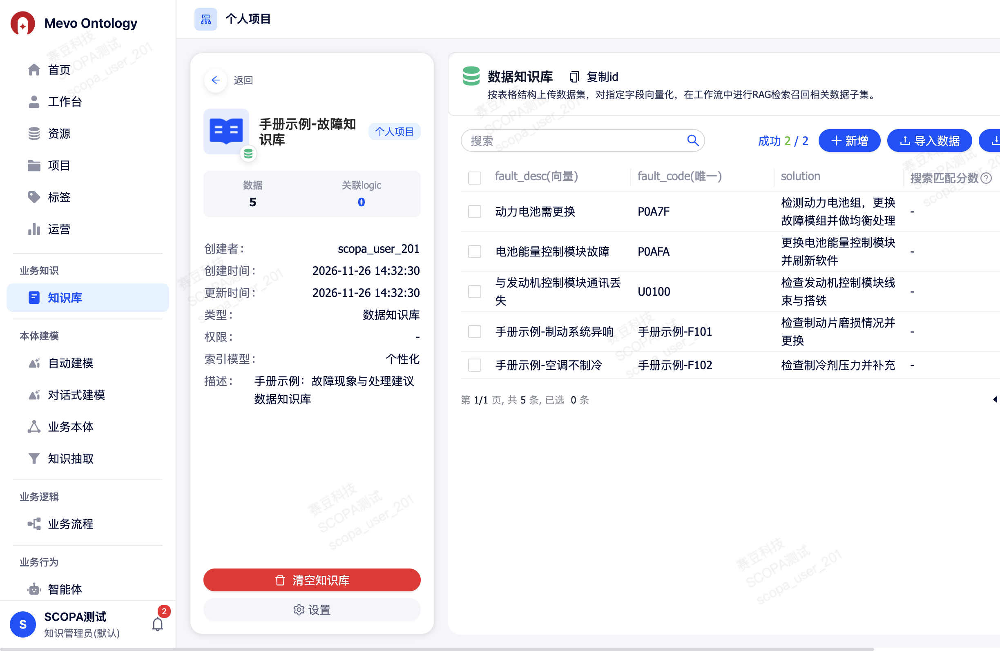

图 5-27 导入结果

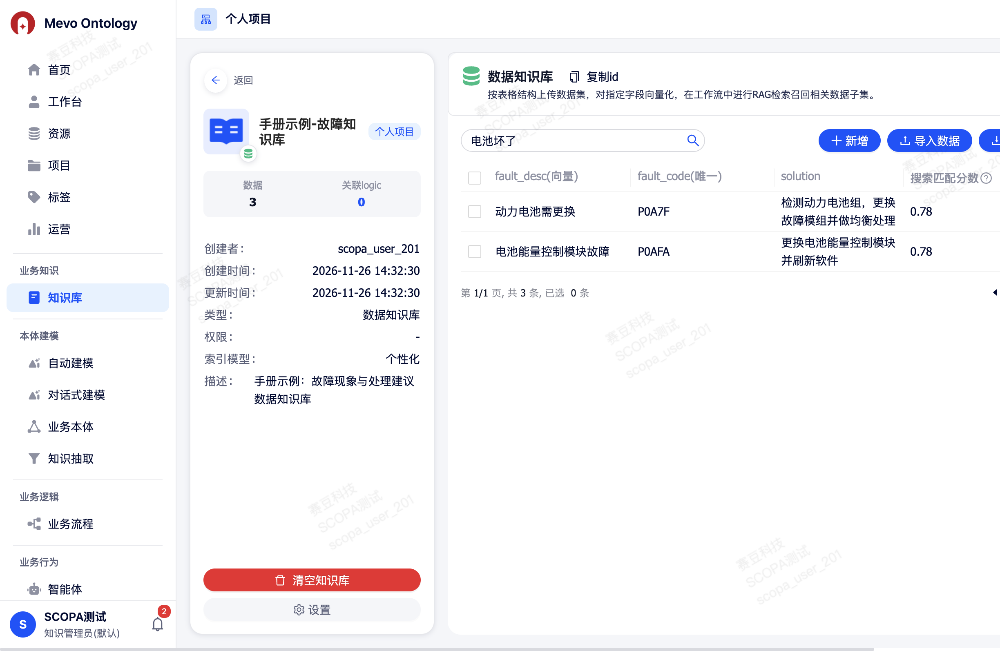

图 5-28 数据知识库检索测试

**说明：** 检索采用语义匹配。上图示例中输入「电池坏了」，「动力电池需更换」「电池能量控制模块故障」两条记录的匹配分数均为 0.78；与电池无关的「与发动机控制模块通讯丢失」未返回，相关度更低的记录不显示。

---

## 本章变更说明（v3.4 → v4.0）

**新增：**

- 5.1.4 查看解析还原与调整分片：原文与解析结果对照、目录、分片预览、分片详情 / 编辑 / 新增子分片、分片内容增强（1030 版本文档版面还原与分片查看）。
- 5.1.5 审核入库与 AI 文档审核：用户确认后入库、解析后立即 AI 审核、手动发起 AI 审核（1030 版本）。
- 5.1.6 编辑知识库与变更向量模型（1030 版本向量模型切换）。

**修改：**

- 章首入口：知识库与数据集统一并入左侧菜单「业务知识」分组，入口改为「知识库」；补充知识库列表的类型、标签筛选和卡片信息。
- 5.1.1 创建文档知识库：新增「Embedding 模型」选择，按实际表单描述字段。
- 5.1.2 导入文档：改为「选择文档 / 解析配置」两步；补充「从文档中心上传」的部门目录与过滤、「直接上传」支持的文件格式；新增审核配置入口。
- 5.1.3 配置解析与分片：解析模式由「快速 / 深度 / 自动匹配」改为「自动 / 通用解析 / 版面识别解析 / 混合模式」；新增分片模式（自动 / 自定义 / 表格）、文本合并、内容增强；删除「复用文档中心解析结果」描述（界面已无此选项）；分片调整内容移至 5.1.4。
- 5.2.1 创建数据知识库：补充字段命名规则和「上传数据」生成结构。
- 5.2.3 导入记录：标题改为「导入记录与检索测试」，补充导入进度、导出、清空知识库和检索测试步骤。
- 11-06 核查：5.1.1 索引模型说明按界面文案改写；5.1.2 补充导入窗口两种标题，「从文档中心上传」改为按个人空间选择（界面无部门目录），筛选项改为「我的资源 / 授权给我的」；5.1.4「更多」菜单按界面修正；5.2.3 导入结果位置与检索测试说明按截图修正。
- 11-26 核查：章首入口改为左侧菜单「业务知识 > 知识库」（路由 /aigo/modules/spotlight-aip-3/micro/app/repository），删除「应用切换器」「本体平台」写法；5.2.1 按实测改写索引模型说明（选「内置」时无 Embedding 模型选项）；图 5-22 重拍干净的填写态（三个英文字段、唯一与向量化各一，无校验提示）。
- 11-26 重截图：图 5-2（知识库列表，全部页签下 4 个知识库卡片）、图 5-16（审核配置：用户确认后入库）、图 5-24 至 5-28（新增数据记录、数据记录列表、导入数据、导入结果、数据知识库检索测试）按环境重拍；5.1.3「更多」菜单补「重新入库」；5.2.3 导入结果示例改为实测的「成功 2 / 2」。

**删除：** 无。

**未变：** 5.2.2 新增与编辑记录（操作方式未变，按环境重截）。

## 待确认

1. **用户确认后入库未生效：** 导入「手册示例-保修政策.md」时已开启「用户确认后入库」，但文档解析后直接变为「已入库」，没有出现「待确认」状态，确认入库按钮的位置和名称因此无法截图。需确认是开关未保存成功、环境缺陷，还是该能力尚未部署。
2. **知识库召回测试（1130 版本）：** 需求表列为 1130 版本，但环境和原型中都未找到对应页面，本章暂未编写。文档知识库目前只能通过 Logic / 智能体引用验证召回效果；数据知识库可用 5.2.3 的检索测试。需提供原型或交互说明后补写。
3. **知识库文件夹：** 原型 `knowledge-base-management.html` 中文档知识库支持新建、重命名、移动、删除文件夹，并在导入时选择目标目录；环境未上线，需求表也未列出版本。需确认是否纳入 1130 版本后再决定是否补写。
4. **公共项目导入与申请资源：** 本次在个人项目中操作。公共项目中导入文档时是否仍有「申请资源」按钮、可选范围如何显示，未在环境中验证。
5. **AI 二次图片解析：** 需求表提到分片可做「AI 二次图片解析」，本次测试文档不含图片，未找到对应入口。
