# 六、构建本体：业务对象、数据、Action、Logic 与规则

本体建设先明确模型与来源（复用已有本体、AIGO 自动构建或手动构建），再完成数据映射、发布、流程运行与实例查看；非结构化文档按 6.5 抽取（按需）；随后按业务需要配置 Action、Logic 与规则，并配置权限。文档可以依据本体草稿抽取，不要求先完成本体发布。Tools、Skill 与 MCP 的共用配置见第七章。

**入口：** 左侧菜单按业务分组，建模相关的入口在「业务知识」组：

- **业务知识**：知识库；建模入口为「自动建模」（AIGO 本体智能构建）、「对话式建模」、「业务本体」、「知识抽取」。
- **业务逻辑**：业务流程（Logic）。
- **业务行为**：智能体、业务行动（Action）、平台工具、Skill。
- **本体洞察**：实体看板、知识推演。

本体按项目管理，在哪个项目中建模，模型、数据映射和自动生成的流程就归属哪个项目。

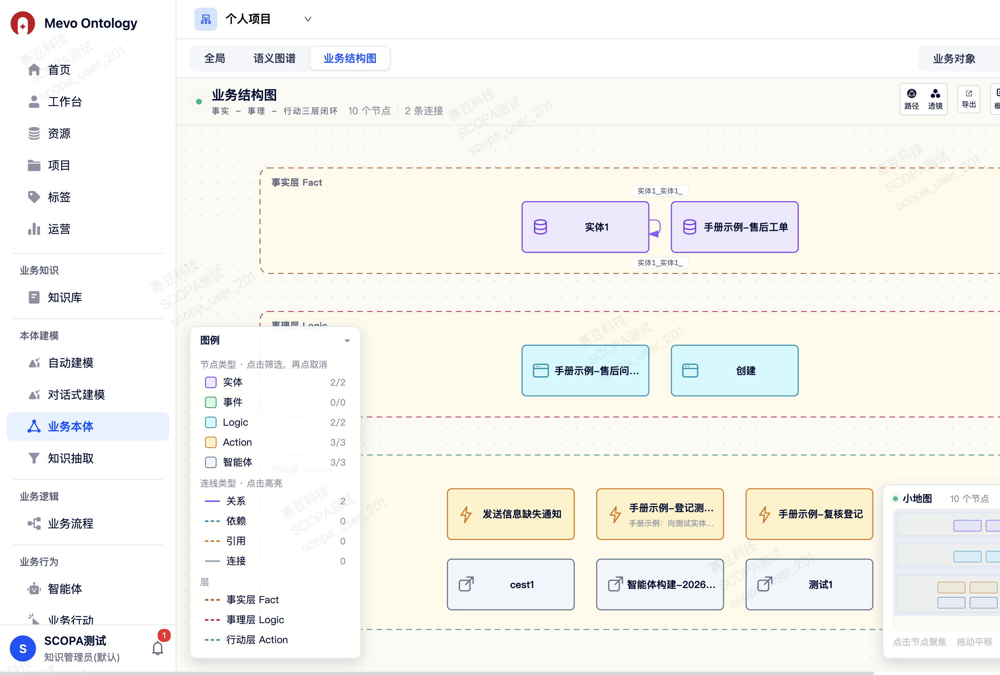

图 6-1 业务本体：事实 - 事理 - 行动三层业务结构图

「业务本体」页以图展示当前项目的业务结构，顶部页签分「全局」「语义图谱」「业务结构图」，并提供「路径」「透镜」「导出」「概要」「索引」等视图控制；左侧导航为「业务对象」「业务关系」「业务事件」。

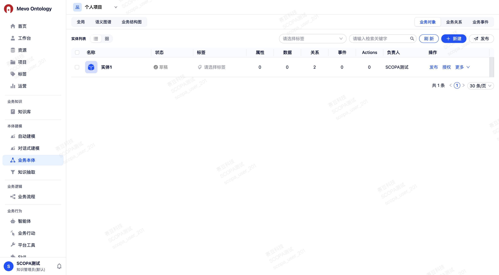

图 6-2 业务对象列表

业务对象、业务关系、业务事件以表格展示，可切换「列表视图 / 卡片视图」。表格列包括名称、状态（草稿 / 待发布 / 流程创建中 / 可用）、标签、属性、数据、关系、事件、Actions、负责人与操作；带「AI」角标的对象由 AIGO 自动构建生成。列表上方提供「刷新」「新建」「发布」，并可按标签筛选、按关键字检索。

## 6.1 复用业务域／企业级已有本体（按需）【规划】

**目标：** 查看在企业级部门或业务域部门已有本体的对象类型、关系类型、事件类型，判断可复用的模型与数据，避免重建重复对象。本步骤按需要选做。

**做法：** 在本体视图中浏览已有对象列表与关系结构；可复用时优先引用或扩展，避免重建。复用前对照本次业务场景检查模型适用性：对象命名、关系方向、事件语义与本次需求一致。

**当前状态（规划中）：** 跨项目、跨级别的本体复用视图为规划能力；当前版本可在本项目的「业务本体」中查看已有对象结构（左侧「业务对象」「业务关系」「业务事件」及「全局」「语义图谱」「业务结构图」页签）。1130 版本支持把项目中的实体发布到项目所属部门（见 6.6.3），发布后的资源在「资源」的部门本体页签中供部门管理员继续授权与共享，这是后续跨项目复用的前提。

## 6.2 AIGO 本体自动构建

### 6.2.1 配置构建材料

**目标：** 在 AIGO 本体智能构建工作台配置构建材料，作为自动生成的输入。

**前置条件：** 1.1.2 的项目材料齐备（材料缺失时构建质量明显下降，先补材料再构建）。

**入口：** `本体建模 > 自动建模`

**操作：**

1. 进入「AIGO 本体智能构建」工作台。顶部显示任务名称、最近保存时间与当前模型（如 `mevo-deepseek-v4`），右上角提供「版本历史」「发布本体」「重命名任务」「质量追溯」；切换任务用顶部任务名称下拉，不另设「新建构建任务」按钮。
2. 在左侧「构建配置」中逐项填写：
   - **构建前引导确认需求**：开关。开启后，发送首条消息时先逐步确认需求、待验证问题和构建方案，再生成本体。
   - **业务场景标签**：为本体元素打上标签，便于按标签管理。
   - **业务知识**：在「离线业务知识」上传文件（支持 PDF、DOCX、XLSX、PPTX、TXT、MD、CSV、JSON、DOC、XLS、PPT，单个不超过 100 MB），或切换到「选择知识库文档」；在「业务场景描述」中写清场景与要解决的问题，可点击「AI 优化」润色。
   - **业务数据**：点击「选择数据表」或「配置数据表」，从资产中心选择已申请到本项目的数据表。
   - **数据库设计文档**：上传 ER 图、表结构与字段含义说明，辅助 AI 进行数据映射；可在「离线上传」与「选择知识库文档」间切换。
   - **我的构建想法**：写明希望得到的实体、关系、事件，以及重点要回答的问题。
3. 点击「保存」；需要清空重填时点击「重置」。

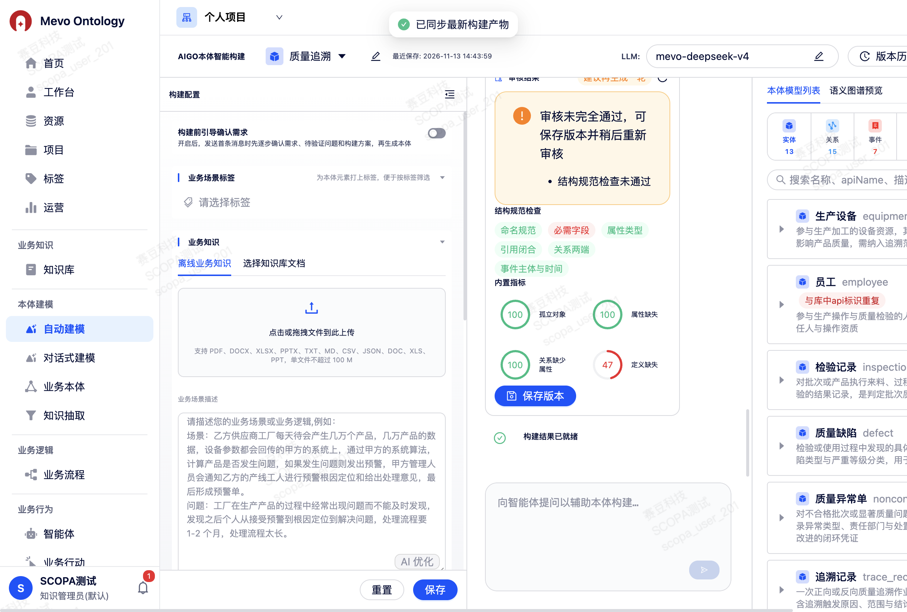

图 6-3 AIGO 本体智能构建工作台

**完成检查与下一步：** 材料配置完整后在中间对话区发起构建（6.2.2）。

### 6.2.2 生成本体草稿

**目标：** 生成实体、关系、事件草稿，形成可人工校正的建模初稿。

**操作：**

1. 在中间对话区输入构建要求并发送，智能体按阶段执行：模型构建（SCHEMA_BUILD）→ 校验（VALIDATE）→ 字段映射（FIELD_MAPPING）→ 结果导出。每次调用内置工具（如 `build_state_update`、`schema_validate`）都会显示耗时与结果。
2. 材料不足时智能体会在对话中追问，按实际业务回答；口径不确定时暂停并与业务方确认，不要按猜测继续生成。
3. 构建完成后，对话区给出「本体模型构建完成」汇总表（实体、属性、关系/事件、字段映射命中数、校验结果）与「最终映射一览」（属性与源字段的对应）。

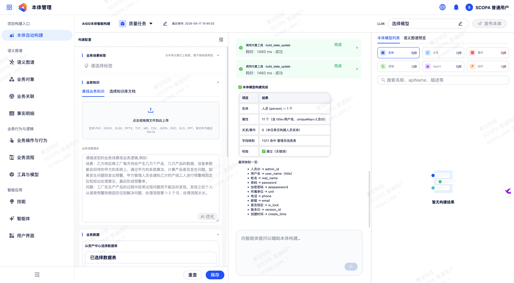

图 6-4 构建过程与结果汇总（沿用 2026-11-06 旧版界面示意）

### 6.2.3 编辑并采纳结果

**目标：** 核对并校正草稿后，把确认的对象发布为本体，进入 6.3 的精细定义。

**操作：**

1. 在右侧「本体模型列表」按实体、关系、事件、逻辑、Agent、动作分类查看生成结果；切换到「语义图谱预览」查看对象之间的连接。
2. 对照已有对象清单逐项检查草稿是否重复创建了已有对象；逐项检查命名、属性与关系两端，API 标识、主键、展示字段是否符合 6.3 的要求。
3. 与本体中已有对象 API 标识相同的草稿会标注「与库中api标识重复」，发布前先确认是复用已有对象还是改名。需要修正时在对话区继续提出修改要求，或采纳后在业务对象中手动调整（6.3）。
4. 确认后点击右上角「发布本体」，结果以草稿状态（带「AI」角标）出现在「业务本体」的业务对象、业务关系、业务事件列表中。
5. 顶部任务名称下拉可切换历史构建任务；「版本历史」查看各次构建的保存版本。

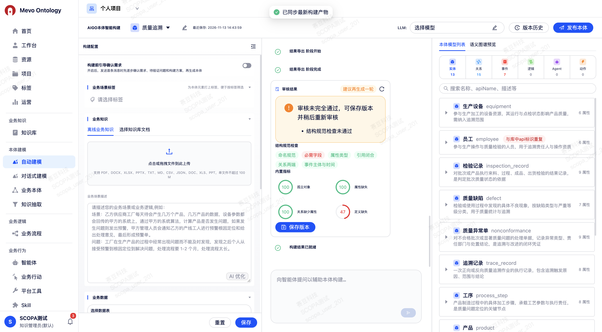

图 6-5 本体模型列表

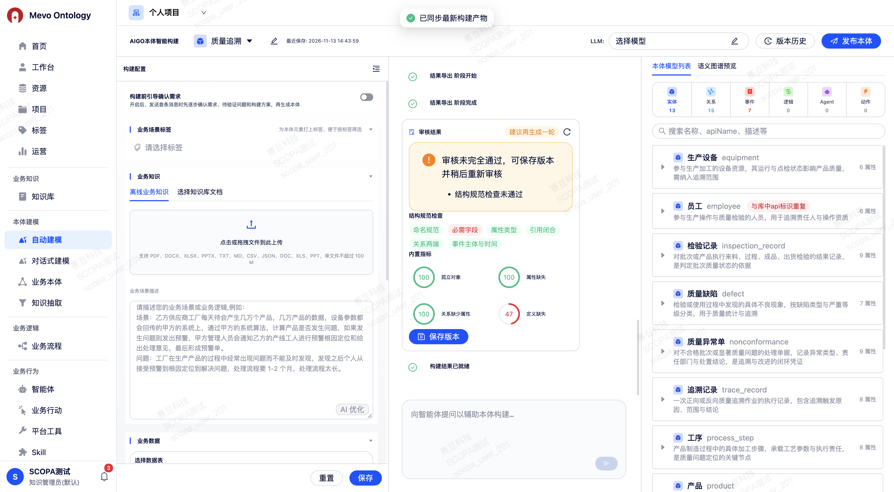

图 6-6 构建任务切换

**注意：** 生成结果只是草稿。业务口径错误即使结构正确也必须修正；未经人工校正的对象不要进入映射与发布。

## 6.3 手动构建本体或本体调整

手动构建实体、关系、事件；已有对象的调整也在本节操作。建模前确认：对象命名与属性清单已梳理，关系两端对象与事件所属对象明确。

### 6.3.1 创建与编辑实体

**目标：** 创建实体对象，定义唯一身份（主键）与展示、业务属性。

**入口：** `业务本体 > 业务对象 > 新建`

新建实体分 5 步：基本信息 → 数据映射 → 属性定义 → 属性映射 → 关联对象。各步底部提供「上一步」「保存并下一步」「保存」「保存并返回」「取消」（第 1 步无「上一步」，第 5 步无「保存并下一步」；第 4、5 步另有「保存并发布」），可随时保存为草稿。本节说明第 1、3、5 步，第 2、4 步的映射见 6.6.1。

**操作：**

1. **基本信息**：
   - **图标和名称**：选择图标，填写实体中文名称（示例：手册示例-售后工单）。
   - **API 标识**：以小写字母开头（示例：`shouce_demo_ticket`），创建后不可修改，命名前确认。
   - **是否自动创建 Action**：勾选后自动生成该实体的「新增 / 编辑 / 删除」Action（Action 见 6.9）。
   - **标签**、**描述**：说明业务含义与适用范围。

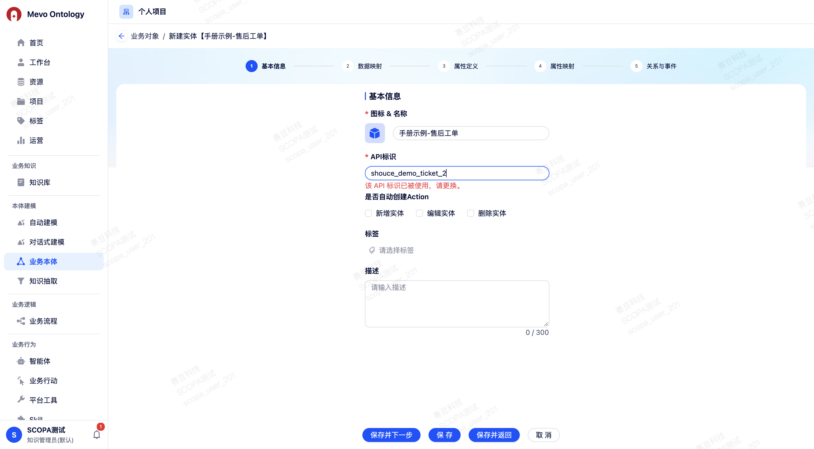

图 6-7 新建实体：基本信息

2. **属性定义**（第 3 步）：
   - 点击「复制原始表作为属性」，在抽屉中选择已映射的数据表，可在「字段信息 / 数据预览 / 数据探查」中查看字段，勾选需要的字段后确认，平台按字段生成属性。
   - 也可在表格中逐行「插入」属性。每行设置属性类型、名称、API 名称、是否多值、索引（精确 / 全文 / 语义）、PK、Title 与描述。
   - 至少设置 1 个主键（PK，唯一标识一条实例）和 1 个展示字段（Title），表格上方会汇总当前 PK 与 Title。
   - 属性类型包括字符串、富文本、整数、小数、日期、日期时间、时分秒、布尔、实体引用、邮箱、图片。
   - 点击行内「设置」可配置默认值、是否可见、文本最大长度（不超过 65535）、主要展示属性、多行输入和条件样式（Color Rule）。
   - 支持「批量设置主要展示属性」「批量添加索引」。

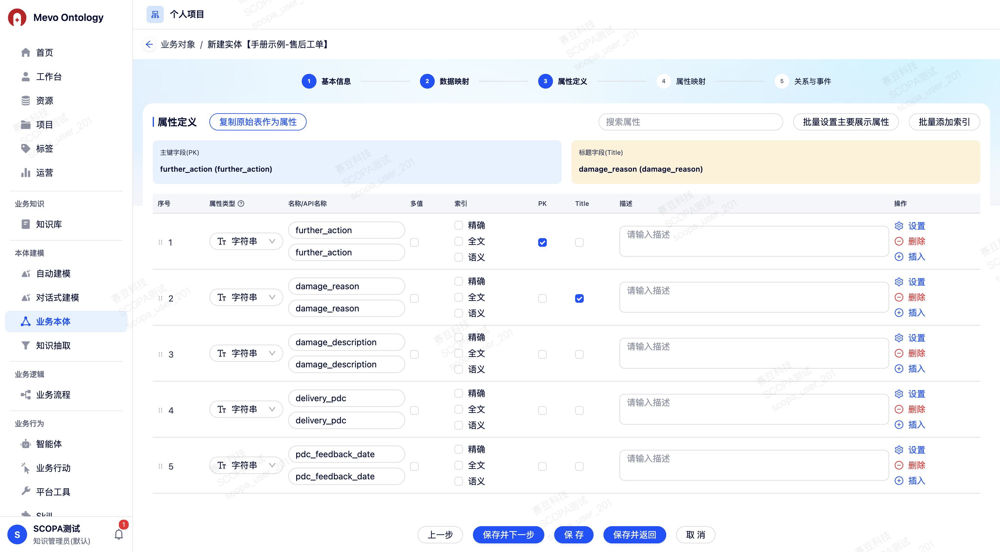

图 6-8 新建实体：属性定义

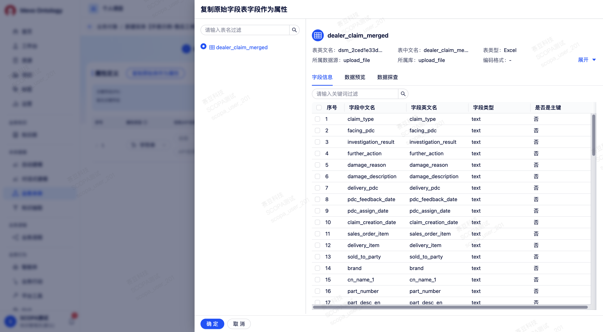

图 6-9 复制原始表字段作为属性

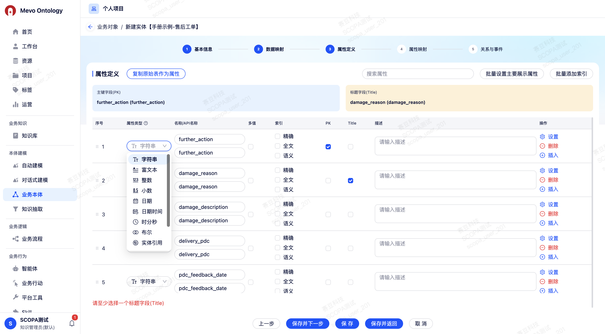

图 6-10 属性类型

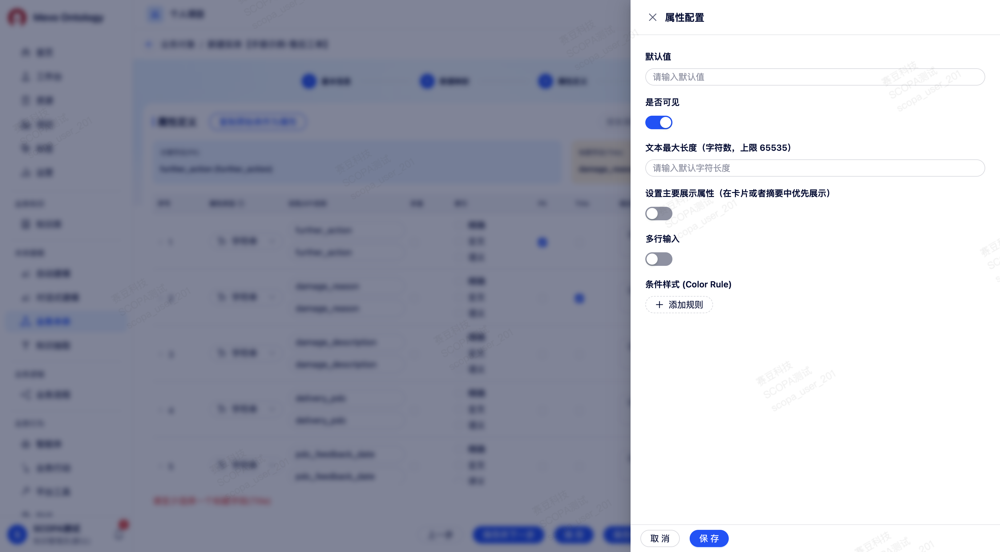

图 6-11 属性设置

3. **关联对象**（第 5 步）：查看与该实体关联的业务关系、业务事件；新建实体时为空，建好关系与事件后在此汇总。

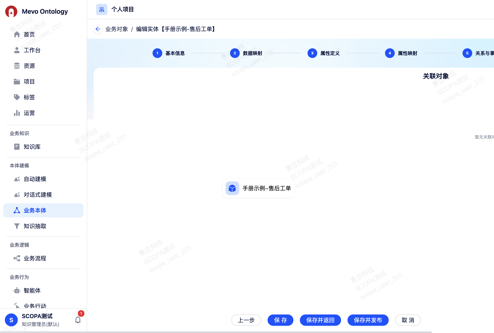

图 6-12 新建实体：关联对象

4. 保存后回到业务对象列表核对该行的属性数与状态。

**编辑与版本：**

- 业务对象以表格展示，每行「操作」列提供「发布」「授权」「更多」；「更多」中包括发布到空间、构建语义索引、复制、历史版本、清空数据、删除。
- 「设置」进入与新建相同的 5 步向导，API 标识置灰不可改。
- 已发布实体修改结构（如新增属性）后状态变为「待发布」，需重新发布（6.6.2）才会生效。
- 「历史版本」按版本号（如「v2 · 2026-11-06 15:37:04 当前发布版本」）只读查看每次发布时的属性结构。

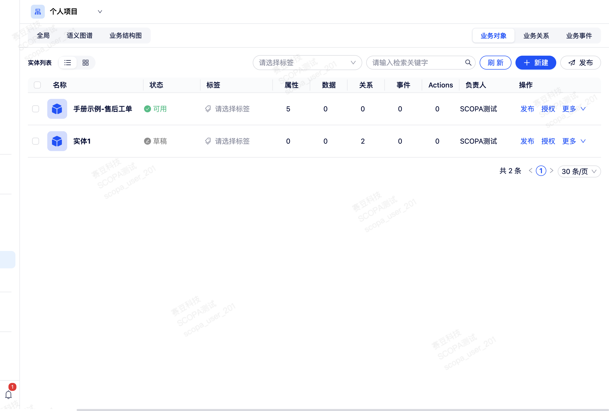

图 6-13 业务对象行操作

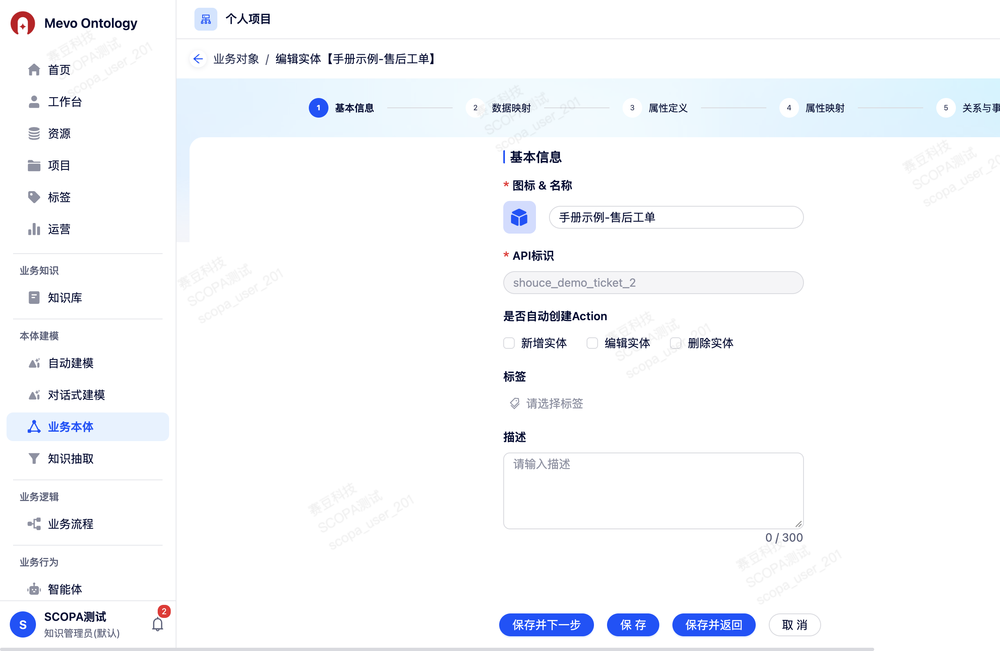

图 6-14 编辑实体

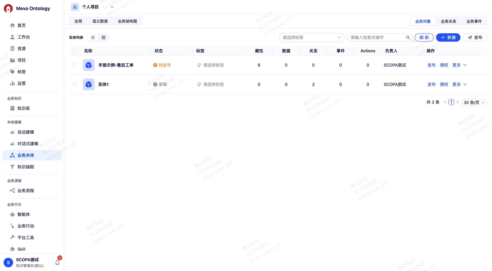

图 6-15 实体待发布状态

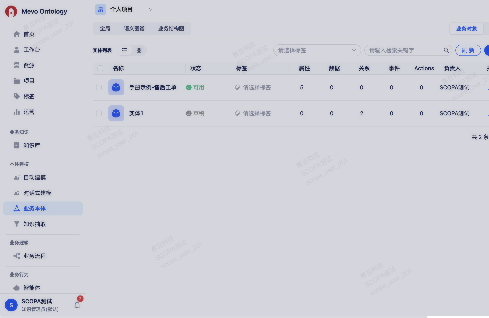

图 6-16 实体历史版本

**完成检查与下一步：** 主键与展示字段设置正确后进入 6.3.2 或 6.6.1；数据映射可先保存草稿，发布前完成。

**异常或限制：** API 标识不可改，命名需一次到位；主键选择不当会导致实例入库去重错误（6.7）。

### 6.3.2 创建与编辑关系

**目标：** 创建关系对象并配置两端实体，描述业务对象之间的关联。

**前置条件：** 关系两端的实体已创建并设置主键。

**入口：** `业务本体 > 业务关系 > 新建`

新建关系分 4 步：基本信息 → 数据映射 → 属性定义 → 属性映射。

**操作：**

1. **基本信息**：
   - 选择**源实体**与**目标实体**（示例：手册示例-售后工单 → 车辆系统）。
   - 选择**关系方向**：单向或双向。
   - 填写**正向关系名称**与 API 名称（示例：涉及系统 / `shouce_ticket_involves_system`）；双向关系还需填写**反向关系名称**与 API 名称（示例：被工单涉及 / `shouce_system_in_ticket`）。
   - 按需勾选自动创建「新增 / 编辑 / 删除关系」Action。
2. **属性定义**：平台自动生成两个「实体引用」属性分别指向源实体和目标实体，并共同作为关系主键；可再补充关系自身的属性。
3. 数据映射与属性映射见 6.6.1。保存后核对关系两端与业务语义一致。

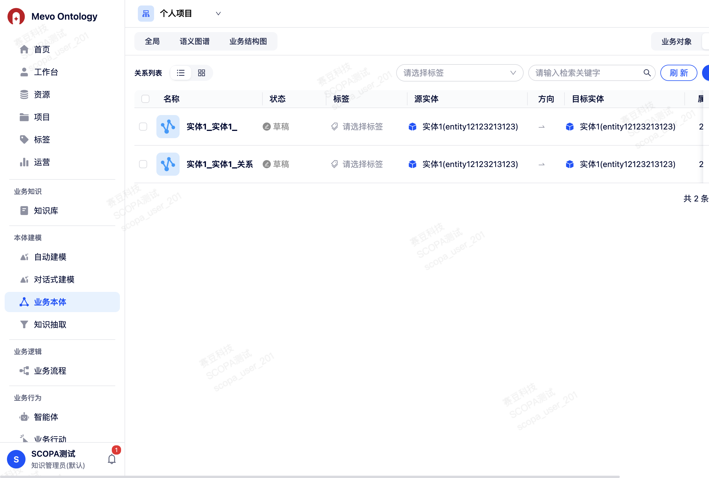

图 6-17 业务关系列表

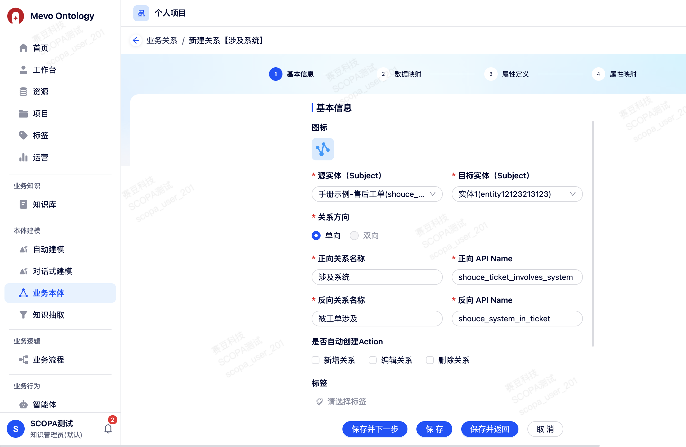

图 6-18 新建关系：基本信息

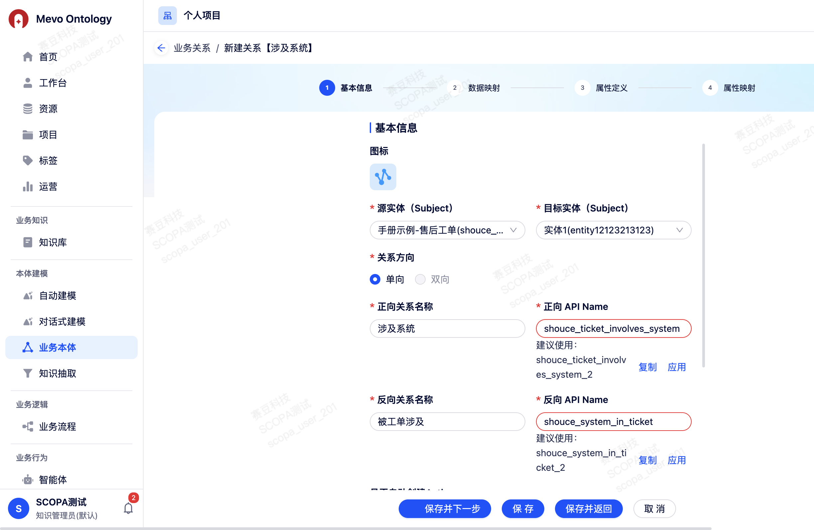

图 6-19 新建关系：属性定义

**完成检查与下一步：** 关系方向与命名经业务确认后进入数据映射（6.6.1）。

**异常或限制：** 方向颠倒会导致查询语义错误；两端实体未发布时，关系的映射与发布无法完成。

### 6.3.3 创建与编辑事件

**目标：** 创建事件对象记录业务事实明细，并关联所属业务对象。

**入口：** `业务本体 > 业务事件 > 新建`

新建事件分 4 步：基本信息 → 数据映射 → 属性定义 → 属性映射。

**操作：**

1. **基本信息**：选择**所属实体**（示例：手册示例-售后工单），填写名称（示例：手册示例-工单派发）与 API 标识（示例：`shouce_demo_dispatch`）；按需勾选自动创建「新增 / 删除事件」Action。事件即业务事件，例如一次理赔、一次工单派发。
2. **属性定义**：平台自动生成指向所属实体的「实体引用」属性并设为主键；再补充事件的时间、状态等事实属性。事件属性表比实体多一列「Time」，用于指定事件发生时间（示例：派发时间，类型为日期时间，同时设为 Title 与 Time）。
3. 数据映射与属性映射见 6.6.1。

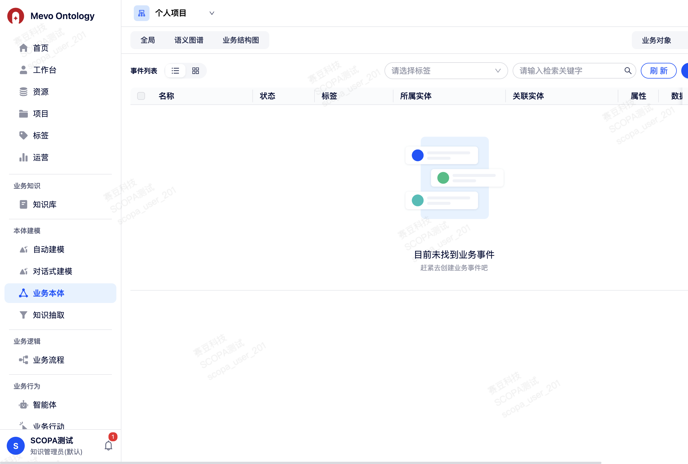

图 6-20 业务事件列表

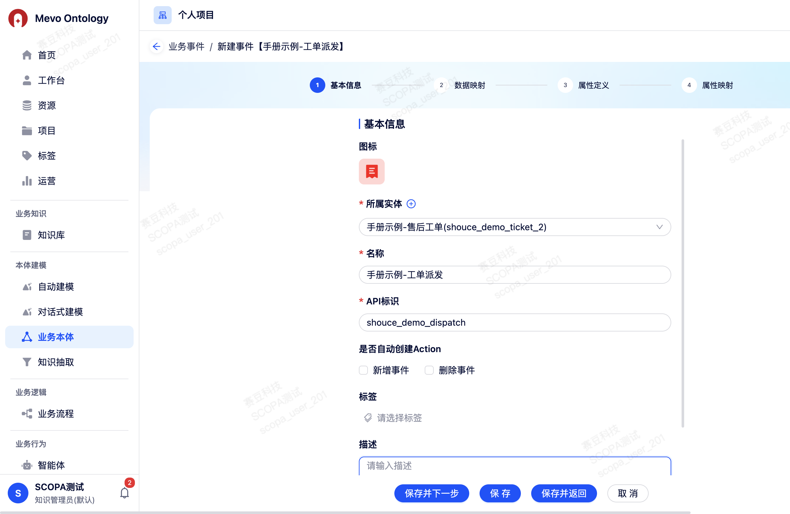

图 6-21 新建事件：基本信息

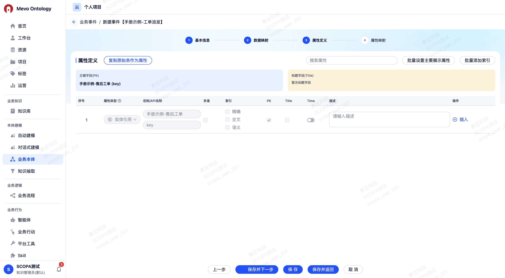

图 6-22 新建事件：属性定义

**发布前语义与口径检查：** 逐对象核对命名、关系方向与事件语义（业务方参与）；核对属性口径与源数据字段一致；线下登记的规则与模型描述一致。检查通过后进入 6.6／6.5 数据准备。

**说明：** 本体属性规则与业务规则的维护见 6.12；实体类型继承／Interface 为待设计能力，当前版本用清晰的命名与描述区分同类实体。

## 6.6 发布本体与数据映射

### 6.6.1 配置数据映射

**目标：** 把实体、关系、事件的属性映射到准备好的结构化数据字段。

**数据来源：** 结构化数据来自 3.2 接入并申请到本项目的数据表；非结构化文档的结构化结果见 6.5（按需）。

**入口：** 新建或编辑实体 / 关系 / 事件时的第 2 步「数据映射」与第 4 步「属性映射」。

**操作：**

1. **数据映射**：在左侧「数据目录」（资产中心 / 个人数据）中勾选源数据表，选中的表进入右侧「已映射数据表」。一个对象可以映射多张表，拖动可调整顺序；多张表在「知识抽取 > 流程管理」的流程中合并为一份数据（见 6.7.1）。
2. **属性映射**：点击「自动映射」，平台按名称为每个属性匹配各源表字段并给出匹配度；匹配度较低的会提示「匹配度较低，请核查」。逐项人工检查每个属性的字段对应。主键需要在所有已映射表中都有对应字段。
3. 关系映射确认两端引用字段；事件映射确认所属实体引用与时间字段（6.3.2、6.3.3 的要求）。
4. 点击「保存」，或直接「保存并发布」（6.6.2）。

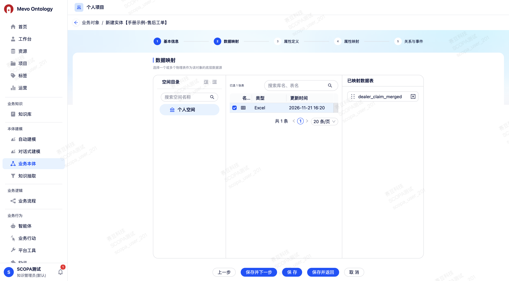

图 6-23 新建实体：数据映射

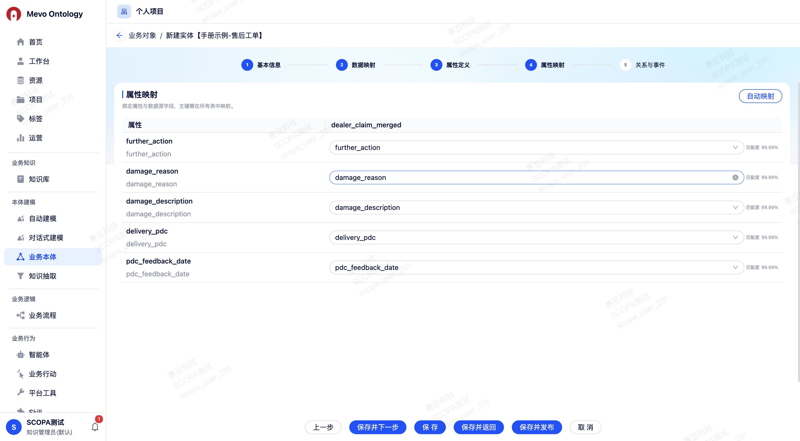

图 6-24 新建实体：属性映射

**完成检查与下一步：** 逐项检查无缺失后进入发布（6.6.2）。

**异常或限制：** 自动映射结果必须逐项检查，字段同名不等于口径一致。

#### 映射编排与结果查询【1130 版本】

1130 版本把实体构建收敛为 3 步：基础信息 → 属性定义 → 映射与发布。「映射与发布」一步以 DAG 展示「源数据表 → 字段映射与转换 → 实体」的链路：

1. 在「映射编排」页签点击「添加源表」或「添加数据表」加入来源表，点击源表卡片查看或调整字段级映射；可「重新自动匹配」。
2. 点击中间的「字段映射与转换」节点，配置**多表组合方式**：JOIN（各表按主键关联）或 UNION（结构相近的数据纵向合并）；再配置**属性融合规则**：属性值冲突时按数据表优先级取值、非空值是否覆盖空值，并用箭头调整数据表优先级。
3. 在右侧「数据承载与发布」选择**物理映射**（构建存储、索引、流程并同步数据）或**虚拟映射**（不构建物理存储，仅构建索引）。
4. 在「映射结果查询」页签输入实例主键（如客户编号），查看每个属性的当前值、来源表字段、映射方式（直接映射、字典转换、SUM/MAX 聚合等）与数据时间，用于核对映射与融合是否正确。

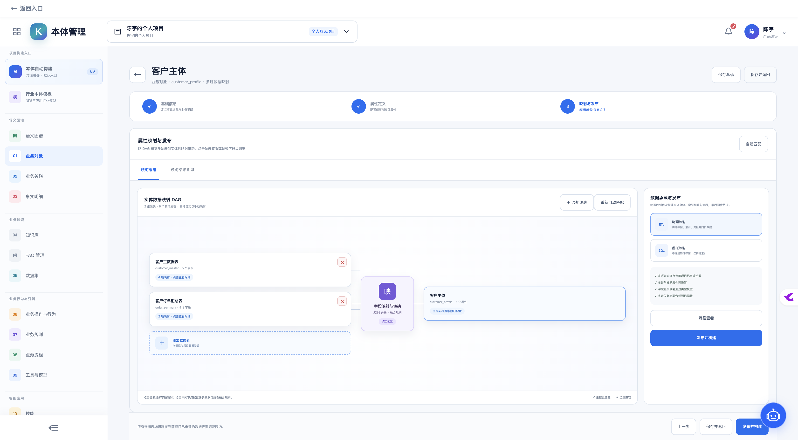

图 6-25 映射与发布：映射编排（原型示意，以上线版本为准）

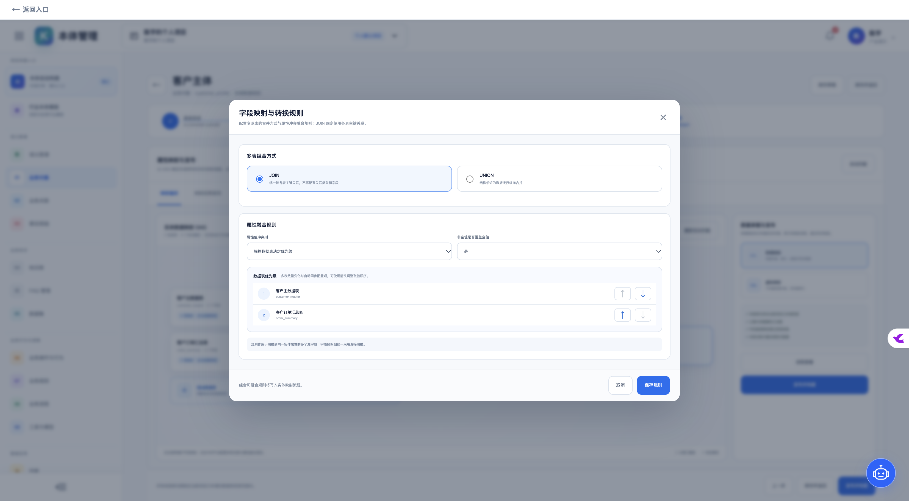

图 6-26 多表组合与属性融合规则（原型示意，以上线版本为准）

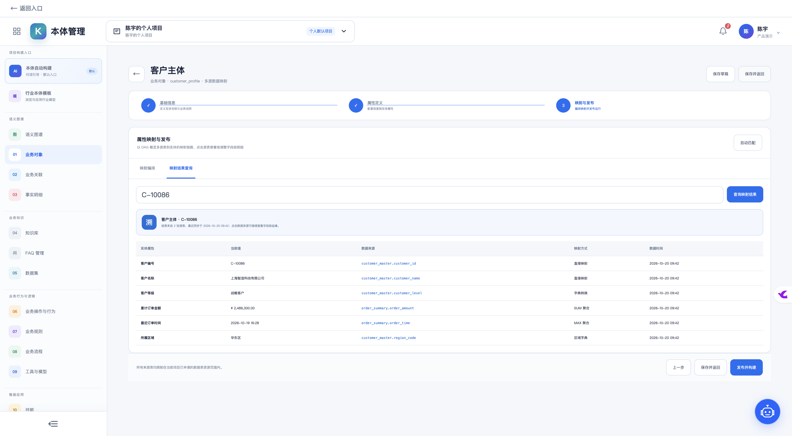

图 6-27 映射结果查询（原型示意，以上线版本为准）

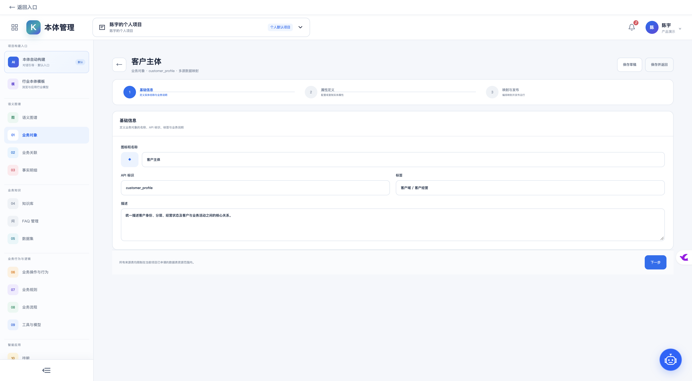

图 6-28 实体构建三步向导（原型示意，以上线版本为准）

### 6.6.2 发布本体

**目标：** 发布本体模型，平台自动生成对应的处理流程；确认流程生成成功。

**入口：** `业务本体 > 业务对象 > 行操作「发布」`，或属性映射步骤中的「保存并发布」。

**操作：**

1. 发布前逐对象核对主键唯一、展示字段有意义、映射无缺失。
2. 单个发布：在业务对象列表中点击该行的「发布」。提示「业务对象【…】发布成功」后，状态依次为「流程创建中」→「可用」。
3. 批量发布：列表上方的「发布」会把当前列表中所有草稿 / 待发布对象一次性发布，**点击后不再弹出确认**。在多人共用的项目中，请先与对象负责人确认发布范围，只想发布自己的对象时使用行内「发布」。
4. 到「知识抽取 > 流程管理」确认自动创建的流程已生成：流程名称为对象 API 标识，所属分组为项目，数据坞为 `aigo_<租户>_<API 标识>_entity`（见 6.7）。

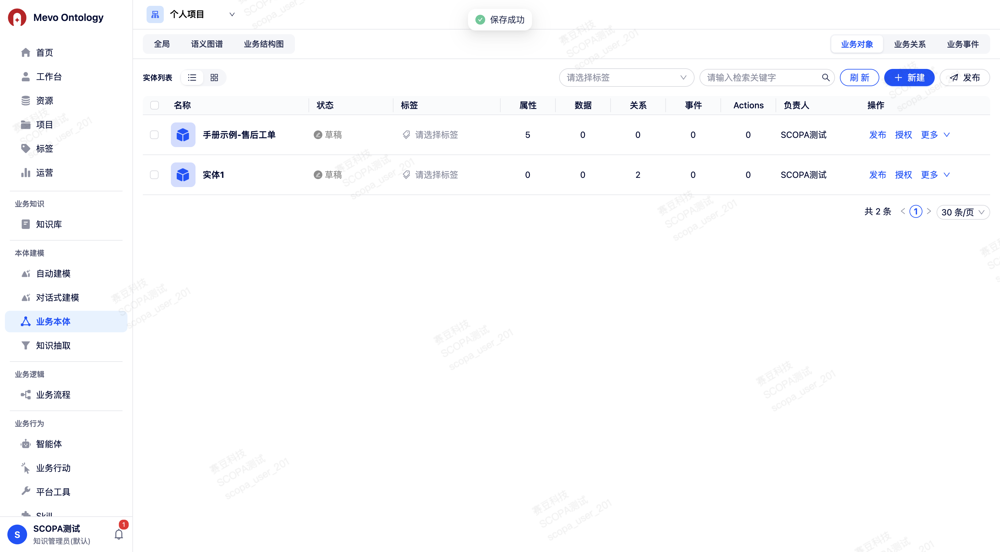

图 6-29 业务对象列表与批量发布入口

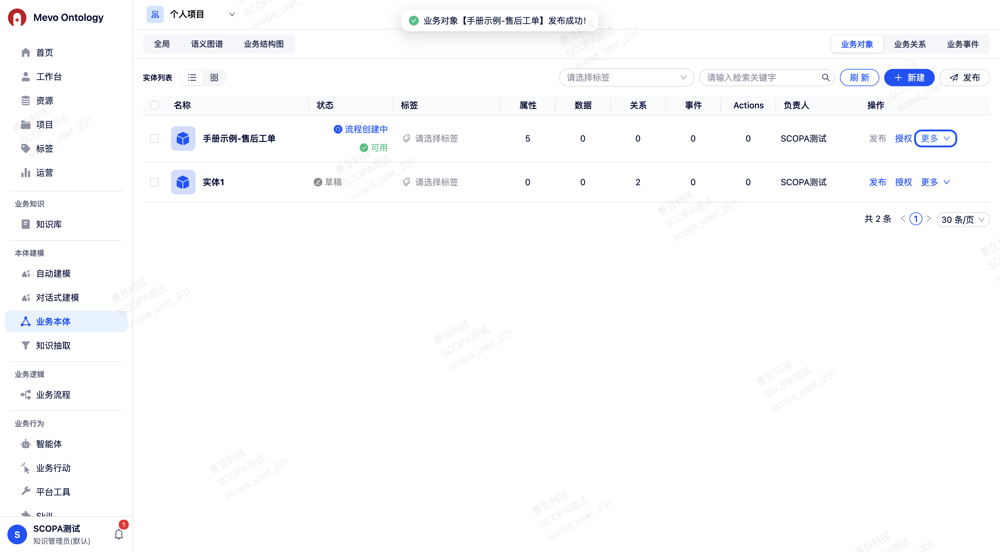

图 6-30 实体发布成功

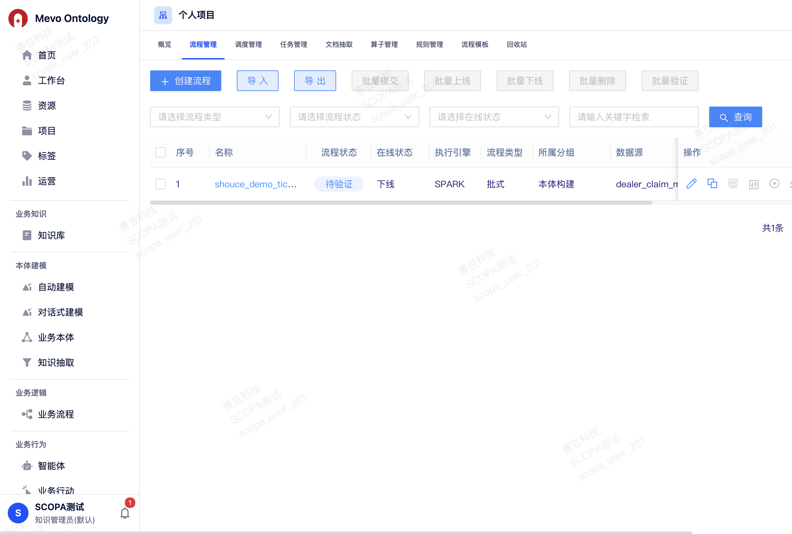

图 6-31 流程管理中的自动生成流程

**说明：**

- 只修改描述等不影响结构的内容时再次发布，会提示「没有资源发布成功。跳过: 1，阻塞: 0，校验跳过: 0，失败: 0」，表示无需重新生成流程。
- 修改属性结构后对象变为「待发布」，重新发布会生成新的历史版本（6.3.1），对应流程回到「待验证 / 下线」状态，需要重新验证、上线并运行（6.7.2）。

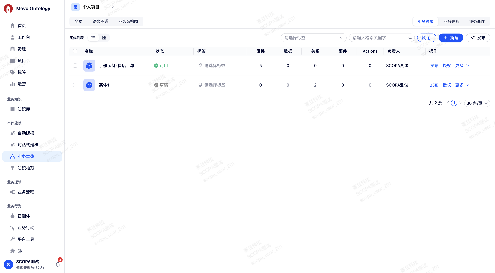

图 6-32 无变更发布提示

**注意：** 本节「发布」仅指承接处理流程，不等于数据已入库，也不同于发布到部门共享（6.6.3）或成果回流（11.6）。

#### 发布前变更影响分析与自动构建【1130 版本】

1130 版本发布已发布过的实体时，先弹出「发布前变更影响分析」：

1. 顶部汇总受影响能力数、相关用户数、需要重点确认数、属性变更数。
2. 左侧「本次发布变更」列出新增、修改的属性和索引变化；右侧「下游能力与用户」列出受影响的关系、事件、Action、流程、智能体及其负责人，并标注「兼容」或「需确认」。
3. 建议先通知受影响能力的负责人，再点击「确认并发布」。
4. 发布后平台按「构建实体存储 → 构建索引 → 构建映射流程 → 同步数据」自动执行，弹窗显示进度。构建期间已发布版本继续可用，完成后自动切换到新版本；关闭弹窗不影响执行，可点击「流程查看」进入「知识抽取 > 流程管理」。行操作「更多」中提供「同步数据」，用于按现有映射重新同步。

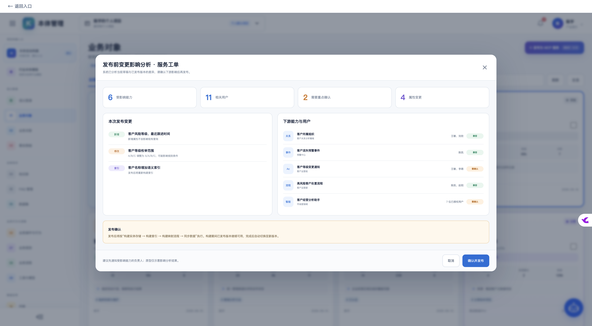

图 6-33 发布前变更影响分析（原型示意，以上线版本为准）

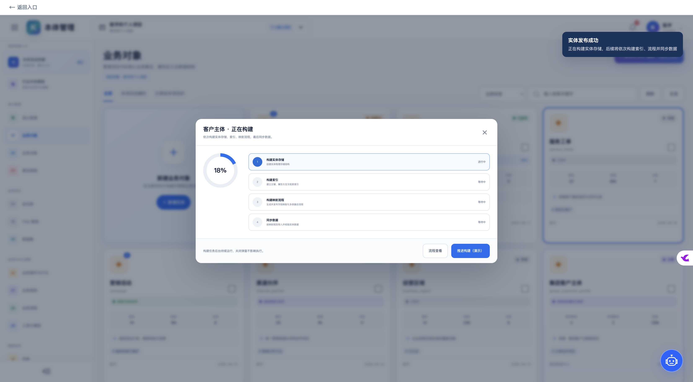

图 6-34 发布并构建进度（原型示意，以上线版本为准）

### 6.6.3 发布到项目所属部门【1130 版本】

**目标：** 把项目内验证过的实体发布到项目所属部门，供部门内其他项目和用户复用。

**入口：** `业务本体 > 业务对象 > 行操作「更多 > 发布到空间」`（测试环境入口文案为「发布到空间」，含义为项目所属部门）

**操作：**

1. 在业务对象列表中打开目标实体的「更多」，点击「发布到空间」。
2. 弹窗中目标部门由项目归属自动确定，不能修改；核对「审批链路」（提交人 → 部门管理员审批 → 发布至本体资源目录）。
3. 填写申请说明，点击「提交发布申请」，等待部门管理员审批。
4. 审批通过后，资源出现在「资源」对应部门的本体页签中，由该部门管理员继续授权与共享（见第二章、第四章）。

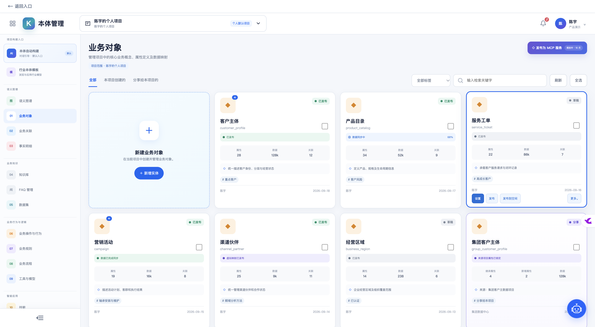

图 6-35 实体行操作：发布到空间（原型示意，以上线版本为准）

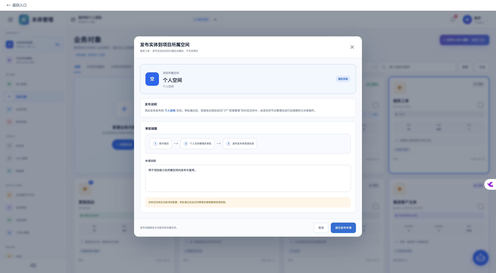

图 6-36 发布实体到项目所属部门（原型示意，以上线版本为准）

## 6.7 知识抽取：运行数据处理与入图流程

**入口：** 左侧菜单「知识抽取」，或从本体发布后的「流程查看」进入。页面顶部页签包括概览、流程管理、调度管理、任务管理、文档抽取、算子管理、规则管理、流程模板、回收站。

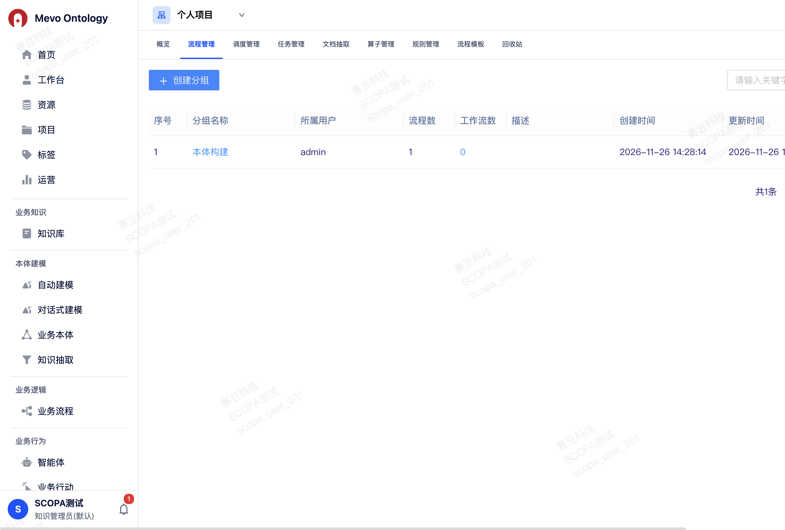

图 6-37 知识抽取：流程管理

### 6.7.1 配置处理流程

**目标：** 运行前核对流程的输入数据源、转换逻辑与本体写入配置，按需配置去重与融合。

**入口：** `知识抽取 > 流程管理 > 选择分组 > 点击流程名称`

**操作：**

1. 在「流程管理」左侧选择分组（自动生成的流程归入项目对应的分组，如「本体构建」），右侧列出该分组下的流程：名称、状态（待验证 / 已上线 / 下线）、计算引擎（如 SPARK）、同步方式（批式 / 实时）、数据坞、数据源与更新时间。
2. 打开流程后对照 6.6.1 的映射检查输入：每张映射表对应一个数据源节点，后接「抽取清洗」节点；多张表经「数据联合」合并后写入数据坞（输出到本项目的本体对象）。
3. 左侧算子面板提供数据探查采样、数据去重、文本向量化、抽取清洗、数据过滤、关联 Join、图谱事件去重、图谱关系融合、图谱实体融合、数据联合、SQL 算子等。对多来源数据按需加入去重与融合算子，避免同一对象重复入库；默认按主键去重。
4. 修改后点击「保存」。

图 6-38 流程管理中的流程列表

### 6.7.2 运行流程

**目标：** 运行流程完成数据处理与本体写入，并确认执行结果。

**操作：**

1. 在流程画布顶部按顺序执行：「验证」（提示「验证通过」，状态变为 VerifyPassed）→「试运行」（选做，首次运行前建议执行）→「上线」→「运行」。
2. 也可在流程管理列表的操作列中执行试运行、运行、重跑、补数、上下线等操作；列表上方另有「创建流程」「导入」「导出」「批量提交」「批量上线」「批量下线」「批量删除」「批量验证」，均为批量操作，共用项目中谨慎使用。
3. 在 `知识抽取 > 任务管理` 按「运行类型」「任务状态」筛选，查看任务实例状态（运行中 → 执行成功）与提交、启动、结束时间。
4. 运行完成后进入 6.8 检查实例数据；失败时按日志定位（6.7.3），修正后重跑。

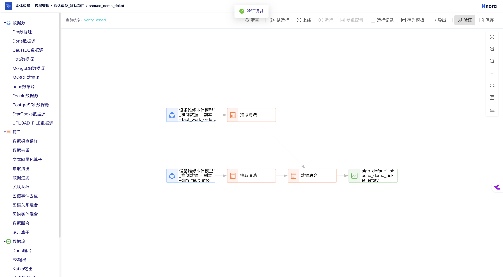

图 6-39 流程验证通过（沿用 2026-11-06 旧版界面示意）

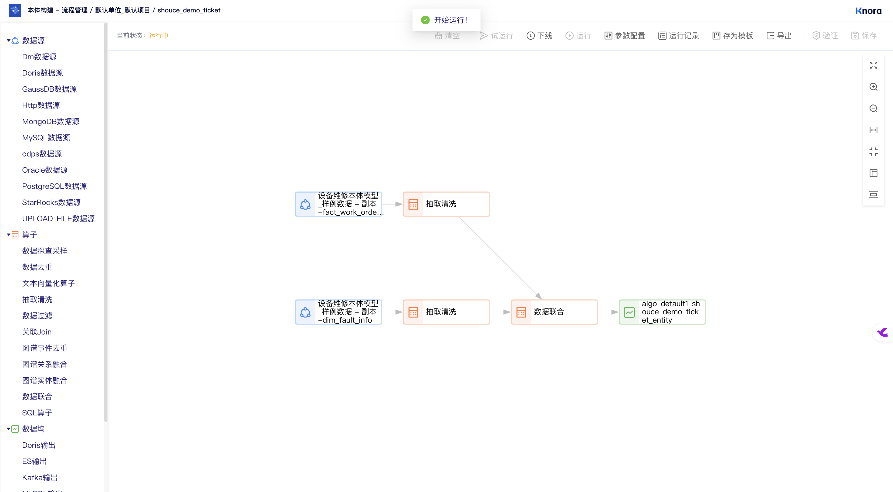

图 6-40 流程运行中（沿用 2026-11-06 旧版界面示意）

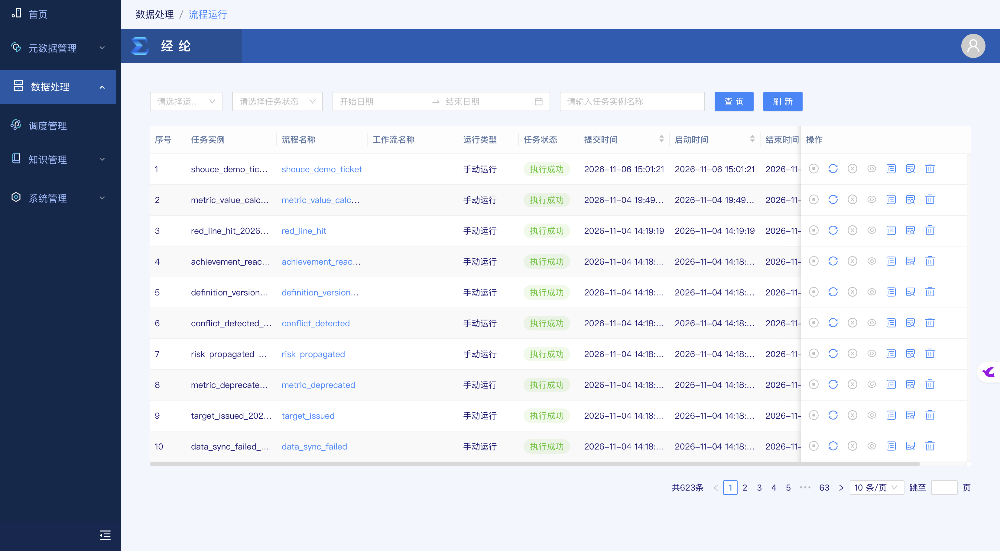

图 6-41 任务实例记录（沿用 2026-11-06 旧版界面示意）

**完成检查与下一步：** 任务成功且数据量符合预期后，进入 6.8 实例查看。

### 6.7.3 查看任务日志

**目标：** 通过任务日志定位流程执行问题（输入缺失、转换错误、写入失败），作为修正与重跑依据。

**入口：** `知识抽取 > 任务管理 > 操作列「查看日志」`

**做法：** 打开对应任务实例的日志窗口，日志未加载时点击窗口内的刷新图标。按执行顺序查看输入、输出与报错信息；输入问题回 3.2／6.6.1 核对映射，转换问题调整 6.7.1 配置。任务日志反映执行状态，不等于逐条数据的完整历史或可回滚记录。

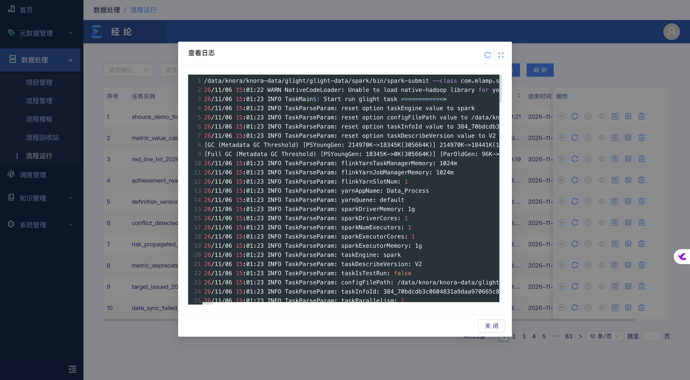

图 6-42 任务日志（当前任务管理无任务数据，沿用 2026-11-06 旧版流程运行日志窗口示意，入口为任务管理操作列「查看日志」）

## 6.5 知识抽取：非结构化转结构化（按需）

非结构化转结构化是本体数据来源的可选路径，与 3.2 的结构化接入并行使用。文档抽取与长文本字段抽取统一放在「知识抽取」的「文档抽取」页签，按项目管理。

### 6.5.1 配置文档抽取

**目标：** 确定抽取依据（实体/关系/事件）与待抽取的文档，新建抽取任务。

**前置条件：** 本体对象已定义（6.3，草稿即可）；文档已按 3.3 接入，或为个人 / 项目文档。

**入口：** `知识抽取 > 文档抽取 > 新建任务`

**操作：**

1. 进入「文档抽取」页签（副标题：通过 Agent 将文档内容抽取为符合本体结构的数据），点击「新建任务」。
2. 弹窗中填写任务名称，选择任务类型：
   - **文档抽取**：上传或选择文档，支持多个文档。
   - **长文本字段抽取**：从单张数据表的文本字段抽取（见 6.5.3）。
3. 点击「新建」，进入抽取配置页。在左侧「文档资源」选择个人或项目文档，或「选择本地文件」（支持 PDF、Word、PPT、TXT，单文件不超过 50 MB）。
4. 在「抽取目标」点击「添加抽取目标」，按实体、关系、事件或自定义结构选择本体对象及属性。
5. 选择 LLM，点击「保存配置」。

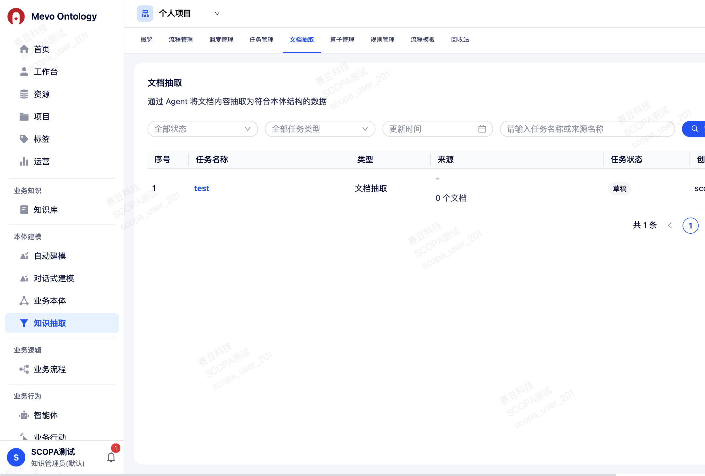

图 6-43 知识抽取：文档抽取

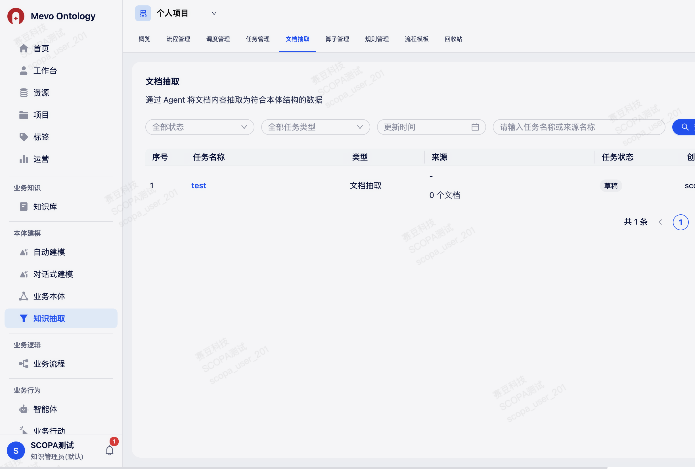

图 6-44 新建抽取任务

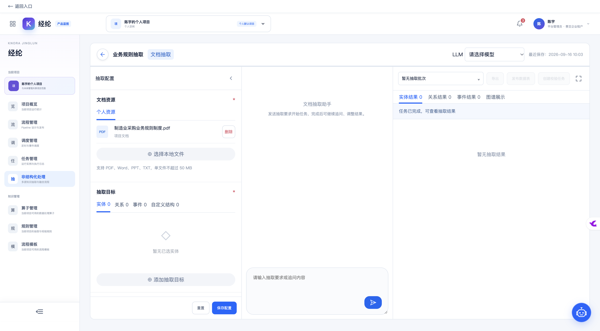

图 6-45 文档抽取配置（原型示意，以上线版本为准）

### 6.5.2 执行抽取并查看结果

**目标：** 按本体模型从文档中抽取实体、关系与事件，产出结构化结果并核对。

**操作：**

1. 在中间「文档抽取助手」输入抽取要求并发送，任务开始；完成后可继续追问、调整结果。
2. 在右侧按抽取批次查看「实体结果 / 关系结果 / 事件结果 / 图谱展示」，按对象抽样核对字段与原文；错误集中的文档调整范围后重抽。
3. 核对后可「导出」结果，或「发布数据表」把结果发布为数据表，再经 6.6.1 的映射流程入库；需要人工复核时点击「创建校验任务」。

**注意：** 抽取结果不自动写回本体，须经映射与发布入库。扫描件识别能力以上线版本为准。

### 6.5.3 配置长文本字段抽取

**目标：** 对已接入数据表中的长文本字段（例如工单描述、供应商反馈）抽取结构化信息，输出能对应到本体对象的属性。

**入口：** `知识抽取 > 文档抽取 > 新建任务 > 长文本字段抽取`

**操作：**

1. 在「数据来源」选择一张数据表，在「抽取字段」中选择文本字段（如 `description`）。
2. 按 6.5.1 添加抽取目标、选择 LLM 并保存配置，按 6.5.2 执行与核对。

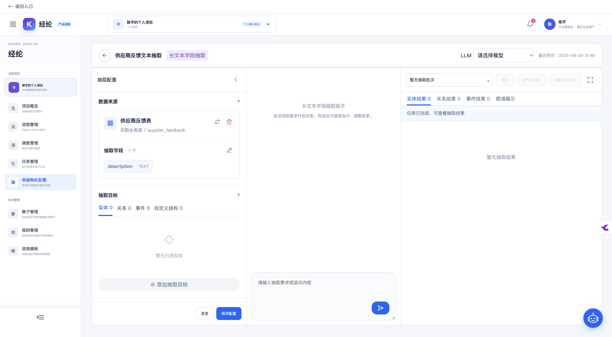

图 6-46 长文本字段抽取配置（原型示意，以上线版本为准）

## 6.8 实体看板：查看实例数据

**入口：** 左侧菜单「本体洞察 > 实体看板」。首页提供自然语言查询、Cypher 查询、「筛选」与搜索，以及「常用类型」「常用操作」；搜索结果按「实体类型 / 实体数据」分页签，左侧按实体类型统计命中数量。

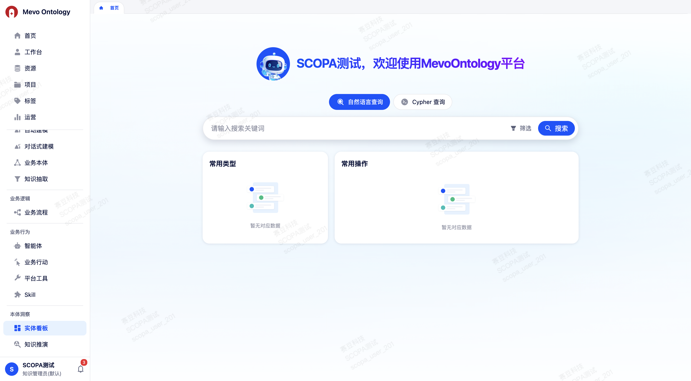

图 6-47 实体看板首页

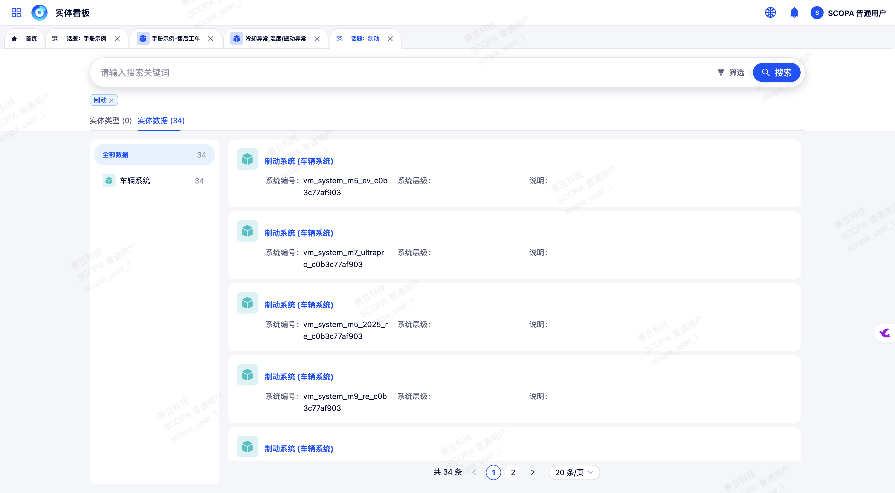

图 6-48 实体看板搜索结果（沿用 2026-11-06 旧版界面示意）

### 6.8.1 查看实体与属性

**目标：** 入库后核对实体实例数据的完整性与正确性。

**操作：**

1. 搜索或从常用类型进入某个实体，在「实体列表」页签查看实例总数（示例：手册示例-售后工单共 310 条）与实例名称（取 Title 属性），对照源数据量核对完整性。「统计分析」页签提供该实体的统计视图。
2. 点击实例名称进入详情，在「全部属性」中抽样核对属性值与源数据一致；主键设置不当导致的重复实例在此暴露。
3. 实例页右上角提供已挂载的 Action（示例：手册示例-登记测试记录，配置见 6.9）；详情页右上角「数据追溯」用于查看实例数据来源。
4. 发现问题按「模型、源数据或处理流程」归位修正：模型问题改 6.3 定义并重新发布（6.6.2）；源数据问题退回数据提供方修正后重跑；处理流程问题调整 6.7 配置。

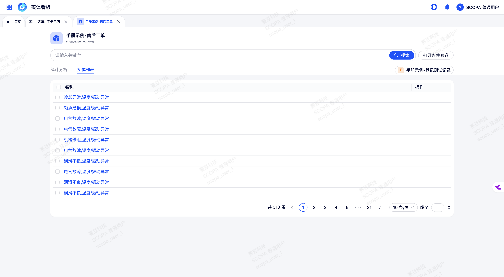

图 6-49 实体看板实例列表（沿用 2026-11-06 旧版界面示意）

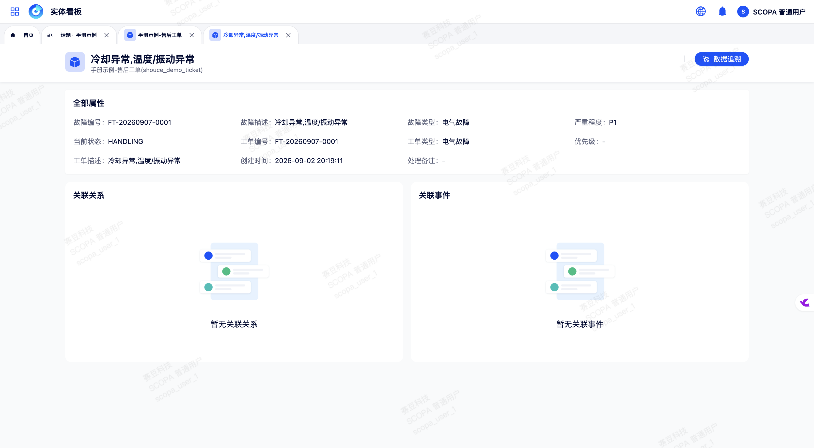

图 6-50 实例详情（沿用 2026-11-06 旧版界面示意）

### 6.8.2 查看关系与事件

**目标：** 核对关系两端实例正确关联、事件挂接对象正确。

**操作：**

1. 在实例详情的「关联关系」区抽样检查关系实例：两端对象与 6.3.2 配置的方向一致，关联字段取值正确。
2. 在「关联事件」区抽样检查事件实例：所属实体引用指向正确对象，时间与状态字段完整。
3. 显示「暂无关联关系 / 暂无关联事件」时，先确认关系、事件是否已完成映射、发布与流程运行。
4. 问题修正同 6.8.1 的闭环方式处理。

## 6.9 本体管理：业务操作与行为（Action）

Action 把“对业务对象做一件事”固化下来：新增、修改、删除实例，维护关系，调用流程或智能体，发送消息。定义好的 Action 可以在实体看板手动执行，也可以由触发器自动执行，或在 Logic 中通过 Action 执行节点调用（附录 B.2.6）。当前版本中，Action 的左侧菜单位于「业务行为」分组的「业务行动」（`/aigo/app/data-model/action`），页面标题为「操作与行为列表」。

### 6.9.1 创建 Action

**目标：** 定义 Action 的基本信息，明确这个动作做什么、给谁用。

**入口：** `业务行为 > 业务行动 > 新建`

**前置条件：** 动作语义（增删改数据、固定业务流程或发送通知）、所需参数和执行范围已与业务方确认；动作作用的业务对象已创建（6.3）。

**操作步骤：**

1. 在「操作与行为列表」点击「新建」。列表显示 Action 名称、状态、标签、关联对象、应用次数、负责人，操作列为「授权」「发布到空间」「更多」。

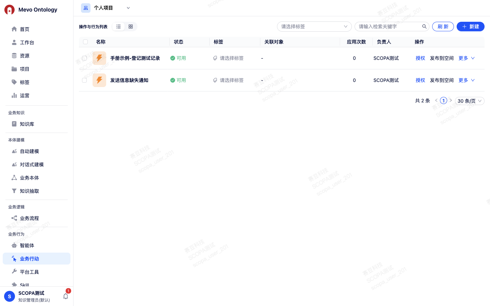

图 6-51 操作与行为列表

2. 第 1 步「基本信息」：选择图标并填写名称、API 标识（创建后不可修改）、标签和描述。描述写清允许与禁止的使用场景。
3. 按需开启「执行结果需用户确认」：开启后，执行结果需要操作人确认后才生效。
4. 点击「保存并下一步」进入自动化配置；只想先保存草稿时点击「保存」。

图 6-52 新建 Action：基本信息

**说明：** 创建向导分三步：基本信息 → 自动化 → 规则配置。输入参数在第 3 步随数据操作一起定义（6.9.3）。写操作类 Action 先在测试数据上验证。

### 6.9.2 配置触发器（按需）

**目标：** 让 Action 在数据变化或到达指定时间时自动执行。

**入口：** 新建 / 编辑 Action 第 2 步「自动化」

**操作步骤：**

1. 点击「添加触发器」，选择「数据更新触发」或「定时触发」。可以添加多个触发器。

图 6-53 添加触发器类型

2. **数据更新触发：** 选择监听对象（实体 / 关系 / 事件）和具体对象，选择数据更新类型（新增 / 更新 / 删除）。触发方式可选「任意数据变化」或「满足条件触发」；选择后者时，在「数据过滤」和「触发条件」中添加条件（如“问题类型 发生变化”），多个条件用 AND / OR 组合。

图 6-54 数据更新触发器配置

3. **定时触发：** 在「执行计划」中选择周期（如每天）并设置执行时间，页面会显示下次执行时间。

图 6-55 定时触发器配置

4. 设置「失败后重试」次数和「失败通知」接收人（必填）。
5. 打开触发器右上角的启用开关。开关未开启时触发器不生效，这是常见遗漏。

### 6.9.3 配置操作规则

**目标：** 定义 Action 实际执行的数据操作、调用和通知，以及每项操作需要的参数。

**入口：** 新建 / 编辑 Action 第 3 步「规则配置」

**操作步骤：**

1. 点击「添加规则」，选择规则类型。可选类型按对象分组：
   - 实体（Entity）：添加实体、编辑实体、删除实体
   - 关系（Relation）：添加关系、编辑关系、删除关系
   - 事件（Event）：添加事件、删除事件
   - 逻辑（Logic）：调用流程工具
   - 智能体（Agent）：调用智能体
   - 消息（Message）：发送通知

图 6-56 添加规则类型

2. 选择「操作对象类型」（如某个实体）。系统列出该操作所需参数，在「参数映射（Input Mapping）」中逐项设置参数名、取值来源（输入、固定值、引用、当前时间等）、是否必填和是否隐藏。
3. 需要限制可填写的值时，点击参数行的设置图标，开启「输入限制」，选择「手动设置」枚举值列表或引用「实体数据」。
4. 一个 Action 可以组合多条规则，按顺序执行。完成后点击「保存并返回」。

图 6-57 规则配置与参数映射

图 6-58 参数输入限制

**说明：**
- 调用 Logic 或智能体时，先确认目标 Logic 已发布为流程工具、目标智能体已配置完成，输入输出与参数映射一致（6.10.4）。
- 属性取值约束在写入数据时校验，详见 6.3 的属性定义。
- Action 的回滚机制（写操作异常时回滚到执行前状态）【待设计】。

### 6.9.4 挂载与执行 Action —— 在【实体看板】执行 Action

**目标：** 把 Action 挂到实体看板的页面上，让业务人员按单条或 Excel 批量方式执行，并核对数据变化。

**入口：**
- 挂载：原「用户界面 > 实体看板编辑」配置页；当前版本左侧菜单已拆为「业务知识 / 业务逻辑 / 业务行为 / 本体洞察」四组，未再提供该入口
- 执行：实体看板对应实体页面（`本体洞察 > 实体看板`）

**操作步骤：**

1. 在 Action 列表的操作列可进行「授权」「发布到空间」「更多」等操作；「更多」中提供「复制」「删除」。

图 6-59 Action 列表的操作列

2. 原「用户界面 > 实体看板编辑 > 动作配置」用于把 Action 挂到实体看板页面。当前版本菜单中已找不到「用户界面」入口（2026-11-26 复查），挂载配置暂时无法在界面中验证，以下步骤依据此前版本界面整理。首页配置的 Action 会出现在实体看板首页的「常用操作」中；当前测试环境实体看板首页的「常用类型」「常用操作」均显示「暂无对应数据」。

图 6-60 实体看板首页的常用操作（当前「常用类型」「常用操作」均为空）

图 6-61 用户界面：动作配置（旧版界面，当前版本已无此入口）

3. 在左侧选择业务对象，再选择挂载位置：「实体分析页面操作」「实体列表行操作」或「实体详情页操作」。点击「新建」，在「添加 Action」中勾选目标 Action 并确定。

图 6-62 选择要挂载的 Action（旧版界面，当前版本已无此入口）

4. 在挂载卡片上设置「启用」「带入默认参数」「允许批量操作」。需要 Excel 批量执行时，打开「允许批量操作」。

图 6-63 挂载 Action 并开启批量操作（旧版界面，当前版本已无此入口）

5. 在实体看板打开对应实体页面，挂载的 Action 显示为页面按钮。

图 6-64 实体看板中的 Action 按钮（旧版界面，当前版本已无此入口）

6. **单条执行：** 点击按钮，执行方式选「单条」，填写参数后点击「执行 Action」。
7. **Excel 批量执行：** 执行方式切换为「批量」，点击「下载模版」，按模板填写多行参数后上传 Excel 文件，再点击「执行 Action」。

图 6-65 单条执行：填写参数（旧版界面，当前版本已无此入口）

图 6-66 Excel 批量执行（旧版界面，当前版本已无此入口）

8. 执行后回到实体列表或详情页，核对实例数据变化；自动化触发的 Action 按触发条件在后台执行。

**说明：** 批量执行前先用少量行测试，确认模板列与参数一一对应。共用项目里只执行自己负责、作用于测试数据的 Action；会给真实人员发消息的 Action（如飞书通知类）不要在测试时执行。

### 6.9.5 配置执行条件【1130 版本】

**目标：** 限定 Action 的执行范围：被编辑、删除的数据满足指定条件时才允许执行，避免误改不该动的数据。

**说明：** 该功能计划在 1130 版本上线。当前测试环境和原型中均未找到对应界面，具体入口与配置项以上线版本为准。

### 6.9.6 发布 Action 到所属空间

**目标：** 把项目中验证过的 Action 发布到对象所属空间，供空间内其他项目和用户复用。测试环境已提供「发布到空间」入口，个人项目发布到个人空间无需审批。

**入口：** `业务行为 > 业务行动 > Action 卡片「发布到空间」`

**操作步骤：**

1. 在 Action 行点击「发布到空间」。发布目标由对象所属空间自动确定，不能修改。
2. 核对发布说明与审批链路。个人项目发布到个人空间无需审批，提交后直接生效；发布到部门等共享空间时，由空间管理员审批。
3. 按需填写申请说明（选填，最多 512 字），点击「确认发布」。

图 6-67 发布 Action 到所属空间

## 6.10 本体管理：流程活动（Logic）

本节介绍 Logic 的创建、编排、调试和发布；各节点的配置见附录 B。测试环境中，Logic 的菜单名为「业务流程」，画布中称为“工作流”。

### 6.10.1 创建 Logic

**目标：** 创建 Logic，确定交互方式和输入输出。

**入口：** `业务逻辑 > 业务流程`

**前置条件：** 流程目标、输入输出已确认；流程要用到的知识库、本体数据、Action 和工具已就绪。

**操作步骤：**

1. 进入「业务流程」列表，点击「创建工作流」卡片上的「创建」（对应卡片内的「创建」按钮）。也可以从「模板」创建或「导入」已有流程。列表可按「全部 / 我的 / 分享给我的」和标签筛选，并可勾选「已停用」查看停用的流程。当前环境中该列表顶部还会显示空态文案「目前未找到创建工作流」，与下方已有的流程卡片同时出现，属于界面显示问题，不影响卡片操作。

图 6-68 业务流程列表

2. 在「新建工作流」中选择图标、填写名称，选择类型：
   - **聊天式：** 以对话方式使用，适合问答类流程。
   - **任务式：** 以表单输入、一次执行的方式使用，适合检索、生成、审核类任务。
3. 按需添加标签，填写描述，点击「确定」。

图 6-69 新建工作流

4. 进入画布。新流程默认带「用户输入」和「输出」两个节点；每个 Logic 只有一个输入节点和一个输出节点。

图 6-70 工作流画布初始状态

5. 点击「用户输入」节点，添加输入变量，设置名称、类型（文本、数值、数组、对象、文件、下拉框、图片、实体引用）和是否必填（附录 B.2.1）。

### 6.10.2 编排节点（具体节点说明见附录 B）

**目标：** 按业务流程编排节点并连接，形成可执行的链路。

**入口：** 业务流程画布

**操作步骤：**

1. 鼠标移到画布左上角的「+」，打开节点面板，把节点拖入画布。按数据形态选节点：
   - 查文档用「知识库检索」，查本体对象和关系用「本体数据推理」，查结构化表格用「数据集」，汇总指标用「本体统计分析」。
   - 真正修改数据或调用业务动作才用「Action执行」。
   - 确定性处理用「代码执行」；分支判断用「条件选择」，为所有情况准备分支，避免无分支命中时流程中断。
   - 多轮状态用「寄存器」；逐条处理用「循环」，相互独立的数据批量处理用「批处理」。
2. 从上游节点右侧的连接点拖到下游节点左侧的连接点，建立连线。连线多时可用画布底部的「自动布局」整理。
3. 点击节点，在右侧配置区设置输入、处理方式和输出。下游节点通过变量选择器引用上游输出；提示词中输入“@”也可以插入变量。
4. 在「输出」节点添加输出变量，选择要返回的上游结果。
5. 点击右上角「保存」保存当前编辑；确认可用后再「另存草稿」生成新版本（6.10.4）。

下图为示例流程「手册示例-售后问题检索」：用户输入售后问题 → 知识库检索 → 大语言模型基于引用内容生成回答 → 输出答案。

图 6-71 流程编排示例（沿用 2026-11-06 旧版界面示意）

图 6-72 LLM 节点引用上游变量编写提示词（沿用 2026-11-06 旧版界面示意）

**说明：** 规则判断可通过「工具调用」节点调用内置工具「规则引擎工具集 > 执行审核规则」（6.12.5）。

### 6.10.3 调试流程

**目标：** 验证各节点配置、节点间数据传递和整体结果是否符合预期。

**入口：** 业务流程画布

**操作步骤：**

1. **检查输出变量：** 输出节点至少要配置一个输出参数。缺少输出参数时，画布会提示「请在智能体输出节点配置至少一个输出参数」，此时无法调试。
2. **打开调试：** 点击右上角「调试」，画布右侧展开调试对话区。上方工具栏依次为「功能」「校验」「调试」「评测管理」「另存草稿」「保存」「发布BOT版本」。

图 6-73 调试窗口

3. **填写输入：** 在调试对话区底部的输入框中，按「用户输入」节点定义的变量填写内容，按回车发送。

图 6-74 调试：填写输入

4. 系统按连线顺序执行整个流程，并在对话区显示最终输出。结果异常时修改节点配置后再次发送；「新对话」可清空上下文重新测试。

图 6-75 调试结果

**说明：** 至少用正常、无命中、信息不足三类样例各跑一次。当前版本画布节点标题上只有折叠、展开和「更多 > 帮助」，没有单节点运行入口，问题定位通过调整输入、分步简化流程实现；单节点调试能力是否提供待确认。

### 6.10.4 发布与使用 Logic

**目标：** 依赖资源就绪后保存版本并发布，按发布形态配置使用方式。

**发布前检查：** 知识库已构建（5.1.3）、本体数据已入库（6.8）、Action 已验证（6.9.4）、工具已试调用（7.1）、调试结果符合预期（6.10.3）。

**操作步骤：**

1. **保存版本：** 点击右上角「另存草稿」，提示「保存新版本成功！」，版本下拉中出现新的版本号（V1、V2……），并标注「基于 V1」。右上角版本下拉可切换查看历史版本，按「草稿」「BOT版本」分组；标有「BOT版本」的是当前对外服务的版本（示例流程尚未发布 BOT 版本，下拉中只有「草稿」分组）。

图 6-76 另存草稿后的版本下拉

2. **配置功能：** 点击「功能」，按需开启对话开场白、全局变量、常量、飞书配置、搜索已归档文档和日志，点击「确认」。

图 6-77 流程功能配置

3. **选择发布形态：** 点击右上角「…」，选择发布形态：
   - **流程工具：** 发布后可被 Action、Agent 和其他 Logic 调用。发布面板展示流程的输入参数和输出参数，确认后点击「发布」。
   - **MCP Server、API、网页嵌入：** 对外开放方式见第九章。

图 6-78 发布形态菜单

图 6-79 发布为流程工具（沿用 2026-11-06 旧版界面示意）

**使用：**

1. 发布为流程工具后，可在 Action 规则「调用流程工具」、Logic 工具调用节点的「流程工具」页签，以及 Agent 的工具配置中选择。
2. MCP / API / 网页嵌入按对应方式调用。
3. 发布后输入输出不要随意变更；必须变更时同步通知引用方并复测（11.4）。

**说明：** 共用项目中，「发布」只对自己负责的流程操作，发布前确认当前打开的是正确的流程和版本。

### 6.10.5 发布流程到部门【1130 版本】

**目标：** 把项目中验证过的流程发布到项目所属部门，供部门内复用和授权。

**说明：** Action 已上线「发布到空间」（6.9.6），流程发布沿用同一机制；但当前业务流程卡片上未找到「发布到空间」按钮（2026-11-26 复查），流程发布入口以上线版本为准。操作方式可参照 Action：确认发布目标与审批链路，填写申请说明后提交；审批通过后，流程出现在知识门户「资源」对应部门的本体资源中。

## 6.12 规则管理：业务规则管理与维护

业务规则把“什么情况算高风险客户”“什么样的工单需要升级”这类判断沉淀成可复用的标准：对指定的业务对象实例按条件逐个分支判断，命中后返回结果，供 Logic、Action 等调用方使用。

当前版本（1030）提供两部分能力：在「业务规则」页面按表单配置规则（6.12.1），以及在 Logic 工具调用节点中通过内置工具「规则引擎工具集 > 执行审核规则」调用规则（6.12.5）。1130 版本「业务规则优化」增加规则集两层管理、更多判断对象、工具调用条件、脚本撰写、AI 创建和可视化 DAG（6.12.2–6.12.4，使用原型截图）。

### 6.12.1 配置业务规则（当前版本）

**目标：** 为某个业务对象定义一条规则：满足什么条件时返回什么结果。

**入口：** 原「业务规则」页面（路由 `/aigo/app/rule-management`）。当前版本左侧菜单已拆为「业务知识 / 业务逻辑 / 业务行为 / 本体洞察」四组，其中没有「业务规则」入口；直接访问该路由提示「抱歉，您无访问权限！」（2026-11-26 复查）。该页面需要业务规则管理权限，请联系平台管理员开通。

> **当前状态说明（2026-11-26）：** 以下操作步骤依据该页面此前的界面文案整理，本次复核未能进入页面实际操作，字段与按钮可能已随版本调整，待开通权限后按实际界面校正并补截图。

**操作步骤：**

1. 进入「业务规则」，列表显示规则名称、判定对象、分支数、状态（草稿 / 已启用 / 已停用）、来源（手工创建 / 模板导入）、创建人和更新时间；操作列提供编辑、模拟测试、启用 / 停用和删除。点击「新建规则」。
2. 填写规则名称和「描述 / 依据」（写明规则出处，如制度条款），选择**判定对象**（项目中的实体）。
3. 配置**分支**：每个分支填写分支说明、命中条件和命中输出。
   - 命中条件：选择「实体类型·属性名称」、操作符和右值；右值来源可选固定值、引用属性、当前时间或相对日期（填写偏移天数，可为负数）。
   - 多个条件按「条件组合方式」（全部满足 / 任一满足）组合，可「添加子条件组」嵌套；需要判断关联对象时，可设置「关联实例需满足的条件」。
   - 命中输出：选择输出类型（文本 / 数值 / 布尔）并填写输出值，可补充输出说明。
4. 需要多个分支时点击「添加分支」，用「上移 / 下移」调整顺序。分支从上到下执行，命中后立即停止；全部未命中时返回**默认输出**。一条规则至少配置一个分支。
5. 点击「保存」，规则保存为草稿。
6. 点击「模拟测试」，在「主实例模拟数据」中按属性 API 名填写一组 JSON 数据，点击「运行测试」，查看求值结果（命中分支 / 默认输出 / 求值异常）、各条件满足与否、实际值和耗时。模拟测试只使用模拟数据求值，不保存、不派发。
7. 测试通过后点击「启用」。启用前服务端会复核配置；启用中的规则须先停用才能删除。

**说明：** 规则只返回结果，具体处置由调用方完成（如 Logic 按返回值走不同分支）。规则口径由业务方确认后再启用。

### 6.12.2 管理规则集与规则【1130 版本】

**目标：** 按业务主题建立规则集，在规则集内维护规则清单。

**入口：** 业务规则页面 `/aigo/app/rule-management`（以上线版本菜单归属为准；当前菜单无该入口且测试账号无权限）

**操作步骤：**

1. 进入「业务规则」，查看当前项目的规则集卡片：名称、标识、可见范围、描述和规则数量。点击「新建规则集」创建新的规则集。

图 6-80 规则集列表（原型示意，以上线版本为准）

2. 点击规则集卡片进入规则列表。列表显示规则名称、规则描述、规则表达式、启用状态和更新时间；可新建、导入、导出规则，对单条规则编辑、复制、删除，用开关启用或停用。

图 6-81 规则集内的规则列表（原型示意，以上线版本为准）

### 6.12.3 创建与配置规则【1130 版本】

**目标：** 定义一条规则的判断对象、判断条件和返回结果。

**入口：** 规则列表 > 「新建规则」或「编辑」

**操作步骤：**

1. **基础设置：** 填写规则名称、规则标识和规则描述，再选择创建方式：
   - **规则配置：** 通过判断对象、条件组与决策值配置。
   - **脚本撰写：** 直接编写统一规则脚本。
   - **AI 创建：** 用自然语言描述业务判断要求。

图 6-82 规则基础设置与创建方式（原型示意，以上线版本为准）

2. **选择判断对象：** 点击「下一步」进入规则创建。对象类型可选本体、数据表、文本、文档。选择本体时再指定项目内的实体、关系或事件；选择文本时直接判断运行时传入的文本内容（全文、标题或指定片段）。

图 6-83 选择规则判断对象：本体（原型示意，以上线版本为准）

图 6-84 选择规则判断对象：文本（原型示意，以上线版本为准）

3. **配置组合条件：** 在 IF 分支中添加条件。
   - 「属性 / 内容判断」：选择属性或文本内容、比较方式（等于、大于等于、包含、匹配正则表达式、在日期范围内等）和比较值来源（输入或变量）。
   - 多个条件用「全部满足（AND）」或「任一满足（OR）」组合；「+ 条件组」可嵌套更复杂的条件。
   - 条件下方实时显示当前表达式，便于核对。
4. **配置工具调用条件：** 点击「+ 工具条件」，选择调用的工具或流程（如客户风险评分工具、文档风险审查流程），设置输入值、输出字段、结果判断和比较值。需要借助模型或外部服务做语义判断时，用这种方式把工具返回结果纳入条件。

图 6-85 工具调用条件（原型示意，以上线版本为准）

5. **配置决策输出：** 在「则返回」填写命中时的返回结果；需要多个分支时点击「+ ELIF」；在 ELSE 中填写都未命中时的返回结果。分支从上到下判断，首个命中后返回并结束。规则只返回结果内容，实际执行方案由调用方处理。

图 6-86 判断分支与决策输出（原型示意，以上线版本为准）

6. **生成并核对统一规则：** 点击「生成规则」，在「统一规则结果」中切换「可视化 DAG」和「规则脚本」核对逻辑。脚本可点击「编辑」继续修改。

图 6-87 规则可视化 DAG（原型示意，以上线版本为准）

图 6-88 统一规则脚本（原型示意，以上线版本为准）

7. 点击「保存草稿」暂存，确认无误后点击「发布规则」。

### 6.12.4 AI 创建规则【1130 版本】

**目标：** 用自然语言描述业务判断要求，由系统生成候选规则，再人工核对。

**操作步骤：**

1. 在基础设置中选择「AI 创建」，点击「下一步」。
2. 按需选择对象类型（不指定时由系统识别），可上传业务材料作为参考。
3. 在「自然语言描述」中写清判断对象、条件和结果，例如“当客户年度贡献金额大于等于 50 万，且风险评分工具返回的 risk_score 大于 0.8 时，判定为高风险；其他情况为无风险”。
4. 点击「生成规则」。系统识别对象、字段、AND / OR 关系、工具调用和决策值，生成统一规则脚本和 DAG。
5. 逐项核对生成内容，必要时在脚本中修改，再保存或发布。

图 6-89 AI 创建规则（原型示意，以上线版本为准）

**说明：** AI 生成的是候选规则，业务口径由业务方确认后才能发布。

### 6.12.5 在 Logic 中调用规则

**目标：** 在流程中对判定对象执行规则集，取回逐条规则结论。

**入口：** 业务流程画布 > 工具调用节点 > 添加工具 > 内置工具

**操作步骤：**

1. 在 Logic 中添加「工具调用」节点，点击「添加工具」，切换到「内置工具」，搜索“规则”。
2. 选择「规则引擎工具集 > 执行审核规则」。该工具对判定对象实例执行审核规则集，返回逐条规则的审核结论与汇总统计。
3. 按工具入参填写规则引擎执行接口的请求体；不指定 ruleIds 时，执行该判定对象下全部启用的规则。
4. 把工具输出接到条件选择或 LLM 节点，按结论走不同分支。

图 6-90 内置工具：规则引擎工具集

**说明：** 执行审核规则只会执行已启用的规则（6.12.1）。当前版本 Action 触发器的条件仍在触发器中单独配置（6.9.2），尚不能直接引用业务规则。

## 6.13 本体管理：权限管理

本体权限分三层：对象权限决定能否访问某类实体、关系、事件和 Action / 流程；属性权限决定能看到对象的哪些属性；行权限决定能看到哪些实例记录。1130 版本起，本体资源发布到部门后，在知识门户「资源管理」中由部门管理员统一授权。

### 6.13.1 配置本体对象权限与属性权限

**目标：** 分别管理本体对象及对象属性的访问范围。

**对象权限（当前版本）：**

**入口：** `业务行为 > 业务行动（或业务逻辑 > 业务流程）> 行内「授权」`

**操作步骤：**

1. 在 Action 行的操作列点击「授权」。
2. 在「可见权限」中选择：只有我（私有）、全体用户或指定成员可见。
3. 点击「确认」。业务流程卡片上的「私有 / 共享」标签反映当前可见范围。
4. 用授权和未授权账号分别检查对象是否可见、能否使用。

图 6-91 Action 授权：可见权限

**本体资源授权与属性权限【1130 版本】：**

**入口：** `知识门户 > 资源 > 部门目录 > 本体`

**操作步骤：**

1. 在部门的「本体」页签查看本部门的实体、关系、事件、行为和流程，可按来源项目筛选。

图 6-92 部门本体资源（原型示意，以上线版本为准）

2. 在资源行点击「授权」，进入「新增授权」：
   - 授权对象：按用户或角色选择。
   - 授权范围：选择「全部属性」或「指定属性」；指定属性时勾选可查看的属性，实现属性权限。
   - 设置授权期限和权限类型，填写说明后点击「确认授权」。
3. 在「查看已授权信息」中核对已授权的用户、角色和范围。

图 6-93 对象与属性授权（原型示意，以上线版本为准）

**注意事项：** 对象权限和属性权限分别判断。获得对象访问权限，不等于获得全部属性的访问权限。

### 6.13.2 配置数据访问权限（行权限）【1130 版本】

**目标：** 通过行权限，让同一对象下的不同实例记录向不同用户开放。

**入口：** 本体资源「授权」> 「行权限授权」

**操作步骤：**

1. 切换到「行权限授权」，选择「表单配置」或「脚本配置」。
2. 表单配置时点击「+ 条件」，设置左侧值（当前实体属性或当前用户属性）、比较方式和右侧值（当前用户属性、当前实体属性或输入值）。例如“当前实体属性·所属区域 等于 当前用户属性·管理区域”，表示用户只能查看自己管理区域内的记录。
3. 多个条件用 AND / OR 组合，「+ 条件组」可嵌套。下方「生成脚本」实时显示对应的行权限表达式。
4. 点击「保存行权限」。未配置规则时，已授权用户可以查看全部数据行。

图 6-94 行权限授权（原型示意，以上线版本为准）

**说明：**
- 用户查看实例、通过应用查询或获得回答时，都应受已配置的数据范围约束，不能因为应用引用了本体就获得全部实例数据。
- 数据接入、转换和入图后，源数据权限如何传递到本体实例仍【待设计】。

## 本章变更说明（v3.4 → v4.0）

### 6.1–6.8

**新增：**

- 章首：按新版左侧菜单（业务知识 / 业务逻辑 / 业务行为 / 本体洞察）重写入口；业务本体页的三层业务结构图、页签与左侧导航；业务对象 / 业务关系 / 业务事件的表格列说明。
- 6.3.1：5 步向导、复制原始表字段、属性类型与属性设置、行内操作、待发布状态、实体历史版本。
- 6.3.2 / 6.3.3：4 步向导、关系方向与正反向名称、自动创建 Action、自动生成实体引用主键、事件 Time 列。
- 6.6.1「映射编排与结果查询」【1130 版本】：3 步向导、DAG 映射、JOIN / UNION、属性融合规则、物理 / 虚拟映射、映射结果查询。
- 6.6.2「发布前变更影响分析与自动构建」【1130 版本】；单个 / 批量发布差异、无变更发布提示、重新发布后流程状态。
- 6.6.3 发布到项目所属部门【1130 版本】。
- 6.7：知识抽取页签结构、流程管理分组与流程列表、任务管理、日志刷新。
- 6.8：实体看板首页与搜索、实例详情、数据追溯、实例页 Action 入口。

**修改：**

- 6.2.1–6.2.3：按新版 AIGO 本体智能构建工作台重写（构建配置、构建前引导确认需求、对话式分阶段构建、本体模型列表 / 语义图谱预览、发布本体、构建任务切换），全部截图重截。
- 6.3.1：第 5 步名称按环境改为「关联对象」；操作说明由「卡片」改为表格行内操作（发布 / 授权 / 更多 > 发布到空间）。
- 6.3.2：前置条件由「两端实体已发布」改为「已创建并设置主键」，发布约束移到异常说明。
- 6.5：去掉【待上线】。入口由「经纶 → 非结构化处理」改为「知识抽取 > 文档抽取」，任务类型改为文档抽取 / 长文本字段抽取，新建按钮改为「新建」。
- 6.7：标题由「经纶」改为「知识抽取」；「流程运行」页改为「任务管理」；补充批量操作按钮与风险提示。
- 6.8：入口改为「本体洞察 > 实体看板」，首页补充自然语言查询与 Cypher 查询。
- 核查补正（2026-11-06）：6.2.3 补充「与库中api标识重复」标注；6.3.1 修正向导按钮说明；重截图 6-5（原图模型列表为空）、6-6（原图未展开任务下拉）、6-10（原图未展开属性类型选项）、6-17（原图列表显示「暂无数据」）。
- 复核补正（2026-11-26）：按新版菜单重写章首与全部入口路径（业务本体 > 业务对象 / 业务关系 / 业务事件；本体建模 > 自动建模；知识抽取）；术语「业务关联」改「业务关系」、「事实明细」改「业务事件」、「经纶」改「知识抽取」；6.5 去掉【待上线】并改为文档抽取入口；重截图 6-1、6-2、6-3、6-13、6-17、6-20、6-29、6-31、6-37、6-38、6-41、6-43、6-44。

**未变：** 6.1（保留【规划】，补充发布到部门的说明）。

**删除：** 无。v3.4 截图（image38–51）全部替换。

### 6.9–6.13

**新增：**
- 6.9.5 配置执行条件【1130 版本】（仅文字说明，无界面）。
- 6.9.6 发布 Action 到部门【1130 版本】。
- 6.10.5 发布流程到部门【1130 版本】。
- 6.12.1 配置业务规则（当前版本）：判定对象、分支（命中条件 / 命中输出）、默认输出、模拟测试、启用与停用。
- 6.12.2–6.12.4【1130 版本】：规则集 / 规则两层管理、多类判断对象、组合条件、工具调用条件、决策输出、脚本与 DAG、AI 创建规则（原型截图）。
- 6.12.5 在 Logic 中调用规则引擎工具集。
- 6.13.1 新增本体资源授权与属性权限（门户「资源」页）；6.13.2 行权限配置方式。
- 2026-11-26 复核：6.9.6 改用当前环境「发布到空间」，去掉【1130 版本】标签。

**修改：**
- 6.9.1：按环境三步向导重写（基本信息 → 自动化 → 规则配置），新增「执行结果需用户确认」；参数定义移到 6.9.3。
- 6.9.2：补充数据更新触发与定时触发两种类型、触发方式与条件、失败重试与失败通知。
- 6.9.3：补充规则类型清单（实体 / 关系 / 事件 / Logic / Agent / 消息）、参数映射与输入限制。
- 6.9.4：按「用户界面 > 实体看板编辑」重写挂载步骤，补充三类挂载位置和 Excel 批量执行。
- 6.10.1–6.10.4：按环境重写。菜单名为「业务流程」；类型为聊天式 / 任务式；新增模板创建与导入、调试对话区、版本管理（另存草稿、BOT版本）、功能配置；发布形态为流程工具 / MCP Server / API / 网页嵌入。全部截图重截。
- 复核补正（2026-11-26）：6.10.3 按实测重写——工具栏为「功能 / 校验 / 调试 / 评测管理 / 另存草稿 / 保存 / 发布BOT版本」，节点标题上无单节点运行入口，删除「测试运行」面板与「调试运行」写法，改为输出参数检查 + 「调试」对话区；图 6-73 改用「调试窗口」重拍，图 6-74、6-75 重拍并改名为 `ch06-b25-调试输入.png`、`ch06-b26-调试结果.png`；图 6-76 图注改为「另存草稿后的版本下拉」；6.10.4 第 2 步补「搜索已归档文档」，图 6-77 重拍；6.9.4 图 6-60 重拍（常用类型 / 常用操作均为空），图 6-61 至 6-66 为旧版界面，图注加注说明。
- 6.12：去掉【规划】标签，按「当前版本规则配置与调用 + 1130 版本规则优化」重写。
- 6.13.1：对象权限按行内「授权」重写；属性权限去掉【规划】，改为 1130 版本。
- 6.13.2：去掉【待升级】，改为 1130 版本行权限。
- 核查补正（2026-11-06）：重截图 6-64（原图实体列表显示「暂无数据」）；图 6-73 中的服务地址打码；6.10.2 规则引用改指 6.12.5。
- 复核补正（2026-11-26）：菜单路径改为「业务行为 > 业务行动」「业务逻辑 > 业务流程」；列表名称改为「操作与行为列表」，列表列改为名称 / 状态 / 标签 / 关联对象 / 应用次数 / 负责人；6.9.6 由【1130 版本】改为当前环境「发布到空间」（个人项目发布到个人空间无需审批）；6.13.1 可见权限选项改为「全体用户」；重截图 6-51、6-52、6-67、6-68、6-69、6-91。

**删除：** 无。

**未变：** 6.9.3 中 Action 回滚机制仍为【待设计】；6.13.2 中源权限传递机制仍为【待设计】。

## 待确认

### 6.1–6.8

1. **误操作记录（需人工核查）：** 2026-11-06 16:08:33 编写时点击了业务对象列表上方的「发布」，以为会弹出确认框，实际直接批量发布了当前项目中 41 个草稿实体（AI 构建的 `mx_*` / `sc_*` 对象，创建人 scopa_user_1），状态由「草稿」变为「可用」；流程管理中未见新生成的对应流程，实例数均为 0。清单见 `_ref/误发布实体清单.md`。界面无法撤回，请对象负责人确认是否需要处理。手册 6.6.2 已加相应提示。
2. 发布前变更影响分析：测试环境重新发布已改结构的实体时直接发布，未出现影响分析弹窗；6.6.2 该部分按 1130 原型编写，需确认上线时间与触发条件。
3. JOIN / UNION 选择、属性融合规则、映射结果查询、构建阶段进度、「同步数据」：测试环境实体向导中未见（多表时流程自动生成「数据联合」），按 1130 原型编写。
4. 实体授权：测试环境业务对象行操作有「授权」（图 6-13），其弹窗内容未核对，6.13.1 暂只写 Action / 业务流程的授权；原型记录 1130「移除实体直接授权」，需确认 1130 是否移除。
5. 发布到部门：环境「更多」中的入口文案为「发布到空间」，未见「发布到部门」；6.6.3 按部门含义写，目标部门与审批链路以上线版本为准，审批通过后的资源页展示需上线后补截图。
6. 实体看板的「数据」数在流程运行成功后一段时间内仍显示 0，实体看板已可查到 310 条；需确认列表数据量的刷新机制。
7. AIGO 自动构建未用测试文件实际跑一轮（避免长时间占用），6.2 截图取自已有构建任务；图 6-5 已于 2026-11-26 按任务「质量追溯」的结果列表重截，图 6-4 仍为 11-06 旧版界面；1130「本体自动构建优化」的界面差异未覆盖。
8. 6.1 复用视图：业务本体页有「全局」页签，未确认其是否即跨项目复用视图。
9. 实体看板「数据追溯」点击后当前页无变化，可能在新窗口打开，未截图。
10. 流程画布：流程管理中点击流程名称未打开画布（环境内未能进入），6.7.1 暂以流程列表截图说明分组与状态；画布结构与算子清单沿用原说明，待补截图核实。
11. 任务管理页当前无任务数据（筛选「运行类型」「任务状态」均返回暂无数据），「查看日志」入口与日志窗口未截图，6.7.3 待补。
12. 测试数据保留在环境中：实体「手册示例-售后工单」（`shouce_demo_ticket`，已发布，有实例）、关系「涉及系统」（草稿）、事件「手册示例-工单派发」（草稿）及对应流程 `shouce_demo_ticket_2`，是否清理请确认。2026-11-26 复核截图时又给该实体补填了「描述」、新增属性「备注」（`remark`），状态已变为「待发布」，另新建了构建任务「质量追溯」。
13. 2026-11-26 无法重截：实体看板搜索「手册示例」只返回「实体类型 (1) / 实体数据 (0)」且提示「暂无数据」「实体未配置索引属性，暂不支持全文检索功能」，无法复现手册所述 310 条实例列表与实例详情，图 6-48、图 6-49、图 6-50 图注已标注沿用旧版界面示意。
14. 2026-11-26 无法重截：当前构建任务已进入审核 / 保存版本阶段，对话区不再显示「本体模型构建完成」汇总表与「最终映射一览」（图 6-4）；重跑构建会生成新的本体草稿、影响他人环境，故不重截，图注已标注沿用旧版界面示意。

### 6.9–6.13

1. 业务规则页面（6.12.1）：前端已部署 `/aigo/app/rule-management`，但当前左侧菜单已无「业务规则」入口，直接访问仍提示「抱歉，您无访问权限！」，2026-11-26 第三次复查结果相同。6.12.1 的字段与按钮依据前端界面文案整理，未实际操作、无截图；开通权限并确认新菜单归属后需走一遍并补截图，同时确认 1030 与 1130 界面的差异（6.12.2–6.12.4 仍用原型截图）。
2. 「语义分析」条件：原型版本记录写明规则支持“语义分析”，但当前原型界面的条件类型只有「属性 / 内容判断」和「工具调用」。6.12.3 暂按工具调用条件描述，需产品确认语义分析的具体形态。
3. Action 执行条件（1130）：环境和原型均未找到界面，6.9.5 只有文字说明，需上线后补入口、步骤和截图。
4. Action / 流程「发布到部门」（1130）：当前环境已上线「发布到空间」（个人项目发布到个人空间无需审批，6.9.6 已按环境重写）；发布到部门/共享空间的审批链路仍以上线版本为准，流程发布到部门在原型中未单独截图，6.10.5 参照 Action 描述。
5. Excel 批量执行：测试工具禁止上传文件，只截到上传界面，批量执行结果和结果反馈未截取。
6. 测试实体「实体测试（entity_test）」中可能有一条主键为“x”的测试记录，需确认来源并清理。
7. 测试 Action「手册示例-登记测试记录」挂载在共享的实体看板应用（手册示例-售后工单页面），手册定稿后需确认是否保留。
8. 截取 Action「授权」弹窗时，脚本点中的是列表中最后一个可见的「授权」按钮，可能不是手册示例 Action；弹窗未做任何修改，已点「取消」关闭。（2026-11-26 复核已改为在自建的「手册示例-复核登记」行上截取，图 6-91 已重截。）
9. 需清理的测试对象：业务流程「手册示例-售后问题检索」（已保存 V2，未发布）、Action「手册示例-登记测试记录」及本次复核新建的 Action「手册示例-复核登记」（apiName `manual_check_2611`）；知识库「手册示例-售后服务知识库」疑似其他子任务创建，清理前需确认。
10. 本体资源授权（6.13）的菜单路径以 1130 上线版本为准。
11. Action 挂载入口（6.9.4）：当前菜单已无「用户界面 > 实体看板编辑」，实体看板首页「常用类型 / 常用操作」均为空，挂载配置与实体看板上的 Action 按钮无法复现；需确认该功能是否下线或迁到其他入口。图 6-60 已按当前空态重拍，图 6-61 至 6-66 仍为旧版界面截图，待入口确认后统一处理。
12. 业务流程列表（6.10.1）：列表页顶部同时出现空态文案「目前未找到创建工作流 赶紧去创建创建工作流吧」和「共 2 条」，疑似空态与列表叠加的界面缺陷，需产品确认。
13. 单节点调试（6.10.3、11.4.1）：当前画布节点标题只有折叠 / 展开和「更多 > 帮助」，未见单节点运行入口；示例流程调试只返回时间戳、无业务答案（流程本身未配置输出内容），真实调试结果需在有可用流程时补截。
14. 示例流程「手册示例-售后问题检索」当前画布只剩「用户输入」「输出」两个节点（输出映射系统.当前时间），知识库检索与 LLM 节点已不在草稿中，图 6-71、6-72 仍为 11-06 截图；需重建示例流程后重拍这两张图（图注已标注沿用旧版界面示意）。
15. 2026-11-26 无法重截：业务流程卡片操作下拉菜单中已无「发布为工具」项（现仅有 复制 / 发布到空间 / 置顶 / 导出 / 运行日志 / 评测管理 / 删除），图 6-79 无法复现该弹窗，图注已标注沿用旧版界面示意。
