# 七、配置通用能力：Tools、Skill 与 MCP【按需】

> 编号与顺序沿用 v3.4。截图来自测试环境（v4.1.2）；标【1130 版本】的小节以上线版本为准。

本章说明两类可复用的能力：

- **平台工具（Tools）**：把外部接口、平台内置能力、已发布的流程和外部 MCP 服务统一登记为工具，供 Logic、Skill 和智能体调用。
- **技能（Skill）**：把一类任务的执行说明、脚本和所需资源打包，供智能体按任务需要调用。

**入口：** `业务行为 > 平台工具`；`业务行为 > Skill`

## 7.1 工具与模型（Tools）：接入与调用验证

「平台工具」页面按工具来源分为四个页签：

| 页签 | 内容 | 对应小节 |
|---|---|---|
| 自定义工具 | 自行登记的 HTTP 接口，按工具集管理 | 7.1.1 |
| 内置工具 | 平台预置的工具集，只能查看和引用 | 7.1.2 |
| 流程工具 | Logic 发布为「流程工具」后自动出现在这里 | 7.1.3 |
| MCP服务 | 接入的外部 MCP 服务及其提供的工具 | 7.1.4 |

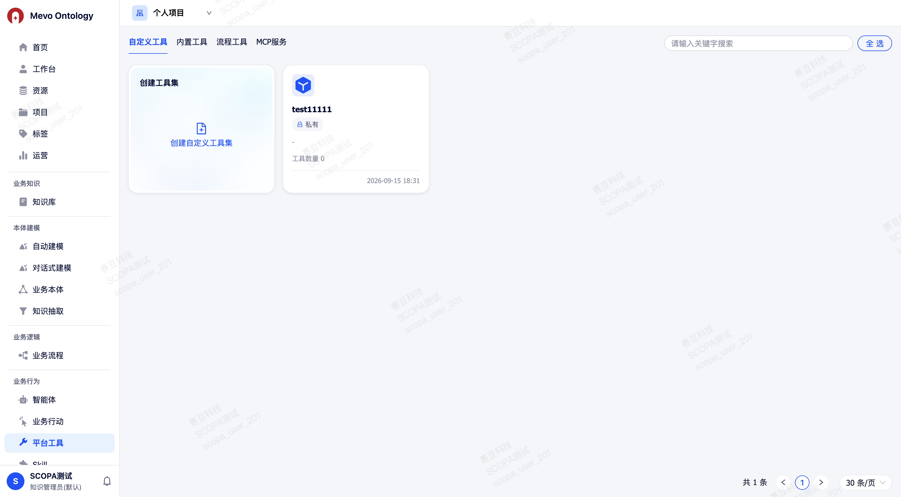

图 7-1 工具与模型列表

### 7.1.1 创建自定义工具

**目标：** 把外部 HTTP 接口登记为自定义工具，供 Logic、Skill 和智能体调用。

**入口：** `业务行为 > 平台工具 > 自定义工具`

**前置条件：** 已拿到接口文档，明确请求地址、请求方式、输入参数、鉴权要求和返回结构。

**操作步骤：**

1. **创建工具集。** 自定义工具按工具集管理。尚无合适的工具集时，点击「创建自定义工具集」，填写图标与名称、描述，点击「确定」。工具集卡片显示可见范围（如「私有」）、工具数量和更新时间。

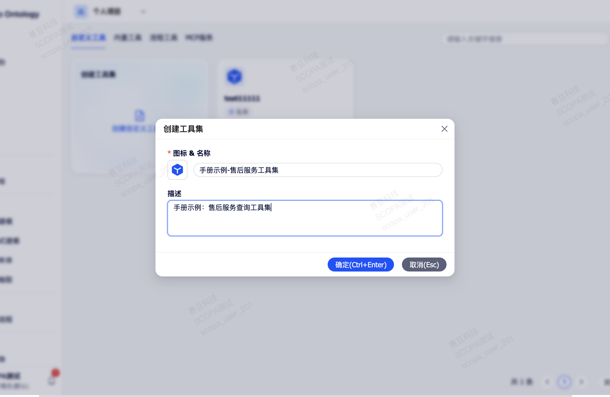

图 7-2 创建自定义工具集

2. **进入工具集。** 点击工具集卡片进入详情页。页面提供「新建工具」「导入」「导出」，列表显示工具名称、工具描述、请求类型与请求地址、返回类型、编辑时间，以及「编辑」「复制」「删除」操作。

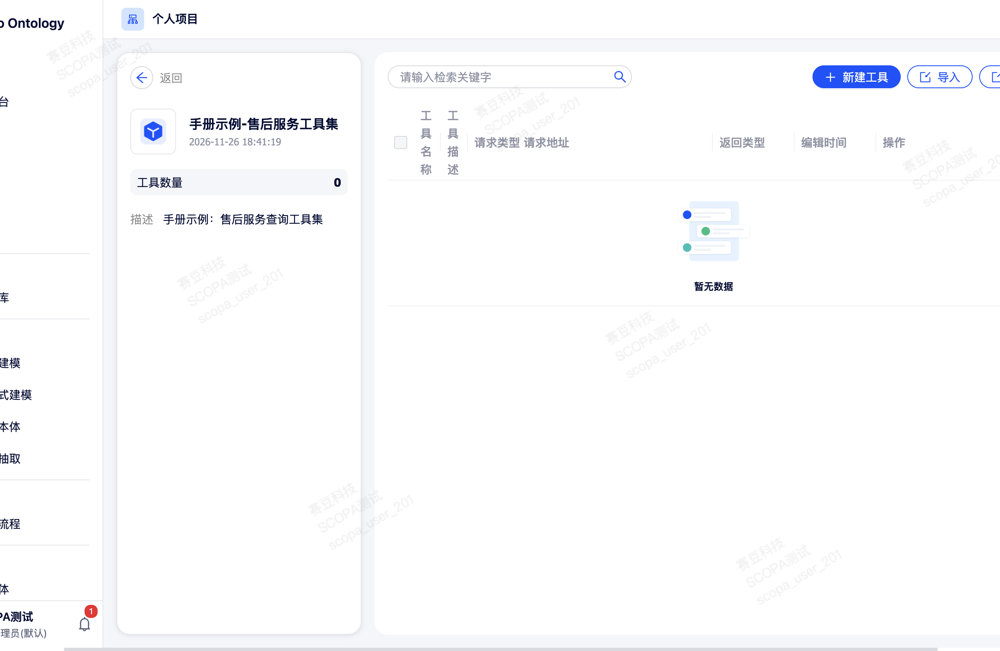

图 7-3 工具集详情

3. **填写基本信息。** 点击「新建工具」，在弹窗中填写「名称」和「描述」。描述要写清工具做什么、什么时候用，智能体会依据描述判断是否调用。

4. **定义输入变量。** 在「接口定义」区点击「添加输入变量」，填写名称、中文名、类型（文本、数组、整数、对象、数值）、是否必填和描述。

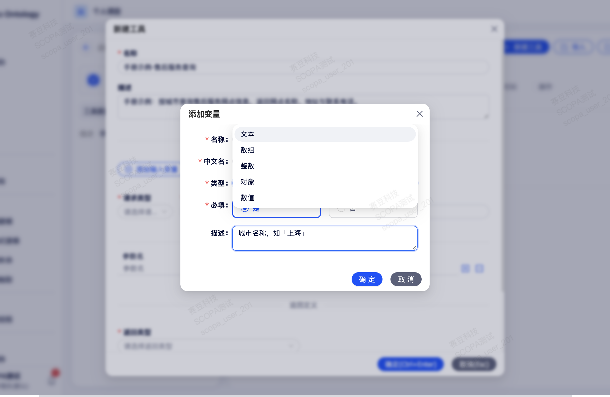

图 7-4 添加输入变量

5. **配置请求。** 选择请求类型（GET / POST），填写请求地址；在「URL参数」「请求头」页签中按接口文档填写参数名和参数值，请求类型为 POST 时增加「Body」页签。需要动态传入的参数值用 `{{变量名}}` 引用第 4 步定义的输入变量，例如 `{{city}}`。接口需要鉴权时，在请求头中填写凭据。

6. **配置返回结果。** 在「返回定义」区选择返回类型（文本、数组、对象、数值、关系图、二维图表、地理坐标、文件、消息推送、表格）；只需要响应中的部分内容时，在「返回数据定义」中按 JSONPath 填写提取路径。

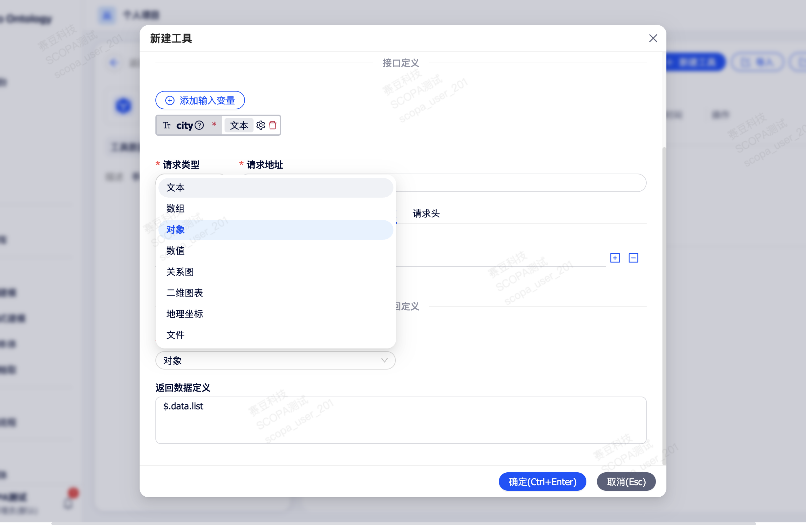

图 7-5 新建自定义工具：接口定义与返回定义

7. **保存。** 检查必填项后点击「确定」，提示「工具新建成功！」，工具出现在工具集列表中。

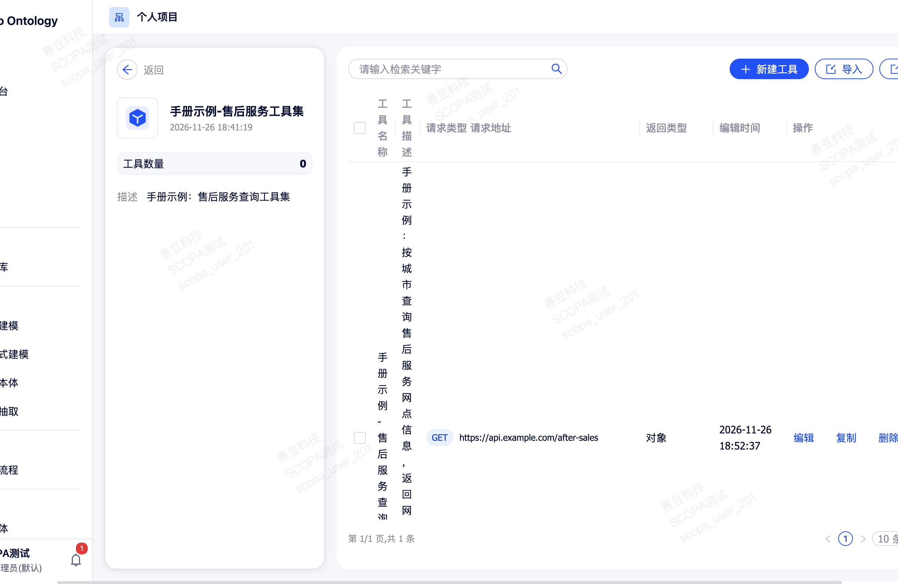

图 7-6 工具集中的自定义工具

8. **验证调用。** 在 Logic 的工具调用节点中引用该工具（见 6.10.2、附录 B），传入测试参数调试运行，确认接口能访问、参数传递正确、返回内容按预期提取。

**完成检查：** 正常调用返回符合预期；再分别用缺少必填参数、鉴权失败、接口异常三种情况测一次，确认返回的错误信息可读。

**注意事项：**

- 自定义工具调用的是真实接口。测试时使用测试接口或只读接口，不要指向会写入业务数据或发送消息的生产接口。
- 请求头中的密钥会保存在工具配置里，工具集的可见范围按需设置，不要把含密钥的工具集共享给无关人员。
- 当前环境中，工具编辑页没有单独的测试按钮，需在 Logic 调用节点中验证。
- 智能体的「工具与技能」中没有自定义工具页签。智能体要用自定义工具，可在 Skill 资源的「工具」中选择该工具（7.2.2），或在 Logic 中调用后把 Logic 发布为流程工具（7.1.3）再引用。

### 7.1.2 查看或配置内置工具

**目标：** 了解平台预置工具的能力和输入输出，按需在 Logic 或智能体中引用。

**入口：** `业务行为 > 平台工具 > 内置工具`

**操作步骤：**

1. 在「内置工具」页签中浏览工具集。当前环境预置的工具集包括：echarts图表生成工具集、excel处理工具集、Word文档处理工具集、博查检索工具集、数据源工具集、文件信息获取、文档模版填充工具、知识库工具、虚拟表工具集、规则引擎工具集等。

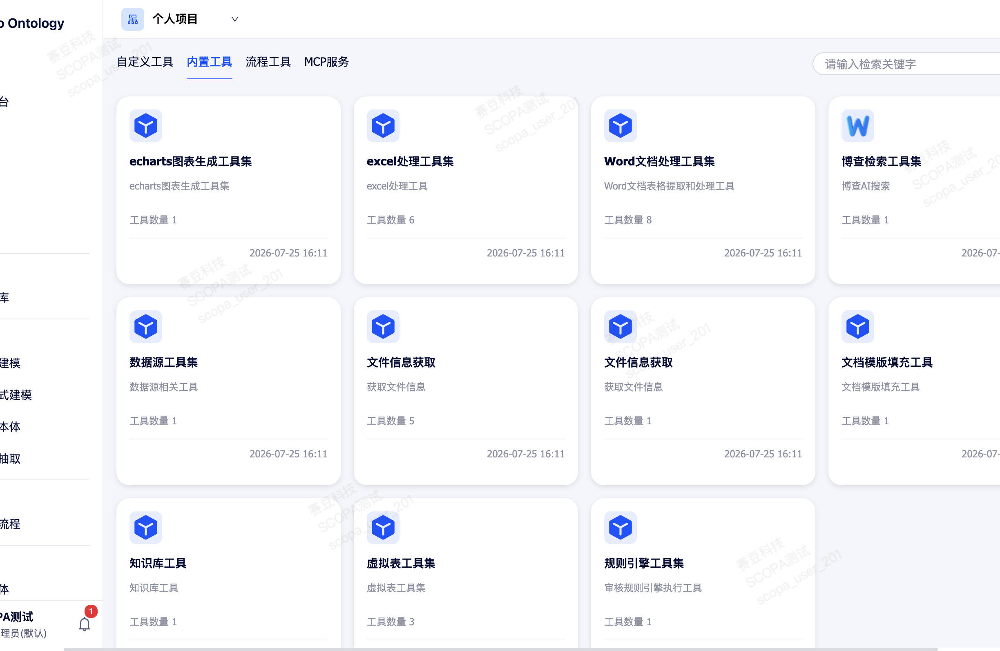

图 7-7 内置工具列表

2. 点击工具集卡片，查看其中的工具名称、描述和编辑时间。

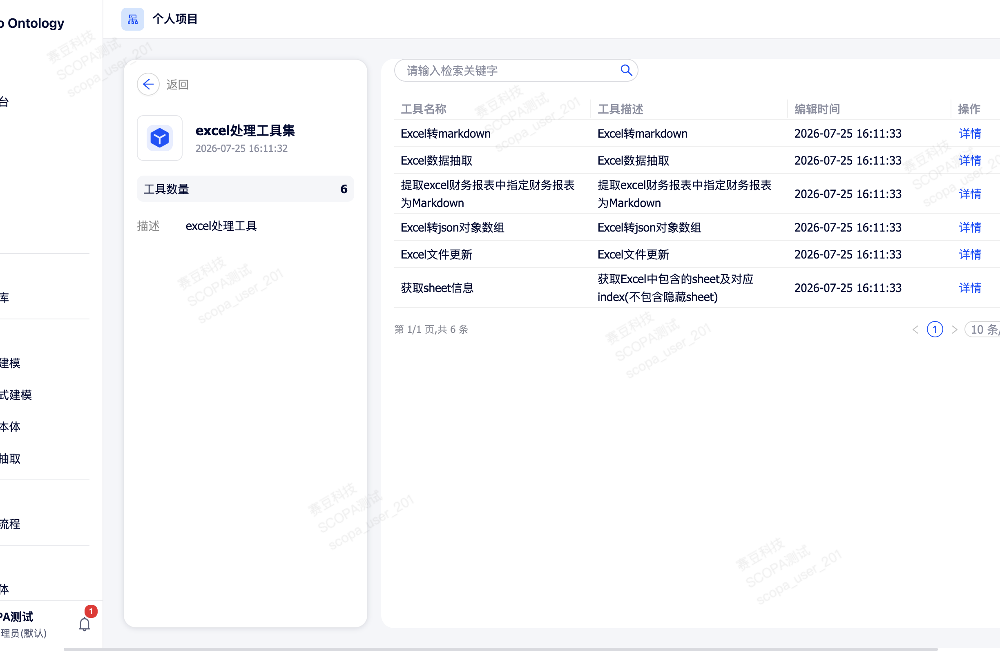

图 7-8 内置工具集详情

3. 点击工具行的「详情」，查看输入参数（带 * 为必填）、输出参数和关联工作流数量。

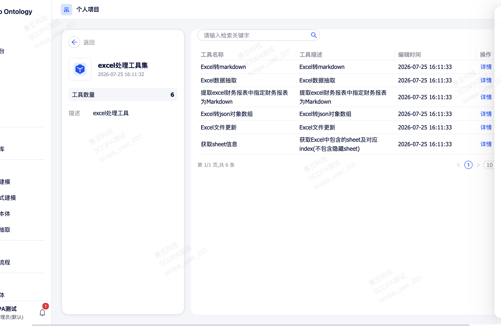

图 7-9 内置工具的输入与输出参数

4. 在 Logic 工具调用节点的「内置工具」页签（6.10.2）或智能体的「工具与技能 > 内置工具」（8.4.1）中引用，并试调用一次确认返回正常。

**注意事项：** 内置工具不能修改；能力范围以当前版本为准，不满足需求时用 7.1.1 自定义工具补充。部分内置工具（如博查检索）依赖外部服务，调用前确认平台已配置对应凭据。

### 7.1.3 引用已发布工具（流程工具）

**目标：** 把已发布的 Logic 作为工具复用，避免同一段流程在多处重复编排。

**入口：** `业务行为 > 平台工具 > 流程工具`

**操作步骤：**

1. 在 Logic 中选择发布形态「流程工具」并发布（6.10.4）。发布后，该流程自动出现在「流程工具」页签中，卡片显示关联工作流数量。

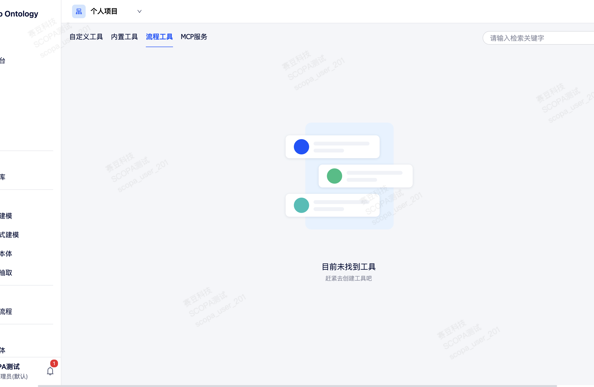

图 7-10 流程工具列表

2. 点击卡片查看详情，核对输入参数和输出参数是否与源 Logic 一致。

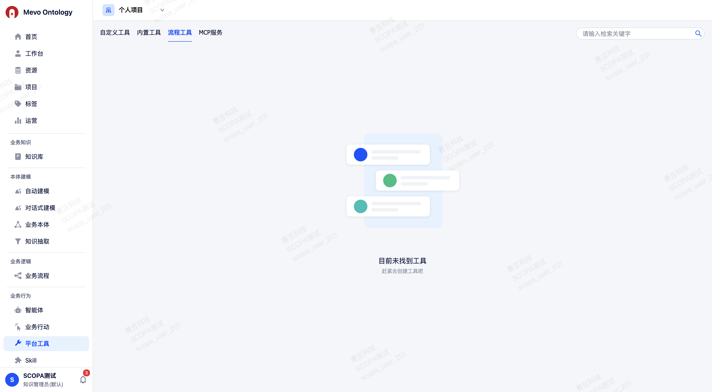

图 7-11 流程工具详情

3. 在需要的位置引用：Action 规则的「调用流程工具」、Logic 工具调用节点的「流程工具」页签、智能体的「工具与技能 > 流程工具」（8.4.1）。引用后跑通一次完整链路。

**注意事项：** 源 Logic 未发布或输入输出变更后未重新发布时，调用会失败或仍按旧参数返回。修改源 Logic 的输入输出前，先确认引用方并在修改后复测（11.4）。

### 7.1.4 接入 MCP 工具

**目标：** 接入外部 MCP 服务，加载服务提供的工具，供 Logic 或智能体引用。

**入口：** `业务行为 > 平台工具 > MCP服务 > 添加MCP服务`

**前置条件：** 已拿到服务端点地址、服务类型和鉴权信息，并确认平台网络能访问该服务。

**操作步骤：**

1. 在「MCP服务」页签点击「添加MCP服务」。

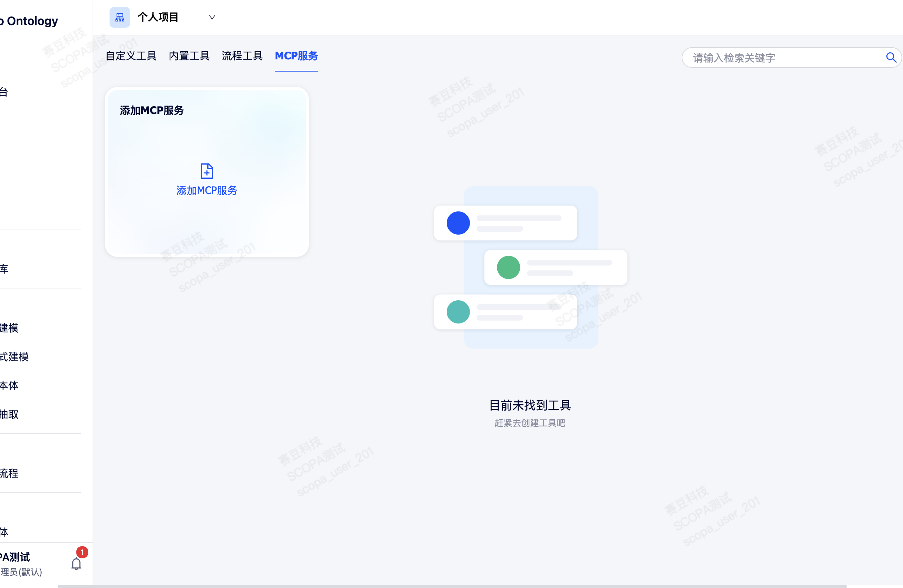

图 7-12 MCP 服务列表

2. **填写基本信息。** 在「添加MCP服务」弹窗中填写「图标」和「名称」，在「服务描述」中说明服务用途和提供的能力。描述会显示在服务卡片上，便于他人判断是否引用。
3. **选择服务类型。** 「服务类型」提供「SSE服务」和「流式HTTP服务」两项，按服务方提供的类型选择，再填写完整端点地址：SSE 服务填「SSE端点URL」，流式HTTP服务填「端点URL」。
4. **配置请求头。** 服务需要鉴权时点击「新增一行」，按服务方要求填写请求头名称和值（表头为 Key / Value）；不需要鉴权可留空。
5. **设置超时。** 填写「HTTP超时时间（秒）」（默认 30）和读取超时时间（SSE 服务为「SSE读取超时时间」，流式HTTP服务为「读取超时时间（秒）」，默认 300），按服务方建议调整。
6. **保存并连接。** 点击「保存」，平台连接服务并加载工具列表。连接失败时提示「MCP服务器连接失败」，弹窗保持打开，已填内容不丢失，可按提示检查后重试。

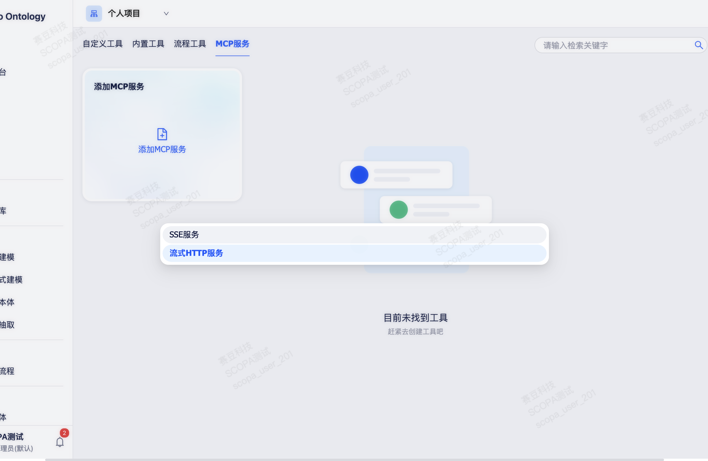

图 7-13 添加 MCP 服务

7. 保存成功后点击服务卡片进入详情，核对加载出的工具名称和说明，点击工具的「详情」查看输入参数。服务端工具有变化时点击「更新工具」重新加载；修改连接配置点击「编辑」。

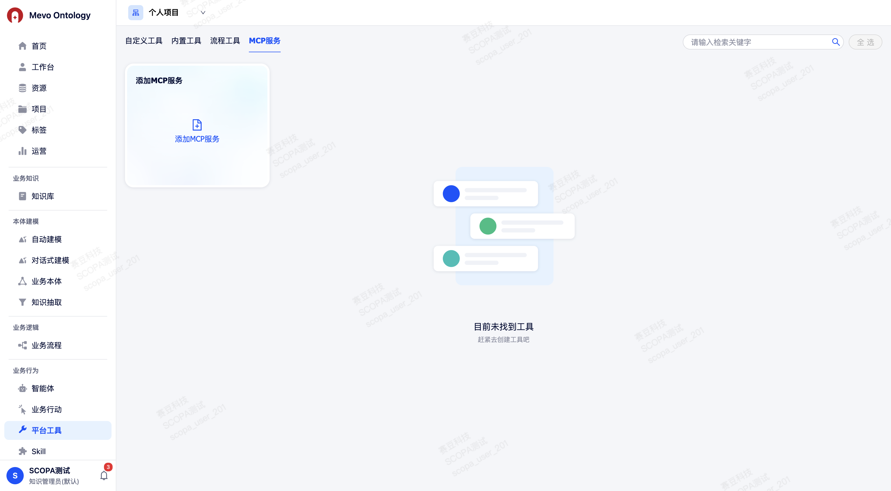

图 7-14 MCP 服务提供的工具与输入参数

8. 在 Logic 工具调用节点或智能体「工具与技能 > MCP」中引用所需工具，传入测试参数验证调用结果。

**完成检查：** 保存成功、工具列表加载成功、实际调用成功，三项分别确认。

**注意事项：** 接入或调用失败时，依次检查服务类型与端点地址是否匹配、请求头中的鉴权信息是否有效、网络是否可达、是否超时。本节是把外部 MCP 服务接进平台；把平台能力以 MCP 方式对外开放见 9.1.2。

### 7.1.5 自定义工具在线测试与地址校验【1130 版本】

**目标：** 在工具编辑页直接填入测试参数发起调用，并校验请求地址是否合法，减少到 Logic 中反复调试的次数。

**说明：** 该功能计划在 1130 版本上线（需求「自定义工具在线测试和地址合法性校验」）。当前测试环境和原型中均未找到对应界面，具体入口与操作以上线版本为准；上线前按 7.1.1 第 8 步在 Logic 中验证。

## 7.2 技能（Skill）：创建与引用

技能（Skill）把一类任务的执行说明（SKILL.md）、脚本和所需资源打包在一起。智能体在对话中判断任务匹配时加载对应技能，按技能说明执行。

**入口：** `业务行为 > Skill`

技能列表支持按标签筛选和关键词检索。卡片显示状态（草稿 / 已发布）、来源（如「自建」）、标签和更新时间；悬停卡片时，草稿可「继续编辑」「导出」「删除」，已发布技能可「编辑」「导出」「删除」。

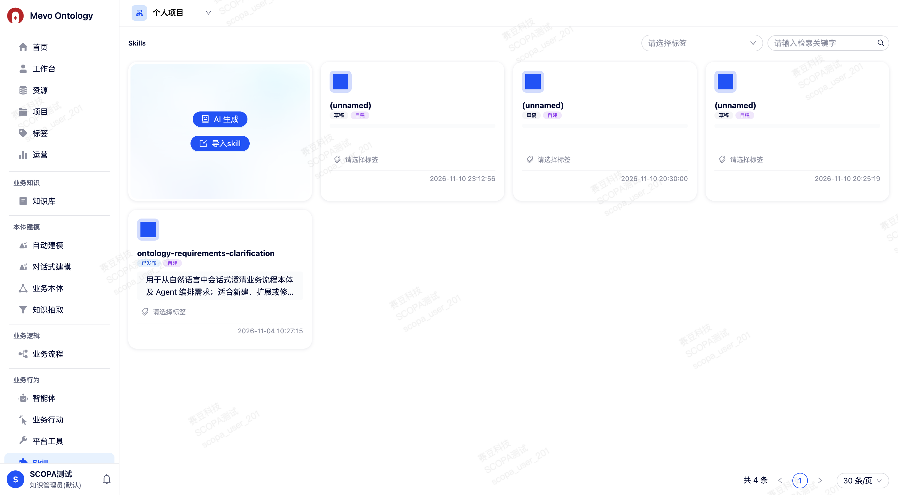

图 7-15 技能列表

### 7.2.1 导入或 AI 创建 Skill

**目标：** 创建技能，界定它完成哪一类任务、在什么场景下使用。

**前置条件：** 任务场景、执行步骤和所需资源已确认。

**方式一：导入已有 Skill**

1. 在技能列表点击「导入skill」，进入导入页。
2. 选择导入来源：
   - **上传 ZIP 包：** 把符合标准的 Skill 包（含 SKILL.md）拖入上传区或点击上传，仅支持 .zip 格式。
   - **从 Skills Hub 导入：** 填写 agentskills.io、GitHub Raw URL 或其他标准 Skill 仓库地址，点击「开始解析」。
3. 右侧「文件解析预览」显示解析出的文件，并给出技能名称、状态、描述和更新时间；核对内容后点击「进入编辑器」继续调整，或直接「发布为 Skill」。

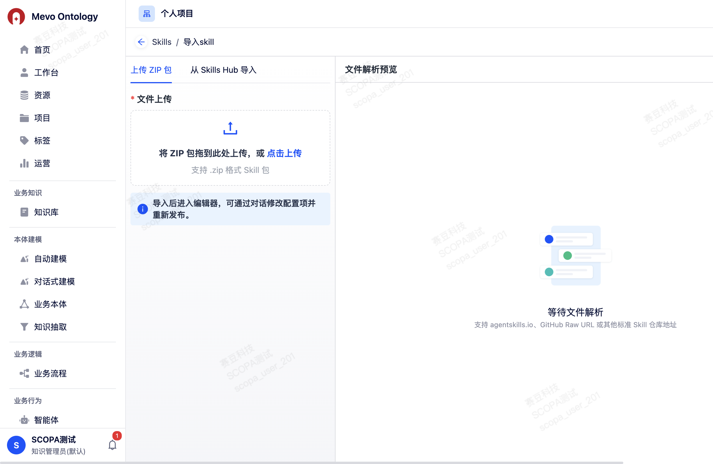

图 7-16 导入 Skill：上传 ZIP 包

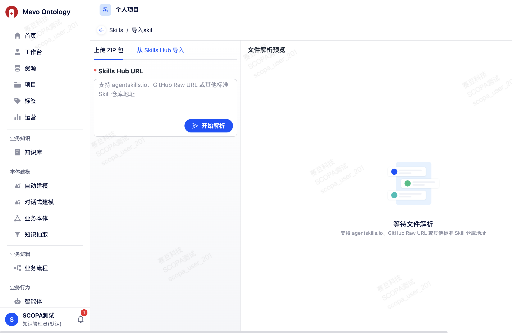

图 7-17 导入 Skill：从 Skills Hub 导入

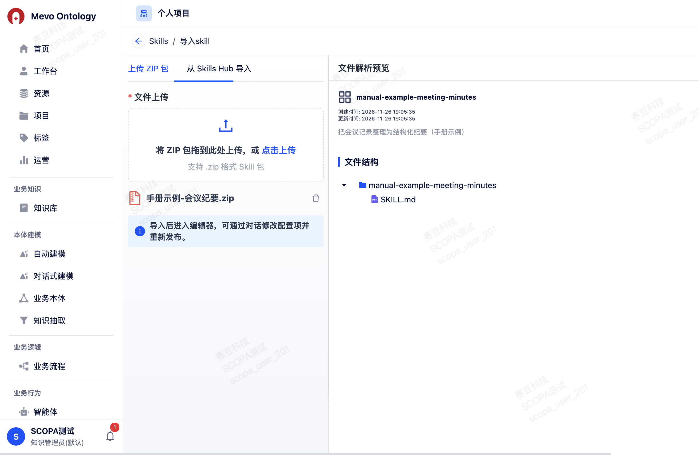

图 7-18 导入 Skill：解析预览

**方式二：AI 生成**

1. 在技能列表点击「AI 生成」，进入「编辑 Skill」对话页。
2. 在输入框中用自然语言描述任务，例如「把会议记录整理为结构化纪要，包含会议主题、时间与参会人、议题与结论、待办事项」。发送后 AI 生成技能说明、参考模板和脚本（默认生成 `SKILL.md`，按需要生成 `references/` 与 `scripts/` 下的文件）。
3. 生成完成后页面自动进入三栏编辑器（7.2.2），名称按生成结果预填，可继续在左侧对话中提出修改要求。

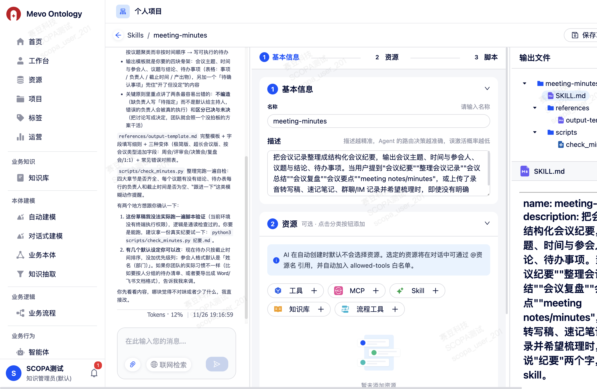

图 7-19 AI 生成 Skill

**注意事项：**

- 导入外部 Skill 前先审阅说明和脚本内容，确认来源可信、没有越权操作。
- 技能说明要写清「什么时候用、什么时候不用」，智能体据此判断是否加载。

### 7.2.2 编辑内容与资源

**目标：** 写清执行步骤、输入要求与边界，并挂载已验证的资源。

**编辑器布局：** 左侧为对话区（可开启「联网检索」）；中间为配置区，分「基本信息」「资源」「脚本」三个页签；右侧为输出文件（实时更新）。顶部提供「保存草稿」和「发布为 Skill」。

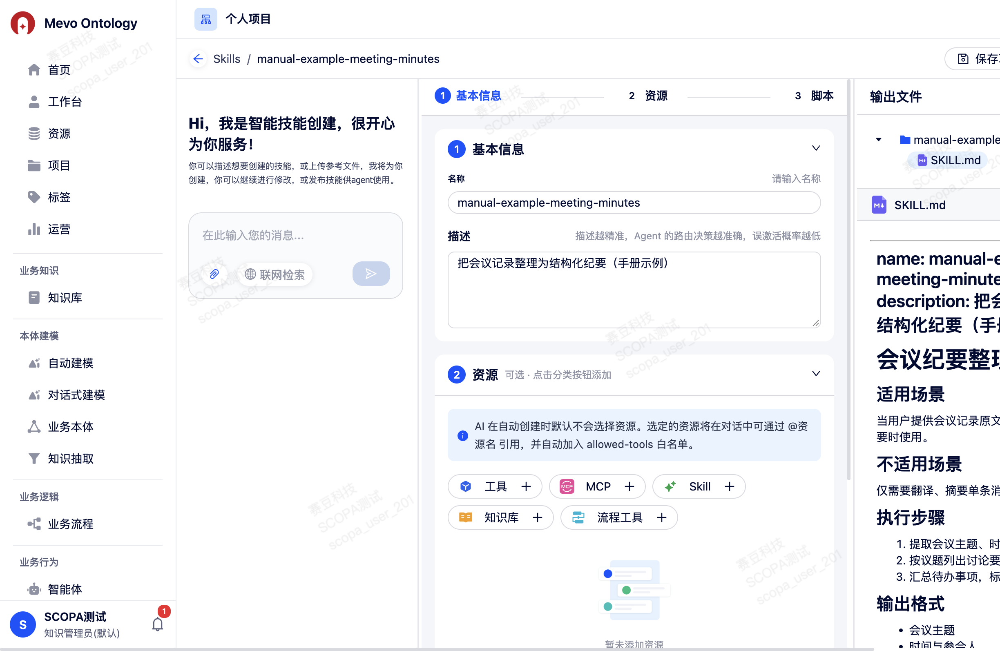

图 7-20 Skill 编辑器

**操作步骤：**

1. **基本信息：** 填写名称和描述。名称需以英文字母开头，只能包含字母、数字、下划线和中横线（如 `manual-meeting-minutes`），不能使用中文。描述下方提示「描述越精准，Agent 的路由决策越准确，误激活概率越低」。
2. **资源：** 在「资源」页签点击「工具」「MCP」「Skill」「知识库」「流程工具」按钮，在「选择资源」中勾选需要的资源，自定义工具在「工具」中选择。页签显示「已添加资源(N)」，可用「清空」移除全部。AI 创建时默认不选资源，需要手动添加；选定的资源可在对话中用「@资源名」引用，并自动加入技能的 allowed-tools 白名单。只添加本场景需要且已验证过的资源。

图 7-21 为 Skill 添加资源：选择工具

3. **脚本：** 需要固定处理逻辑时在「脚本」页签点击「创建」添加脚本，脚本自动同步到 scripts/ 目录。
4. **技能说明：** 在对话中补充或修改任务目标、执行步骤、输入输出、异常处理与禁止事项，右侧输出文件同步更新。说明质量直接决定智能体的执行效果。
5. 点击「保存草稿」，提示「草稿保存成功」。自查后再进入发布。

### 7.2.3 安全检测与发布

**目标：** 通过安全检测后发布技能，供智能体引用。

**操作步骤：**

1. 在编辑器顶部点击「发布为 Skill」，系统先进行安全检测，弹出「安全扫描」窗口。
2. 查看检测结果：窗口顶部显示「安全检查通过」或未通过原因（如「未发现 CRITICAL 或 HIGH」），下方列出技能名称、问题数量、最高等级、扫描耗时，以及本次参与的分析器（如 static_analyzer、behavioral_analyzer、trigger_analyzer、cross_skill_scanner、pipeline、bytecode）。每个问题标注等级（INFO / LOW / MEDIUM 等）和「修复建议」，按建议修改说明或脚本。
3. 检测通过后点击窗口中的「发布为 Skill(Ctrl+Enter)」完成发布，或点击「关闭」返回修改。

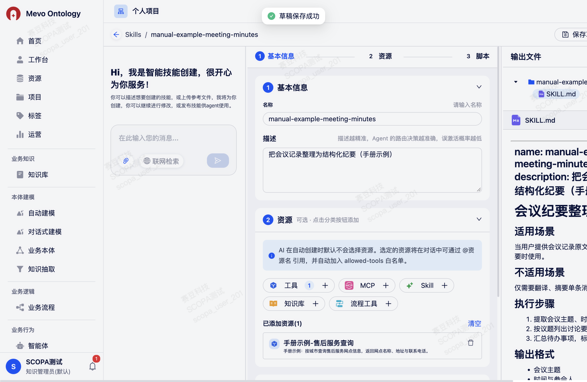

图 7-22 Skill 安全检测

4. 发布后技能卡片状态变为「已发布」，卡片显示技能的英文名称。在智能体配置中引用（8.4.2），并在 8.5 验证调用。

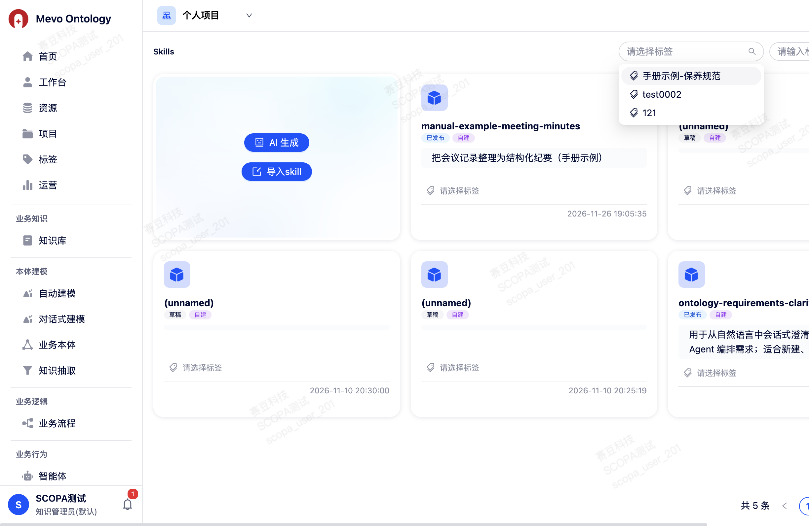

图 7-23 已发布的 Skill

5. 技能更新后重新安全检测并发布，同步检查引用它的智能体（11.5）。

**注意事项：** 不要绕过安全检测发布。检测有告警时，先修改说明或脚本再重新发布。

---

## 本章变更说明（v3.4 → v4.0）

**新增**

- 7.1 开头：四个页签（自定义工具 / 内置工具 / 流程工具 / MCP服务）说明。
- 7.1.5 自定义工具在线测试与地址校验【1130 版本】（仅文字说明，无界面）。
- 7.2 开头：技能列表说明。

**修改**

- 7.1.1：按环境重写。补充工具集创建、输入变量字段、`{{变量}}` 引用方式、返回类型枚举和保存提示；「不能直接添加到 Agent」的限制改写为两种使用路径（Skill 资源、流程工具）。全部截图重截。
- 7.1.2：补充当前内置工具集清单和详情查看方式。
- 7.1.3：「智能体工具」改为环境中的「流程工具」页签。
- 7.1.4：按环境重写。弹窗标题改为「添加MCP服务」；服务类型补充「流式HTTP服务」及两种类型对应的端点、超时字段与默认值；请求头补充 Key / Value 表头；失败提示按界面原文写作「MCP服务器连接失败」；保留详情页「更新工具」「编辑」。v4.0 初稿中的「示例 / 填写」步骤环境中不可见，已删除。图 7-13 重截。
- 7.2.1：入口改为「AI 生成」「导入skill」；导入方式补充「从 Skills Hub 导入」，并补充解析预览（名称、状态、描述、更新时间）；AI 生成补充自动生成 `SKILL.md`、`references/`、`scripts/` 并自动进入编辑器。
- 7.2.2：按编辑器三栏布局重写，补充名称命名规则、描述提示语、「已添加资源(N)」「清空」、资源类型与 @ 引用、脚本、保存草稿提示「草稿保存成功」；删除「显示 Tokens 用量」（当前对话区无此显示）。
- 7.2.3：补充「安全扫描」窗口的检测结论、问题数量、最高等级、扫描耗时、分析器与修复建议，以及发布按钮。
- 复核截图：图 7-6、7-7、7-13、7-16 ~ 7-23 重截（图 7-16 ~ 7-23 按最新界面重截并新增「图 7-18 导入 Skill：解析预览」）；图 7-11、7-14 受环境限制未能重截，见「待确认」。

**删除**

- 无。

**未变**

- 各小节的目标与完成检查要求。

## 待确认

1. 自定义工具在线测试与地址校验（1130）：环境和原型均未找到界面，7.1.5 只有文字说明，上线后补入口、步骤和截图。
2. 7.1.4 MCP 接入未能走通保存环节：测试环境后端连不上任何 MCP 服务，即使端点指向可公网访问的 `https://mcp.deepwiki.com/mcp`（浏览器可直接访问）也提示「MCP服务器连接失败」，等待约 30 秒后失败、弹窗保持打开。11-26 复核时「MCP服务」页签下没有任何服务，图 7-14 已按当前界面重截为「目前未找到工具」空列表；服务详情与工具列表待后端打通、有服务接入后补截。
3. 图 7-11（流程工具详情）：11-26 复核时个人项目和「手册示例-演示项目」下「流程工具」页签均为空，图 7-11 已按当前界面重截为「目前未找到工具」空列表；工具详情待有流程工具发布后补截。
4. ZIP 包上传：浏览器环境限制无法上传本地文件，只截了上传界面；上传后的解析预览界面待补截。
5. 内置工具中需要凭据的工具（如博查检索）的凭据配置位置未在界面中找到，是否由平台统一配置待确认。
6. 自定义工具经 Skill 资源供智能体调用：已核实 Skill「选择资源 > 工具」中可选到自定义工具，但测试工具未指向真实接口，未跑通智能体端到端调用，需产品确认。
7. 7.2.3 发布：点击「发布为 Skill(Ctrl+Enter)」后应用跳转到「服务器出错了」页面，但技能实际已发布成功（卡片状态「已发布」）。疑似发布后跳转接口返回 500，需产品确认是否影响使用。
8. 11-26 最新环境复核：入口改为 `业务行为 > 平台工具`、`业务行为 > Skill`，页面顶部有「个人项目」切换。已重截 7-1、7-7、7-10 ~ 7-14、7-15、7-16 ~ 7-23（其中 7-11、7-14 为「目前未找到工具」空列表）；图 7-2 ~ 7-6、7-8、7-9 仍为旧界面（7.1.1 ~ 7.1.3 另由他人复核）。
