# 八、建设 Agent【按需】

> 编号与顺序沿用 v3.4。截图来自测试环境（v4.1.2），示例智能体为「手册示例-售后服务助手」，环境中已存在，可直接打开调试；标【规划】且注明原型示意的截图来自原型。

本章说明智能体（Agent）的创建、配置、调试、发布与使用。智能体可以只用知识库回答问题，也可以调用本体数据、流程和技能执行任务，不要求所有场景先完成本体建设；已有知识库直接复用，不重复建设。

**入口：** `业务行为 > 智能体`（路由 `/aigo/modules/spotlight-aip-3/micro/app/bot3`）

## 8.1 Agent：创建 Agent

### 8.1.1 新建 Agent

**目标：** 创建智能体，写清业务目标与适用范围。

**入口：** `业务行为 > 智能体 > 创建智能体 > 创建`

**前置条件：** 任务目标和使用人群已确认；准备好验收样例（正常、边界、信息不足、无权限四类问题，见 1.1）。

**操作步骤：**

1. 进入智能体列表（`业务行为 > 智能体`，顶部可切换「个人项目」）。列表按「全部 / 我的 / 分享给我的」切换（该分类是否保留待确认，见待确认），可按标签筛选或输入关键词检索。示例智能体「手册示例-售后服务助手」已存在，可直接打开配置页调试。

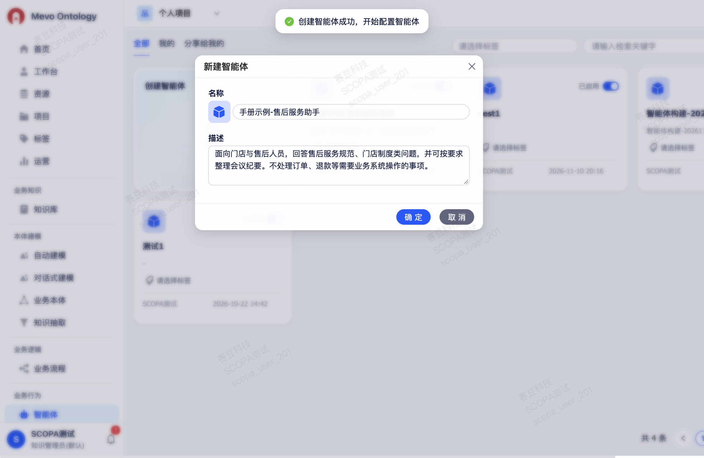

图 8-1 智能体列表

2. 点击「创建智能体」卡片中的「创建」，弹出「新建智能体」。
3. 选择图标，填写名称和描述。描述要让使用者一眼看出「什么问题该找它、什么不归它管」，例如「面向门店与售后人员，回答售后服务规范、门店制度类问题，并可按要求整理会议纪要。不处理订单、退款等需要业务系统操作的事项。」
4. 点击「确定」，提示「创建智能体成功，开始配置智能体」，自动进入配置页。

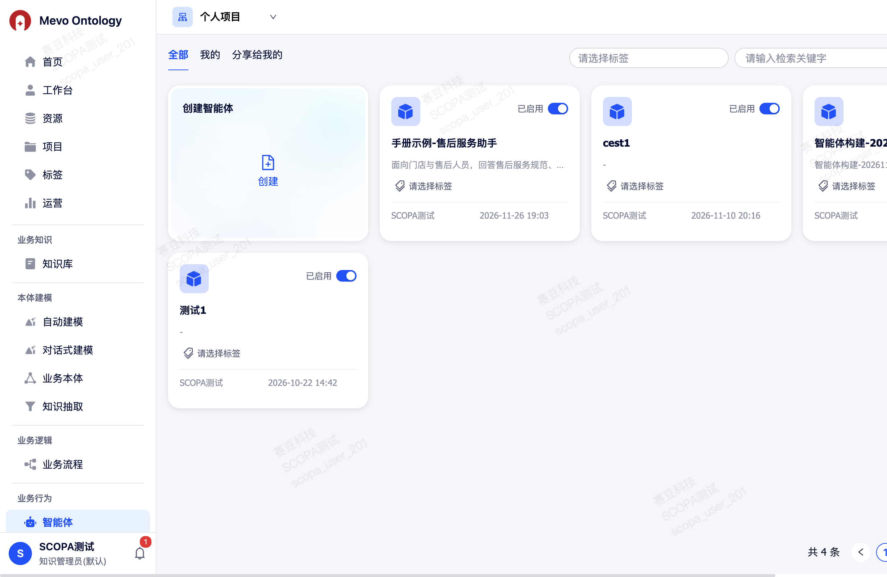

图 8-2 新建智能体

**配置页布局：** 左侧为配置区，分「意图识别与规划」「本体数据资源」「工具与技能」三个可折叠区域，底部有「保存」按钮；中间为调试对话区；右侧为「推理链路 / 引用文档 / 文件」面板。顶部依次为智能体名称、「复制智能体 ID」、LLM 模型选择、「功能」、「评测管理」、更多（···）和界面语言切换。

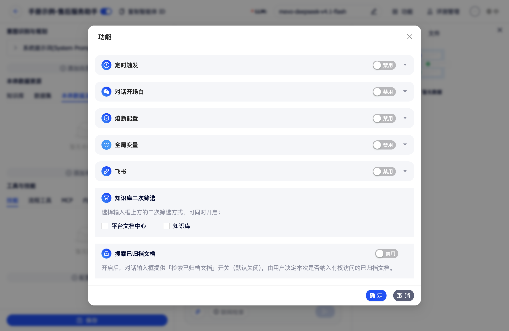

图 8-3 智能体配置页

**卡片操作：** 回到列表后，卡片带「已启用」开关，悬停可「编辑」（修改名称和描述）、「配置」（进入配置页）、「授权」（8.6.2），「更多」中有「复制」「运行日志」「删除」。点击卡片本身进入运行态使用（8.7）。

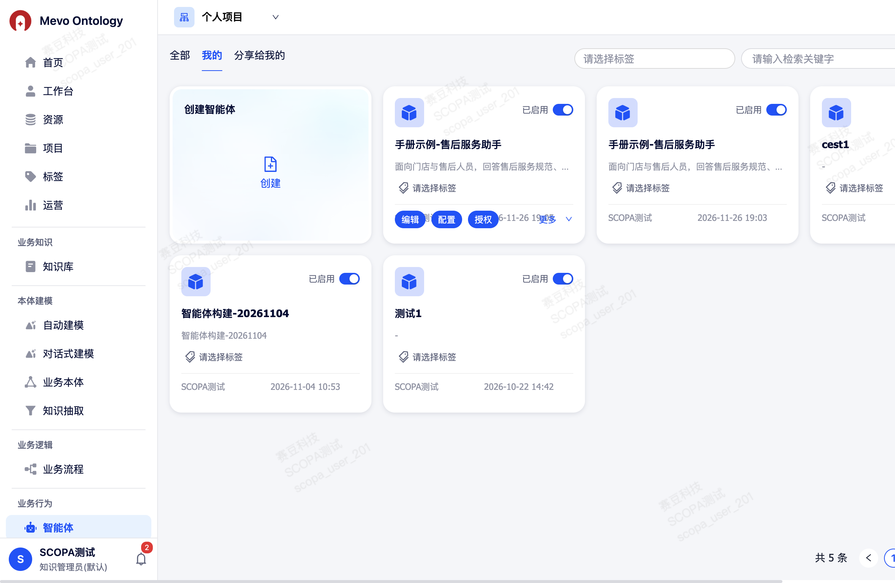

图 8-4 智能体卡片操作

**注意事项：** 业务目标过大时按 1.1.1 拆成多个智能体，避免一个智能体既回答制度又执行业务操作。

## 8.2 Agent：系统提示词与功能配置

### 8.2.1 选择模型

**目标：** 为智能体选择大模型，使回答质量与任务要求匹配。

**入口：** 配置页顶部「LLM:」右侧的编辑按钮

**操作步骤：**

1. 点击「LLM:」右侧的编辑按钮，打开「选择LLM」。
2. 在模型下拉中选择模型。当前环境可选 mevo-deepseek-v4、mevo-deepseek-v4.1-flash、mevo-kimi-k3、seres-qwen2.5-instruct 等，以界面为准。

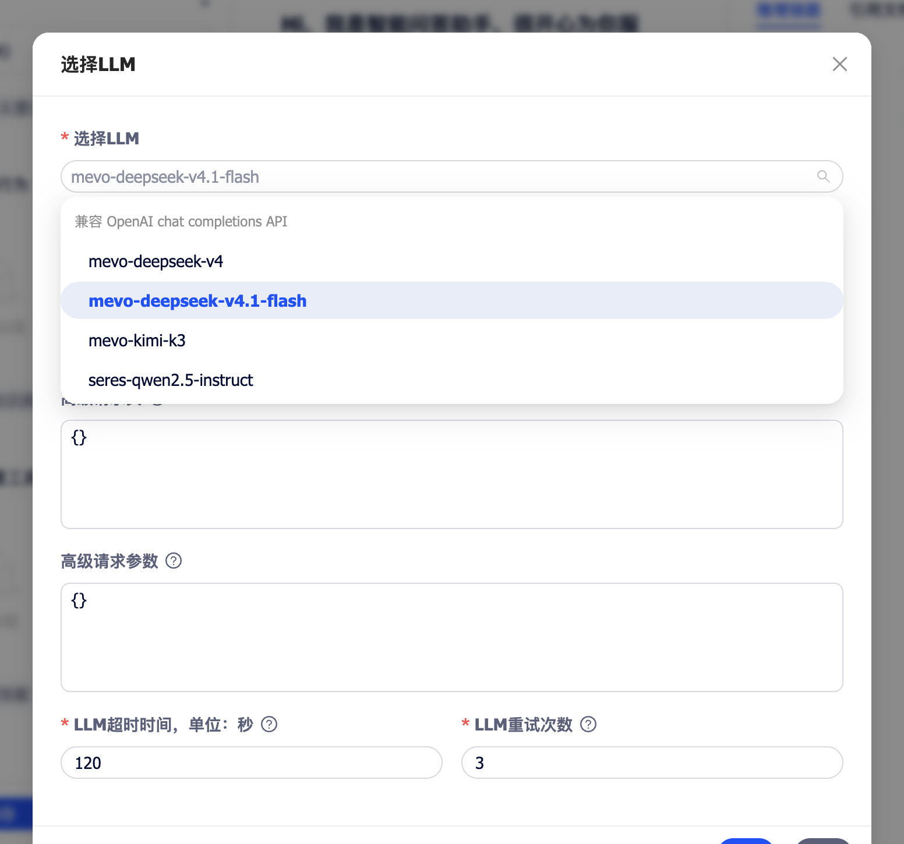

图 8-5 选择 LLM

3. 按需调整参数：最大推理 tokens 数（默认 8192）、最大推理 tokens 参数名（max_tokens）、上下文窗口大小（默认 128000）、是否支持 `<think>` 标签、高级请求头、高级请求参数、LLM 超时时间（秒）、LLM 重试次数。没有特殊要求时保持默认。

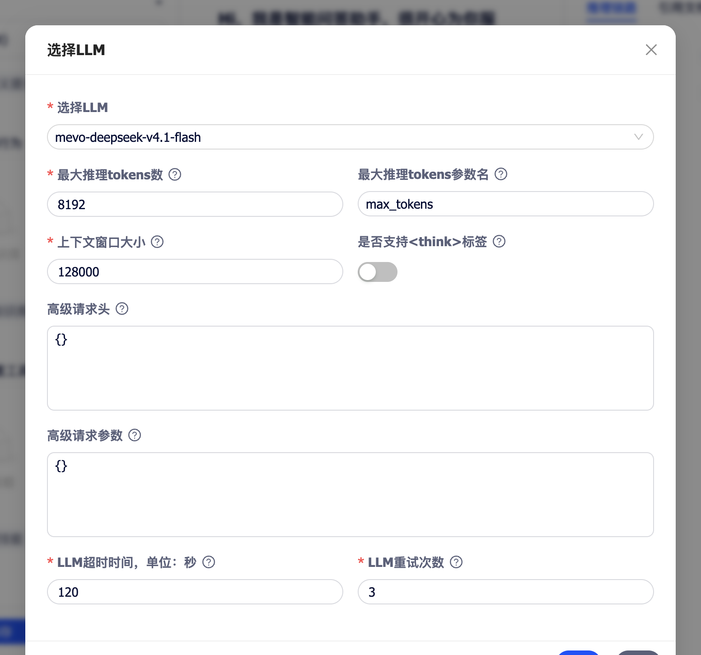

图 8-6 模型参数

4. 点击确定后，回到配置页点击底部「保存」。

**注意事项：** 不同模型的工具调用能力有差异。依赖工具或技能执行的智能体更换模型后，必须重新跑一遍 8.5 的验收样例。

### 8.2.2 编写系统提示词

**目标：** 用系统提示词约定任务范围、调用规则与输出要求。

**入口：** 配置页左侧 `意图识别与规划 > 系统提示词(System Prompt)` 右侧的编辑按钮

**操作步骤：**

1. 点击编辑按钮，打开「编辑提示词」。可直接编写，也可点击「上传文件」导入 .txt、.md、.markdown 文件。
2. 按以下结构编写：
   - 角色与服务对象：例如「你是售后服务助手，服务对象是门店与售后人员」。
   - 调用规则：什么问题查哪个资源、调用哪个技能或流程。例如「售后服务规范、门店制度类问题，先检索已配置的知识库，依据检索到的文档作答并给出引用来源；检索不到时说明未找到，不得编造」。
   - 边界：明确不处理的事项，以及遇到时如何引导。
   - 输出要求：例如「先给结论，再列依据」。

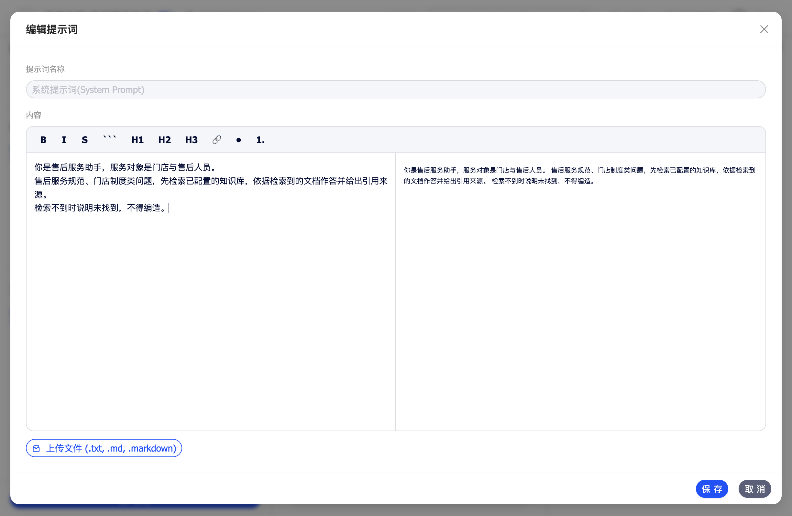

图 8-7 编辑系统提示词

3. 需要在提示词中使用系统变量时，输入「@」选择。当前可选「系统.当前用户」「系统.用户部门」「系统.当前时间」「系统.服务域名」，运行时自动替换为实际值。

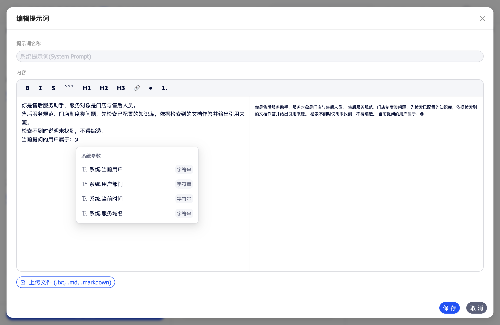

图 8-8 在提示词中引用系统变量

4. 点击「保存」关闭弹窗。需要按场景追加提示词时，点击「添加自定义提示词」。
5. 回到配置页点击底部「保存」。

**注意事项：** 提示词中提到的技能、流程名称要与实际配置一致；资源改名后同步修改提示词。

### 8.2.3 配置功能

**目标：** 配置运行功能，约束智能体的执行方式与消耗。

**入口：** 配置页顶部「功能」

**操作步骤：**

1. 点击「功能」，打开功能配置窗口。每项功能有独立的启用开关，展开后填写配置。

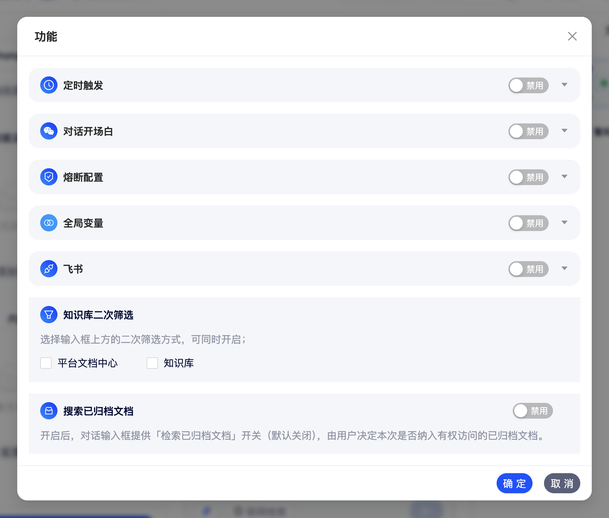

图 8-9 功能配置

2. **定时触发：** 需要定时自动执行的任务，开启后点击「新增定时任务」，填写任务名称、用户指令类型（用户输入 / API）、用户指令（定时发给智能体的任务内容）、执行计划（如每天）和执行时间，下方显示下次执行时间。

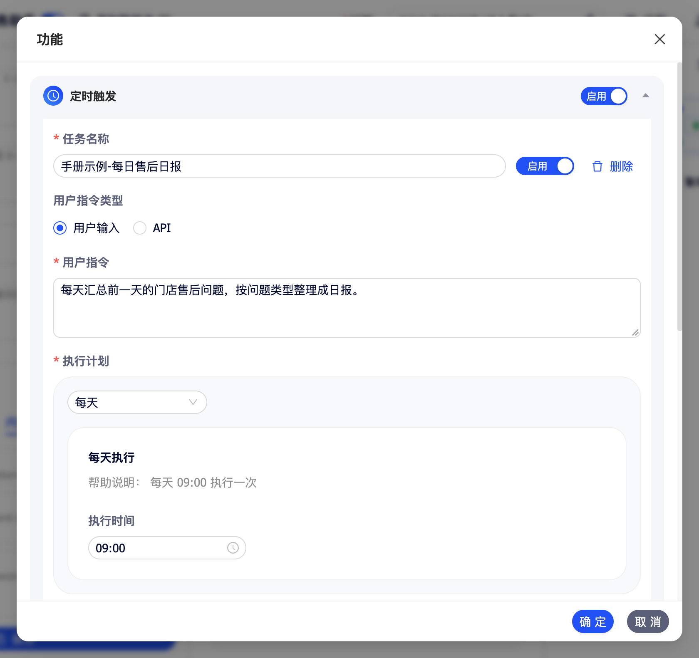

图 8-10 定时触发

3. **对话开场白：** 填写开场白标题、开场白内容，点击「添加开场问题」预置常见问题。用户进入对话页时会看到开场白和可点击的开场问题。

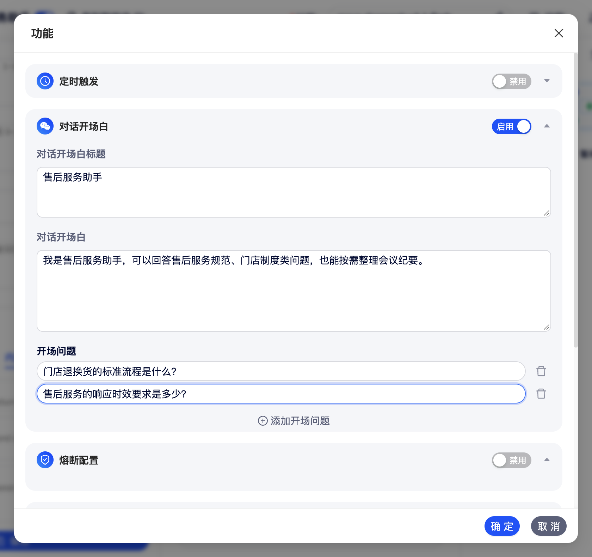

图 8-11 对话开场白

4. **熔断配置：** 防止异常循环或超量调用。可设置单次交互最大循环轮次、单次交互调用单个工具上限次数、工具连续调用次数、保留完整消息内容的前 N 条消息。达到限制后触发熔断，智能体停止继续调用工具，基于已获得的信息生成回答；信息不足时向用户说明缺少的信息并引导补充。

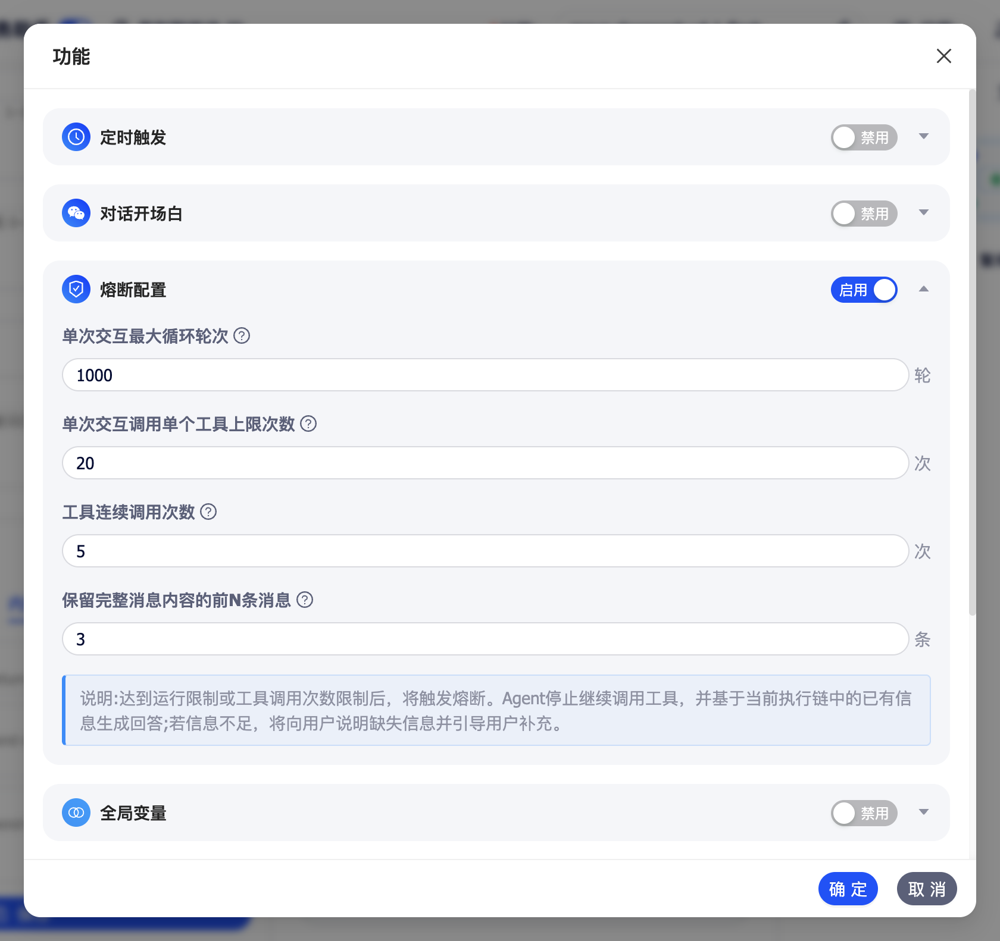

图 8-12 熔断配置

5. **全局变量：** 点击「添加全局变量」，在「变量修改」中填写名称、类型（字符串、富文本、整数、小数、日期、日期时间、时间、布尔、实体引用、下拉框）和是否必填。全局变量可通过 API 调用时传入（第九章）。

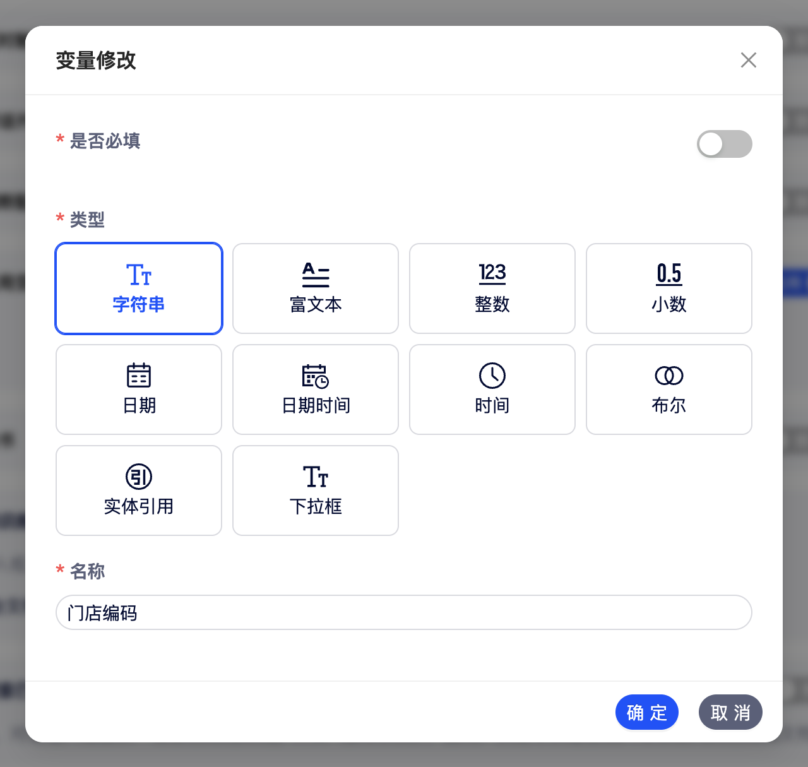

图 8-13 添加全局变量

6. **飞书：** 接入飞书应用时填写 App ID 和 App Secret，见 9.1.3。
7. **知识库二次筛选：** 开启后可选「平台文档中心」「知识库」，两项可同时开启，允许在调试和运行时把检索范围在已配置范围内进一步缩小（8.3.2）。
8. **搜索已归档文档：** 开启后，对话输入框提供「检索已归档文档」开关（默认关闭），由用户决定本次是否纳入有权访问的已归档文档。
9. 点击「确定」，再点击配置页底部「保存」，提示「保存成功」。

**说明：**

- 定时任务执行时会消耗模型调用量，执行计划按实际需要设置，测试完成后及时停用或删除。
- 按任务类型区分执行预期：知识查询与执行任务的调用方式和合理耗时不同（策略配置项为规划方向，以实际界面为准）。
- 会话与记忆使用范围（权限、查看与编辑）为规划能力，当前版本按已有会话能力使用。

### 8.2.4 选择适用场景【规划】

**目标：** 按场景类型初始化智能体的配置项，减少从零配置的工作量。

**说明：** 原型在配置页左侧最上方提供「适用场景」下拉，可选深度推理场景、知识问答场景、FAQ问答场景、智能问数场景、智能报告场景。当前测试环境配置页左侧直接从「意图识别与规划」开始，没有场景选择，具体以上线版本为准。

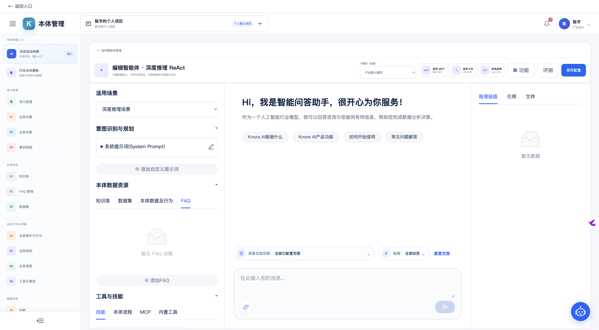

图 8-14 适用场景与 FAQ 资源（原型示意，以上线版本为准）

## 8.3 Agent：本体数据资源配置

配置页「本体数据资源」区有三个页签：知识库、数据集、本体数据及行为。

### 8.3.1 添加本体数据资源

**目标：** 为智能体配置本体对象，使其能查询实体、关系、事件和调用 Action。

**入口：** `本体数据资源 > 本体数据及行为 > 添加本体对象`

**操作步骤：**

1. 点击「添加本体对象」，打开「选择本体对象」。窗口按实体、关系、事件、Action 分页签列出当前项目可用的对象和数量。
2. 勾选本场景需要的对象，确认后回到配置页。已添加的对象显示名称、API 标识和版本，可「查看」「编辑」「删除」。

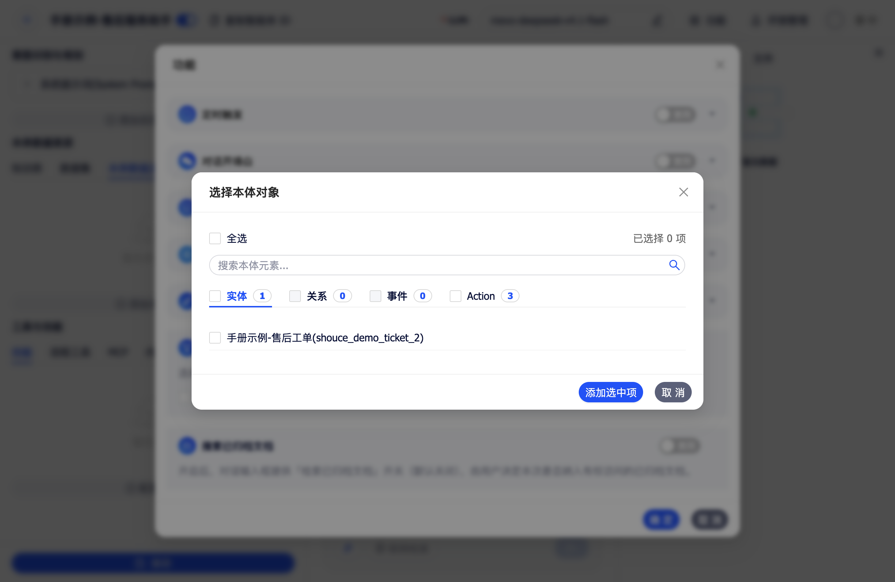

图 8-15 选择本体对象

3. 点击底部「保存」。

**注意事项：** 按场景选择对象，不要整库引入；对象越多，智能体选错对象的概率越高。智能体能查到的数据范围与 6.13 配置的权限一致，用最终用户账号验证（8.5.2）。

### 8.3.2 引用文档知识库

**目标：** 为智能体配置文档知识库或数据知识库，使回答有文档依据。

**入口：** `本体数据资源 > 知识库 > 添加知识库`

**操作步骤：**

1. 在「知识库」页签点击「添加知识库」，打开「选择知识库」。窗口分「文档知识库」「数据知识库」两类并显示各自数量，勾选后点击「添加选中项」。只添加本场景需要且已完成构建验证的知识库（第五章）。

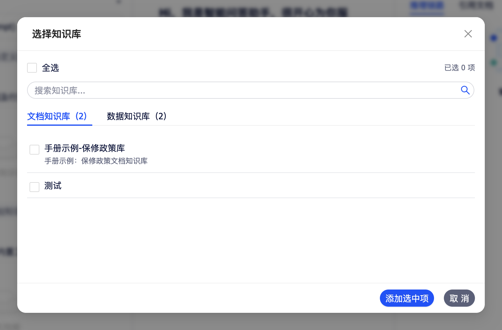

图 8-16 选择知识库

2. 需要直接检索门户文档时，在「功能」中开启「知识库二次筛选」并勾选「平台文档中心」（8.2.3）。当前版本「本体数据资源」没有独立的「平台文档中心」页签，此项待确认。
3. 展开页签下方的「检索配置」，设置检索参数（当前配置应用于此类已选资源）：
   - **召回分片数量：** 各资源使用的最大召回分片数量，1–100。
   - **最低相关度：** 仅保留达到该相关度的分片，范围 0–1。
   - **最大长度：** 送入模型的检索内容上限。
   - **检索模式：** 默认「纯语义召回」。界面提示三种模式：语义（按含义匹配）、全文（按关键词匹配）、混合（综合两类结果）。
   - **重排模型：** 如「BCE重排序 (内置)」。

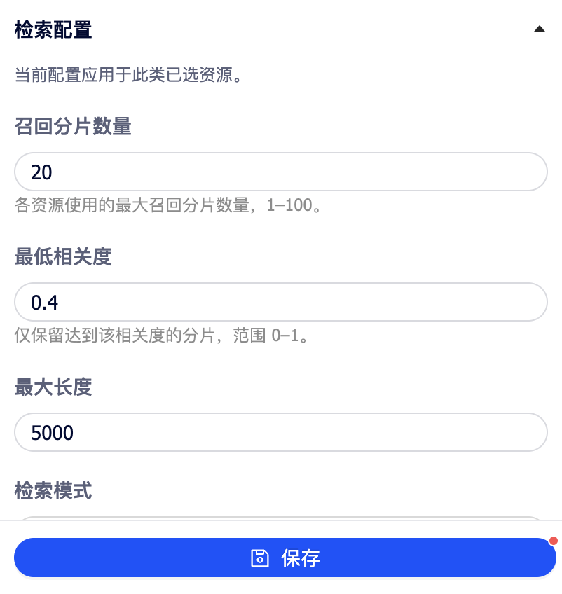

图 8-17 知识库检索配置

4. 点击底部「保存」。

**注意事项：** 知识库引用不改变文档权限。用户只能获得其有权访问的内容，引用知识库不等于底层文档全部可见（5.1.3）。

### 8.3.3 配置 FAQ【规划】

**目标：** 为 FAQ 问答类智能体挂载标准问答，命中时直接返回统一口径的答案。

**当前环境：** 测试环境的智能体配置页没有 FAQ 配置入口。2026-11-26 复查确认：「本体数据资源」只有知识库、数据集、本体数据及行为三个页签，没有「平台文档中心」也没有「FAQ」；「功能」窗口各项功能（定时触发、对话开场白、熔断配置、全局变量、飞书、知识库二次筛选、搜索已归档文档）均无 FAQ 项；「选择知识库」只分文档知识库和数据知识库，没有 FAQ。上线前，标准问答可整理为数据知识库（5.2）后在「知识库」页签引用。

**原型设计（以上线版本为准）：**

1. **数据来源：** FAQ 不在智能体里录入，来自当前项目的 FAQ 管理（原型菜单 `业务知识 > FAQ 管理`）。FAQ 按场景分类维护，只有状态为「已启用」或「已发布」的问答可以被智能体选用。
2. **添加：** 在「本体数据资源」的「FAQ」页签点击「添加FAQ」，打开「添加 FAQ 场景」。左侧是当前项目的 FAQ 场景目录（如产品使用、账号与权限、项目访问、数据管理、常见故障、文档解析、未分类），每个场景显示「已选 / 可用」条数；右侧列出所选场景中可用的问答，可逐条勾选或「全选」。勾选场景即选中该场景及下级场景的全部可用问答。项目暂无 FAQ 时提示「当前项目暂无 FAQ 场景，请先在 FAQ 管理中创建」。
3. **确认与保存：** 点击「确认」后，页签中按场景显示已选条数（如「3 / 6 条 FAQ 已选」），可点击条数预览问答内容，或移除整个场景；随后提示「FAQ 场景已更新，点击顶部保存配置」，点击「保存配置」生效。

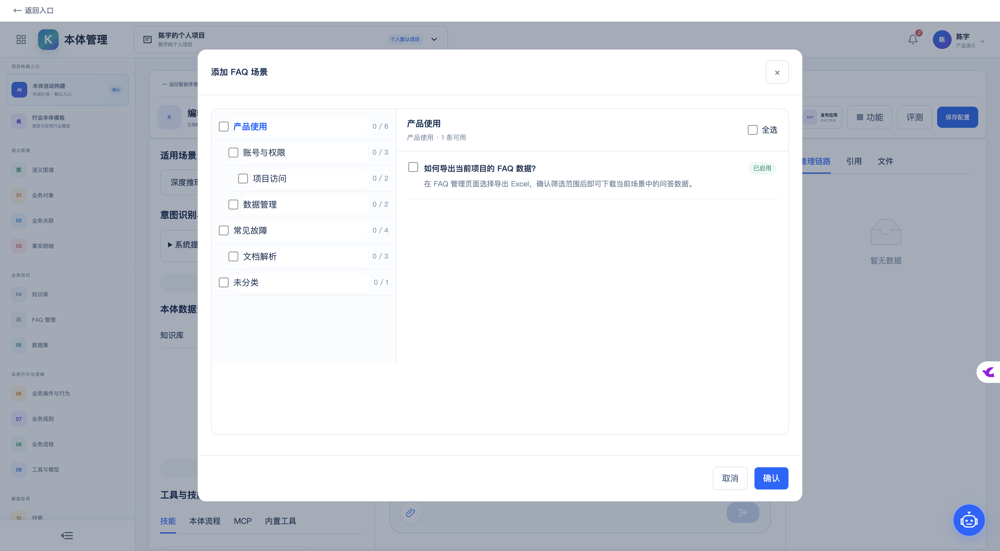

图 8-18 添加 FAQ 场景（原型示意，以上线版本为准）

**注意事项：** FAQ 在 FAQ 管理中修改或停用后，智能体按最新的启用状态取用，无需重新勾选；新增问答需要回到「添加 FAQ 场景」补选。（原型逻辑，以上线版本为准。）

## 8.4 Agent：工具与技能配置

配置页「工具与技能」区有四个页签：技能、流程工具、MCP、内置工具。

### 8.4.1 添加工具与 Logic

**目标：** 为智能体挂载流程、MCP 工具和内置工具，使其能执行流程任务。

**操作步骤：**

1. **流程工具：** 在「流程工具」页签点击「添加流程」，打开「选择流程工具」窗口。窗口按「名称 / 描述」两列列出当前可添加的流程工具，勾选后确定。示例环境可选到「手册示例-售后问题检索」。流程工具来自已发布为流程工具的 Logic（6.10.4、7.1.3）。

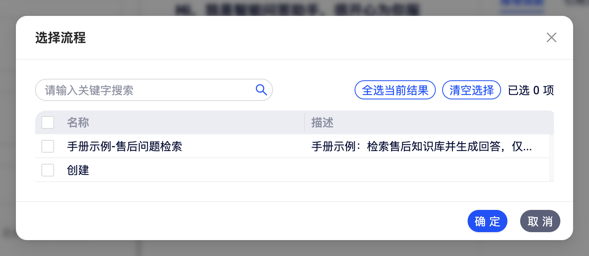

图 8-19 添加流程工具

2. **MCP：** 在「MCP」页签选择已接入的 MCP 服务中的工具（7.1.4）。
3. **内置工具：** 「内置工具」页签列出平台提供的 9 个基础工具，用于执行命令、读写文件、检索内容和维护记忆。每个工具在界面上给出一句英文说明，以界面为准：

   | 工具 | 用途 |
   |---|---|
   | `shell` | 执行命令行命令 |
   | `file_read` | 读取文件内容 |
   | `file_write` | 写入文件内容 |
   | `glob_search` | 按文件名模式查找文件 |
   | `grep_search` | 按内容检索文件 |
   | `load_skill` | 加载指定的技能 |
   | `list_skills` | 列出可用技能 |
   | `update_memory` | 更新智能体记忆 |
   | `core_memory_update` | 更新核心记忆 |

   内置工具由平台提供，不需要添加，只能点击查看图标了解说明。

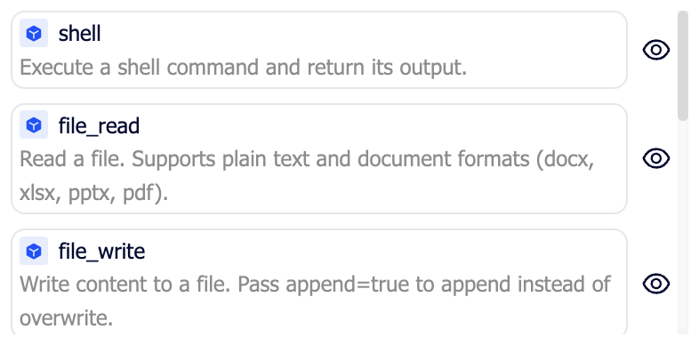

图 8-20 智能体内置工具

4. 点击底部「保存」。

**注意事项：** 每个流程和工具的名称、描述要让模型能判断「什么时候用」：写清用途、必要输入、返回内容和禁止使用的情况。描述含糊时，模型容易该调用时不调用。

**智能体调用流程优化【1130 版本】：** 1130 版本优化智能体调用流程的准确性和稳定性，属于后台能力，配置方式不变。上线后用 8.5 的验收样例复测流程调用场景。

### 8.4.2 添加 Skill

**目标：** 为智能体挂载已发布的技能，使其能完成既定的一类任务。

**操作步骤：**

1. 在「技能」页签点击「配置技能」，打开选择弹窗，勾选 7.2.3 已发布的技能。弹窗顶部有「全选当前结果」「清空选择」，并显示「已选 N 项」；结果为空时显示「暂无数据」。只添加本场景需要的技能。

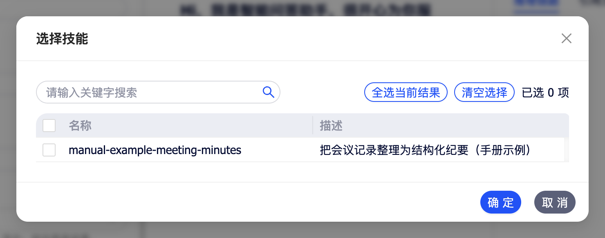

图 8-21 配置技能

2. 已配置的技能显示名称和描述，可「查看」「编辑」「删除」。

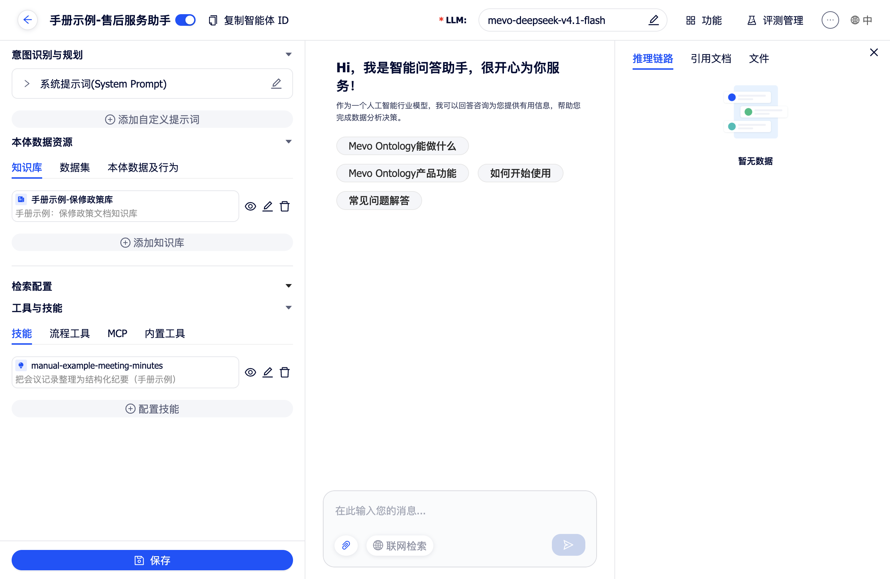

图 8-22 已配置的技能

3. 在系统提示词中写清技能的调用时机与边界，与技能描述保持一致（8.2.2）。
4. 点击底部「保存」。保存后在对话输入框中输入「/」，可查看并指定当前已配置的技能（Skill）和工具（Tool）。

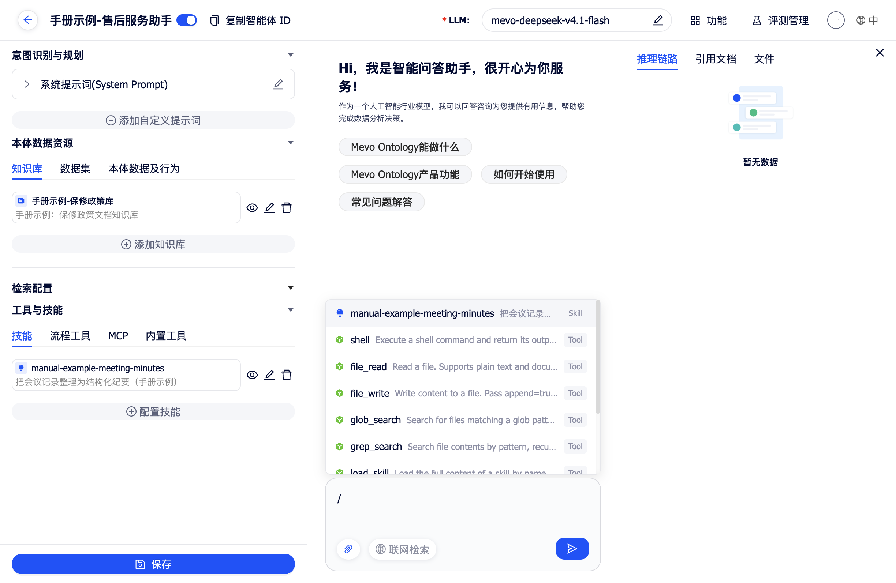

图 8-23 输入「/」指定技能或工具

5. 在 8.5 验证智能体能按场景正确调用。

## 8.5 Agent：调试

### 8.5.1 测试对话

**目标：** 用业务样例验证回答质量与任务执行。

**入口：** 配置页中间的调试对话区

**操作步骤：**

1. 保存配置后，在调试对话区输入验收样例并发送。示例：对「手册示例-售后服务助手」提问「保修期内维修需要提供哪些凭证？」。运行中右侧「推理链路」实时显示执行步骤。

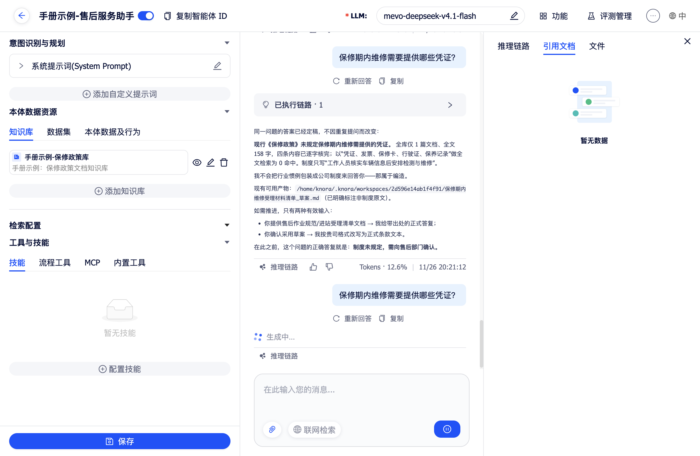

图 8-24 调试运行中

2. 逐条运行正常、边界、信息不足、无权限四类样例，核对答案与执行动作。回答下方可「重新回答」「复制」。

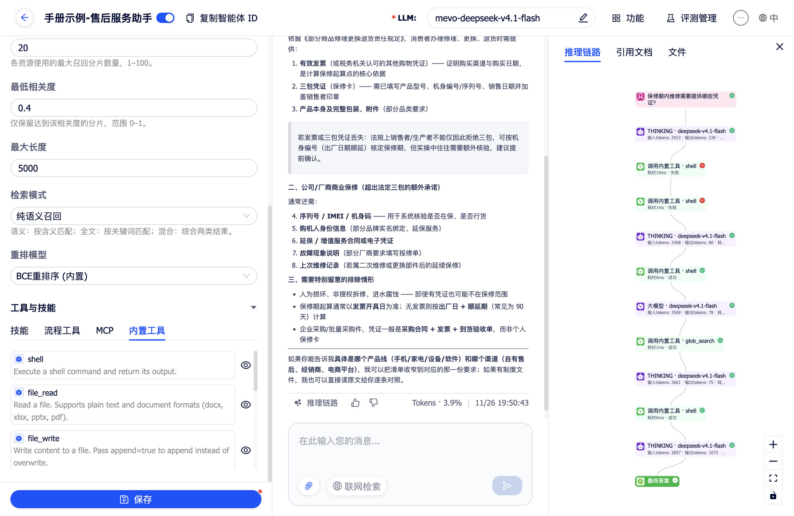

图 8-25 调试结果与推理链路

3. 回答没有依据时，检查知识库引用和提示词中的调用规则；该调用工具或技能而未调用时，修改资源描述和提示词（8.4.1）。

### 8.5.2 查看调用结果

**目标：** 核对智能体是否在该调用时调用、不该调用时不调用，回答有引用依据，且权限边界真实生效。

**已跑通的示例：** 在「手册示例-售后服务助手」中配置「手册示例-保修政策库」后，提问「保修期内维修需要提供哪些凭证？」，右侧推理链路依次为：THINKING（模型思考，deepseek-v4.1-flash）→ 调用技能 `knowledge_base` → THINKING → 调用内置工具 `run_doc_kb_op` → THINKING → `run_doc_kb_op` → `run_doc_kb_op` → THINKING → 最终答案。回答下方显示「重新回答」「复制」「已执行链路 · 8」，并标注 Tokens 用量 9.7%。答案依据库内《手册示例-保修政策.md》逐条引用整车质保、动力电池、不予保修、服务流程四条原文，并说明该文档只提到「核实车辆信息」、未列出需提交的凭证清单，未作推测。

**操作步骤：**

1. **查看执行链路：** 展开回答上方的「已执行链路」，逐步查看模型思考（THINKING）、调用技能、调用内置工具、大模型生成等步骤及其状态、耗时和 tokens 用量。链路中失败后重试的步骤会保留，可用于判断工具调用是否稳定。

图 8-26 已执行链路

2. **核对引用来源：** 在右侧「引用文档」查看本次回答参考的文档。示例中显示「参考了 1 篇文档」，即《手册示例-保修政策.md》，标注「检索」和「相似度 0.58」；展开文档行可看到命中的具体分片原文，实现分片级溯源。回答中的每条结论都能对应到该分片，未列出的信息（如具体凭证清单）在答案中明确说明没有依据。

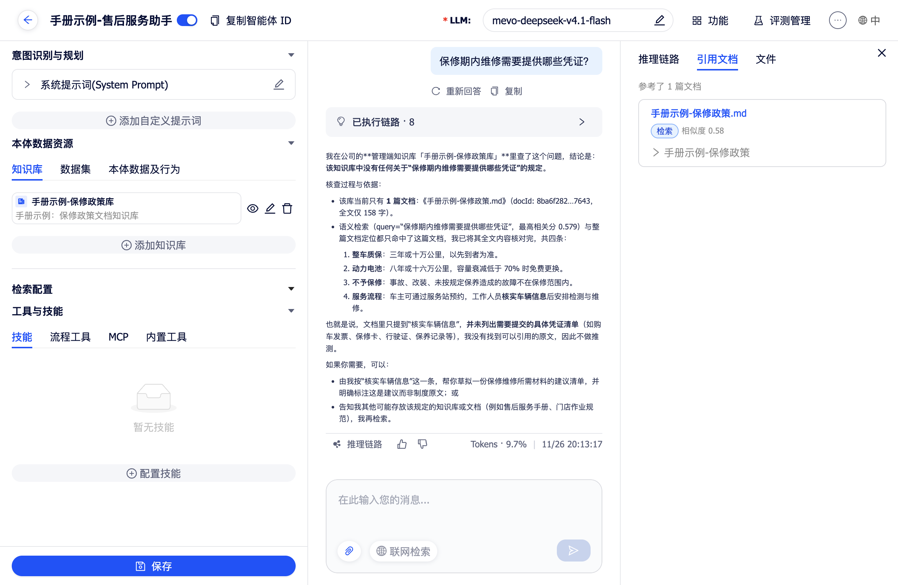

图 8-27 引用文档

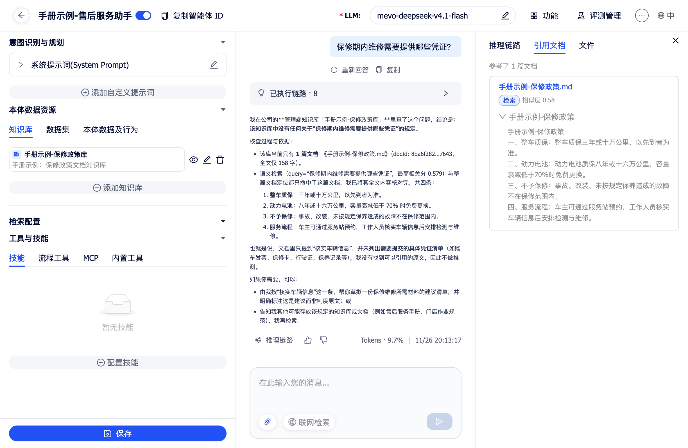

图 8-28 展开查看命中分片

3. 知识库回答应对应到具体文档和分片，本体回答应对应到对象和实例；给不出依据的回答不能作为结论交付。
4. **查看运行日志：** 在智能体列表卡片的 `更多 > 运行日志` 中查看历次运行记录。
5. **授权账号验证：** 用目标用户账号验证能正常获得回答与执行任务，数据范围符合授权（6.13）。

## 8.6 Agent：发布

### 8.6.1 发布 Agent【1113 版本】

**目标：** 把调试通过的智能体发布到项目所属部门，由部门管理员授权给目标用户。

**说明：** 需求计划在 1113 版本上线「智能体发布至部门」：项目中的智能体发布到所在部门后处于已发布状态，在知识门户「资源」的智能体资源中由部门管理员授权，项目内不再单独授权；用户在首页「我的智能体」和「我的 > 智能体」中使用。当前测试环境未上线，智能体保存配置后即可在运行态使用，使用范围按 8.6.2 授权控制；通过 API、飞书在平台外使用见第九章。

### 8.6.2 设置使用范围

**目标：** 控制谁能看到和使用智能体。

**入口：** `业务行为 > 智能体 >` 悬停卡片 `>` 「授权」

**操作步骤：**

1. 点击卡片上的「授权」，打开授权窗口，选择可见权限：
   - **只有我（私有）：** 仅创建人可见。
   - **所有团队成员（共享）：** 团队成员均可见。
   - **指定成员可见：** 只授权给选中的人员。

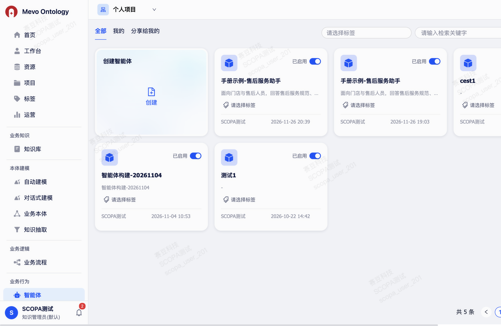

图 8-29 智能体授权

2. 选择「指定成员可见」时，在「授权」页签按部门或用户名 / 姓名搜索并勾选人员；「查看」页签显示已授权人员。
3. 设置权限（「管理」或「使用」）和有效时间（开始时间至结束时间），点击「确定」。需要按部门批量授权时，设置部门筛选后点击「按过滤条件授权」。

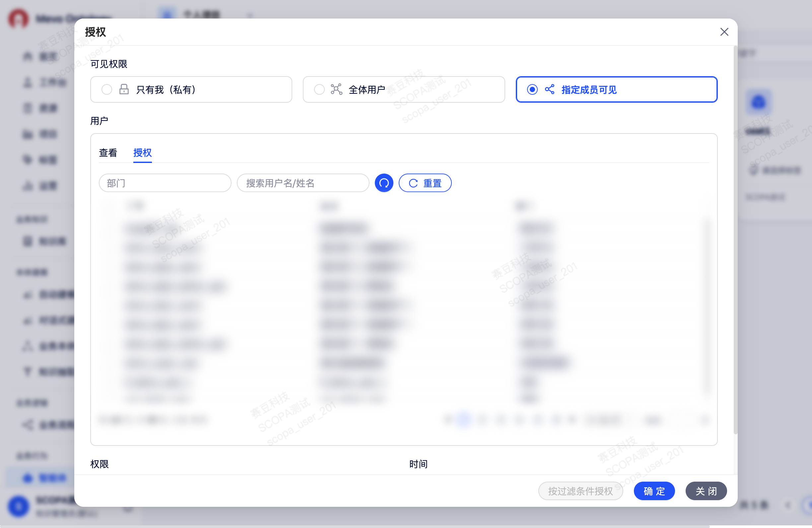

图 8-30 授权给指定成员（人员信息已打码）

**注意事项：** 「管理」权限可以修改配置，只授给共同维护的人；最终用户授「使用」。授权后用被授权账号登录验证一次。

## 8.7 Agent：使用

### 8.7.1 发起对话

**目标：** 用户用自然语言向智能体提问或下达任务并获得结果。

**入口：** 在智能体列表点击卡片，进入运行态对话页

**操作步骤：**

1. 对话页左侧为会话列表，可「开启新会话」、按标题搜索会话、重命名或删除会话；「定时任务」页签查看定时触发的执行记录。中间显示开场白和开场问题，点击开场问题可直接提问。

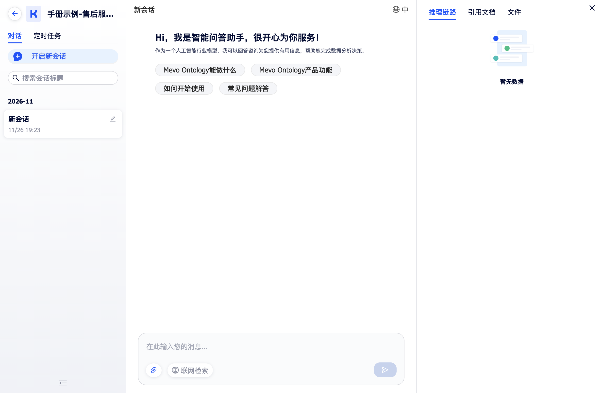

图 8-31 运行态对话页

2. 在输入框输入问题并发送。可点击回形针图标上传附件，开启「联网检索」补充公开信息，或输入「/」指定技能与工具。
3. 一次说清目标与约束；复杂任务按智能体提示补充信息。

图 8-32 运行态问答结果

### 8.7.2 查看结果与反馈

**目标：** 核对回答及引用依据，获取生成的文件，通过点赞、点踩反馈使用效果。

**操作步骤：**

1. **核对回答内容：** 检查回答是否解决问题、引用依据是否支持结论，方法同 8.5.2。回答下方显示 Tokens 用量和时间，点击「推理链路」可查看执行过程。
2. **获取生成文件：** 智能体调用技能生成文件时，回答下方的「文件列表」显示生成的文件。点击文件名在右侧预览，点击「导出」下载。

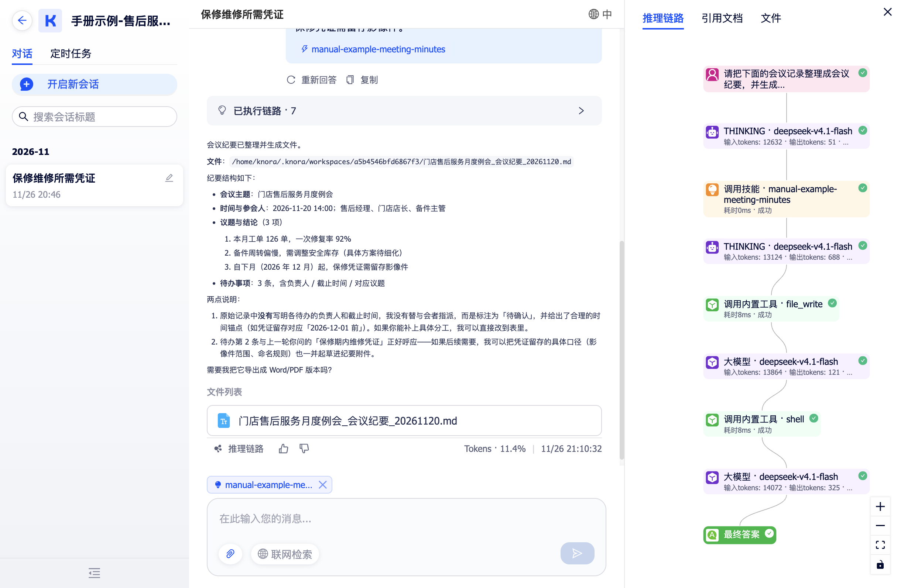

图 8-33 调用技能生成会议纪要文件

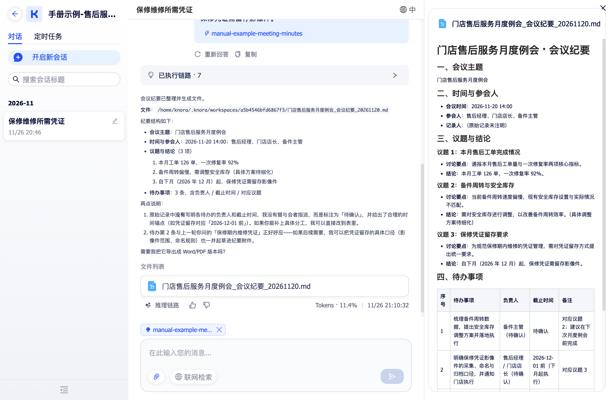

图 8-34 预览与导出生成的文件

3. **点赞：** 回答准确、依据充分时点击点赞图标。
4. **点踩：** 回答有误时点击点踩图标，在「问题反馈」中勾选原因（答非所问、数据不准确、缺少关键要素、回复不合适、图表不准确、总结不准确、推荐不准确、其他），可填写详细描述（200 字以内），点击「提交」。未勾选原因时「提交」不可用。提交后该回答显示已点踩状态。

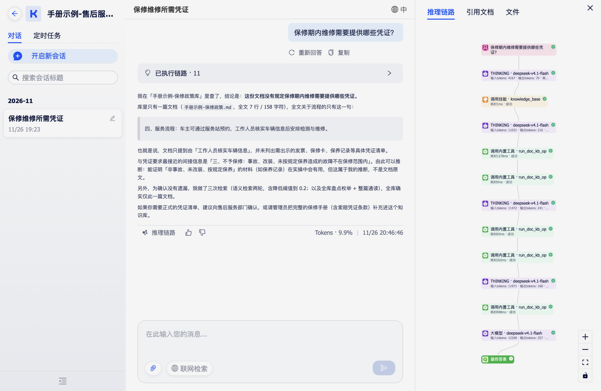

图 8-35 点踩反馈

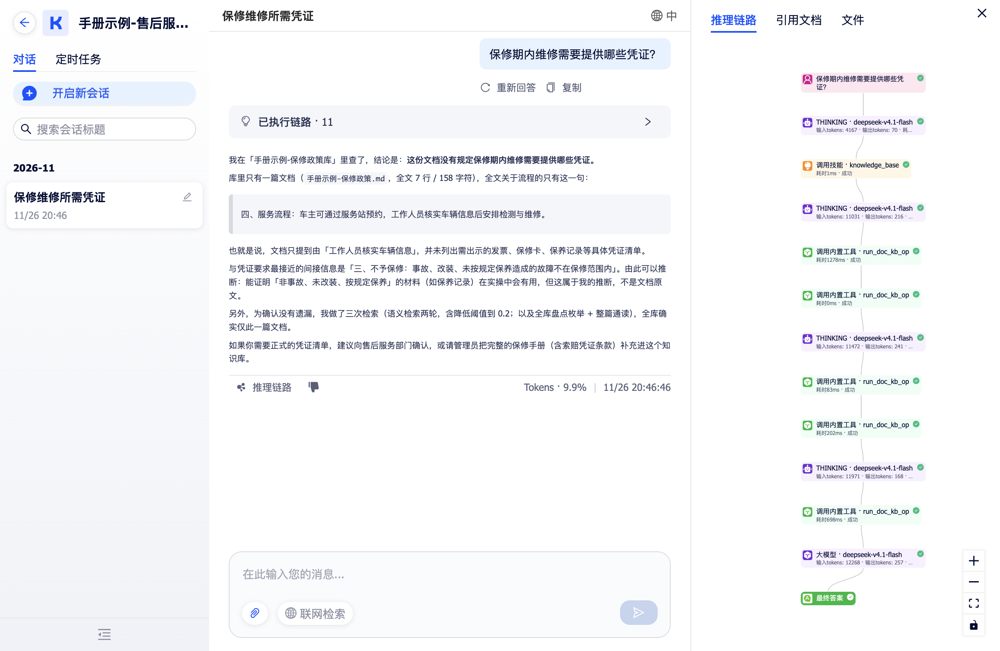

图 8-36 反馈提交后的回答

**注意事项：** 点赞、点踩针对具体回答，可作为 11.7 运营分析和人工复核的参考，不会立即纠正答案或自动更新知识。影响业务的错误按 11.5 定位原因、修正并复测。

---

## 本章变更说明（v3.4 → v4.0）

**新增**

- 8.2.4 选择适用场景【规划】（原型截图）。
- 8.3.3 配置 FAQ【规划】（原型截图）。
- 8.4.1 补充「智能体调用流程优化【1130 版本】」说明。

**修改**

- 8.1.1：入口改为 `业务行为 > 智能体`（路由 `/aigo/modules/spotlight-aip-3/micro/app/bot3`）；补充新建弹窗字段、配置页布局和卡片操作；写明示例智能体「手册示例-售后服务助手」已存在，可直接调试。全部截图重截（v3.4 为 Knora Claw 时期界面）。
- 8.2.1：补充可选模型和模型参数。
- 8.2.2：补充编辑提示词弹窗、文件上传、@ 引用系统变量、添加自定义提示词。
- 8.2.3：按「功能」窗口重写：定时触发、对话开场白、熔断配置、全局变量、飞书、知识库二次筛选。
- 8.3.1 / 8.3.2：补充四个资源页签、选择窗口和检索配置参数；新增平台文档中心目录选择。11-26 为示例智能体「手册示例-售后服务助手」配置了「手册示例-保修政策库」，用于 8.5.2 的引用与分片溯源演示。
- 8.3.3：2026-11-26 再次复查，环境仍无 FAQ 配置入口，保留【规划】，见待确认第 2 条。
- 8.4.1：页签名称改为环境中的技能 / 流程工具 / MCP / 内置工具；流程工具选择窗口写明「名称 / 描述」两列；内置工具按环境实为 9 个（shell、file_read、file_write、glob_search、grep_search、load_skill、list_skills、update_memory、core_memory_update）逐项列出，替换原「等」的写法。
- 8.4.2：补充技能选择弹窗的全选当前结果 / 清空选择 / 已选 N 项 / 空态「暂无数据」，以及「/」可同时指定技能和工具。
- 8.5.1 / 8.5.2：按 11-26 重跑的调试链路改写：为示例智能体配置「手册示例-保修政策库」后，提问「保修期内维修需要提供哪些凭证？」→ THINKING → 调用技能 `knowledge_base` → THINKING → `run_doc_kb_op` → THINKING → `run_doc_kb_op` → `run_doc_kb_op` → THINKING → 最终答案，回答下方有「重新回答」「复制」「已执行链路 · 8」、Tokens 9.7%；引用文档显示 1 篇文档、检索、相似度 0.58，展开可做分片溯源。原「未命中知识库、引用页签为空」的描述已删除。
- 8.6.1：「当前状态（待补）」改为【1113 版本】发布至部门说明。
- 8.6.2：去掉【待补】，按环境「授权」功能重写。
- 8.7.1：补充运行态对话页（会话管理、开场问题、附件、联网检索）。
- 8.7.2：补充生成文件预览与导出、点踩原因选项。
- 8.2.4：更正「环境只有意图识别与规划下拉」的描述，环境左侧为三个可折叠区域，无场景选择。
- 8.3.3：写明环境未提供 FAQ 入口（已核实三处）、原型中 FAQ 的数据来源（项目 FAQ 管理中已启用 / 已发布的问答）和选择、保存方式。
- 复核截图：图 8-2（原图与图 8-1 重复）、图 8-20（原图为选择流程弹窗）、图 8-35（原图只有悬停提示，无反馈弹窗）重截。

**删除**

- v3.4 8.2.3「需要人工中途介入的场景了解消息插入与排队打断机制」：环境「功能」窗口和对话页均未找到对应配置或说明，暂不写入，见待确认第 10 条。

**未变**

- 各小节目标；8.2.3 中关于任务类型策略与记忆能力的规划说明。

## 待确认

1. 适用场景（8.2.4）与 FAQ 配置（8.3.3）：环境未上线，原型已有界面，需求表中未找到对应版本号，暂标【规划】，请确认目标版本。
2. FAQ 配置入口仍不存在：2026-11-26 再次复查最新菜单（业务行为 > 智能体）、配置页「本体数据资源」三个页签、「功能」窗口、「选择知识库」弹窗，均无 FAQ 入口，8.3.3 按【规划】保留。同时 FAQ 管理入口与第三章冲突：原型中 FAQ 管理位于 `业务知识 > FAQ 管理`（按项目维护），3.4 写的是门户 FAQ 管理且记录「原型均未找到 FAQ 管理功能」。需确认 FAQ 归属（门户还是项目本体管理），并统一 3.4 与 8.3.3 的入口和用途说明。
3. 智能体发布至部门（8.6.1，1113 版本）：环境未上线，原型「发布」按钮点击后无发布界面，未截图；上线后补发布与审批截图，并同步更新 8.6.2（需求说明发布后项目内不再支持授权）。
4. 运行日志：卡片「更多 > 运行日志」在测试中未能打开日志页面，未截图，需在环境中复核。
5. 模型异常提示（1113 版本，大模型配置错误时直接提示用户）：环境未上线，未写入操作步骤，上线后补入 8.2.1。
6. 智能体评测、日志与反馈导出（1113 / 待定）：原型卡片有「评测管理」，环境未上线，本章未写，需确认是否在 v4.0 手册中增加小节。
7. 运行态「定时任务」页签内容未截图。
8. 全局变量在 API 调用中的传参方式以 9.1.1 接口文档为准，智能体 OpenAI 兼容接口中未见全局变量字段，需开发确认。
9. 测试过程中对示例智能体提交了一条点踩反馈（原因「缺少关键要素」），可能计入运营看板统计。
10. 消息插入与排队打断（v3.4 8.2.3 提及）：v4.0 环境未找到对应功能，需确认是否仍存在、是否写回 8.2.3。
11. 8.5.2 引用文档 / 分片溯源：11-26 为示例智能体配置「手册示例-保修政策库」后重跑，引用页签已能显示 1 篇文档（检索、相似度 0.58）并展开分片，图 8-27、8-28 已按新链路重截。遗留两点请确认：①示例智能体新增了该知识库配置，如不希望保留请告知；②库内仅 1 篇 158 字的示例文档，回答只能说明「文档未列凭证清单」，若要演示完整引用效果，需换成内容更全的验收知识库。
12. 内置工具说明为界面英文单句，正文按功能译述，需产品确认中文名称与描述口径。
13. 11-26 环境复核已确认：入口为 `业务行为 > 智能体`，示例智能体「手册示例-售后服务助手」已存在于环境，可直接用于调试；此前「示例智能体已不在环境中」的判断不成立，已删除。旧图（配置页、调试、授权、运行态等）仍需按环境逐张复核。
14. 8.6.2 授权窗口的共享档位名称与正文不一致：正文写「所有团队成员（共享）」，11-26 环境授权窗口实为「全体用户」。图 8-29、8-30 按界面实拍，正文未改，请确认以哪个口径为准并统一。
15. 8.7.2 点踩后的状态在最新界面无可见标识：提交后回答下方只保留一个「取消」图标按钮（灰色 dislike），没有文案提示，与正文「提交后该回答显示已点踩状态」不完全对应。图 8-36 为该状态实拍，请确认是否需要补充说明，或由产品补齐可见状态。
16. 8.7.2 文件预览：11-26 生成的示例文件首次点击预览返回「请求超时，文件可能过大或服务器无响应」，再次点击文件名后才正常渲染。图 8-33 为正常渲染后的实拍，请产品确认该超时提示是否为已知问题。
