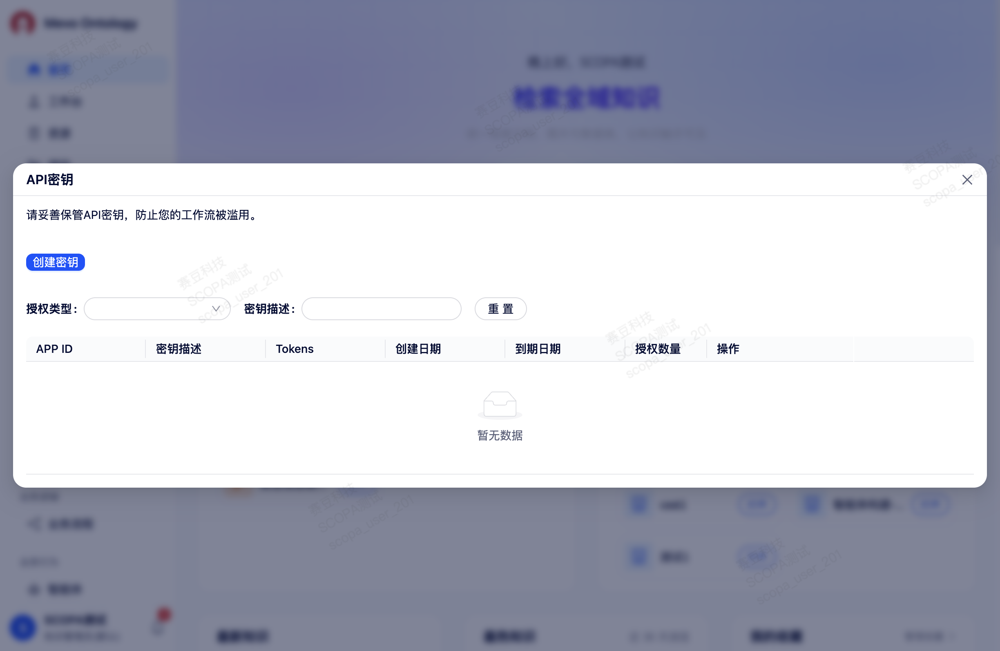
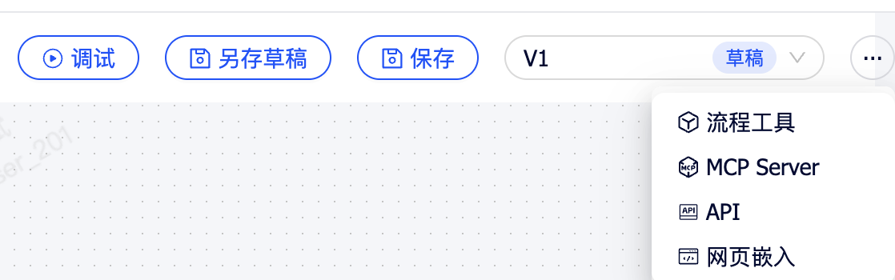
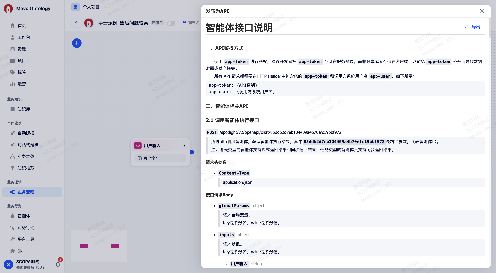
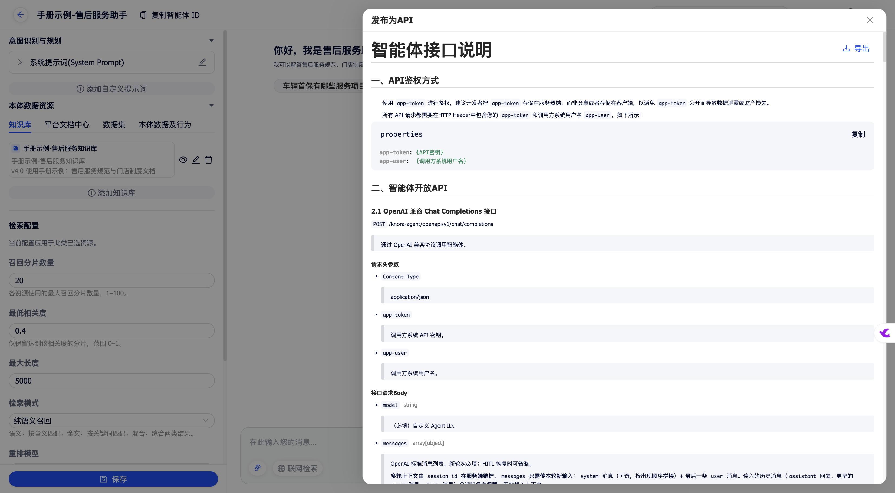
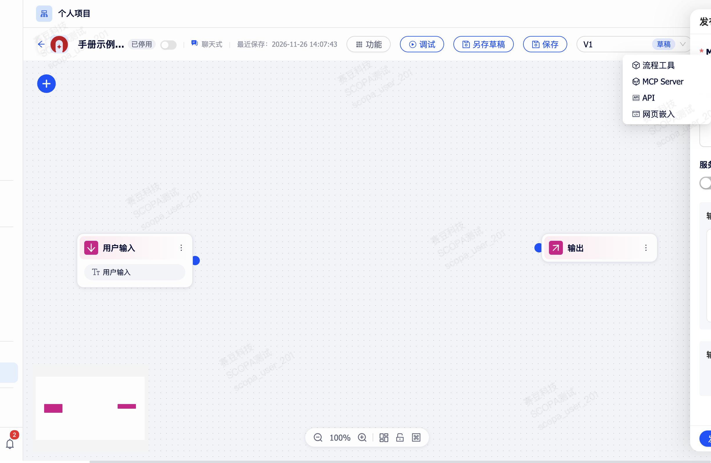
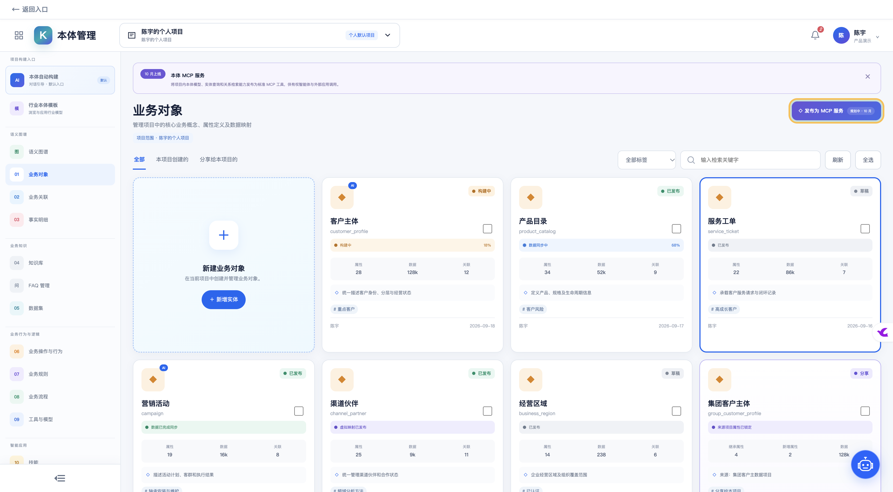
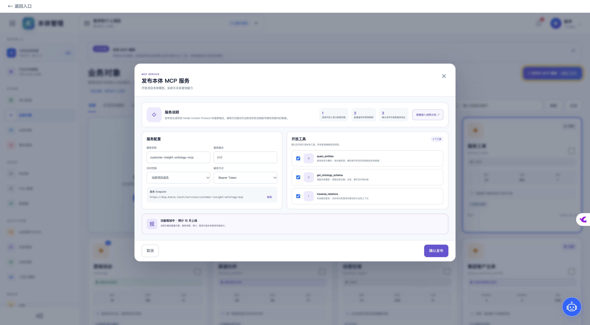
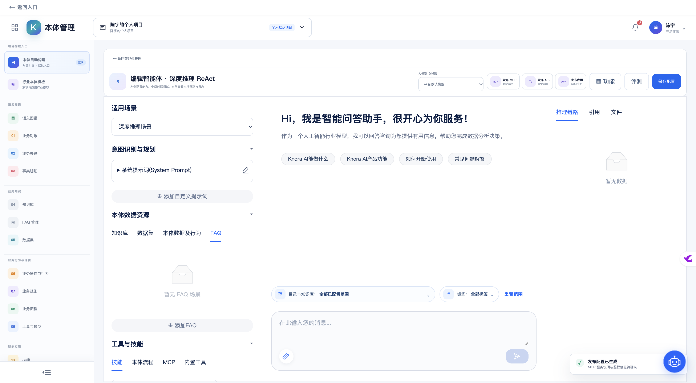
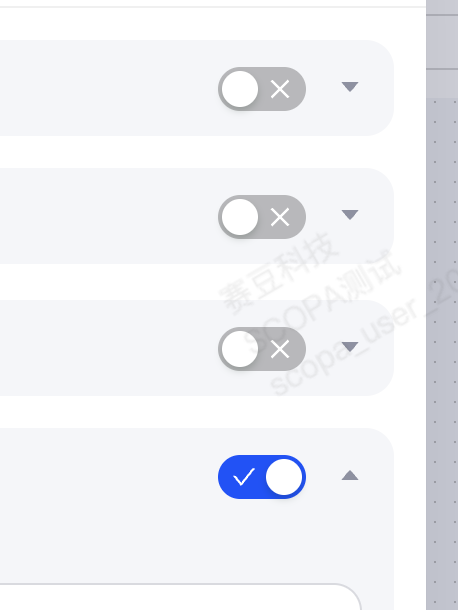
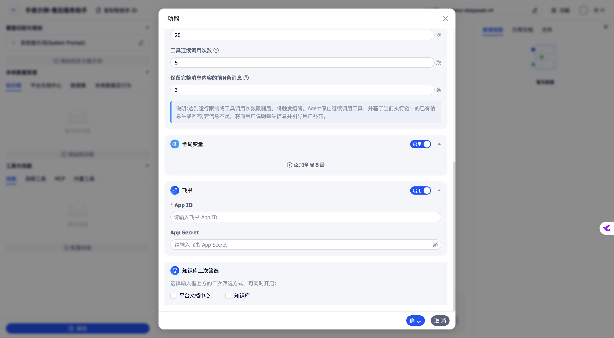

# 九、对外开放

> 编号与顺序沿用 v3.4。截图来自测试环境（v4.1.2）；标【1130 版本】的小节以上线版本为准。

本章说明如何通过 API、MCP 和飞书在平台外使用平台能力。当前环境（11-26 复核）的支持情况如下：

| 开放方式 | Logic | 智能体 | 知识库 | 本体 |
|---|---|---|---|---|
| API | 已支持（「…」> API） | 已支持 | 以现有接口文档为准 | — |
| MCP | 已支持（「…」> MCP Server） | 1130 版本（当前环境未见发布入口） | 1113 版本（进行中） | 1130 版本（业务本体、业务对象页未见发布入口） |
| 飞书 | 「功能」面板有「飞书配置」折叠项，打开开关后为 App ID / App Secret | 「功能」面板有「飞书配置」折叠项（配置页当前环境无法进入，未复核） | — | — |

## 9.1 对外开放：API、MCP 与飞书

### 9.1.1 API 调用

**目标：** 外部系统通过 API 调用 Logic 或智能体，把流程执行和智能问答接入已有业务系统。

**前置条件：** Logic 或智能体已调试通过并保存；调用方已拿到 API 密钥。

**第一步：准备 API 密钥**

**入口：** 右上角用户名 `>` 设置密钥

1. 点击右上角用户名，在下拉菜单中选择「设置密钥」，打开「API密钥」。

图 9-1 用户菜单中的「设置密钥」

2. 列表按 APP ID、密钥描述、Tokens（脱敏显示）、创建日期、到期日期和授权数量分列，可按授权类型和密钥描述筛选，点「重置」清空筛选条件；操作列提供「编辑」「复制密钥」「删除」。列表为空时显示「暂无数据」。
3. 需要新密钥时点击「创建密钥」。点击后立即生成一条新密钥，随后点击「编辑」补充密钥描述、到期日期和授权范围。

图 9-2 API 密钥列表（当前账号暂无密钥，仅显示「创建密钥」入口）

**注意事项：** 「请妥善保管API密钥」。密钥只通过「复制密钥」取得，存放在调用方服务器端，不要写进前端代码、文档或截图；不再使用的密钥及时删除。

**第二步：查看接口文档**

**Logic：** 打开目标 Logic，点击右上角「…」，选择「API」，右侧打开「发布为API」接口说明。

图 9-3 Logic 发布形态菜单

图 9-4 Logic 接口说明

Logic 接口要点：

- 地址：`POST /spotlight/v2/openapi/chat/{流程ID}`，流程 ID 已在文档中自动填好。
- 请求头：`app-token`（API 密钥）、`app-user`（调用方系统用户名）、`Content-Type: application/json`。
- 请求 Body：`globalParams`（全局变量）、`inputs`（流程输入参数，文档按当前流程列出参数名）、`stream`（是否流式；任务式流程只支持同步）、`returnLog`（是否返回运行日志）、`chatId`（多轮对话时传上一轮返回的会话 ID）。
- 返回：会话 ID、运行状态（running / failed / timeout / finish）、输出变量 `outputs`，按需返回运行日志 `runLogs`。

**智能体：** 打开智能体配置页，点击右上角更多（···），选择「API」，打开「发布为API」接口说明。

图 9-5 智能体接口说明（沿用 2026-11-06 旧版界面示意）

智能体提供两种兼容协议的接口，鉴权方式与 Logic 相同：

- **OpenAI 兼容：** `POST /knora-agent/openapi/v1/chat/completions`，`model` 填智能体 ID，`messages` 只需传本轮输入。
- **Anthropic 兼容：** `POST /knora-agent/openapi/anthropic/v1/messages`，`model` 填智能体 ID，系统提示词通过独立的 `system` 字段传入。
- 多轮对话由服务端按 `session_id` 维护：首轮不传，服务端在响应中返回；后续轮次携带该值。不传则每轮相互独立。
- 采样温度、输出上限、外部工具等参数由智能体配置控制，接口中传入无效。
- 支持流式（默认）和同步两种响应；`content` 只包含最终回答，执行过程的思考在 `reasoning_content` 中返回。

点击接口说明右上角「导出」可下载文档交给调用方。

**第三步：调用与验证**

1. 按接口文档准备调用地址、密钥、目标 ID 和请求参数，发起请求。
2. 核对返回结果；调用 Logic 时同时确认流程执行结果符合预期，调用智能体时核对回答依据。
3. 按文档中的错误说明排查异常，验证通过后接入业务系统。

**知识库：** 已支持 API 调用，接口及能力范围以现有 API 文档为准。

**注意事项：** 调用方以 `app-user` 传入的用户身份访问，按该用户的权限返回数据。Logic 与智能体分别按各自接口文档接入，参数结构不通用。

### 9.1.2 MCP 调用

**目标：** 把平台能力发布为 MCP 服务，让支持 MCP 的外部应用和智能体发现并调用。

**注意事项：** 本节是平台向外部提供 MCP 服务，与 7.1.4 接入外部 MCP 服务方向相反。

#### Logic 发布为 MCP 工具

**入口：** 打开目标 Logic `>` 右上角「…」`>` MCP Server

**操作步骤：**

1. 在「发布为MCP工具」中填写 MCP 工具名称和描述（必填）。描述要写清工具做什么，外部调用方据此判断是否调用。
2. 设置服务状态（启用 / 禁用）。
3. **输入参数配置：** 为流程的每个输入参数填写 MCP 参数名称（字母开头，最多 32 个字符）和参数描述。
4. **输出参数配置：** 确认输出参数名称，设置是否在返回中显示。
5. 点击「发布」。

图 9-6 Logic 发布为 MCP 工具

**注意事项：** 发布前确认流程已调试通过；共用项目中只对自己负责的流程操作。

#### 本体 MCP【1130 版本】

**目标：** 把项目内的本体模型、实体查询和关系检索能力发布为标准 MCP 服务，供有权限的智能体与外部应用调用。

**入口：** `本体建模 > 业务本体 > 业务对象 >` 页面右上角（以上线版本为准）「发布为 MCP 服务」

图 9-7 发布为 MCP 服务入口（原型示意，以上线版本为准）

**操作步骤（以原型为准）：**

1. 点击「发布为 MCP 服务」，打开「发布本体 MCP 服务」。
2. **服务配置：** 填写服务名称和服务版本，选择访问范围（当前项目成员、项目所在部门、指定调用方）和鉴权方式（Bearer Token、OAuth 2.0、平台身份透传）。系统生成服务 Endpoint，可复制。
3. **开放工具：** 默认只开放只读工具：`query_entities`（查询实体与属性）、`get_ontology_schema`（读取本体模型）、`traverse_relations`（关系路径查询），所有查询遵循项目权限。
4. 点击「确认发布」，复制服务地址交给调用方；点击「查看接入说明文档」获取接入方式。

图 9-8 发布本体 MCP 服务（原型示意，以上线版本为准）

**说明：** 服务权限、审计、限流与版本机制以上线版本为准。调用方只能访问当前项目和当前账号授权范围内的数据。

#### 智能体 MCP【1130 版本】

**目标：** 把智能体发布为标准 MCP 服务，供外部应用调用。

**入口：** 智能体配置页顶部「发布 MCP」（以上线版本为准）

**说明：** 原型在智能体配置页顶部提供「发布 MCP（服务与鉴权）」，点击后生成 MCP 服务说明，鉴权信息待确认。服务说明、鉴权与版本策略以上线版本为准。

图 9-9 智能体配置页的「发布 MCP」（原型示意，以上线版本为准）

### 9.1.3 飞书调用

**目标：** 把 Logic 或智能体接入飞书，让企业用户通过飞书机器人使用。

**前置条件：** Logic 或智能体已调试通过；飞书侧已创建应用并配置机器人，取得 App ID 和所需凭据。飞书侧的具体配置步骤待补。

**Logic 接入飞书：**

1. 打开目标 Logic，点击右上角「功能」，在右侧面板展开「飞书配置」（与「对话开场白」「全局变量」「常量」并列，均为折叠项）。
2. 打开「飞书配置」开关后出现 **App ID** 和 **App Secret** 两个输入框。填写飞书应用的 App ID（必填）；App Secret 按实际接入要求填写。
3. 当前环境该面板没有单独的「确认」按钮，填写后点画布上方的「保存」保存流程版本（6.10.4）。

图 9-10 Logic「功能」面板中的飞书配置

**智能体接入飞书：**

1. 打开智能体配置页，点击右上角「功能」，展开「飞书配置」并打开开关。
2. 填写 App ID 和 App Secret，再点击配置页底部「保存」。当前环境同样未见单独的「确认」按钮。

> 说明：11-26 复核时智能体列表为空（显示「目前未找到创建智能体」），无法进入配置页核对，上述步骤沿用 11-06 截图（图 9-11）。

图 9-11 智能体飞书配置（沿用 2026-11-06 旧版界面示意）

**验证：** 确认飞书侧机器人配置完成后，用目标用户账号在飞书中向机器人发起请求，检查 Logic 是否正常执行、智能体回答是否符合预期。

**注意事项：** 平台侧配置与飞书侧机器人配置需要配合完成，只填写 App ID 不代表已完成接入。App Secret 属于密钥，不要写入文档或截图。

---

## 本章变更说明（v3.4 → v4.0）

**新增**

- 章首增加开放方式支持情况表。
- 9.1.1：第一步「准备 API 密钥」（设置密钥）；智能体 API（OpenAI / Anthropic 兼容接口）。
- 9.1.2：Logic 发布为 MCP 工具；本体 MCP【1130 版本】；智能体 MCP【1130 版本】。
- 9.1.3：智能体接入飞书。

**修改**

- 9.1.1：Agent API 去掉【规划】，按环境「发布为API」接口说明重写；Logic API 补充入口和接口要点。全部截图新截。
- 9.1.2：去掉【规划】，按环境（Logic MCP Server）和 1130 原型重写。
- 9.1.3：Logic 飞书配置截图重截；「当前飞书接入仅支持 Logic」改为 Logic 和智能体均支持。
- 复核截图：图 9-1 重截（原图停在加载中的语义图谱页，未展开用户菜单）。
- 11-26 复核（统一左侧菜单版）：章首支持情况表按环境实测改写（Logic API/MCP 已支持，智能体 MCP、本体 MCP 未见发布入口，飞书为「功能」面板中的「飞书配置」折叠项，打开开关后为 App ID / App Secret）。9.1.1 密钥列表按当前账号「暂无数据」状态改写，图 9-2 换为当前空列表（含「创建密钥」入口，未点击）。图 9-3 重截为「…」下拉（流程工具 / MCP Server / API / 网页嵌入）。9.1.3 改为「功能」面板折叠项「飞书配置」，写明开关打开后出现 App ID / App Secret，当前环境无单独「确认」按钮；图 9-10 重截。智能体列表当前为空，9.1.3 智能体部分与图 9-11 沿用 11-06 截图并加注说明。

**删除**

- v3.4「Agent API 在上线前不作为当前可用能力使用」「MCP 对外调用尚未上线」等说明。

**未变**

- 9.1.3 前置条件中「飞书侧具体配置步骤待补」。

## 待确认

1. 知识库 API：本次未找到知识库的接口文档入口，沿用 v3.4「以现有 API 文档为准」，需补入口和截图。
2. 知识库 MCP（1113 版本，需求状态「进行中」）：环境中知识库详情未核实发布入口，原型有「发布为 MCP 服务」，是否写入本章待确认。
3. 本体 MCP：原型标注「10 月上线」，需求表为 1130 版本，菜单入口（业务对象页右上角）以上线版本为准。
4. 智能体 MCP：原型点击「发布 MCP」只弹出「发布配置已生成」提示，没有配置界面，步骤待上线后补。
5. 「创建密钥」点击后不经确认直接生成密钥。测试时误生成了一条密钥，已立即删除（当时列表恢复为原有 1 条），未复制、未外传。11-26 复核时该账号密钥列表为「暂无数据」，未见原有记录，原因待确认；手册是否需要提示「创建前先确认用途」请产品确认。
6. 飞书机器人端到端调用未验证（按约束不调用会发真实消息的功能），飞书侧配置步骤待补。
7. Logic 发布为 MCP 工具后的服务地址获取方式、外部调用示例未验证（未点击发布）。
8. API 密钥「编辑」中的授权范围字段未展开核实。
9. 11-26 最新环境复核：菜单已改为统一左侧菜单，Logic 入口为 `业务逻辑 > 业务流程`。本体 MCP、智能体 MCP 的发布入口在本次复核中未找到：`业务本体 > 业务对象` 列表仅有「新建 / 发布」，行操作只有「发布 / 授权 / 更多」；智能体列表当前为空，无法进入配置页核对「发布 MCP」，仍按 1130 版本原型处理。用户菜单「设置密钥」已重新核对（图 9-1、9-2 为新界面，未点击「创建密钥」）。
10. 飞书配置面板：Logic 与智能体两侧的「功能」面板均只有「飞书配置」折叠项，展开后为开关 + App ID + App Secret，未见「确认 / 确定」按钮，也未见提示保存位置。上线版本以哪个按钮提交、是否随流程版本保存，需产品确认。
11. 2026-11-26 无法重截：智能体列表为空（「目前未找到创建智能体」），无法进入配置页和 API 面板，图 9-5（智能体接口说明）、图 9-11（智能体飞书配置）沿用 2026-11-06 旧版界面示意，待环境中存在智能体后补截。
