# 十、企业知识门户检索与问答

知识门户面向企业内所有用户开放，不要求创建或加入项目，也不要求构建本体或项目知识库。检索和问答的范围以资源权限为准：使用前先确认自己在各部门的资源权限（见 2.2），结果只包含个人空间以及有权限部门中的资源。上层部门成员可以看到下级部门的文档列表，但要在检索中命中下级部门文档，还需成为对应下级部门的成员。

## 10.1 智能搜索

**入口：** 左侧菜单「首页」，即知识门户首页（路由 `/aigo/modules/knora-portal/micro/home`）。

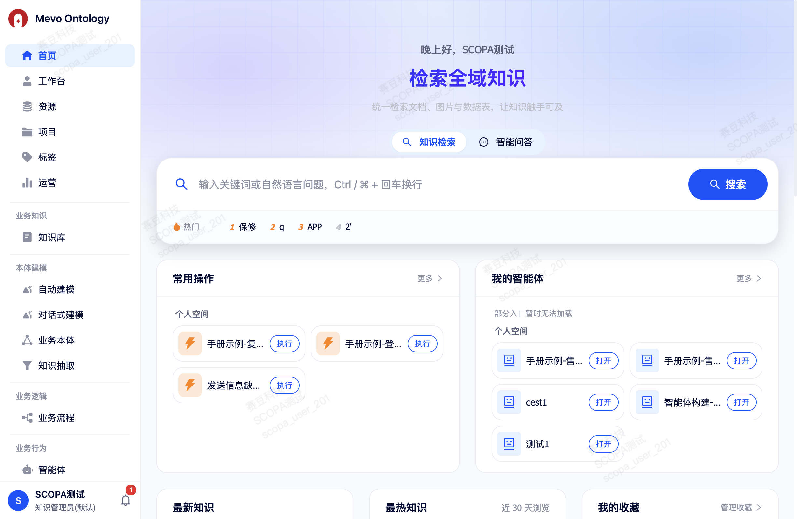

图 10-1 门户首页检索入口

首页顶部检索框上方有「知识检索」和「智能问答」两个模式页签，检索框右侧按钮随页签在「搜索」和「提问」之间切换；检索框下方是热门搜索词。首页下方依次展示常用操作、我的智能体、最新知识、最热知识。检索范围（「类型与目录」「标签」）在检索结果页设置，见 10.1.4、10.1.5。

### 10.1.1 发起问答

**目标：** 用自然语言提问，直接获得带出处的答案。

**入口：** `知识门户 > 首页 >` 检索框上方「智能问答」页签

**操作：**

1. 在首页检索框上方点击「智能问答」，检索框按钮由「搜索」变为「提问」。
2. 按需设置检索范围（见 10.1.4、10.1.5），输入问题，点击「提问」或按回车。
3. 页面进入问答结果页：左侧为「检索结果」（本次问题同时命中的文档）和「历史会话」，中间为问答区，右侧为「相关搜索」和「来源文档」。问答区顶部显示「智能问答」、模型选择（默认「默认模型」）、「新对话」和「我要反馈」。
4. 回答生成期间显示「生成中…」；生成完成后：
   - 答案上方显示「针对关键词「…」」，「已执行链路 · N」可展开查看本次回答经过的检索与推理步骤；
   - 答案下方列出「知识来源」，显示文档名、召回方式和相似度，展开「分片」可看到具体命中的分片及所在页码；
   - 可对回答「重新回答」或「复制问题」。
5. 在底部输入框继续追问，或点击「新对话」开始新的会话；点击「模型」处可切换问答使用的模型。左侧「历史会话」可回看以往问答。
6. 回答生成失败时，页面显示「生成失败，点击重试」，点击「重试」重新生成。

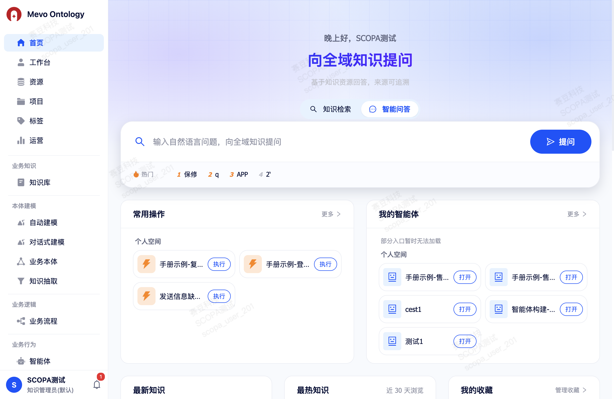

图 10-2 切换智能问答模式

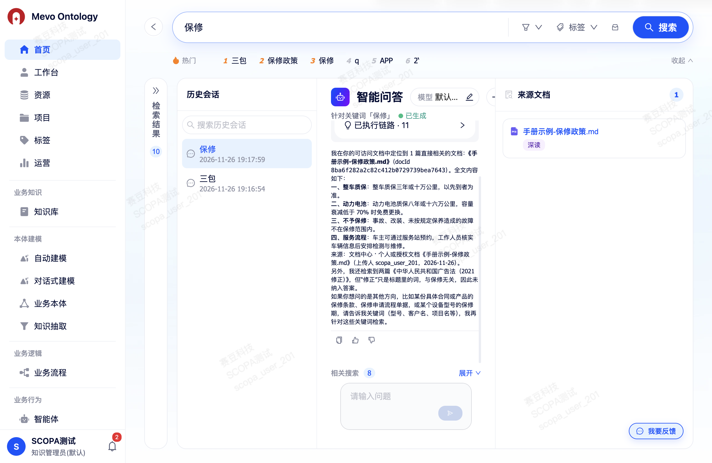

图 10-3 智能问答结果与来源文档

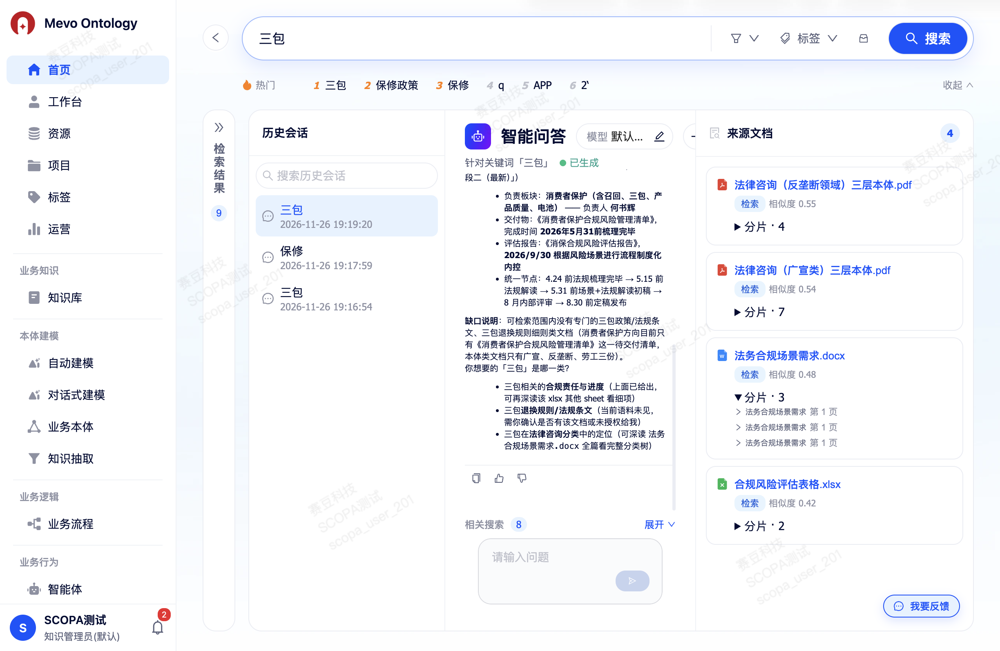

图 10-4 来源文档分片定位

**说明：** 问答目前基于文档资源生成答案。回答较复杂的问题时，生成可能需要数分钟。

### 10.1.2 检索文档内容

**目标：** 按关键词查找文档和图片，并在结果旁直接获得 AI 归纳。

**入口：** `知识门户 > 首页 >` 检索框上方「知识检索」页签

**操作：**

1. 在首页保持「知识检索」页签，输入关键词，点击「搜索」。
2. 进入检索结果页。页面顶部保留「类型与目录」「标签」和检索框，可直接修改关键词或范围后再次检索；检索框下方显示热门和最近搜索词。
3. 结果区按「文档」「图片」「数据表」「实体类型」「实体数据」五个页签展示，页签右侧显示命中总数（如「共检索到 28 条」）：
   - 每条文档结果显示标题、命中片段（关键词高亮）、更新时间、上传人和文档编号。点击「查看命中上下文」弹出上下文窗口，显示全文命中段数，逐处列出命中段落及前后相邻段落（含章节路径和页码，命中段落高亮）；点击「打开完整文档」查看原文。
   - 可对结果「赞」「踩」「收藏」，或点击「预览」「新窗口打开」查看原文。
   - 结果上方可按类型、更新时间、上传人筛选，并选择「相关度排序」等排序方式；列表底部可翻页并选择每页条数。
4. 左侧「知识目录」可勾选部门或目录，进一步缩小检索范围。
5. 右侧「智能问答」卡片会针对当前关键词自动生成归纳回答，并列出「知识来源」和「相关搜索」；可在卡片底部输入框围绕检索结果继续提问。
6. 检索不到需要的知识时，点击结果列表下方的「我要反馈」提交反馈。

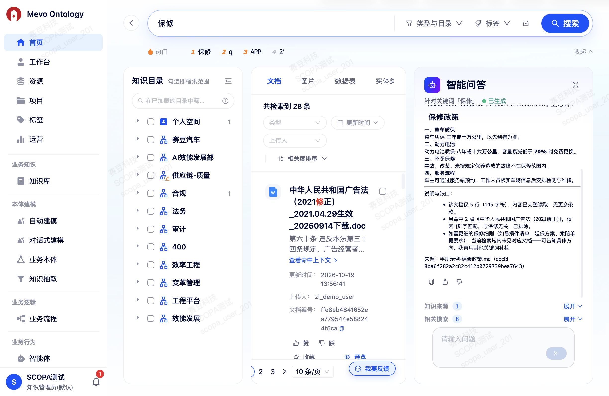

图 10-5 检索结果页

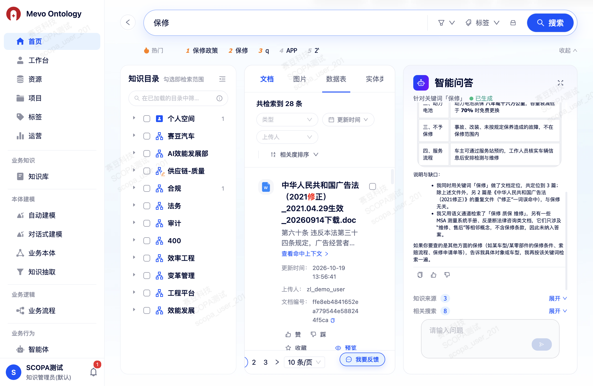

图 10-6 检索结果页的智能问答与知识来源

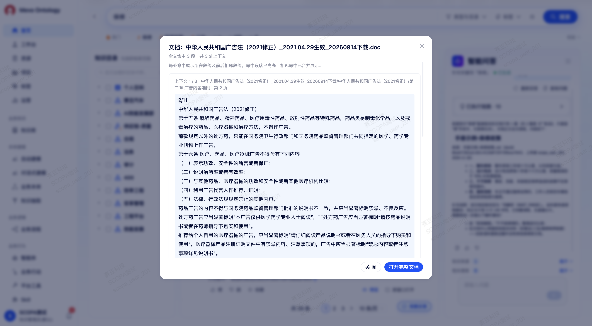

图 10-7 查看命中上下文

**异常或限制：** 新上传的文档需等解析完成后才能被检索；长期未命中的文档按 3.3.4 检查处理状态。

### 10.1.3 切换检索与问答模式

**目标：** 根据需要在「查找资料」和「直接要答案」之间切换。

**入口：** 首页检索框上方，或检索 / 问答结果页顶部的「知识检索」「智能问答」页签

**操作：**

1. 在首页或结果页顶部点击「知识检索」或「智能问答」切换模式。
2. 「知识检索」返回文档、图片等资源列表，同时在右侧给出 AI 归纳；「智能问答」进入对话界面，以答案为主，附来源文档。
3. 切换后输入内容保留，点击「搜索」或「提问」即按新模式执行。

**说明：** 检索模式可查询文档和数据表资源；问答模式目前基于文档资源回答。

### 10.1.4 按类型与目录筛选范围

**目标：** 检索或问答前先圈定资源类型和部门目录，减少无关结果。

**入口：** 检索结果页顶部的「类型与目录」

**操作：**

1. 点击「类型与目录」，弹出范围面板，顶部显示当前选择路径（如「全部类型 › 全部有权空间 › 全部目录」）。
2. 在「资源类型」中选择全部类型或指定类型。
3. 在「部门」中勾选个人空间或部门（可搜索部门名称）。
4. 勾选部门后，可在右侧进一步限定目录（可选）。
5. 点击「确认」生效；点击「重置范围」恢复为全部有权空间。确认后，检索框右侧的范围提示随之更新。

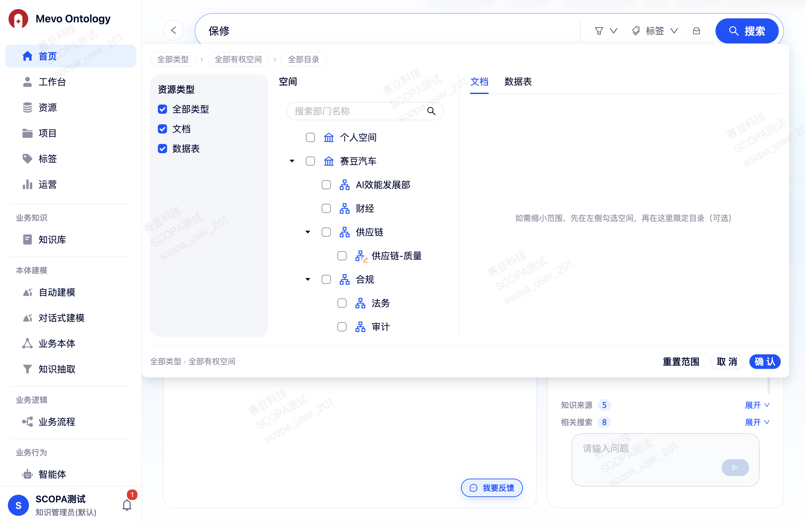

图 10-8 类型与目录筛选

**说明：** 选择全部类型时可筛选到部门一级；选择指定类型（文档或数据表）时可筛选到文件夹一级。结果页再次检索前同样可以调整范围。

### 10.1.5 按标签筛选

**目标：** 只检索带有指定标签的资源。

**入口：** 检索结果页顶部的「标签」

**操作：**

1. 点击「标签」，弹出「标签筛选」面板，面板中列出当前账号可见的标签。
2. 默认勾选「全部标签」。取消后，可在搜索框输入关键字查找标签并勾选。
3. 点击「确认」生效，检索和问答只在带有所选标签的资源中进行；点击「取消」关闭面板且不改变范围。

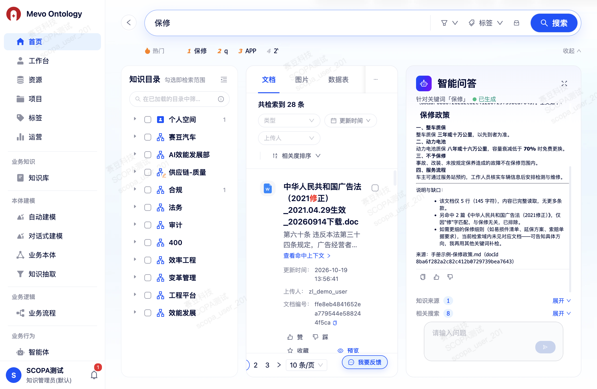

图 10-9 标签筛选

**说明：** 标签来自知识门户统一的标签体系（见 2.4）。当前账号可见的标签为空时，面板显示「暂无数据」；本环境可见「手册示例-业务主题」。

### 10.1.6 查询数据资源

**目标：** 在检索中查找自己有权限的数据表，并查看详情。

**入口：** 检索结果页 `>` 「数据表」页签

**操作：**

1. 在检索模式下输入关键词并搜索。
2. 在结果区点击「数据表」页签，列表显示数据库或数据表的名称、英文名、说明和数据源类型，只展示当前用户可检索的资源；没有命中时显示「未检索到相关数据表」。
3. 点击「查看详情」，在详情抽屉中查看数据预览、关联数据项（字段）、授权信息和数据探查结果；数据库则显示其关联的数据表。

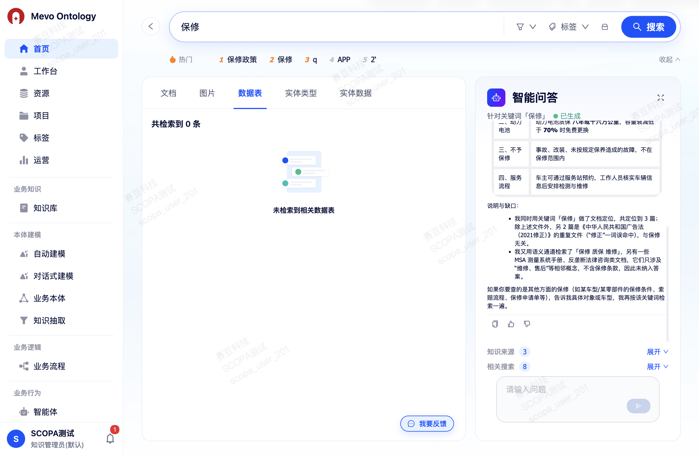

图 10-10 数据表检索

**说明：** 该功能属于 1106 版本。测试账号在「类型与目录」中只能选到文档，检索结果的数据表页签为空，详情抽屉未能在环境中打开，详见本章「待确认」。

### 10.1.7 查询实体类型与实体数据【1130 版本】

**目标：** 在门户中直接检索本体中的实体类型和实体数据，获得结构化答案。

**入口：** 检索结果页 `>` 「实体类型」/「实体数据」页签

**操作：**

1. 在检索模式下输入关键词并搜索。
2. 点击「实体类型」页签，列表显示命中的实体类型名称、英文标识、说明和数据条数，点击可查看定义。
3. 点击「实体数据」页签，按实体类型分组展示命中的实体数据，每条数据显示编号、名称和关键属性（如风险等级、客户名称、责任人、当前状态）。

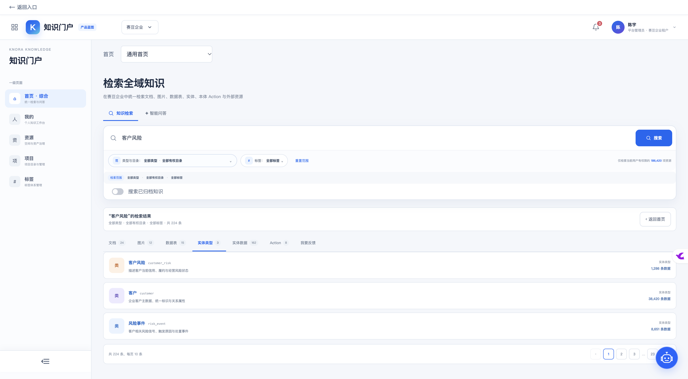

图 10-11 实体类型检索（原型示意，以上线版本为准）

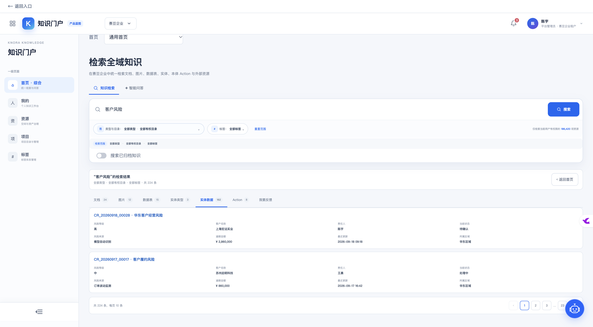

图 10-12 实体数据检索（原型示意，以上线版本为准）

**说明：** 测试环境的检索结果页已出现「实体类型」「实体数据」两个页签，但检索后分别显示「暂无数据」和「实体搜索结果加载失败」，尚未返回实体内容，故仍以原型示意。

---

## 本章变更说明（v3.4 → v4.0）

**新增：**

- 10.1.3 切换检索与问答模式（1030 版本）。
- 10.1.4 按类型与目录筛选范围（1030 版本）。
- 10.1.5 按标签筛选（1030 版本）。
- 10.1.6 查询数据资源（1106 版本，原型示意）。
- 10.1.7 查询实体类型与实体数据【1130 版本】（原型示意）。

**修改：**

- 章节编号：v3.4 中「智能搜索」未编号、两个小节都编为 10.1.1，本版统一为 10.1 智能搜索，下设 10.1.1–10.1.7。
- 10.1.1 发起问答：按新的问答结果页重写，补充历史会话、已执行链路、来源文档与分片定位、追问、新对话和模型切换。
- 10.1.2 检索文档内容：由「问答后点击 AI 检索页签」改为独立的检索模式，补充结果页筛选、排序、知识目录、命中上下文、右侧 AI 归纳和知识缺失反馈。
- 11-06 核查：10.1.2 补充「查看命中上下文」弹窗说明和截图（图 10-7），后续图号顺延。
- 章首：「部门」按 v4.0 界面改称「部门」，入口改为知识门户首页。
- 11-26 核查：入口改为左侧菜单「首页」，删除「应用切换器」写法；首页说明按实测改写（检索范围在结果页设置，首页展示常用操作、我的智能体、最新知识、最热知识）。10.1.1 按实测重写问答结果页布局（左侧检索结果与历史会话、中间问答区、右侧相关搜索与来源文档），补充失败重试。10.1.2 按实测改为五个结果页签并补充命中总数、翻页，「知识缺失」改为列表下方「我要反馈」。10.1.4、10.1.5 入口删去「首页检索框下方」。10.1.6 数据表页签已在环境出现，改用环境截图，去掉原型示意。10.1.7 补充环境页签现状。图 10-1、10-2、10-4、10-5、10-6、10-7、10-8、10-10 重拍。

**删除：** 无。

**未变：** 章首关于权限范围的说明（措辞随界面称谓调整）。

## 待确认

1. **数据表页签无结果（10.1.6）：** 结果页已出现「数据表」页签，但测试账号检索后显示「未检索到相关数据表」，「类型与目录」的资源类型中也只有「文档」，详情抽屉无法打开。可能是该账号没有分配到数据表资源，需要用有数据表权限的账号复核并补拍详情截图。
2. **问答界面显示调试信息：** 11-26 复测仍可复现：问答生成过程中会显示「已执行链路」中的工具调用与模型名（如「大模型 · deepseek-v4.1-flash」），个别问题还会出现问答服务调用失败的 500 报错。需确认正式版本是否隐藏，以及该报错是否为环境问题。
3. **全资源问答与溯源（12 月）：** 需求表列为 12 月版本，原型中问答「答案依据」区分文档、本体、数据表三类来源。环境当前只按文档回答，本章未单列小节，待版本确定后补写。
4. **Action 检索：** 原型检索结果中还有「Action」页签，需求表未单独列出版本，本章未编写。
5. **标签筛选效果：** 标签面板已能看到「手册示例-业务主题」，但本次未勾选标签做过滤验证，按标签过滤后的结果待复核。
6. **实体检索无结果（10.1.7）：** 结果页已有「实体类型」「实体数据」页签，但分别显示「暂无数据」「实体搜索结果加载失败」，需确认实体索引是否已构建。
