# 十一、日常维护、成果复用与运营查看

日常维护沿用前述模块的已有操作，运营情况通过运营看板查看。成员授权、文档审批和基础标签维护见第二章；问题修改后，用原业务场景复核结果。

## 11.1 知识门户与文档中心：更新与维护

### 11.1.1 维护部门、文档与标签

**目标：** 组织或内容口径变化时，及时更新部门、文档和标签，保持门户内容口径唯一。

**入口：** 左侧菜单「资源」（部门与文档）；左侧菜单「标签」（标签）

**操作：**

1. **组织更新：** 管理员在 `资源` 左侧「部门组织目录」右上角点击「部门同步」按钮，从 UUMS 同步组织信息（见 2.1.1）。拥有部门管理员权限的用户可编辑和维护本部门的资源信息。
2. **文档更新：** 在部门文档列表中维护文档：
   - 新增文档用「上传到部门」，按目录整理用「新建目录」（见 3.3）。
   - 文档操作列提供「收藏」「授权」，「更多」菜单提供「重新解析」「下载」「归档」「历史版本」「删除」「移动」「移交」「审批链路」。
   - 内容变更时，在「历史版本」中新建版本并发布，新版本替换生效版本（见 3.3.6）；过期但需留存的文档使用「归档」，可在列表「已归档」筛选中查看。
   - 勾选多篇文档后，可批量「归档」「删除」。
3. **标签更新：** 标签定义或口径变化时，在左侧菜单「标签」中维护标签类型、子集和标签，并按需启用或停用（见 2.4）。
4. **复测：** 更新后用原业务问题复测检索问答（见第十章），确认过期内容不再被返回；涉及权限的变更，用有授权和无授权的账号分别验证。

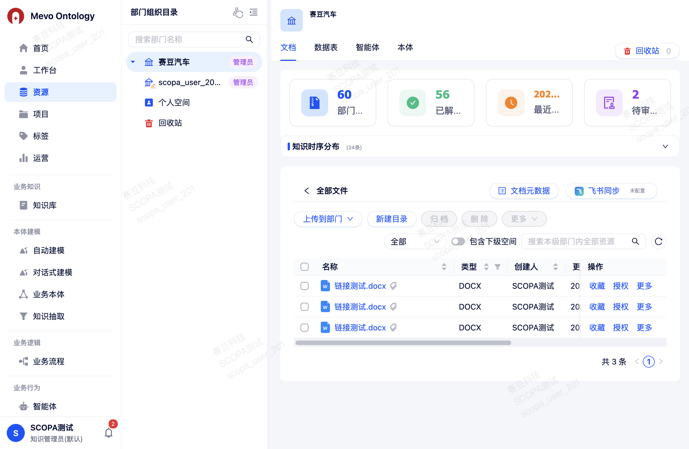

图 11-1 部门文档管理

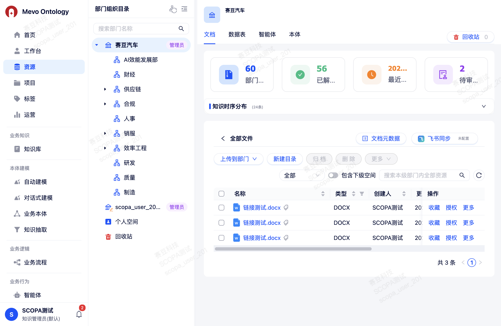

图 11-2 文档「更多」操作

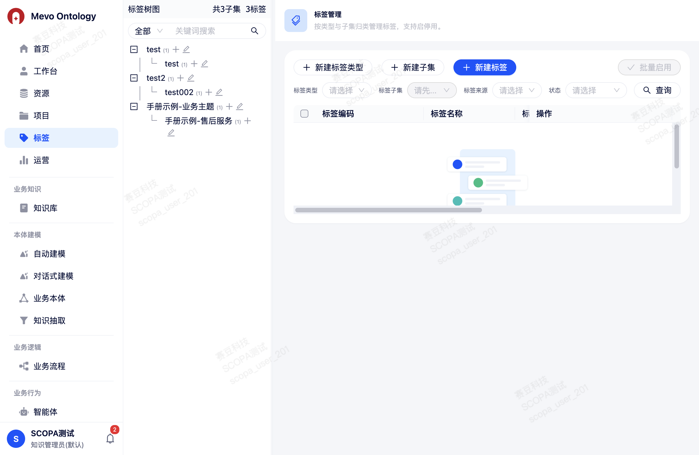

图 11-3 标签管理

**说明：** 部门页面顶部显示部门文档数、已解析文档数、最近更新时间和待审批文档数，可用于快速判断本部门资源是否需要维护。

## 11.2 知识库：更新与维护

### 11.2.1 更新文档与知识记录

**目标：** 知识库内容与来源保持一致，更新后能被正确检索。

**入口：** 左侧菜单「业务知识 > 知识库」，在列表中点开目标知识库

**操作：**

1. **文档知识库：**
   - 个人项目中的知识库，直接「导入文档」补充新文档；文档内容变化时，删除旧文档后重新导入，或在文档「更多」菜单中点击「重新入库」（见 5.1.2、5.1.3）。
   - 公共项目中的知识库，先按第四章为项目申请新资源，审批通过后再导入。
   - 暂时不希望某篇文档或某个分片被检索时，关闭其启用开关；需要下线文档时，在「更多」菜单中「取消入库」或「删除」。
   - 分片内容有误时，进入文档详情页直接编辑分片（见 5.1.4）。
2. **更换向量模型：** 在详情页「设置 > 变更模型」中更换 Embedding 模型，全部文档会自动重新向量化入库（见 5.1.6）。
3. **数据知识库：** 单条数据用「编辑」「删除」维护；批量更新用「导入数据」；需要全量替换时，先点击左侧「清空知识库」，再重新导入（见 5.2.3）。
4. **数据表：** 本地上传的数据表内容需要更新时，重新上传文件（3.2.2）；表结构变化后核对 6.6.1 的数据映射，并按需重新发布相关模型。
5. **复测：** 用原业务问题复测检索结果：文档知识库在引用它的 Logic 或智能体中复测，数据知识库可直接在列表搜索框中测试匹配分数。引用侧无需改动配置，内容更新后自动生效。

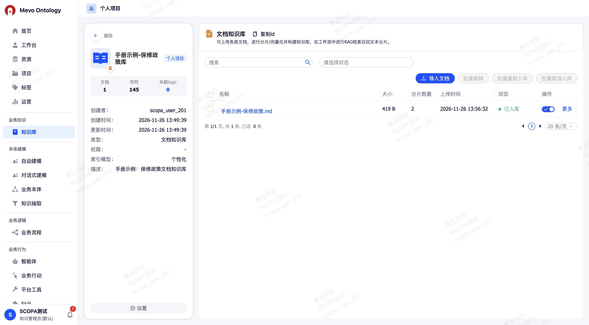

图 11-4 文档知识库的文档列表与入库状态

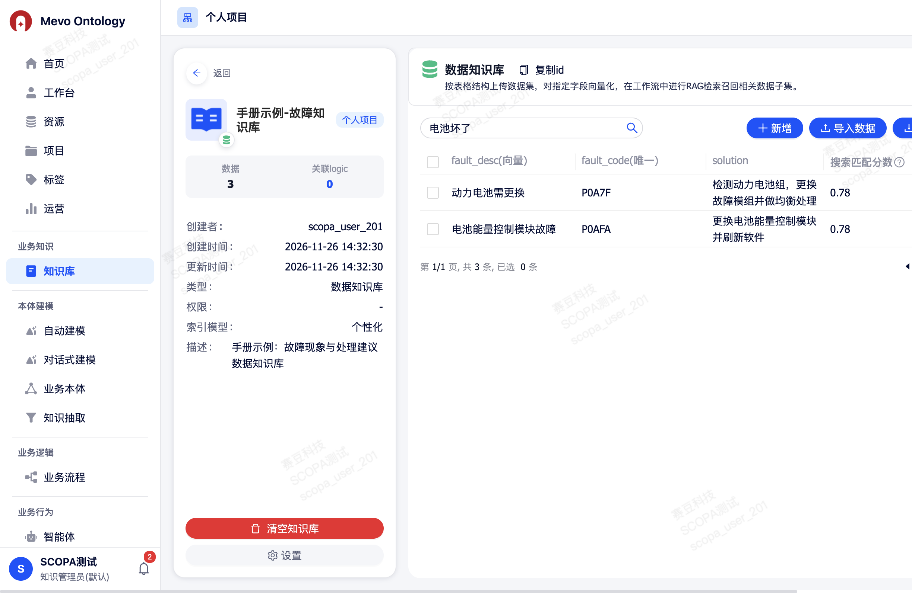

图 11-5 数据知识库检索测试

## 11.3 本体：配置调整与结果复核

### 11.3.1 修改模型与映射

**目标：** 在本体建模与映射配置中修正模型或数据问题。

**入口：** `业务本体 > 业务对象 / 业务关系 / 业务事件 > 行操作「设置」`（也可在「操作」列直接点「设置」）

**操作：**

1. **模型修正：** 进入「设置」，在与新建相同的 5 步向导中编辑实体、关系、事件定义（6.3）。API 标识不可改，其他内容按需调整。修改属性结构后对象状态变为「待发布」。
2. **映射修正：** 源数据表变更后，先在「数据映射」重新选择或调整对应数据表，按需修改「属性定义」，再在「属性映射」中点击「自动映射」并逐项核对匹配结果（6.6.1）。
3. **重新发布：** 在列表行「操作」列点击「发布」（6.6.2）。只改描述等非结构内容时会提示「没有资源发布成功。跳过: 1…」，无需重跑；结构变更会生成新的历史版本，可在「更多 > 历史版本」对照修改前后的属性结构。1130 版本发布前会先展示变更影响分析，确认受影响的关系、事件、Action、流程与智能体后再发布。
4. **Action 与规则修正：** 调整 Action 的触发条件、规则或启停开关（6.9）。

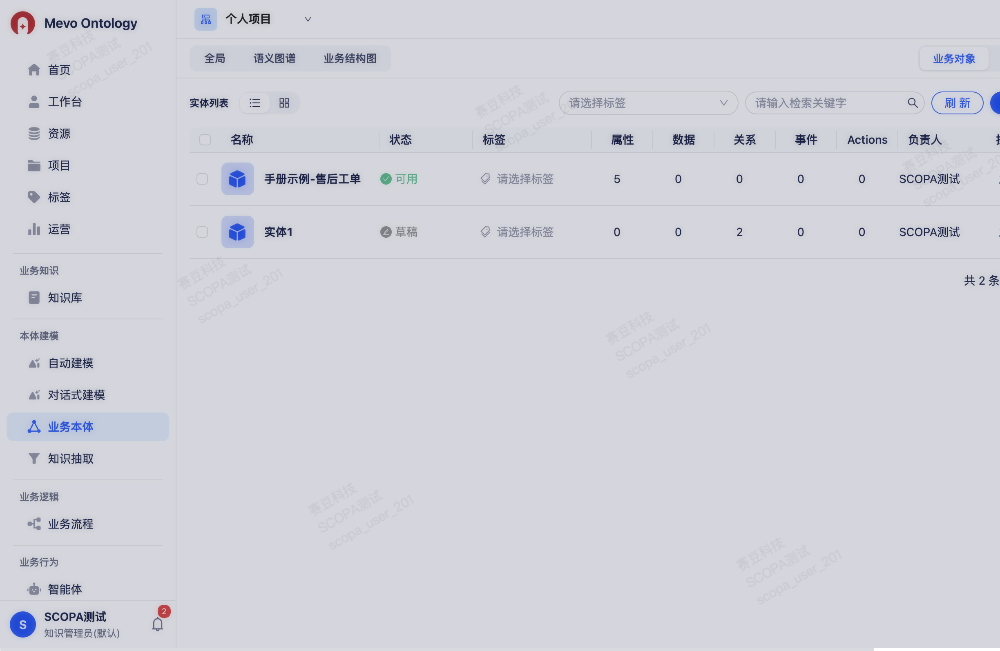

图 11-6 修改前后对照：实体历史版本

**注意：** 共用项目中只发布自己负责的对象，使用行内「发布」；列表上方的「发布」会直接批量发布全部草稿和待发布对象，不再确认。

### 11.3.2 重跑知识抽取流程

**目标：** 配置修正后重跑流程，确认数据恢复正常。

**入口：** `知识抽取 > 流程管理`

**操作：**

1. 在流程管理中找到受影响的流程（流程名称为对象 API 标识）。重新发布结构变更后，流程会回到「待验证 / 下线」状态，此时运行、重跑按钮不可用。
2. 打开流程画布，依次「验证」→「上线」→「运行」（6.7.2）；流程已上线且只需重新处理数据时，在列表操作列使用「重跑」，按时间段补历史数据时使用「补数」。
3. 在 `知识抽取 > 任务管理` 确认任务状态为「执行成功」；失败时「查看日志」定位问题（6.7.3）。
4. 在实体看板用 6.8.1、6.8.2 的方法核对实例数量、属性值与关联关系、事件。问题涉及多个对象时按依赖顺序（实体 → 关系 → 事件）逐个重跑和验证。

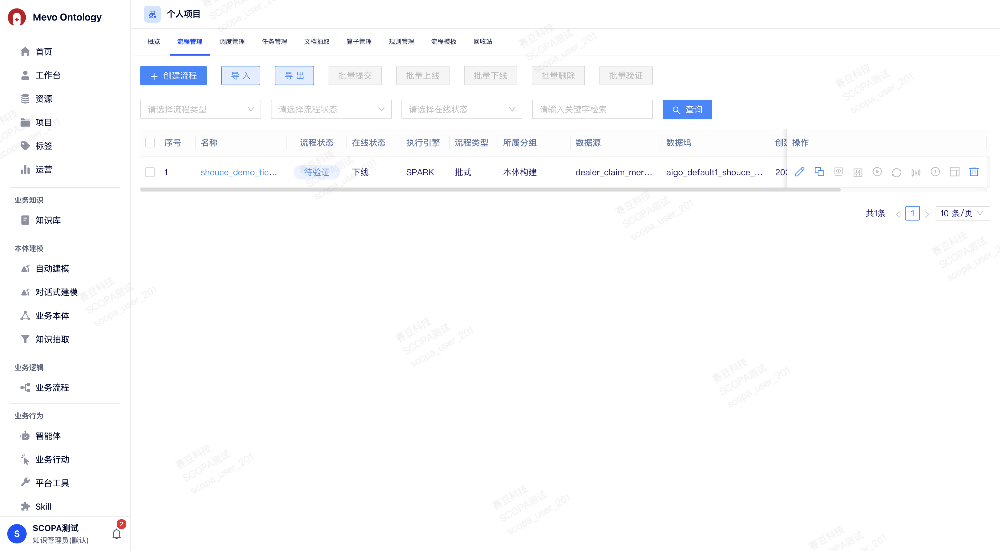

图 11-7 重新发布后流程回到待验证、下线状态

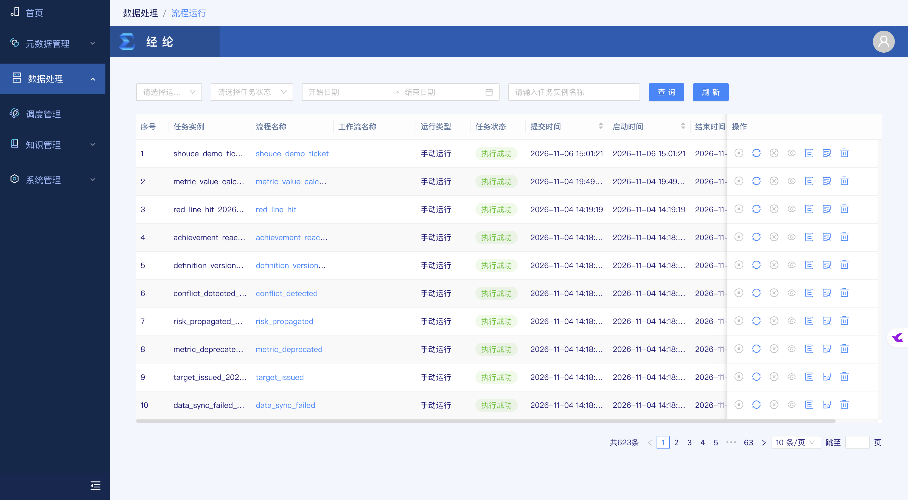

图 11-8 流程运行记录

**说明：** 1130 版本发布后自动按「构建实体存储 → 构建索引 → 构建映射流程 → 同步数据」执行，构建期间旧版本继续可用；只需按现有映射重新同步时，使用行操作「更多 > 同步数据」（原型示意，以上线版本为准）。

## 11.4 Logic：配置维护

### 11.4.1 修改与调试 Logic

**目标：** 调整 Logic 的运行效果，修改过程不影响正在使用的版本。

**入口：** `业务逻辑 > 业务流程 > 打开目标流程`

**操作步骤：**

1. **定位问题节点：** 点击右上角「调试」，在右侧调试对话区用当初发现问题的业务样例重跑，查看最终输出（6.10.3）。结果不对时，按输出逐步倒推：先检查最后一段生成或判断节点的配置，再沿连线往前核对检索、参数和条件分支。当前版本的节点标题上没有单节点运行入口，问题定位靠分段验证实现。

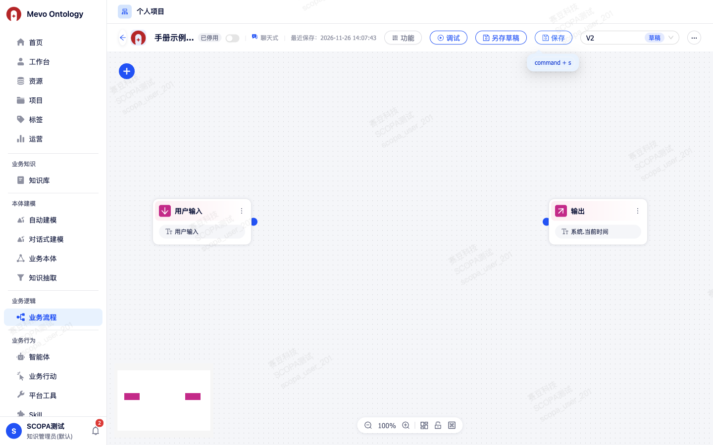

图 11-9 调试窗口：重跑业务样例

2. **局部调整：** 修改问题节点的配置（提示词、检索参数、条件分支、代码等），点击「保存」后再次调试，确认结果正确。

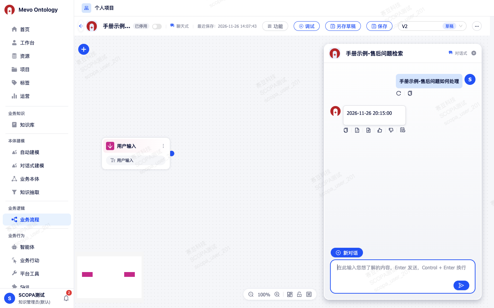

图 11-10 调试复测结果

3. **另存草稿生成新版本：** 调试通过后点击「另存草稿」，系统提示「保存新版本成功！」并生成新的版本号。右上角版本下拉可查看和切换历史版本；标有「BOT版本」的是当前对外服务的版本。需要回退时，切换到历史版本核对后再另存草稿。

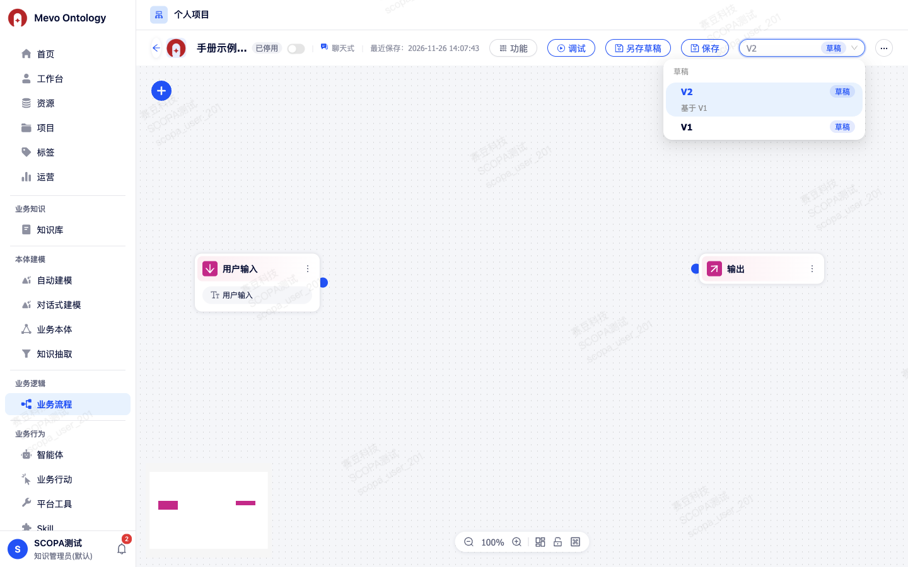

图 11-11 版本下拉：查看与切换历史版本

4. **按需重新发布：** 发布形态和输入输出不变时，无需重新发布；输入输出有变化时，在「…」中重新发布为流程工具 / MCP Server / API / 网页嵌入（6.10.4），并通知引用方。
5. **同步处理依赖资源变更：**
   - Action 调整后，复测调用它的 Action 执行节点和调用链路。
   - Tools 接口变更时，更新地址、参数与返回解析并复测（7.1）。
   - 知识库、数据集内容更新后，用原问题复测检索结果；引用配置无需改动。
   - Skill 更新后，同步检查引用它的 Agent。
6. **复测与留档：** 用当初发现问题的业务样例复测，检查引用该 Logic 的其他 Logic、Action、Agent 是否受影响；复测记录留档。

**说明：** 共用项目中只修改、发布自己负责的流程；修改他人流程前先与负责人确认。

## 11.5 Agent：配置维护

### 11.5.1 修改与调试 Agent

**目标：** 智能体运行中发现的问题在原配置页修正，复测通过后再交给用户使用。

**入口：** `业务行为 > 智能体 >` 悬停卡片 `>` 「配置」

**问题来源：**

- 用户在运行态对话页的点踩反馈及原因（8.7.2）。
- 运营看板中的使用与反馈数据（11.7）。
- 卡片 `更多 > 运行日志` 中的运行记录，以及回答上方「已执行链路」中失败或耗时异常的步骤（8.5.2）。

**操作步骤：**

1. **复现问题：** 进入配置页，在调试对话区用用户反馈的原问题重跑，展开「已执行链路」和右侧「引用文档」，判断问题出在哪一环：
   - 没检索到或引用了错误文档：检查知识库内容（11.2）和检索配置（召回分片数量、最低相关度、检索模式，8.3.2）。
   - 该调用的技能或流程没有调用：修改系统提示词中的调用规则，补充技能、流程工具的描述（8.2.2、8.4）。
   - 调用了但结果不对：到对应的技能（7.2）或 Logic（11.4）中修正。
   - 循环次数过多或中途停止：检查熔断配置（8.2.3）。
2. **修改配置：** 按定位结果调整提示词、资源引用、检索配置或功能配置，点击底部「保存」，提示「保存成功」。改动较大时，可先在卡片 `更多 > 复制` 复制一份智能体，在副本上调试，确认后再改正式智能体。
3. **同步依赖资源：** 技能更新说明或资源后，重新安全检测并发布（7.2.3），再检查引用它的智能体；流程工具的输入输出变更后，重新发布 Logic 并在智能体中复测；更换模型后完整复测（8.2.1）。
4. **复测：** 用原问题和 8.5 的验收样例（正常、边界、信息不足、无权限）逐条复测，核对回答和引用依据；用目标用户账号验证一次权限边界。
5. **记录：** 复测通过后告知反馈用户；修改内容和复测结果留档。

**注意事项：** 配置保存后立即对所有有权限的用户生效。正在被大量使用的智能体，先在副本上调试，避免调试过程中影响用户。

## 11.6 项目成果：本体（实体、关系、事件）回流与复用

项目中验证过的本体成果（实体、关系、事件、Action、流程）发布到项目所属部门后，成为部门的本体资源，由部门管理员授权给其他项目复用，也可向上级部门移交。

### 11.6.1 提交本体成果到部门、业务域、企业级【1130 版本】

**目标：** 把项目内的本体成果纳入部门统一管理，并按需逐级移交到业务域或企业级部门。

**操作步骤：**

1. **发布到项目所属部门：** 在本体管理中，对实体、关系、事件点击卡片「发布到部门」（当前环境「更多」中的文案为「发布到空间」，6.6.3），对 Action、流程分别见 6.9.6、6.10.5。发布目标由项目归属自动确定，提交后进入部门管理员审批。
2. **在部门中查看：** 审批通过后，进入 `知识门户 > 资源 >` 选择部门 `> 本体` 页签。页面顶部显示本部门实体、关系、事件的数量，列表按「全部 / 实体 / 关系 / 事件」切换，可按来源项目和发布状态筛选，列显示名称、类型、来源项目、发布状态、负责人和更新时间。当前环境该页签已上线但无资源，显示「暂无本体资源」。

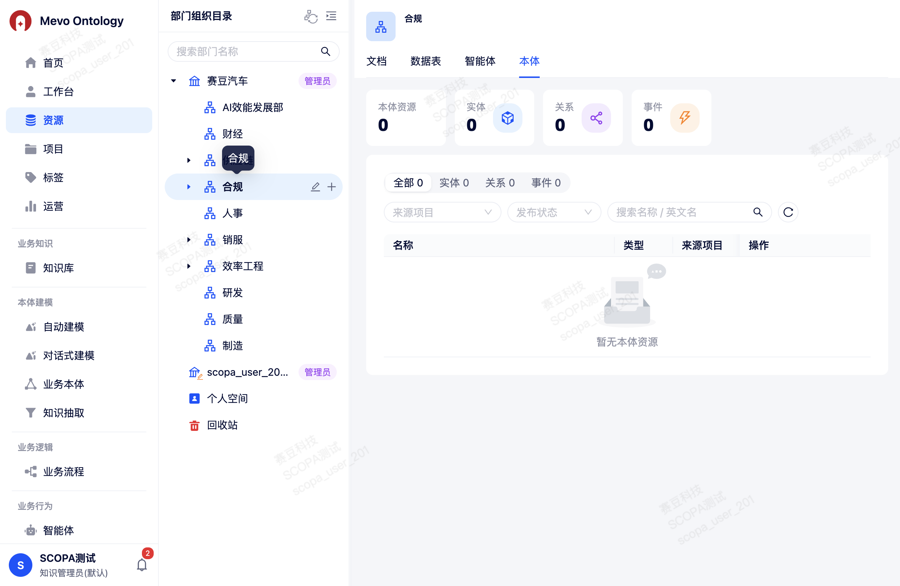

图 11-12 部门本体资源（2026-11-26 环境截图，当前部门下暂无本体资源）

3. **向上级移交：** 需要在更大范围管理时，部门管理员点击资源行的「向上级移交」（多个资源可勾选后「批量向上级移交」）。在弹窗中选择目标上级部门（只能选当前部门的上级路径，单选），核对审批路径（提交申请 → 目标部门管理员审批 → 资源移动并移交管理），填写申请说明，点击「提交申请」。

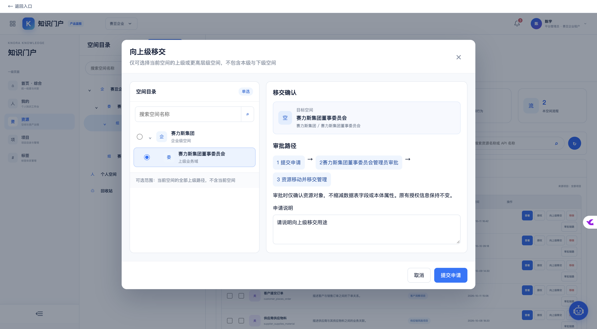

图 11-13 本体资源向上级移交（原型示意，以上线版本为准）

**说明：** 移交审批只确认资源对象，不缩减本体属性；原有授权信息保持不变。智能体发布到部门及其移交计划在 1113 版本上线（8.6.1）。

### 11.6.2 授权复用【1130 版本】

**目标：** 把部门中的本体成果授权给其他项目或用户复用，避免重复建设。

**操作步骤：**

1. **部门管理员授权：** 在 `知识门户 > 资源 >` 部门 `> 本体` 中点击资源行的「授权」，按对象、属性、行三层配置权限（6.13）。
2. **项目申请复用：** 其他项目的成员在项目详情页「申请资源」中选择「本体」页签，按实体、关系、事件、Action、流程筛选并勾选需要的对象，提交申请（4.3.3）。本体资源按完整对象申请。
3. **在项目中使用：** 申请通过后，资源出现在项目的本体管理中，可在 Logic、智能体中直接引用。

**注意事项：** 授权复用不转移资源归属，源资源仍由原部门维护。源资源修改后，引用它的项目需复测相关 Logic 和智能体（11.3、11.4、11.5）。

## 11.7 运营看板：查看运营情况与筛选范围【待升级】

### 11.7.1 筛选查看范围【待规划】

**【功能规划中】** 按企业级、业务域、部门筛选运营看板的统计范围，查看与本职责对应的数据。

### 11.7.2 查看运营统计

**目标：** 掌握平台的使用规模、使用趋势、部门分布和模型消耗，为资源调配和推广提供依据。

**入口：** 左侧菜单「运营」，进入运营看板。

**操作：**

1. **选择统计时间：** 在页面右上角选择「今天」「近一周」「近一月」「近一季度」「近一年」，或在日期框中自定义起止日期。
2. **查看运营总览：** 页面顶部展示四项指标：
   - 工作流总数：当前统计范围内的工作流数量；
   - 执行总次数：工作流的累计执行次数；
   - 总成功率：执行成功次数占总执行次数的比例；
   - 活跃用户数：统计时间范围内使用平台的用户数量。
3. **查看使用情况：**
   - 「工作流使用情况」以环形图展示各工作流的分布，可切换「Token消耗量」「调用次数」「点赞」「点踩」。
   - 「用户使用情况」以柱线图展示各用户的 Token 量和调用次数，可选择排序方式（如「按大模型tokens使用量排序」）。
4. **查看部门与模型使用情况：**
   - 「部门使用情况」可选择部门，查看各部门的 Token 量和调用次数，并选择排序方式。
   - 「大模型使用情况」以表格列出各模型的 Token 消耗量和调用次数，可按列排序。
5. **查看时间分布：** 「智能体调用数量时间分布」「大模型tokens消耗时间分布」两张图可单独选择「今天」「近一周」「近一月」，并按小时等粒度查看趋势。
6. **查看平台 Token 消耗：** 切换到页面顶部的「平台 Token 消耗」页签，查看平台级（汇总全部租户）的消耗情况：
   - 顶部可选择统计时间、「粒度」（小时 / 天 / 周 / 月）和「对象类型」（全部 / 工作流 / 智能体）；
   - 四项指标：总 Token 消耗（含输入、输出占比及较上一周期的变化）、大模型调用次数、有消耗的对象（分别统计工作流与智能体数量）、次均 Token（总 Token ÷ 调用次数）；
   - 「Token 消耗趋势」可切换「Token」「调用次数」，并按类型或按输入/输出查看；「消耗排行 Top10」可按 Token 或调用次数排序；
   - 「对象趋势对比」对比所选对象的消耗走势；「消耗明细」逐项列出排名、名称、类型、总 Token、输入、输出、调用次数、次均 Token 和占比，可「导出 CSV」。

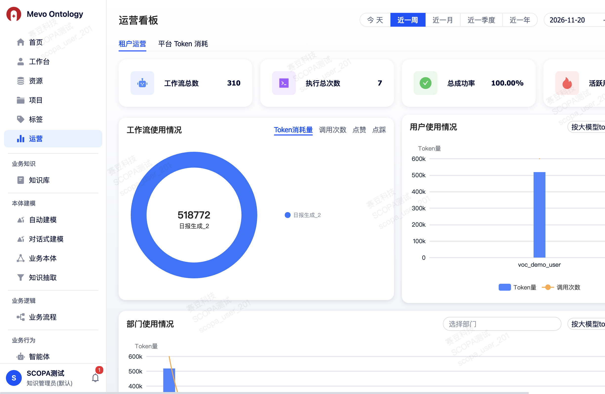

图 11-14 运营看板总览

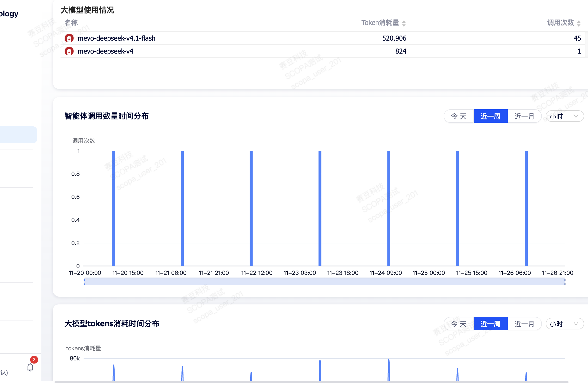

图 11-15 大模型使用情况与调用时间分布

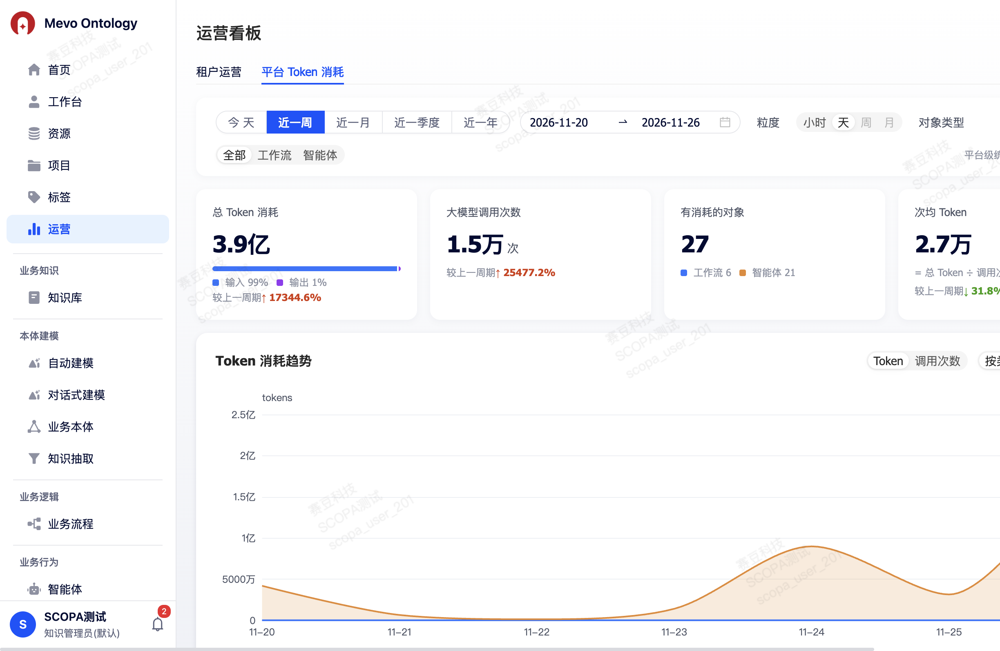

图 11-16 平台 Token 消耗

---

## 本章变更说明（v3.4 → v4.0）

### 11.1 / 11.2 / 11.7

**新增：**

- 11.7.2 新增「查看时间分布」步骤（智能体调用数量时间分布、大模型 tokens 消耗时间分布）。
- 11-26 新增：11.7.2 第 6 步「查看平台 Token 消耗」（运营看板顶部第二个页签，平台级汇总全部租户：粒度、对象类型、四项指标、Token 消耗趋势、消耗排行 Top10、对象趋势对比、消耗明细与「导出 CSV」），配图 11-16（ch11-7-01）。

**修改：**

- 11.1.1 标题由「维护文档、标签」改为「维护部门、文档与标签」；「部门」按界面改称「部门」，「部门同步」改为「部门同步」；文档维护由「替换上传」改为按「历史版本」「归档」等实际操作描述，补充文档「更多」菜单和批量操作；补充入口路径和截图。
- 11.2.1 补充文档 / 分片启停、重新入库、取消入库、编辑分片、变更向量模型、数据知识库清空与导入等维护方式；补充入口和截图。
- 11.1.1 文档版本维护改为引用 3.3.6（历史版本功能已在环境验证可用）；去掉未验证的「归档后不再被默认检索」表述；图 11-3 重截（原图标签列表为空）。
- 11.7.2 入口改为左侧菜单「运营」；时间筛选按界面改为今天 / 近一周 / 近一月 / 近一季度 / 近一年 / 自定义日期；补充各图表的切换与排序方式；按环境重截。
- 11-26 核查：11.1.1 入口按新版菜单改为左侧菜单「资源」「标签」；「部门同步」为部门组织目录右上角的图标按钮；文档「更多」菜单补充「审批链路」。11.2.1 入口改为左侧菜单「业务知识 > 知识库」。11.7.2 入口改为左侧菜单「运营」，删除「应用切换器」写法。图 11-1（部门文档管理）、图 11-14（运营看板总览）、图 11-15（大模型使用与时间分布）、图 11-16（平台 Token 消耗）按环境重拍。

**删除：** 无。

**未变：** 11.7 标题【待升级】标签与 11.7.1【待规划】（按企业、业务域、部门筛选统计范围的能力环境和原型均未提供，保留 v3.4 原文）。

### 11.3

**修改：**

- 11.3.1：补充入口、「待发布」状态、无变更发布提示、历史版本对照、1130 变更影响分析，以及批量发布的注意事项。
- 11.3.2：补充重新发布后流程回到「待验证 / 下线」须重新验证上线、重跑与补数的区别（操作列名称已在环境核对）、运行记录与日志查看，以及 1130 自动构建与「同步数据」。
- 2026-11-26 复核：按新版菜单重写入口与用词——11.3.1 入口改为 `业务本体 > 业务对象 / 业务关系 / 业务事件 > 行操作「设置」`，「业务关联」「事实明细」改为「业务关系」「业务事件」，「卡片上的发布」改为行内「发布」，「列表左上角」改为「列表上方」；11.3.2 标题改为「重跑知识抽取流程」，入口改为 `知识抽取 > 流程管理`，任务状态改为在 `知识抽取 > 任务管理` 查看。
- 截图：新增 1 张（ch11-3-01），另引用第六章 2 张；图号按本文件续编为图 11-6 至 11-8；2026-11-26 复核时 ch11-3-01 已按当前环境重截。

**删除：** 无。

### 11.4

**修改：** 11.4.1 按测试环境重写。补充入口路径；调试步骤对应「调试」对话区、保存与另存草稿；新增版本下拉与「BOT版本」说明；发布形态改为流程工具 / MCP Server / API / 网页嵌入；依赖资源变更补充知识库、数据集复测。配 3 张截图（其中 2 张与 6.10.3 共用），图号为图 11-9 至 11-11。

- 2026-11-26 复核：按实测工具栏（功能 / 校验 / 调试 / 评测管理 / 另存草稿 / 保存 / 发布BOT版本）重写第 1、2、3 步——删除「调试运行」「仅保存」「保存新版本」和单节点运行图标的写法，改为「调试」对话区重跑、按连线倒推定位、保存后另存草稿；图 11-9 换为调试窗口截图（原单节点调试图），图 11-10 重拍。

**新增 / 删除：** 无。

### 11.5 / 11.6

**修改**

- 11.5.1：按环境重写。补充问题来源（点踩反馈、运行日志、已执行链路）、按链路定位问题的方法、复制智能体后调试、依赖资源同步与复测；修正 v3.4「同步检查引用它的Action」为「引用它的智能体」。
- 11.6：标题去掉【规划】；11.6.1、11.6.2 由【待规划】改为【1130 版本】，按原型补充发布到部门、部门本体资源、向上级移交、授权与项目申请的步骤。
- 11.6 图号由占位的 11-E / 11-F 改为按本文件续编的图 11-12、11-13。
- 11.5.1 不配截图，配置页、执行链路与引用文档界面见第八章图 8-3、8-26、8-27。
- 11-26 复核：11.6.1 第 1 步补注当前环境「更多」中的文案为「发布到空间」（同 6.6.3）；第 2 步按环境改写部门本体资源页（统计仅实体 / 关系 / 事件，列表按全部 / 实体 / 关系 / 事件切换，可按来源项目、发布状态筛选，列为名称、类型、来源项目、发布状态、负责人、更新时间；页签已上线但当前无资源）。11.5.1 入口「业务行为 > 智能体」与环境一致；当前环境智能体列表为空（显示「目前未找到创建智能体」），配置页、卡片「更多」菜单和运行日志仍无法复核。

**新增 / 删除**

- 无新增、删除小节。

## 待确认

### 11.1 / 11.2 / 11.7

1. **知识运营看板：** 需求表「400 需求」列有「知识运营看板」（围绕反馈流、审批流统计任务及审批数量、闭环率、超期情况），未标版本；原型 `operations-dashboard.html` 有对应设计。版本确定后，再决定是否在 11.7 新增小节并去掉【待升级】标签。
2. **部门同步：** 测试账号不是企业级管理员，未执行「部门同步」，其执行结果未验证。
3. **数据表更新方式：** 重新上传同名文件是覆盖原表还是生成新表，环境中未验证，需确认后在 11.2.1 补充。
4. **运营看板统计口径：** 看板顶部指标名仍为「工作流总数」「执行总次数」，统计对象是工作流还是包含智能体、Logic，需产品确认后在 11.7.2 中注明。
5. **归档文档的检索范围：** 归档后的文档是否仍参与门户检索问答，环境中未验证，11.1.1 暂不写检索影响。
6. **运营看板两个页签的定位：** 「租户运营」按本租户统计，「平台 Token 消耗」标注「平台级统计 · 汇总全部租户」，两者的可见角色（是否仅平台管理员可见）和适用场景未确认；11.7.2 暂按界面文案描述。另「平台 Token 消耗」中的「对象类型」只分工作流、智能体，是否包含 Logic、Skill 未确认。

### 11.3

1. 「重跑」「补数」为知识抽取流程管理操作列的实际按钮（已核对悬停提示：编辑、复制、试运行、参数设置、运行、重跑、补数、上线/下线、模板化），但未对任何流程实际执行，补数的参数界面与执行结果待补截图。
2. 1130 版本「同步数据」与发布后自动运行流程的行为以原型为准，上线后补截图。
3. 流程画布：测试环境在流程管理中点击流程名称未打开画布（同 6.7 待确认第 10 条），11.3.2 第 2 步「验证 → 上线 → 运行」的画布入口未现场核对。
4. 任务管理页当前无任务数据（同 6.7 待确认第 11 条），11.3.2 第 3 步「执行成功」「查看日志」未现场核对；图 11-7 为重新发布后流程列表状态，图 11-8 为旧版流程运行记录。

### 11.4

1. 切换到历史版本后能否直接设为「BOT版本」（对外服务版本），以及“回退”的具体操作，测试中未验证。
2. 示例流程已保存为 V2 但未发布；修改后重新发布对已引用方（Action、Agent）的影响未验证。
3. 单节点调试：当前画布节点标题只有折叠 / 展开和「更多 > 帮助」，未见单节点运行入口，11.4.1 第 1 步已改为按连线倒推定位；单节点调试能力是否提供待确认（同 6.10.3）。
4. 示例流程调试只返回时间戳、无业务答案（流程未配置输出内容），图 11-10 反映的是调试对话区交互，真实答案效果待用可用流程补拍。

### 11.5 / 11.6

1. 11.6 的向上级移交、授权与项目申请本体资源均为 1130 版本，环境未上线，入口和审批链路以上线版本为准；部门本体资源页签已上线（当前为空），图 11-12 已按 11-26 环境重截为空列表，图 11-13 仍为原型。
2. 原型中向上级移交只能选当前部门的上级路径；同级或跨业务域部门之间的共享方式待确认。
3. 11.5.1 中「卡片 更多 > 运行日志」在测试时未能打开日志页面；11-26 复核时智能体列表为空（「目前未找到创建智能体」），无法进入卡片菜单，需在环境中复核。
4. 智能体资源移交（1113 版本）环境未上线，本片段只做文字引用。
