# 附录 B：Logic 各节点介绍

本附录补充第 6.10.2 节，按节点说明在 Logic
画布中如何配置、连接和验证。截图选自已有产品操作手册，用于定位配置区域；界面样式、字段及可用范围以当前部署版本为准。v4.0 起，有变化的节点改用测试环境（v4.1.2）截图，新增数据集节点（B.2.16）；统计分析和 Action 执行节点已补拍当前界面截图。

## B.1 进入画布与通用操作

1\. 进入「业务逻辑 > 业务流程」列表（页面标题「业务流程」，画布内称“工作流”），打开目标 Logic
的编排画布。确认本次处理的是正确项目、正确 Logic。

2\.
从节点面板选择节点放入画布，拖动连接点建立上游与下游关系；点击节点，在配置区填写输入、处理方式和输出。

3\.
保存后先检查变量名称和类型，再用右上角「调试」在对话区跑通整条链路（当前画布节点标题上没有单节点运行入口）；调试、发布与使用见第
6.10.3—6.10.4 节。下文各节点说明中的“单独运行 / 单独测试”，按当前版本理解为在调试对话区构造该节点的样例输入进行验证。

当前节点面板按类别列出：大语言模型（LLM）、知识库检索、知识库写入、寄存器、工具调用、代码执行、数据集、批处理、Action执行、本体数据推理、本体统计分析；条件 / 聚合类的条件选择、变量聚合；循环类的循环体、终止循环、设置变量。

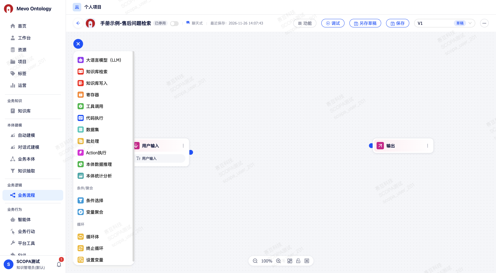

图 B-0-1 节点面板（当前界面截图）

## B.2 节点配置与验证

### B.2.1 输入节点

用途：定义 Logic 的外部入参。一个 Logic 只有一个输入节点。

1\.
点击输入节点，在配置区选择“添加输入变量”。按业务含义填写变量名称，选择变量类型并设置是否必填。可选类型有文本、数组、对象、数值、文件、下拉框、图片、实体引用；下拉框用于限定可选值，图片用于上传图片类输入，实体引用用于传入本体实体实例。

2\.
需要多个输入时逐项添加；任务式入口要核对变量显示顺序。文件、图片类输入按当前界面设置允许的类型和数量。

3\.
将输入节点的变量连接到需要使用它的下游节点。用完整参数、缺少必填参数和类型不符的参数试运行。

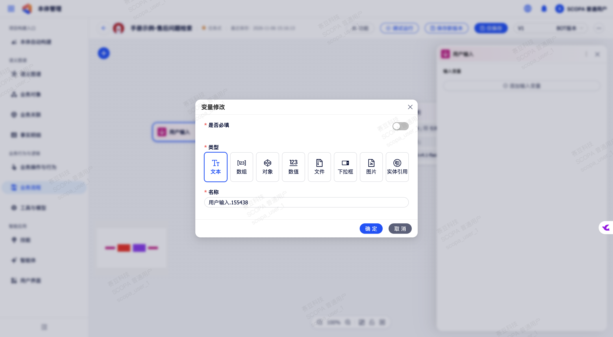

图 B-1-1 输入变量的类型与必填设置（当前界面截图）

### B.2.2 大语言模型（LLM）节点

用途：调用模型处理理解、归纳、分类与文本生成。

1\. 在画布中添加 LLM
节点并连接上下游。选择可用模型，把本节点实际需要的上游输出加入“输入”。

2\.
分别填写系统提示词和用户提示词，引用已选输入变量；需要稳定的结构化结果时，在提示词中写清字段、类型和格式。

3\.
定义输出变量名称与类型，按需调整模型高级参数。单独运行正常、信息不足和无关输入，核对输出能否被下游引用。

<figure>
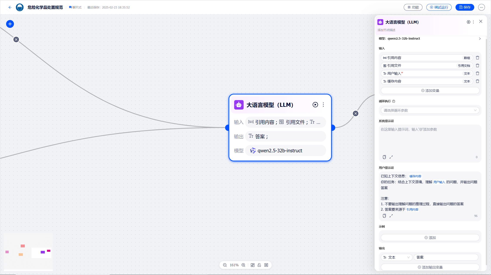
<figcaption>
图 B-2-1 LLM
节点的模型、输入与提示词配置（既有手册截图）
</figcaption>
</figure>

### B.2.3 知识库检索节点

用途：在 Logic
中检索已授权的文档知识库或数据知识库，并将引用内容与来源提供给后续节点。

1\.
添加知识库检索节点，按需填写节点描述；在“查询条件”点击“添加查询条件”，将用户问题或上游节点输出设置为检索输入。

2\.
在“知识库配置”中切换“文档知识库”或“数据知识库”页签，点击添加目标知识库。以下参数针对截图中的文档知识库；数据知识库按其页签显示的字段配置。

3\.
使用文档知识库时，选择语义、全文、混合或交集检索，设置引用上限、文档引用上限和最低相关度；按需选择结果重排、配置检索变量，并选择返回段落或全文。

4\.
核对“输出”中的“引用内容”和“引用文件”变量，并连接后续节点。单独运行已知答案、无命中及无权限样例，检查返回内容、来源与访问范围。

<figure>
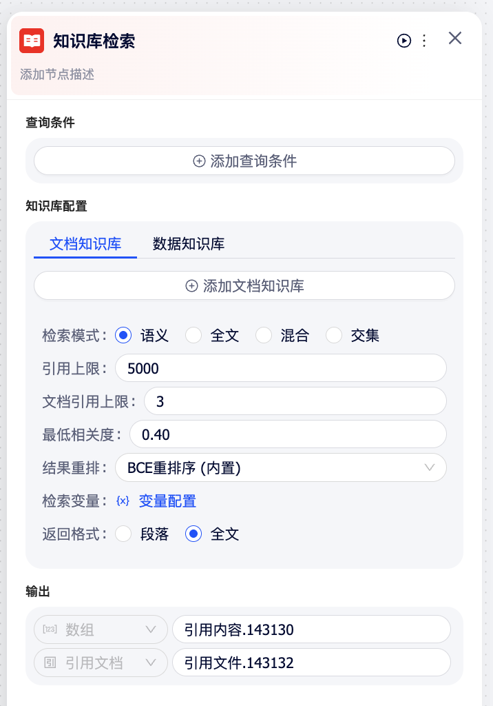
<figcaption>
图 B-3-1
知识库检索节点的查询条件、文档知识库参数与输出（当前界面截图）
</figcaption>
</figure>

> v4.0 补充：添加文档知识库时，选择弹窗支持按标签筛选和关键词搜索知识库（下图）。原型中规划的“目录范围”“标签筛选”检索范围配置，测试环境节点配置区尚未提供，上线版本待确认。

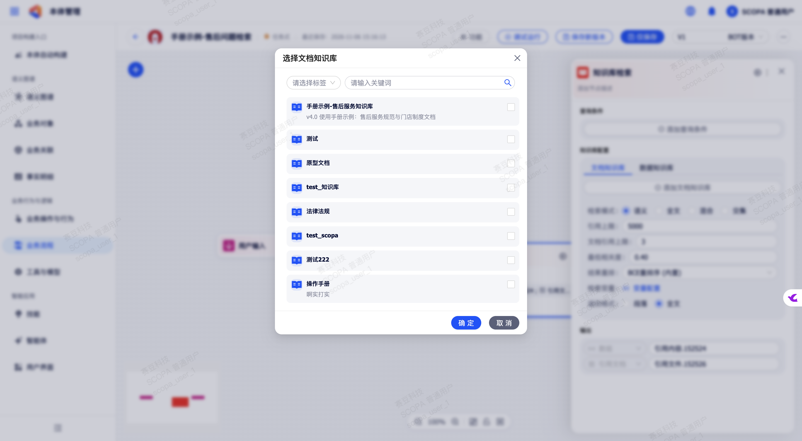

图 B-3-2 选择文档知识库：标签筛选与搜索（当前界面截图）

### B.2.4 本体数据推理节点

用途：检索实体、属性、关系和事件，或沿关系查找关联对象。

1\.
添加本体数据推理节点，先判断要查实体本身（实体查询），还是从已知实体出发查关联关系（关系挖掘）。

2\.
实体查询时点击“添加实体”选择对象类型，再选择检索类型：
- 语义：按问题语义匹配实体。在“检索属性”中可指定多个已建语义索引的属性，设置引用上限和最低相关度。
- 精确：在条件区添加一个或多个属性条件（属性、比较方式、引用变量或固定值），多个条件用 AND / OR 组合，用于按编号、名称等精确定位实体。
- 混合：同时使用精确条件和语义检索。
需要先锁定某个实体再查询时，在“定位条件”中引用上游变量。“返回内容”可选全部属性或指定对象属性。

3\.
关系挖掘时，在“实体数据”中引用起点实体（通常来自实体查询的输出），在“关系配置”中设置最大拓展深度、关系类型（可多选）、关系方向和最大条目数。输出包括拓展结果、拓展子图、实体列表以及查询是否成功、查询错误信息。运行已知样例，核对返回对象、关系方向及空结果。

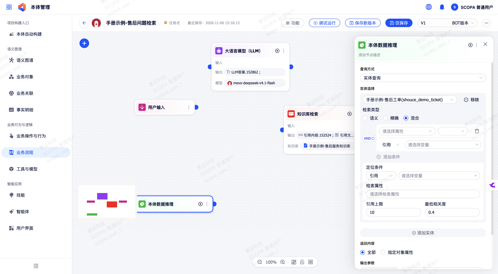

图 B-4-1 本体实体查询配置：检索类型、条件与检索属性（当前界面截图）

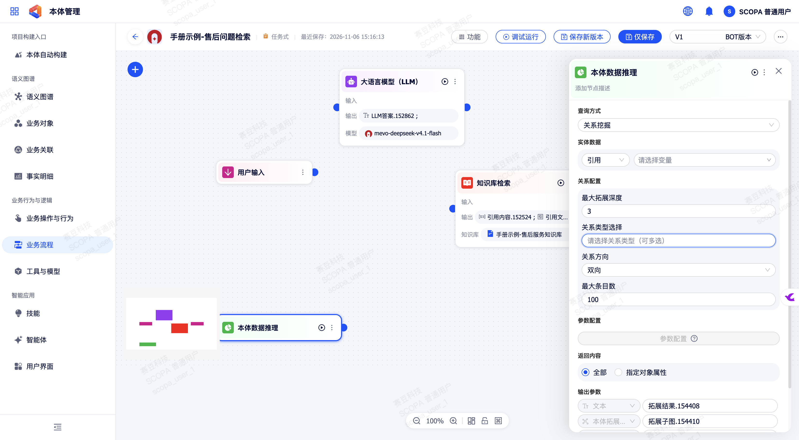

图 B-4-2 本体关系挖掘配置（当前界面截图）

### B.2.5 本体统计分析节点

用途：对本体数据进行聚合、分组、排序与指标分析。

1\.
添加本体统计分析节点，在“输入来源”中引用用户的统计问题或上游输出。明确统计对象、指标口径、时间范围和分组维度。

2\.
选择用于生成查询的模型，在“查询对象范围”中选择可查询的实体；设置失败重试次数和最大返回条数。

3\.
节点输出查询结果、生成的 SQL、查询是否成功和查询错误信息。用可人工复算的样例核对结果与口径，并检查生成 SQL 是否符合预期；再测试无权限和无数据的情形。

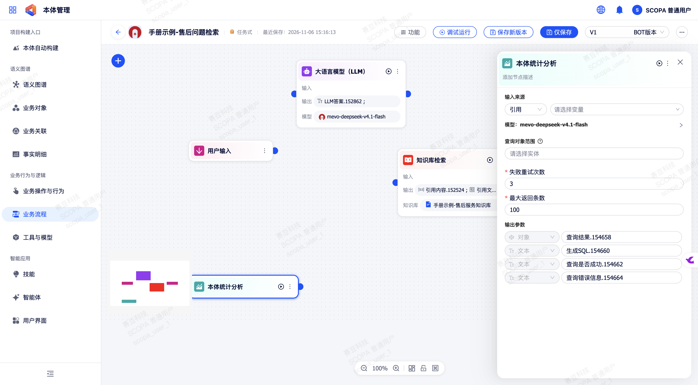

图 B-5-1 本体统计分析节点配置（当前界面截图）

### B.2.6 Action 执行节点

用途：调用已配置的 Action 执行业务操作。

1\. 先在本体管理中完成目标 Action 的定义和测试，再在 Logic 画布中添加
Action 执行节点。

2\. 在“Action 选择”中选择目标
Action，在“参数配置”中逐项添加参数，映射到用户输入、上游输出或固定值。执行前核对操作对象和授权。

3\.
节点输出 Action 作用的对象、执行记录、执行结果和错误信息。用测试实例检查实际数据变化与节点返回值；再测试缺参、无权限和执行失败。会发送消息或修改他人数据的 Action，不要在调试中选用。

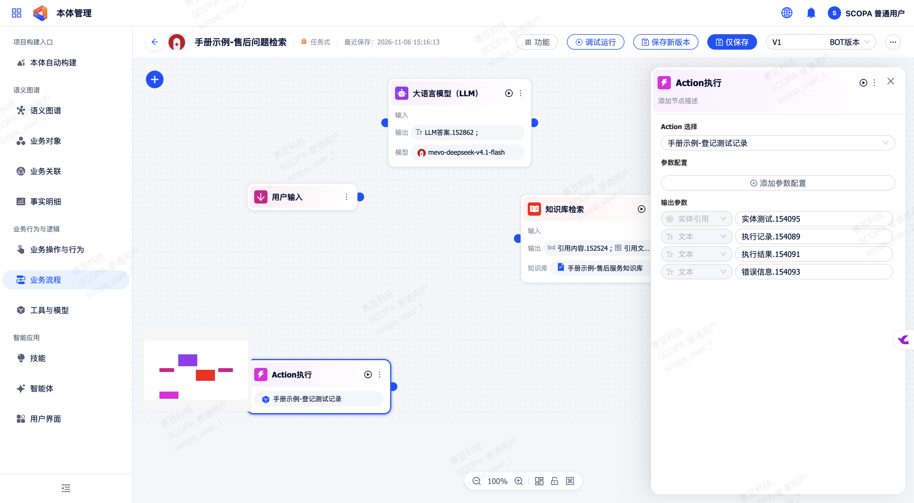

图 B-6-1 Action 执行节点配置（当前界面截图）

### B.2.7 工具调用节点

用途：调用已接入的自定义工具、内置工具、流程工具或 MCP 工具。

1\.
添加工具调用节点，在配置区点击“添加工具”。弹窗分为自定义工具、内置工具、流程工具、MCP 工具四个页签，根据名称和用途选择目标工具。规则判断可选内置工具“规则引擎工具集 > 执行审核规则”（6.12.5）。

2\.
查看工具的输入定义，将参数映射到上游变量或填写固定值。参数随问题变化且需模型判断时，才按当前界面开启智能填参并写清规则。

3\.
配置输出变量并单独试调用；核对返回值、解析结果与错误信息。需要在调用失败时走单独路径，在“异常处理”中设置异常分支。再测试缺参、无权限和接口失败。

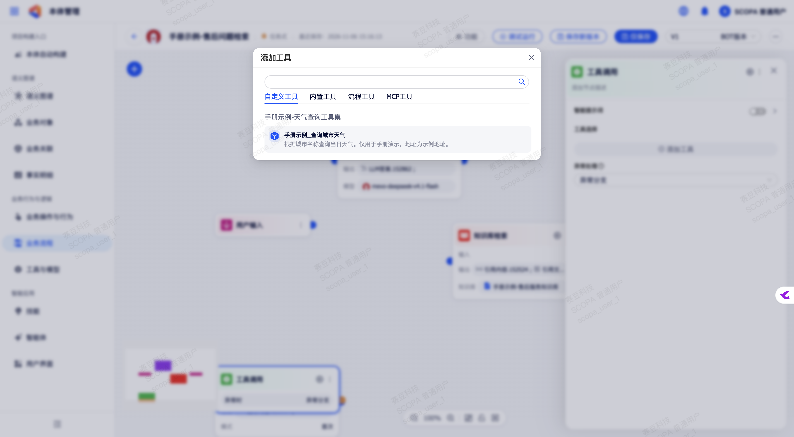

图 B-7-1 添加工具：四类工具页签（当前界面截图）

### B.2.8 寄存器节点

用途：保存同一会话内需要再次使用的状态或上下文。

1\.
添加寄存器节点，选择需要保存的上游变量。寄存模式可选首次、追加或替换。

2\.
追加模式应设置保存轮次；替换模式应明确每轮更新的来源。按需开启“是否生成时间戳”（为每次写入记录时间）和“是否结构化输出”（以结构化格式输出缓存内容）。将寄存器输出“缓存内容”接到后续需要上下文的节点。

3\.
连续运行两轮，检查读写顺序和最新值；开启新会话后确认变量是否按预期初始化。

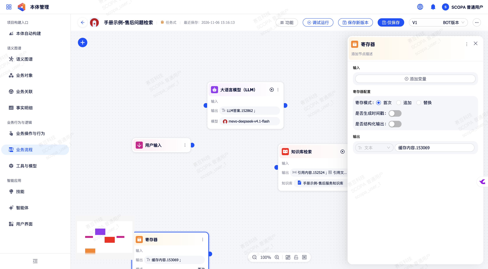

图 B-8-1 寄存器节点的寄存模式与输出设置（当前界面截图）

### B.2.9 条件选择节点

用途：按照明确条件把流程分到不同路径。

1\.
添加条件选择节点，为每个分支选择判断变量、比较方式和目标值；多个条件并用时明确“且／或”关系。

2\.
将各分支分别连接到下游节点，并为其他情况设置兜底路径。条件重叠时检查优先顺序。

3\.
准备各分支命中与未命中的样例，确认只有预期路径运行，且分支结束后可以汇合或输出。

<figure>
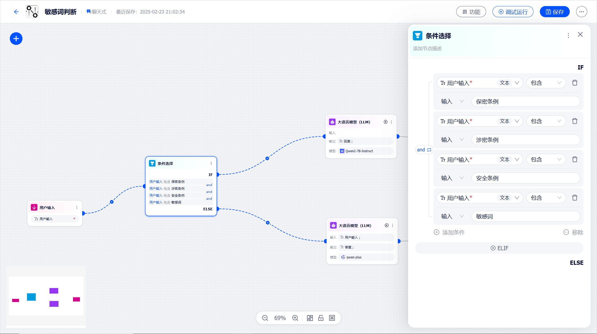
<figcaption>
图 B-9-1
条件选择节点的分支配置（既有手册截图）
</figcaption>
</figure>

### B.2.10 代码执行节点

用途：用确定性脚本完成格式转换、计算、去重和结构重组。

1\.
添加代码执行节点，选择当前界面支持的脚本语言（python3）。为脚本参数命名，并逐个映射到上游输出。

2\.
编写处理逻辑，定义返回字段及类型；返回键名要与节点输出变量一致。也可以点击编辑器工具栏的 AI 图标，在“代码编辑”中输入代码生成需求，点击“生成”后核对代码再确定。对空值、非法类型和异常输入提供处理；需要在脚本报错时走单独路径，在“异常处理”中设置。

3\. 先单独运行边界样例，再接入整个流程；核对输出结构能被下游读取。AI 生成的代码必须经过人工核对和测试。

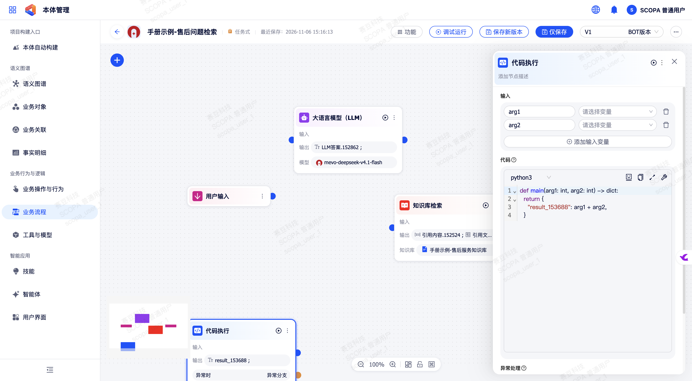

图 B-10-1 代码执行节点的输入、脚本与输出配置（当前界面截图）

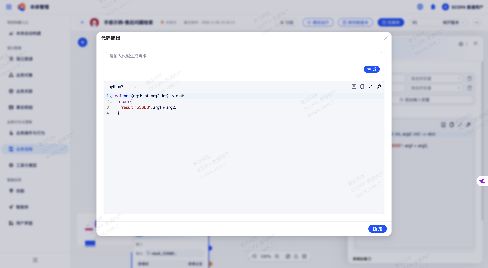

图 B-10-2 AI 生成代码（当前界面截图）

### B.2.11 变量聚合节点

用途：将不同条件分支的结果汇成一个下游变量。

1\. 在条件分支的汇合位置添加变量聚合节点，将各分支要传出的变量选为输入。

2\.
设置聚合后的统一变量名称和类型，再连接共同的下游节点。各分支应返回同一语义和兼容的数据类型。

3\. 逐个触发分支，核对下游都能取得变量；不要用它聚合同时执行的并行结果。

<figure>
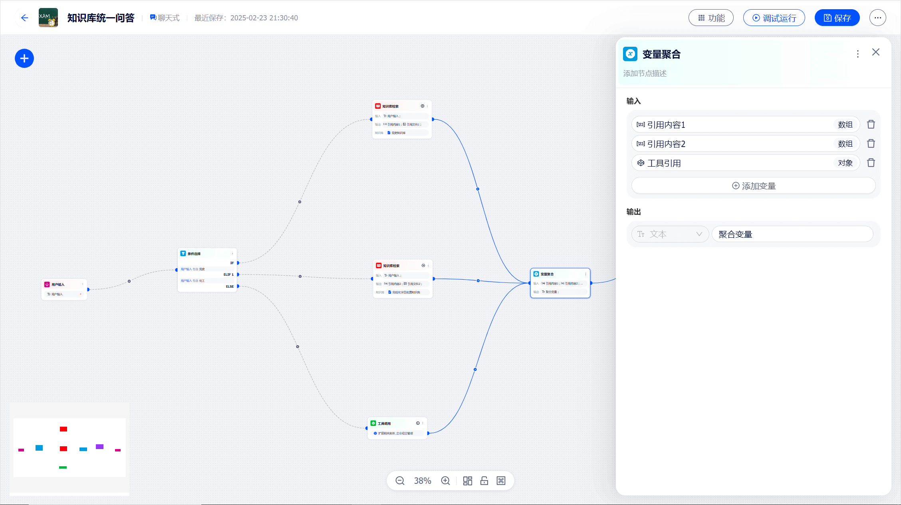
<figcaption>
图 B-11-1
变量聚合节点的分支输入配置（既有手册截图）
</figcaption>
</figure>

### B.2.12 循环节点

用途：让子流程按数组元素、固定次数或结束条件逐轮执行。

1\.
添加循环体并选择循环方式。数组循环指定数组输入；固定次数循环填写次数；需要按条件退出时设置最大次数。

2\.
把要反复执行的节点放入循环体，定义每轮输入及输出。需要跨轮保留状态时配置循环变量，并在循环体内使用“设置变量”更新。

3\.
需要提前结束时，将“终止循环”放在满足条件的分支中。用空数组、单条和多条数据测试结果顺序与终止行为。

<figure>
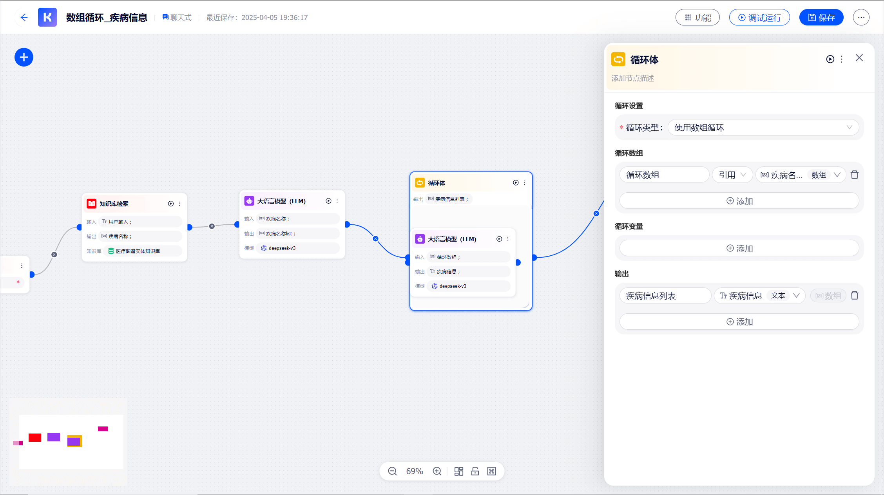
<figcaption>
图 B-12-1
循环体、循环方式与变量配置（既有手册截图）
</figcaption>
</figure>

<figure>
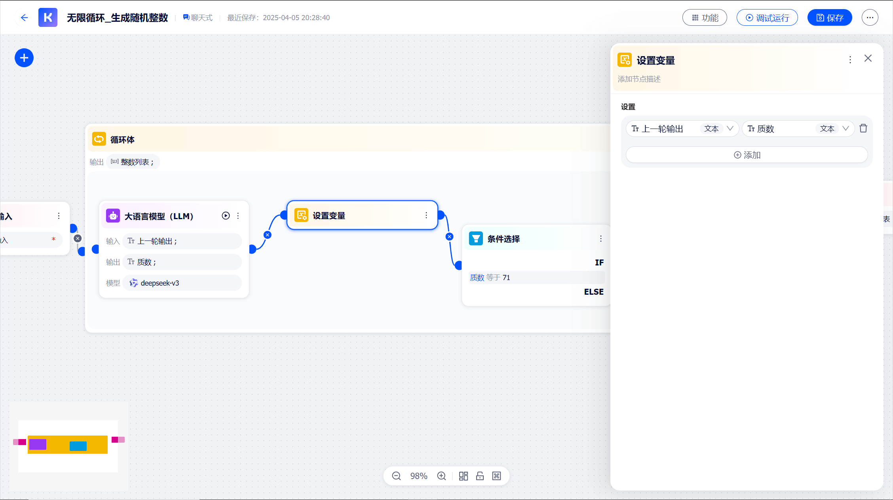
<figcaption>
图 B-12-2
循环体内设置变量（既有手册截图）
</figcaption>
</figure>

### B.2.13 知识库写入节点

用途：将流程产生的内容写入指定知识库。

1\.
添加知识库写入节点，在“基础文档”或“数据”页签选择唯一目标知识库；核对当前用户是否具有写入权限。

2\.
基础文档知识库填写文档内容和文档名称，均可引用上游变量；数据知识库按目标字段逐项设置“引用上游变量”或“输入固定值”。节点输出“写入文档”。

3\.
运行后查看写入结果，并在知识库完成处理后检索验证。写入成功不表示内容立即可被检索。

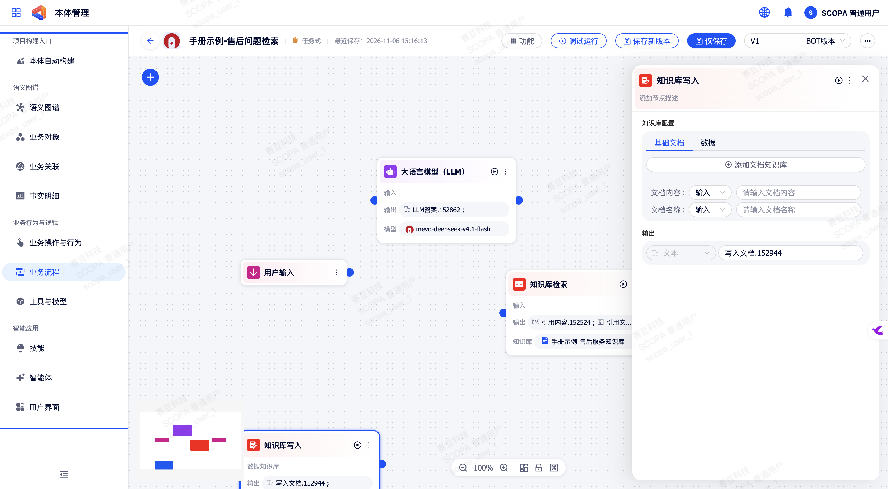

图 B-13-1 知识库写入节点的目标与字段映射（当前界面截图）

### B.2.14 批处理节点

用途：并行处理相互独立的多条数组数据。

1\. 添加批处理节点，选择数组型输入，配置每个元素都要执行的子流程。

2\.
按当前界面设置并行数量、处理上限和失败处理方式，并把子流程输出映射为批处理的汇总输出。

3\.
先用小批量检查输出结构、顺序与失败项，再扩大处理量。各条数据若依赖前一条的状态，应改用循环。

<figure>
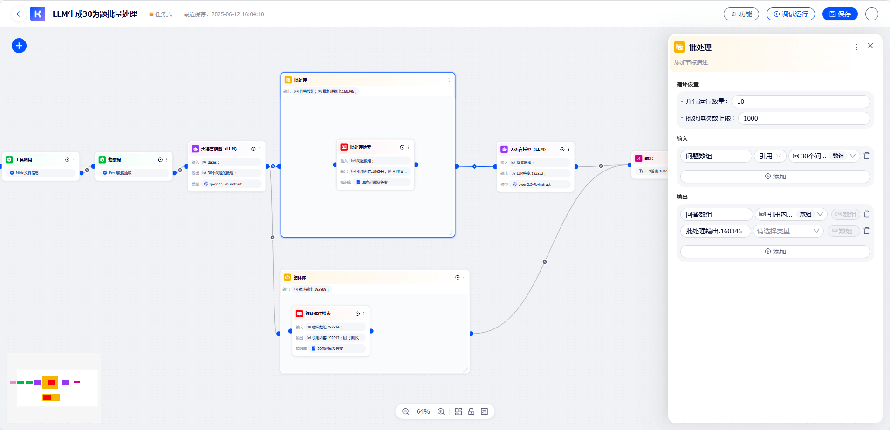
<figcaption>
图 B-14-1
批处理节点的并行与输入配置（既有手册截图）
</figcaption>
</figure>

### B.2.15 输出节点

用途：定义 Logic 返回给用户、Agent 或其他调用方的最终结果。一个 Logic
只有一个输出节点。

1\.
在输出节点点击“添加输出变量”，为每项输出选择来源变量，填写名称和类型。

2\. RAG 问答需要展示来源时，把答案和引用文档分别映射到输出；返回给其他
Logic 或 API 时，核对字段名与类型约定。

3\.
运行正常、空结果和失败样例，检查最终显示及调用方接收的结构；发布后变更输出时同步复测下游。

<figure>
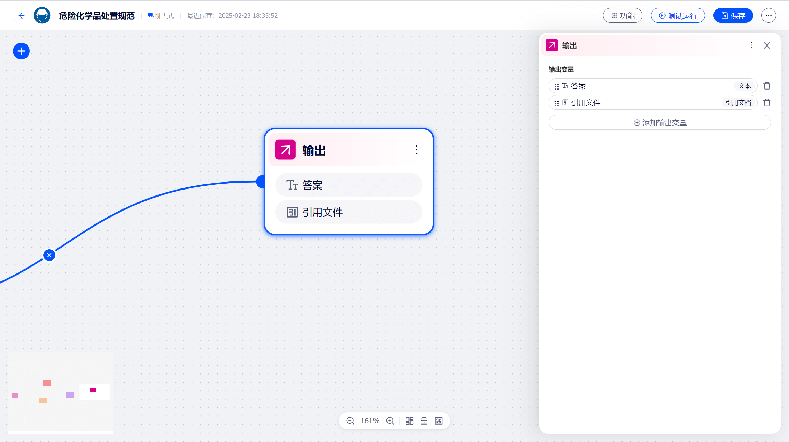
<figcaption>
图 B-15-1
输出节点的变量映射（既有手册截图）
</figcaption>
</figure>

### B.2.16 数据集节点（v4.0 新增）

用途：查询项目中已构建的数据集（结构化数据表），把查询结果交给后续节点。

1\.
添加数据集节点，在“输入”中选择查询问题或条件所在的上游变量。

2\.
点击“添加数据集”，选择项目内已构建、当前用户有权限的数据集。数据集基于项目申请到的数据表资源构建。

3\.
节点输出“查询结果”（数组）和“失败信息”（文本）。用已知数据的样例核对返回行数和字段，再测试无数据和无权限的情形。

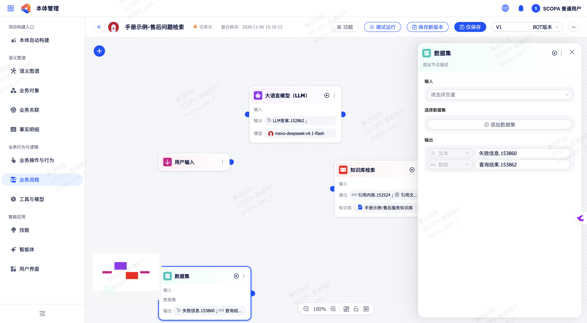

图 B-16-1 数据集节点配置（当前界面截图）

## B.3 运行前的共同检查

逐项核对节点输入是否存在、变量类型是否匹配、所引用的知识库或本体数据是否已就绪，以及当前用户是否具有对应权限。对写操作和外部接口调用，先在测试数据上验证；对分支、循环和批处理，至少覆盖正常、空结果与失败路径。检查通过后，按第
6.10.3 节在调试对话区跑通整条链路。

## 本章变更说明（v3.4 → v4.0）

**有变化的节点（重写说明并换用当前界面截图）：**
- B.2.1 输入节点：新增下拉框、图片、实体引用三种变量类型。
- B.2.4 本体数据推理节点：实体查询新增语义 / 精确 / 混合检索类型、多条件精确定位、定位条件、多属性语义检索；关系挖掘新增实体列表输出。
- B.2.5 统计分析节点：节点名改为“本体统计分析”，按当前界面补写字段（模型、查询对象范围、失败重试、最大返回条数、生成 SQL 输出），补拍截图，去掉【截图待补】。
- B.2.6 Action 执行节点：按当前界面补写参数配置与输出，补拍截图，去掉【截图待补】。
- B.2.7 工具调用节点：添加工具分为自定义 / 内置 / 流程 / MCP 四个页签，新增异常处理；补充规则引擎工具集。
- B.2.8 寄存器节点：新增“是否生成时间戳”“是否结构化输出”开关。
- B.2.10 代码执行节点：新增 AI 生成代码和异常处理。
- B.2.13 知识库写入节点：页签改为“基础文档 / 数据”，文档字段为文档内容与文档名称。

**新增：**
- B.1 补充节点面板说明与截图。
- B.2.16 数据集节点（v3.4 未纳入）。
- B.2.3 补充选择知识库弹窗的标签筛选截图（节点说明本身未变）。

**未变的节点（保留 v3.4 原文和原图）：** B.2.2 大语言模型（LLM）、B.2.3 知识库检索、B.2.9 条件选择、B.2.11 变量聚合、B.2.12 循环、B.2.14 批处理、B.2.15 输出；B.3 共同检查。以上 7 个节点已于 2026-11-06 在测试环境逐一打开核对，配置项与 v3.4 截图一致（循环类型选项为使用数组循环 / 指定循环次数 / 无限循环，无限循环需设置最大循环次数，与原文一致）。2026-11-26 复核再次确认节点面板的分类与节点名称与本附录一致（大语言模型、知识库检索、知识库写入、寄存器、工具调用、代码执行、数据集、批处理、Action执行、本体数据推理、本体统计分析；条件/聚合：条件选择、变量聚合；循环：循环体、终止循环、设置变量），未发现新增或改名节点。

**删除：** 引言中“数据集节点暂不纳入本手册”“统计分析和 Action 执行节点暂无截图”的说明。

## 待确认

1. 知识库检索节点的“目录范围”“标签筛选”检索范围配置仅见于原型，测试环境节点配置区没有，上线版本待确认。
2. 关系挖掘的“关系属性筛选”“对端实体筛选”：测试时关系类型列表为空，未能展示这两项配置，需在有关系数据的实体上补截。
3. 循环类的“设置变量”“终止循环”节点只能放在循环体内，本次未逐一打开复核，暂按未变处理（B.2.12 图 B-12-2 仍为 v3.4 截图）。
4. 未变节点按附录规则沿用 v3.4 截图（环境界面已核对一致）；README 要求“界面未变的也用环境重截”，两条规则冲突，是否统一换成当前界面截图请确认。
5. Action 执行节点的下拉列表包含他人 Action（含会发送飞书消息的 Action），调试时未执行任何节点，执行效果截图待用测试 Action 补拍。
6. 2026-11-26 复核：节点面板（图 B-0-1）的分类与节点名称已与当前画布核对一致，但节点配置区未逐节点重开（B.2.1–B.2.16 的字段与截图沿用 2026-11-06 核对结果）；本次复核新建了测试 Action「手册示例-复核登记」，后续可用于补拍 Action 执行节点的真实执行效果。
7. 单节点验证（B.1 第 3 步、B.3 末句）：当前画布节点标题只有折叠 / 展开和「更多 > 帮助」，未见单节点运行入口，附录中「对可单独运行的节点进行测试」「完成单节点验证后」的表述已按实测调整为整链路调试；单节点调试能力是否提供待确认（同 6.10.3）。
