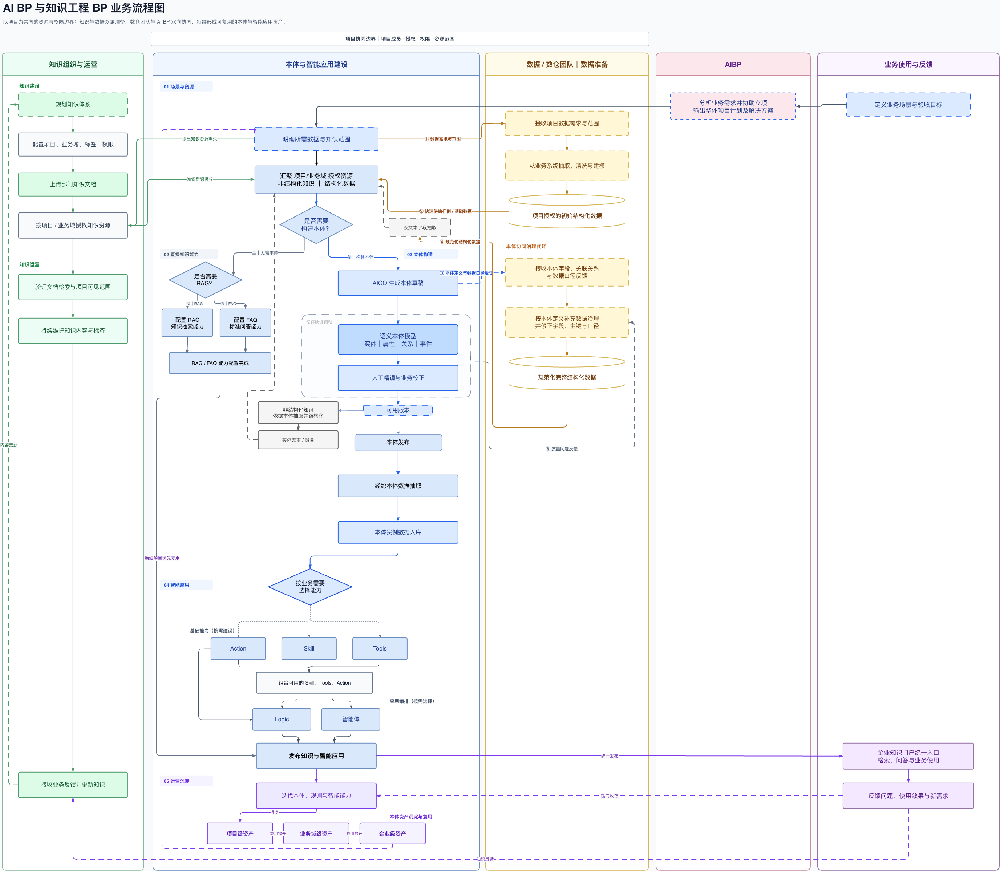

# 前言——产品架构与阅读路径

使用本平台的主线是：**从业务目标出发，准备并授权资源，在项目中建设所需能力，交付业务使用，再根据反馈维护和复用成果。**
图中展示了知识组织与运营、本体与智能应用建设、数据准备、AI BP
协同以及业务使用之间的关系。各方围绕同一业务目标协作，但不必由同一人员完成所有环节。

组织负责接入和管理文档、数据等资源，确定资源归属、管理责任与访问范围；项目负责知识库、本体和智能应用建设。项目获得授权后引用组织资源，资源归属不随之改变。建设过程中，业务人员确认需求与验收目标，知识工程人员组织模型和能力，数据团队准备符合业务口径的数据，AI
BP 协助明确方案并推动协同。

建设成果交付后，用户通过知识门户或相应应用检索、问答和处理业务。使用中发现的问题与新增需求，返回知识维护、数据准备和能力建设环节持续修正；可复用的成果按管理要求回流到部门、业务域或企业级范围，供其他项目授权使用。

阅读本手册时，先用第一章明确目标和建设路径，再按需要查阅资源、项目、建设与使用章节。图是理解平台协作关系的总览；各条场景的完整路径和具体操作，以后续章节为准。

<figure>

<figcaption>
平台业务流程总览
</figcaption>
</figure>

**手册目录说明：**

第一章从业务目标出发，明确要解决的问题、所需材料和建设路径。第二章确定资源的组织管理范围、职责和权限。第三章接入并管理文档、结构化数据及门户
FAQ。需要建设知识库、本体或应用时，再按第四章确定项目范围，申请并获得所需资源的使用授权。

完成准备后，根据业务需要进入建设环节。第五章说明如何构建文档知识库和数据知识库；第六章说明如何构建本体，处理数据并配置
Action、Logic 和规则；第七章说明 Tools、Skill 与 MCP
等通用能力；第八章说明如何组合所需知识与能力，建设和调试
Agent。这些章节按选定路径使用，不要求逐章完成所有建设内容。

第九章说明如何通过 API
等方式向外部系统开放能力。第十章说明用户如何依据组织资源权限，在企业知识门户中检索和问答；门户使用不以创建项目为前提。第十一章承接使用反馈，说明日常维护、成果回流复用与运营查看，让业务使用中发现的问题重新进入更新和建设过程。

# 
