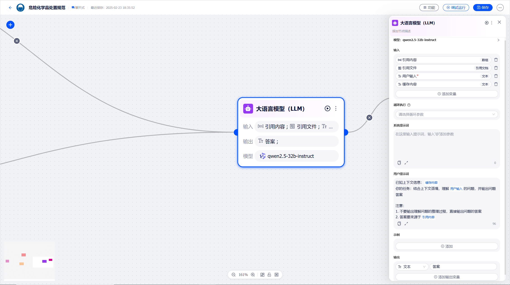
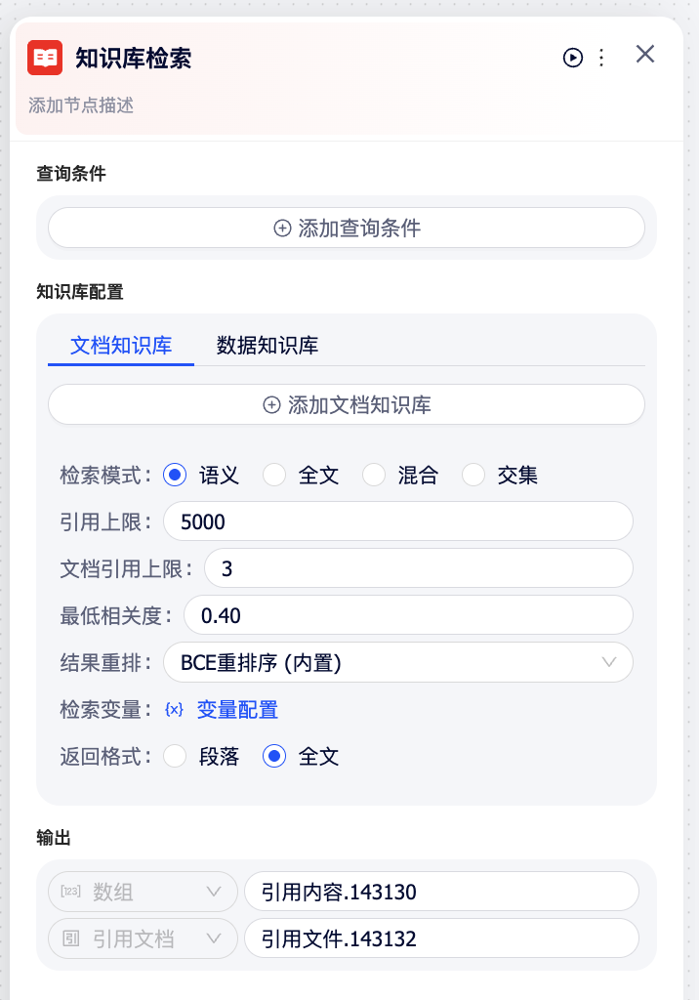
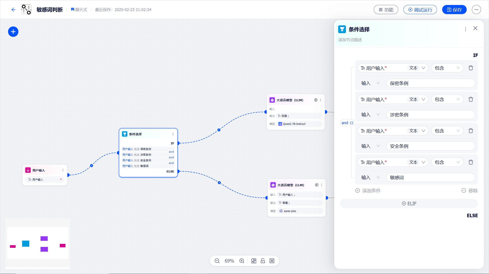
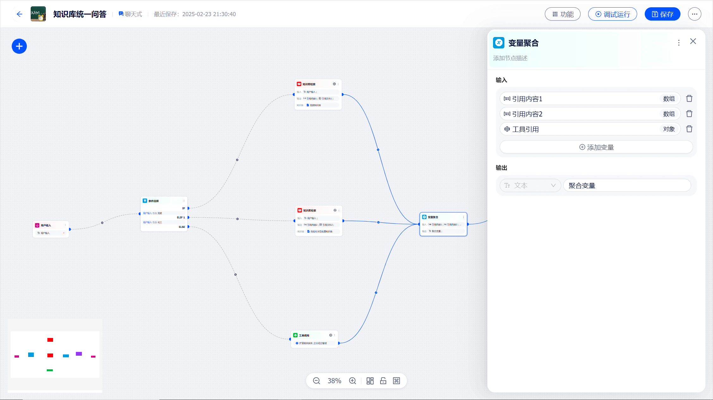
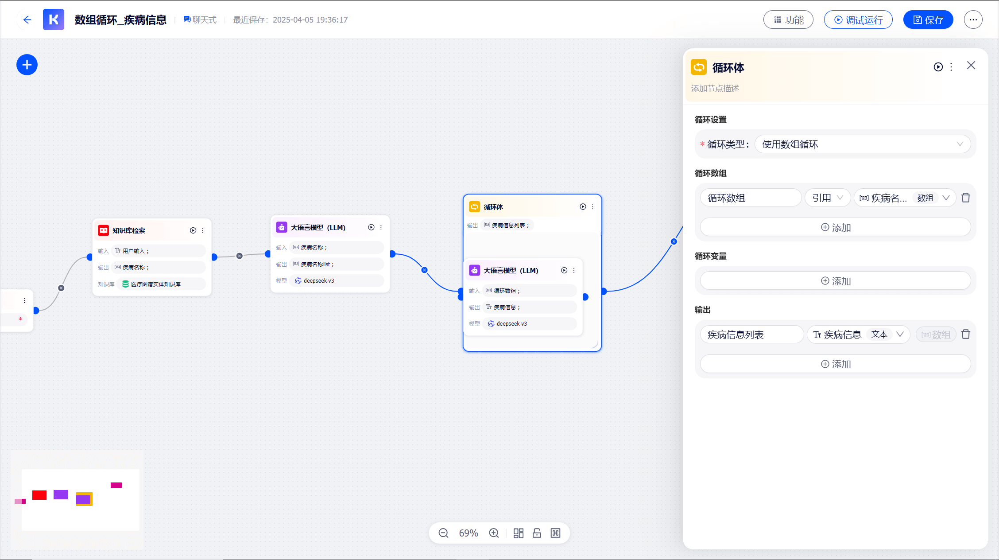
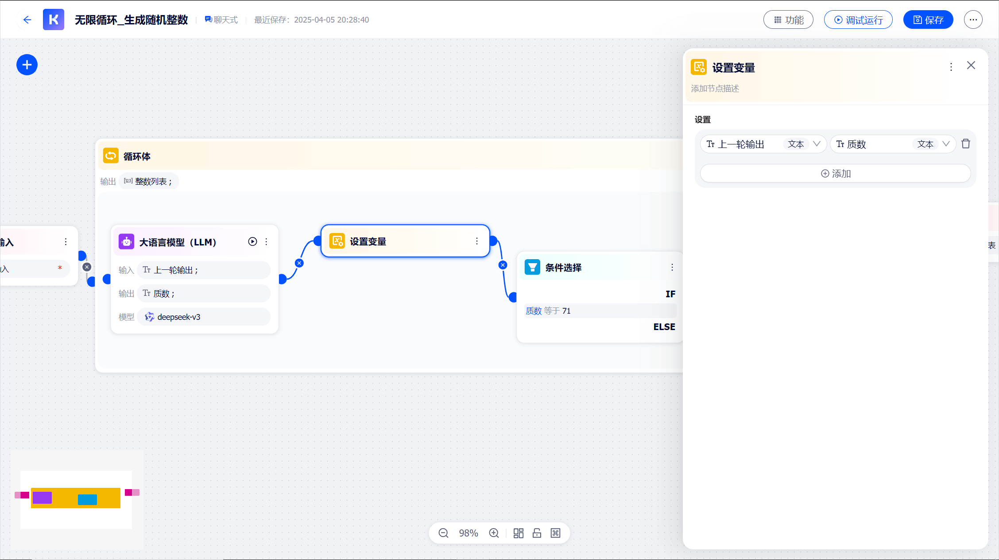
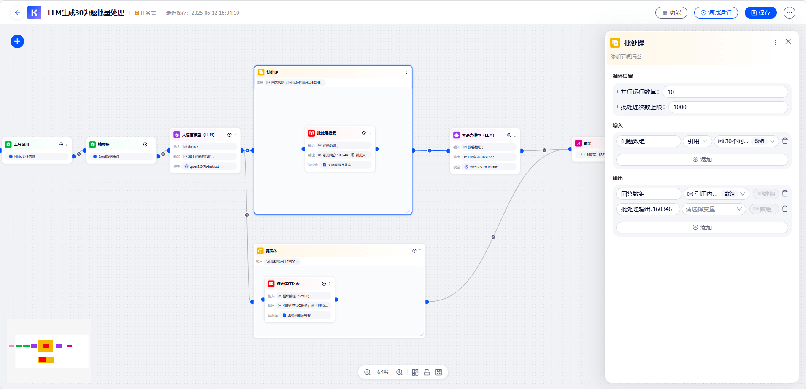
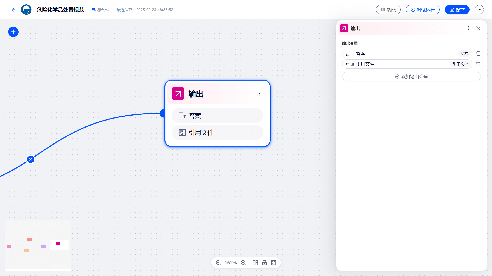

# 附录 B：Logic 各节点介绍

本附录补充第 6.10.2 节，按节点说明在 Logic
画布中如何配置、连接和验证。截图选自已有产品操作手册，用于定位配置区域；界面样式、字段及可用范围以当前部署版本为准。数据集节点暂不纳入本手册。统计分析和
Action 执行节点暂无可核对的节点配置截图，保留操作说明并标出待补项。

## B.1 进入画布与通用操作

1\. 进入本体管理的 Logic 列表，打开目标 Logic
的编排画布。确认本次处理的是正确项目、正确 Logic。

2\.
从节点面板选择节点放入画布，拖动连接点建立上游与下游关系；点击节点，在配置区填写输入、处理方式和输出。

3\.
保存后先检查变量名称和类型，再对可单独运行的节点进行测试；整体调试、发布与使用见第
6.10.3—6.10.4 节。

## B.2 节点配置与验证

### B.2.1 输入节点

用途：定义 Logic 的外部入参。一个 Logic 只有一个输入节点。

1\.
点击输入节点，在配置区选择“添加输入变量”。按业务含义填写变量名称，设置文本、数值、数组、对象、文件等类型及是否必填。

2\.
需要多个输入时逐项添加；任务式入口要核对变量显示顺序。文件类输入按当前界面设置允许的类型和数量。

3\.
将输入节点的变量连接到需要使用它的下游节点。用完整参数、缺少必填参数和类型不符的参数试运行。

<figure>

<figcaption>
图 B-1-1
任务式输入节点配置（既有手册截图）
</figcaption>
</figure>

### B.2.2 大语言模型（LLM）节点

用途：调用模型处理理解、归纳、分类与文本生成。

1\. 在画布中添加 LLM
节点并连接上下游。选择可用模型，把本节点实际需要的上游输出加入“输入”。

2\.
分别填写系统提示词和用户提示词，引用已选输入变量；需要稳定的结构化结果时，在提示词中写清字段、类型和格式。

3\.
定义输出变量名称与类型，按需调整模型高级参数。单独运行正常、信息不足和无关输入，核对输出能否被下游引用。

<figure>

<figcaption>
图 B-2-1 LLM
节点的模型、输入与提示词配置（既有手册截图）
</figcaption>
</figure>

### B.2.3 知识库检索节点

用途：在 Logic
中检索已授权的文档知识库或数据知识库，并将引用内容与来源提供给后续节点。

1\.
添加知识库检索节点，按需填写节点描述；在“查询条件”点击“添加查询条件”，将用户问题或上游节点输出设置为检索输入。

2\.
在“知识库配置”中切换“文档知识库”或“数据知识库”页签，点击添加目标知识库。以下参数针对截图中的文档知识库；数据知识库按其页签显示的字段配置。

3\.
使用文档知识库时，选择语义、全文、混合或交集检索，设置引用上限、文档引用上限和最低相关度；按需选择结果重排、配置检索变量，并选择返回段落或全文。

4\.
核对“输出”中的“引用内容”和“引用文件”变量，并连接后续节点。单独运行已知答案、无命中及无权限样例，检查返回内容、来源与访问范围。

<figure>

<figcaption>
图 B-3-1
知识库检索节点的查询条件、文档知识库参数与输出（当前界面截图）
</figcaption>
</figure>

### B.2.4 本体数据推理节点

用途：检索实体、属性、关系和事件，或沿关系查找关联对象。

1\.
添加本体数据推理节点，先判断要查实体本身，还是从已知实体出发查关联关系。

2\.
实体查询时选择对象类型和检索方式，映射上游问题或实体标识；需要精确匹配时填写属性条件。

3\.
关系拓展时明确起点实体、关系类型、方向与对端对象。运行已知样例，核对返回对象、关系方向及空结果。

<figure>

<figcaption>
图 B-4-1
本体实体查询配置（现有手册截图）
</figcaption>
</figure>

<figure>

<figcaption>
图 B-4-2
本体关系拓展配置（现有手册截图）
</figcaption>
</figure>

### B.2.5 统计分析节点【截图待补】

用途：对本体数据进行聚合、分组、排序与指标分析。

1\.
添加统计分析节点，将用户的统计问题或上游输出映射到输入。明确统计对象、指标口径、时间范围和分组维度。

2\.
按当前界面选择可查询的本体范围，并设置返回条数与超时保护；具体字段以当前部署版本为准。

3\.
用可人工复算的样例核对结果、口径及无权限情形。该节点在现有详细手册中没有可核对的配置截图，当前界面截图待补。

### B.2.6 Action 执行节点【截图待补】

用途：调用已配置的 Action 执行业务操作。

1\. 先在本体管理中完成目标 Action 的定义和测试，再在 Logic 画布中添加
Action 执行节点。

2\. 选择目标
Action，逐项查看其入参；将每项参数映射到用户输入、上游输出或固定值。执行前核对操作对象和授权。

3\.
用测试实例检查实际数据变化与节点返回值；再测试缺参、无权限和执行失败。现有资料缺少此节点的配置截图，待从当前界面补拍。

### B.2.7 工具调用节点

用途：调用已接入的自定义工具、内置工具或已发布能力。

1\.
添加工具调用节点，在配置区点击“添加工具”，根据名称和用途选择目标工具。

2\.
查看工具的输入定义，将参数映射到上游变量或填写固定值。参数随问题变化且需模型判断时，才按当前界面开启智能填参并写清规则。

3\.
配置输出变量并单独试调用；核对返回值、解析结果与错误信息，再测试缺参、无权限和接口失败。MCP
工具是否可选以当前上线范围为准。

<figure>

<figcaption>
图 B-7-1
工具调用节点配置（既有手册截图）
</figcaption>
</figure>

### B.2.8 寄存器节点

用途：保存同一会话内需要再次使用的状态或上下文。

1\.
添加寄存器节点，选择需要保存的上游变量。按照当前界面提供的模式，确定首次保存、追加或替换的行为。

2\.
追加模式应设置保存轮次；替换模式应明确每轮更新的来源。将寄存器输出接到后续需要上下文的节点。

3\.
连续运行两轮，检查读写顺序和最新值；开启新会话后确认变量是否按预期初始化。

<figure>

<figcaption>
图 B-8-1
寄存器节点的输入与存储模式（既有手册截图）
</figcaption>
</figure>

### B.2.9 条件选择节点

用途：按照明确条件把流程分到不同路径。

1\.
添加条件选择节点，为每个分支选择判断变量、比较方式和目标值；多个条件并用时明确“且／或”关系。

2\.
将各分支分别连接到下游节点，并为其他情况设置兜底路径。条件重叠时检查优先顺序。

3\.
准备各分支命中与未命中的样例，确认只有预期路径运行，且分支结束后可以汇合或输出。

<figure>

<figcaption>
图 B-9-1
条件选择节点的分支配置（既有手册截图）
</figcaption>
</figure>

### B.2.10 代码执行节点

用途：用确定性脚本完成格式转换、计算、去重和结构重组。

1\.
添加代码执行节点，选择当前界面支持的脚本语言。为脚本参数命名，并逐个映射到上游输出。

2\.
编写处理逻辑，定义返回字段及类型；返回键名要与节点输出变量一致。对空值、非法类型和异常输入提供处理。

3\. 先单独运行边界样例，再接入整个流程；核对输出结构能被下游读取。

<figure>

<figcaption>
图 B-10-1
代码执行节点的输入、脚本与输出配置（既有手册截图）
</figcaption>
</figure>

### B.2.11 变量聚合节点

用途：将不同条件分支的结果汇成一个下游变量。

1\. 在条件分支的汇合位置添加变量聚合节点，将各分支要传出的变量选为输入。

2\.
设置聚合后的统一变量名称和类型，再连接共同的下游节点。各分支应返回同一语义和兼容的数据类型。

3\. 逐个触发分支，核对下游都能取得变量；不要用它聚合同时执行的并行结果。

<figure>

<figcaption>
图 B-11-1
变量聚合节点的分支输入配置（既有手册截图）
</figcaption>
</figure>

### B.2.12 循环节点

用途：让子流程按数组元素、固定次数或结束条件逐轮执行。

1\.
添加循环体并选择循环方式。数组循环指定数组输入；固定次数循环填写次数；需要按条件退出时设置最大次数。

2\.
把要反复执行的节点放入循环体，定义每轮输入及输出。需要跨轮保留状态时配置循环变量，并在循环体内使用“设置变量”更新。

3\.
需要提前结束时，将“终止循环”放在满足条件的分支中。用空数组、单条和多条数据测试结果顺序与终止行为。

<figure>

<figcaption>
图 B-12-1
循环体、循环方式与变量配置（既有手册截图）
</figcaption>
</figure>

<figure>

<figcaption>
图 B-12-2
循环体内设置变量（既有手册截图）
</figcaption>
</figure>

### B.2.13 知识库写入节点

用途：将流程产生的内容写入指定知识库。

1\.
添加知识库写入节点，选择唯一目标知识库；核对当前用户是否具有写入权限。

2\.
文档知识库填写文档内容及名称等当前界面要求的字段；数据知识库按目标字段逐项设置“引用上游变量”或“输入固定值”。

3\.
运行后查看写入结果，并在知识库完成处理后检索验证。写入成功不表示内容立即可被检索。

<figure>

<figcaption>
图 B-13-1
知识库写入节点的目标与字段映射（既有手册截图）
</figcaption>
</figure>

### B.2.14 批处理节点

用途：并行处理相互独立的多条数组数据。

1\. 添加批处理节点，选择数组型输入，配置每个元素都要执行的子流程。

2\.
按当前界面设置并行数量、处理上限和失败处理方式，并把子流程输出映射为批处理的汇总输出。

3\.
先用小批量检查输出结构、顺序与失败项，再扩大处理量。各条数据若依赖前一条的状态，应改用循环。

<figure>

<figcaption>
图 B-14-1
批处理节点的并行与输入配置（既有手册截图）
</figcaption>
</figure>

### B.2.15 输出节点

用途：定义 Logic 返回给用户、Agent 或其他调用方的最终结果。一个 Logic
只有一个输出节点。

1\.
在输出节点点击“添加输出变量”，为每项输出选择来源变量，填写名称和类型。

2\. RAG 问答需要展示来源时，把答案和引用文档分别映射到输出；返回给其他
Logic 或 API 时，核对字段名与类型约定。

3\.
运行正常、空结果和失败样例，检查最终显示及调用方接收的结构；发布后变更输出时同步复测下游。

<figure>

<figcaption>
图 B-15-1
输出节点的变量映射（既有手册截图）
</figcaption>
</figure>

## B.3 运行前的共同检查

逐项核对节点输入是否存在、变量类型是否匹配、所引用的知识库或本体数据是否已就绪，以及当前用户是否具有对应权限。对写操作和外部接口调用，先在测试数据上验证；对分支、循环和批处理，至少覆盖正常、空结果与失败路径。完成单节点验证后，按第
6.10.3 节整体调试。
