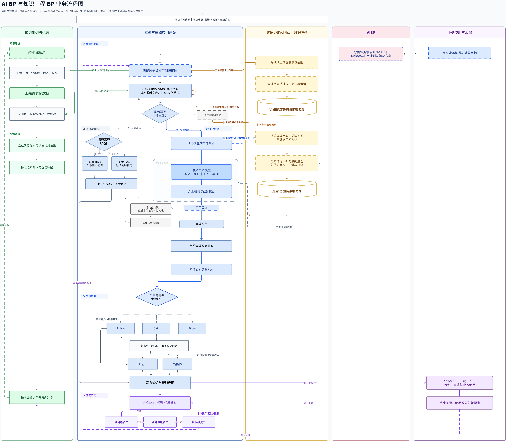
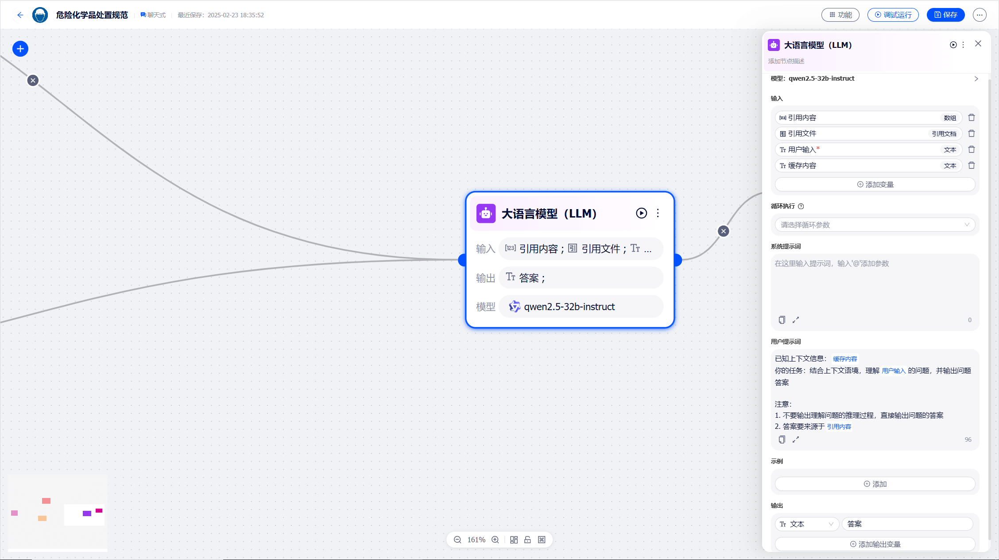
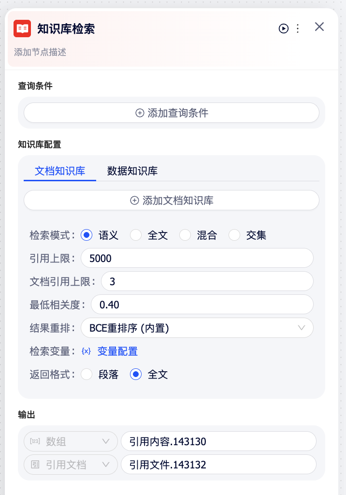
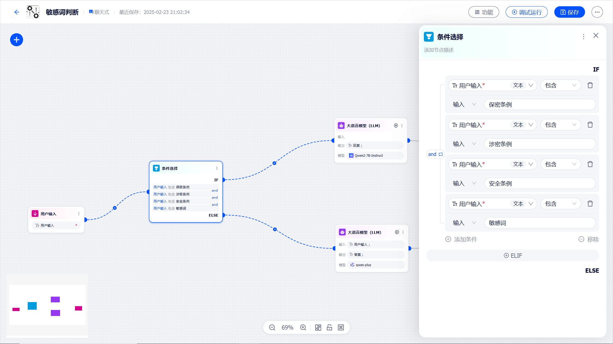
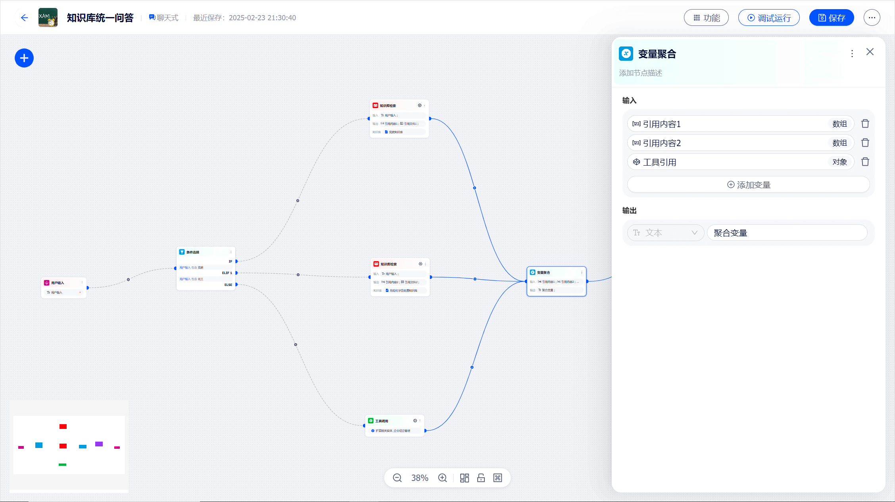
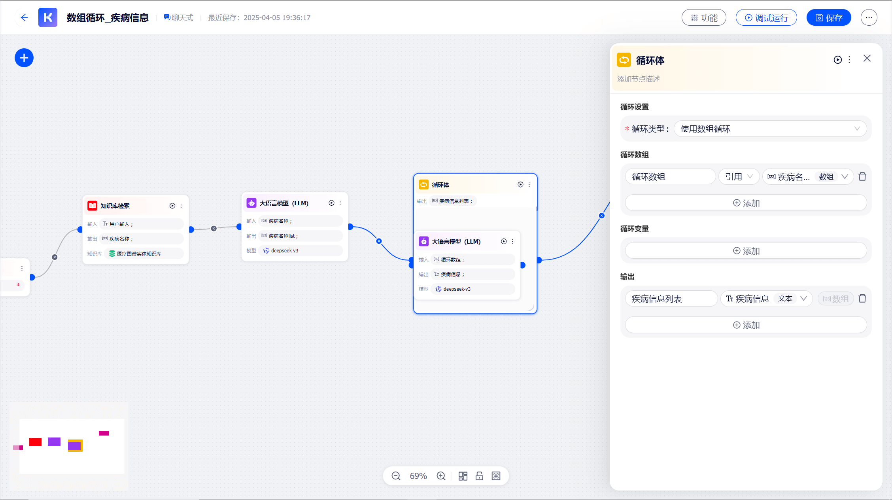
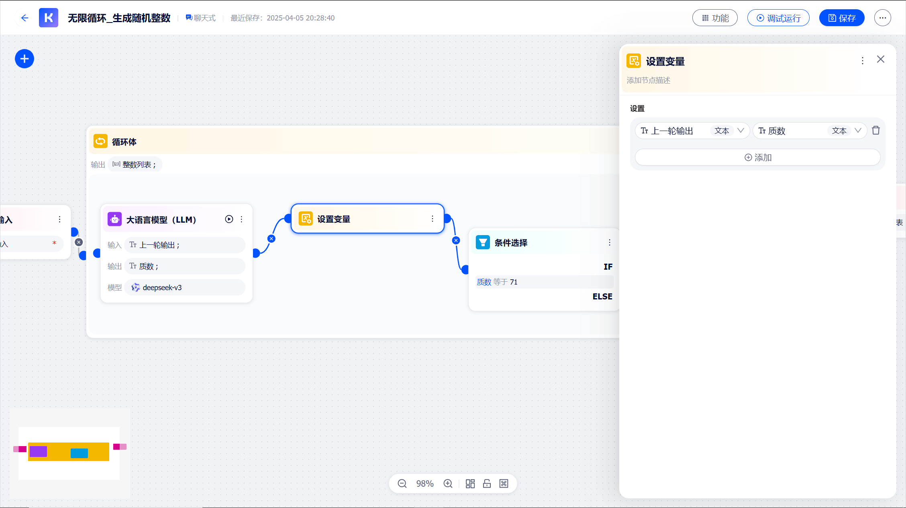
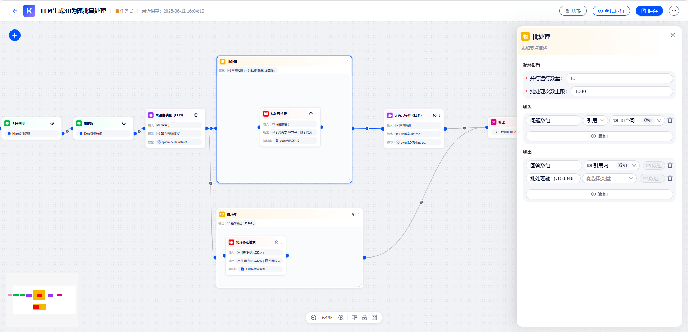
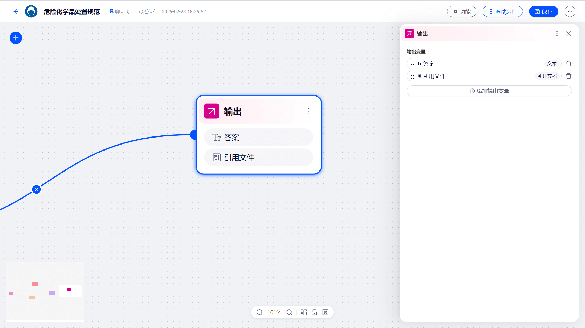

# 目录

[前言——产品架构与阅读路径
[10](#前言产品架构与阅读路径)](#前言产品架构与阅读路径)

[一、规划业务场景与建设路径（线下前置）
[12](#一规划业务场景与建设路径线下前置-1)](#一规划业务场景与建设路径线下前置-1)

> [1.1 业务场景规划（线下准备）
> [12](#业务场景规划线下准备)](#业务场景规划线下准备)
>
> [1.1.1 明确业务场景 [12](#明确业务场景)](#明确业务场景)
>
> [1.1.2 准备业务材料 [12](#准备业务材料)](#准备业务材料)
>
> [1.2 能力路径选择（前置判断）
> [13](#能力路径选择前置判断)](#能力路径选择前置判断)
>
> [1.2.1 选择建设路径 [13](#选择建设路径)](#选择建设路径)
>
> [1.3 FAQ 场景（路径） [14](#faq-场景路径)](#faq-场景路径)
>
> [1.4 RAG 场景（路径） [15](#rag-场景路径)](#rag-场景路径)
>
> [1.5 构建本体场景（路径） [16](#构建本体场景路径)](#构建本体场景路径)
>
> [1.6 混合场景（路径） [17](#混合场景路径)](#混合场景路径)

[二、配置组织资源管理 [18](#二配置组织资源管理)](#二配置组织资源管理)

> [2.1 组织管理：配置资源空间管理范围（企业、业务域、部门）
> [18](#组织管理配置资源空间管理范围企业业务域部门)](#组织管理配置资源空间管理范围企业业务域部门)
>
> [2.1.1 创建/同步资源组织空间【待升级】
> [18](#创建同步资源组织空间待升级)](#创建同步资源组织空间待升级)
>
> [2.2 组织权限：配置资源管理职责
> [19](#组织权限配置资源管理职责)](#组织权限配置资源管理职责)
>
> [2.2.1 空间人员配置 [19](#空间人员配置)](#空间人员配置)
>
> [2.2.3 资源空间审批配置 [20](#资源空间审批配置)](#资源空间审批配置)
>
> [2.3 知识门户：资源审批配置与待办
> [22](#知识门户资源审批配置与待办-1)](#知识门户资源审批配置与待办-1)
>
> [2.3.1 处理审批 [22](#处理审批)](#处理审批)
>
> [2.3.2 查看审批记录 [23](#查看审批记录)](#查看审批记录)
>
> [2.4 知识门户：标签管理 [24](#知识门户标签管理)](#知识门户标签管理)
>
> [2.4.1 创建与维护标签 [24](#创建与维护标签)](#创建与维护标签)

[三、接入与管理资源 [25](#三接入与管理资源)](#三接入与管理资源)

> [3.1 资源管理：查看资源并纳入部门管理【规划】
> [25](#资源管理查看资源并纳入部门管理规划-1)](#资源管理查看资源并纳入部门管理规划-1)
>
> [3.2 数据资产：数仓及其他结构化数据接入
> [26](#数据资产数仓及其他结构化数据接入-1)](#数据资产数仓及其他结构化数据接入-1)
>
> [3.2.1 连接数仓或数据库 [26](#连接数仓或数据库)](#连接数仓或数据库)
>
> [3.2.2 上传本地数据 [27](#上传本地数据)](#上传本地数据)
>
> [3.2.3 查看数据表与字段 [30](#查看数据表与字段)](#查看数据表与字段)
>
> [3.3 文档管理：本地与飞书非结构化资源接入
> [30](#文档管理本地与飞书非结构化资源接入)](#文档管理本地与飞书非结构化资源接入)
>
> [3.3.1 上传本地文档 [30](#上传本地文档)](#上传本地文档)
>
> [3.3.2 同步飞书文档【待上线】
> [31](#同步飞书文档待上线)](#同步飞书文档待上线)
>
> [3.3.3 配置文档权限【待升级】
> [31](#配置文档权限待升级)](#配置文档权限待升级)
>
> [3.4 FAQ 配置与管理（待升级）
> [32](#faq-配置与管理待升级)](#faq-配置与管理待升级)
>
> [3.4.1 新增与编辑 FAQ [32](#新增与编辑-faq-1)](#新增与编辑-faq-1)
>
> [3.4.2 导入与导出 FAQ [33](#导入与导出-faq)](#导入与导出-faq)
>
> [3.4.3 FAQ 权限配置【待设计】
> [34](#faq-权限配置待设计)](#faq-权限配置待设计)

[四、准备项目与申请资源
[34](#四准备项目与申请资源)](#四准备项目与申请资源)

> [4.1 项目管理 [34](#项目管理)](#项目管理)
>
> [4.1.1 创建项目 [35](#创建项目)](#创建项目)
>
> [4.1.2 管理项目信息及成员
> [36](#管理项目信息及成员)](#管理项目信息及成员)
>
> [管理员同样可修改成员角色或删除成员。只有项目成员，才可在本体构建、知识库构建时进入此项目进行场景构建。
> [38](#管理员同样可修改成员角色或删除成员只有项目成员才可在本体构建知识库构建时进入此项目进行场景构建)](#管理员同样可修改成员角色或删除成员只有项目成员才可在本体构建知识库构建时进入此项目进行场景构建)
>
> [4.2 项目管理：查看可申请资源【规划】
> [38](#项目管理查看可申请资源规划)](#项目管理查看可申请资源规划)
>
> [4.3 项目管理：申请与获得资源【规划】
> [38](#项目管理申请与获得资源规划)](#项目管理申请与获得资源规划)

[五、 构建知识库 [39](#构建知识库)](#构建知识库)

> [5.1 知识库管理：构建文档知识库
> [40](#知识库管理构建文档知识库)](#知识库管理构建文档知识库)
>
> [5.1.1 创建文档知识库 [40](#创建文档知识库)](#创建文档知识库)
>
> [5.1.2 导入文档 [41](#导入文档)](#导入文档)
>
> [5.1.3 配置解析与分片 [44](#配置解析与分片)](#配置解析与分片)
>
> [5.2 知识库管理：构建数据知识库
> [47](#知识库管理构建数据知识库)](#知识库管理构建数据知识库)
>
> [5.2.1 创建数据知识库 [48](#创建数据知识库)](#创建数据知识库)
>
> [5.2.2 新增与编辑记录 [49](#新增与编辑记录-1)](#新增与编辑记录-1)
>
> [5.2.3 导入记录 [50](#导入记录)](#导入记录)

[六、构建本体：业务对象、数据、Action、Logic 与规则
[52](#六构建本体业务对象数据actionlogic-与规则)](#六构建本体业务对象数据actionlogic-与规则)

> [6.1 本体管理：复用业务域／企业级已有本体（按需）【规划】
> [52](#本体管理复用业务域企业级已有本体按需规划)](#本体管理复用业务域企业级已有本体按需规划)
>
> [6.2 本体管理：AIGO 本体自动构建
> [52](#本体管理aigo-本体自动构建)](#本体管理aigo-本体自动构建)
>
> [6.2.1 配置构建材料 [52](#配置构建材料)](#配置构建材料)
>
> [6.2.2 生成本体草稿 [53](#生成本体草稿)](#生成本体草稿)
>
> [6.2.3 编辑并采纳结果 [54](#编辑并采纳结果)](#编辑并采纳结果)
>
> [6.3 本体管理：手动构建本体或本体调整
> [55](#本体管理手动构建本体或本体调整)](#本体管理手动构建本体或本体调整)
>
> [6.3.1 创建与编辑实体 [55](#创建与编辑实体)](#创建与编辑实体)
>
> [6.3.2 创建与编辑关系 [56](#创建与编辑关系)](#创建与编辑关系)
>
> [6.3.3 创建与编辑事件 [57](#创建与编辑事件)](#创建与编辑事件)
>
> [6.6 本体管理：本体发布到经纶
> [58](#本体管理本体发布到经纶)](#本体管理本体发布到经纶)
>
> [6.6.1 配置数据映射 [58](#配置数据映射)](#配置数据映射)
>
> [6.6.2 发布本体 [59](#发布本体)](#发布本体)
>
> [6.7 经纶：运行数据处理与入图流程
> [60](#经纶运行数据处理与入图流程)](#经纶运行数据处理与入图流程)
>
> [6.7.1 配置处理流程 [60](#配置处理流程)](#配置处理流程)
>
> [6.7.2 运行流程 [60](#运行流程-1)](#运行流程-1)
>
> [6.7.3 查看任务日志 [61](#查看任务日志)](#查看任务日志)
>
> [6.5 文档抽取与经纶算子：非结构化转结构化（按需）
> [61](#文档抽取与经纶算子非结构化转结构化按需)](#文档抽取与经纶算子非结构化转结构化按需)
>
> [6.5.1 配置文档抽取 [61](#配置文档抽取-1)](#配置文档抽取-1)
>
> [6.5.2 执行抽取并查看结果
> [62](#执行抽取并查看结果)](#执行抽取并查看结果)
>
> [6.5.3 配置长文本算子【待设计】
> [63](#配置长文本算子待设计)](#配置长文本算子待设计)
>
> [6.8 实体看板：查看实例数据
> [63](#实体看板查看实例数据)](#实体看板查看实例数据)
>
> [6.8.1 查看实体与属性 [63](#查看实体与属性)](#查看实体与属性)
>
> [6.8.2 查看关系与事件 [64](#查看关系与事件)](#查看关系与事件)
>
> [6.9 本体管理：业务操作与行为（Action）
> [64](#本体管理业务操作与行为action)](#本体管理业务操作与行为action)
>
> [6.9.1 创建 Action [64](#创建-action)](#创建-action)
>
> [6.9.2 配置触发器（按需） [65](#配置触发器按需)](#配置触发器按需)
>
> [6.9.3 配置操作规则 [66](#配置操作规则)](#配置操作规则)
>
> [6.9.4 挂载与执行 Action —— 在【实体看板】执行 Action
> [67](#挂载与执行-action-在实体看板执行-action)](#挂载与执行-action-在实体看板执行-action)
>
> [6.10 本体管理：流程活动（Logic）
> [68](#本体管理流程活动logic)](#本体管理流程活动logic)
>
> [6.10.1 创建 Logic [68](#创建-logic)](#创建-logic)
>
> [6.10.2 编排节点 (具体节点说明见附录 B)
> [69](#编排节点-具体节点说明见附录-b)](#编排节点-具体节点说明见附录-b)
>
> [6.10.3 调试流程 [70](#调试流程-1)](#调试流程-1)
>
> [6.10.4 发布与使用 Logic [71](#发布与使用-logic)](#发布与使用-logic)
>
> [6.12 规则管理：业务规则管理与维护【规划】
> [72](#规则管理业务规则管理与维护规划-1)](#规则管理业务规则管理与维护规划-1)
>
> [6.13 本体管理：权限管理 [72](#本体管理权限管理)](#本体管理权限管理)
>
> [6.13.1 配置本体对象权限与属性权限
> [72](#配置本体对象权限与属性权限)](#配置本体对象权限与属性权限)
>
> [6.13.2 配置数据访问权限【待升级】
> [73](#配置数据访问权限待升级)](#配置数据访问权限待升级)

[七、配置通用能力：Tools、Skill 与 MCP【按需】
[74](#七配置通用能力toolsskill-与-mcp按需)](#七配置通用能力toolsskill-与-mcp按需)

> [7.1 工具与模型（Tools）：接入与调用验证
> [74](#工具与模型tools接入与调用验证)](#工具与模型tools接入与调用验证)
>
> [7.1.1 创建自定义工具 [74](#创建自定义工具)](#创建自定义工具)
>
> [7.1.2 查看或配置内置工具
> [76](#查看或配置内置工具)](#查看或配置内置工具)
>
> [7.1.3 引用已发布工具 [76](#引用已发布工具)](#引用已发布工具)
>
> [7.1.4 接入 MCP 工具 [76](#接入-mcp-工具)](#接入-mcp-工具)
>
> [7.2 技能（Skill）：创建与引用
> [78](#技能skill创建与引用)](#技能skill创建与引用)
>
> [7.2.1 导入或 AI 创建 Skill
> [78](#导入或-ai-创建-skill)](#导入或-ai-创建-skill)
>
> [7.2.2 编辑内容与资源 [80](#编辑内容与资源)](#编辑内容与资源)
>
> [7.2.3 安全检测与发布 [80](#安全检测与发布)](#安全检测与发布)

[八、建设 Agent【按需】 [81](#八建设-agent按需)](#八建设-agent按需)

> [8.1 Agent：创建 Agent [82](#agent创建-agent)](#agent创建-agent)
>
> [8.1.1 新建 Agent [82](#新建-agent)](#新建-agent)
>
> [8.2 Agent：系统提示词与功能配置
> [82](#agent系统提示词与功能配置)](#agent系统提示词与功能配置)
>
> [8.2.1 选择模型 [82](#选择模型)](#选择模型)
>
> [8.2.2 编写系统提示词 [83](#编写系统提示词)](#编写系统提示词)
>
> [8.2.3 配置功能 [83](#配置功能-1)](#配置功能-1)
>
> [8.3 Agent：本体数据资源配置
> [84](#agent本体数据资源配置)](#agent本体数据资源配置)
>
> [8.3.1 添加本体数据资源 [84](#添加本体数据资源)](#添加本体数据资源)
>
> [8.3.2 引用文档知识库 [84](#引用文档知识库)](#引用文档知识库)
>
> [8.4 Agent：工具与技能配置
> [85](#agent工具与技能配置)](#agent工具与技能配置)
>
> [8.4.1 添加工具与 Logic [85](#添加工具与-logic)](#添加工具与-logic)
>
> [8.4.2 添加 Skill [85](#添加-skill)](#添加-skill)
>
> [8.5 Agent：调试 [86](#agent调试)](#agent调试)
>
> [8.5.1 测试对话 [86](#测试对话)](#测试对话)
>
> [8.5.2 查看调用结果 [87](#查看调用结果)](#查看调用结果)
>
> [8.6 Agent：发布 [87](#agent发布)](#agent发布)
>
> [8.6.1 发布 Agent [87](#发布-agent)](#发布-agent)
>
> [8.6.2 设置使用范围【待补】
> [88](#设置使用范围待补)](#设置使用范围待补)
>
> [8.7 Agent：使用 [88](#agent使用)](#agent使用)
>
> [8.7.1 发起对话 [88](#发起对话)](#发起对话)
>
> [8.7.2 查看结果与反馈 [88](#查看结果与反馈)](#查看结果与反馈)

[九、对外开放 [89](#九对外开放)](#九对外开放)

> [9.1.1 API 调用 [89](#api-调用)](#api-调用)
>
> [9.1.2 MCP 调用【规划】 [89](#mcp-调用规划)](#mcp-调用规划)
>
> [9.1.3 飞书调用 [90](#飞书调用)](#飞书调用)

[十、企业知识门户检索与问答
[91](#十企业知识门户检索与问答)](#十企业知识门户检索与问答)

> [智能搜索 [91](#智能搜索)](#智能搜索)
>
> [10.1.1发起问答 [91](#发起问答)](#发起问答)
>
> [10.1.1 检索文档内容 [92](#检索文档内容)](#检索文档内容)

[十一、日常维护、成果复用与运营查看
[93](#十一日常维护成果复用与运营查看)](#十一日常维护成果复用与运营查看)

> [11.1 知识门户与文档中心：更新与维护
> [93](#知识门户与文档中心更新与维护)](#知识门户与文档中心更新与维护)
>
> [11.1.1 维护文档、标签 [93](#维护文档标签)](#维护文档标签)
>
> [11.2 知识库：更新与维护 [93](#知识库更新与维护)](#知识库更新与维护)
>
> [11.2.1 更新文档与知识记录
> [93](#更新文档与知识记录)](#更新文档与知识记录)
>
> [11.3 本体：配置调整与结果复核
> [94](#本体配置调整与结果复核)](#本体配置调整与结果复核)
>
> [11.3.1 修改模型与映射 [94](#修改模型与映射)](#修改模型与映射)
>
> [11.3.2 重跑经纶流程 [94](#重跑经纶流程)](#重跑经纶流程)
>
> [11.4 Logic：配置维护 [94](#logic配置维护)](#logic配置维护)
>
> [11.4.1 修改与调试 Logic [94](#修改与调试-logic)](#修改与调试-logic)
>
> [11.5 Agent：配置维护 [95](#agent配置维护)](#agent配置维护)
>
> [11.5.1 修改与调试 Agent [95](#修改与调试-agent)](#修改与调试-agent)
>
> [11.6 项目成果：本体（实体、关系、事件）回流与复用【规划】
> [95](#项目成果本体实体关系事件回流与复用规划)](#项目成果本体实体关系事件回流与复用规划)
>
> [11.6.1 提交本体成果到部门、业务域、企业级【待规划】
> [95](#提交本体成果到部门业务域企业级待规划)](#提交本体成果到部门业务域企业级待规划)
>
> [11.6.2 授权复用【待规划】 [95](#授权复用待规划)](#授权复用待规划)
>
> [11.7 运营看板：查看运营情况与筛选范围【待升级】
> [96](#运营看板查看运营情况与筛选范围待升级)](#运营看板查看运营情况与筛选范围待升级)
>
> [11.7.1 筛选查看范围【待规划】
> [96](#筛选查看范围待规划)](#筛选查看范围待规划)
>
> [11.7.2 查看运营统计 [96](#查看运营统计)](#查看运营统计)

[附录 ：术语与模块入口速查
[97](#附录-术语与模块入口速查)](#附录-术语与模块入口速查)

[术语与模块入口速查 [98](#术语与模块入口速查)](#术语与模块入口速查)

> [A.1 术语速查 [98](#a.1-术语速查)](#a.1-术语速查)
>
> [A.1.1 基础术语 [98](#a.1.1-基础术语)](#a.1.1-基础术语)
>
> [A.1.2 能力术语 [99](#a.1.2-能力术语)](#a.1.2-能力术语)
>
> [A.2 模块入口速查（以当前版本界面为准）
> [100](#a.2-模块入口速查以当前版本界面为准)](#a.2-模块入口速查以当前版本界面为准)
>
> [A.2.1 资源与项目入口
> [100](#a.2.1-资源与项目入口)](#a.2.1-资源与项目入口)
>
> [A.2.2 建设与使用入口
> [101](#a.2.2-建设与使用入口)](#a.2.2-建设与使用入口)

[附录 B：Logic 各节点介绍
[103](#附录-blogic-各节点介绍)](#附录-blogic-各节点介绍)

> [B.1 进入画布与通用操作
> [103](#b.1-进入画布与通用操作)](#b.1-进入画布与通用操作)
>
> [B.2 节点配置与验证 [103](#b.2-节点配置与验证)](#b.2-节点配置与验证)
>
> [B.2.1 输入节点 [103](#b.2.1-输入节点)](#b.2.1-输入节点)
>
> [B.2.2 大语言模型（LLM）节点
> [104](#b.2.2-大语言模型llm节点)](#b.2.2-大语言模型llm节点)
>
> [B.2.3 知识库检索节点
> [105](#b.2.3-知识库检索节点)](#b.2.3-知识库检索节点)
>
> [B.2.4 本体数据推理节点
> [106](#b.2.4-本体数据推理节点)](#b.2.4-本体数据推理节点)
>
> [B.2.5 统计分析节点【截图待补】
> [108](#b.2.5-统计分析节点截图待补)](#b.2.5-统计分析节点截图待补)
>
> [B.2.6 Action 执行节点【截图待补】
> [108](#b.2.6-action-执行节点截图待补)](#b.2.6-action-执行节点截图待补)
>
> [B.2.7 工具调用节点 [109](#b.2.7-工具调用节点)](#b.2.7-工具调用节点)
>
> [B.2.8 寄存器节点 [110](#b.2.8-寄存器节点)](#b.2.8-寄存器节点)
>
> [B.2.9 条件选择节点 [111](#b.2.9-条件选择节点)](#b.2.9-条件选择节点)
>
> [B.2.10 代码执行节点
> [112](#b.2.10-代码执行节点)](#b.2.10-代码执行节点)
>
> [B.2.11 变量聚合节点
> [113](#b.2.11-变量聚合节点)](#b.2.11-变量聚合节点)
>
> [B.2.12 循环节点 [114](#b.2.12-循环节点)](#b.2.12-循环节点)
>
> [B.2.13 知识库写入节点
> [116](#b.2.13-知识库写入节点)](#b.2.13-知识库写入节点)
>
> [B.2.14 批处理节点 [117](#b.2.14-批处理节点)](#b.2.14-批处理节点)
>
> [B.2.15 输出节点 [118](#b.2.15-输出节点)](#b.2.15-输出节点)
>
> [B.3 运行前的共同检查
> [119](#b.3-运行前的共同检查)](#b.3-运行前的共同检查)

# 前言——产品架构与阅读路径

使用本平台的主线是：**从业务目标出发，准备并授权资源，在项目中建设所需能力，交付业务使用，再根据反馈维护和复用成果。**
图中展示了知识组织与运营、本体与智能应用建设、数据准备、AI BP
协同以及业务使用之间的关系。各方围绕同一业务目标协作，但不必由同一人员完成所有环节。

组织负责接入和管理文档、数据等资源，确定资源归属、管理责任与访问范围；项目负责知识库、本体和智能应用建设。项目获得授权后引用组织资源，资源归属不随之改变。建设过程中，业务人员确认需求与验收目标，知识工程人员组织模型和能力，数据团队准备符合业务口径的数据，AI
BP 协助明确方案并推动协同。

建设成果交付后，用户通过知识门户或相应应用检索、问答和处理业务。使用中发现的问题与新增需求，返回知识维护、数据准备和能力建设环节持续修正；可复用的成果按管理要求回流到部门、业务域或企业级范围，供其他项目授权使用。

阅读本手册时，先用第一章明确目标和建设路径，再按需要查阅资源、项目、建设与使用章节。图是理解平台协作关系的总览；各条场景的完整路径和具体操作，以后续章节为准。

<figure>

<figcaption>
平台业务流程总览
</figcaption>
</figure>

**手册目录说明：**

第一章从业务目标出发，明确要解决的问题、所需材料和建设路径。第二章确定资源的组织管理范围、职责和权限。第三章接入并管理文档、结构化数据及门户
FAQ。需要建设知识库、本体或应用时，再按第四章确定项目范围，申请并获得所需资源的使用授权。

完成准备后，根据业务需要进入建设环节。第五章说明如何构建文档知识库和数据知识库；第六章说明如何构建本体，处理数据并配置
Action、Logic 和规则；第七章说明 Tools、Skill 与 MCP
等通用能力；第八章说明如何组合所需知识与能力，建设和调试
Agent。这些章节按选定路径使用，不要求逐章完成所有建设内容。

第九章说明如何通过 API
等方式向外部系统开放能力。第十章说明用户如何依据组织资源权限，在企业知识门户中检索和问答；门户使用不以创建项目为前提。第十一章承接使用反馈，说明日常维护、成果回流复用与运营查看，让业务使用中发现的问题重新进入更新和建设过程。

# 

# 一、规划业务场景与建设路径（线下前置）

本章作为整个流程的前置准备，全部在线下完成，不在平台操作。

**目的：**想清楚要解决什么问题、需要什么材料、走哪条建设路径；完成后形成建设范围与资源清单，作为第二章配置、第三章资源接入和第四章资源申请的输入。

## 1.1 业务场景规划（线下准备）

### 1.1.1 明确业务场景

**目标：**把模糊需求整理成边界清楚的场景，任何参与人员都能用一句话说明”解决什么、不解决什么”，并确定本次建设的对象范围、参与角色与完成标准。

**做法**：

1.  明确开始条件与结束条件（例如”收到索赔申请”到”形成可复核结论”）；列出需要回答的问题、需要作出的判断和可能执行的动作；没有对应问题或动作的数据暂不纳入。目标同时包含多类任务时，先拆成可独立验收的小场景。

2.  定义判断标准——结果是否正确、来源是否可追溯、权限是否正确、失败时能否说明原因并转人工；确认业务、知识管理、数据／数仓等参与方的职责分工。验收目标明确可测试（正常、边界、信息不足、无权限四类），不写成”效果良好”。

### 1.1.2 准备业务材料

**目标：**形成知识、数据来源清单与项目材料，标明缺失项与获取方式。

**做法**： 1.
列出所需文档、数据库表等，建议对每项标明来源、版本、负责人员和获取方式。结构化数据与非结构化文档分别列示，接入方式见
3.2、3.3。

2\.
整理项目业务需求、项目描述与设计材料。项目范围确定（4.3）按规划需要这些材料；第六章建模时，业务知识、数据库设计说明与真实样例也是
AIGO 构建配置（6.2.1）的输入。

## 1.2 能力路径选择（前置判断）

### 1.2.1 选择建设路径

**目标：**按需求特征选定建设路径，并检查能否直接复用已有成果，形成本次建设的章节路线。

**路径判断要点**：

**FAQ 场景：问题可预先整理，答案需要保持统一。**

适用于常见问题范围明确、能够提前编写标准答案的需求。建设前需准备问题与答案，明确适用条件，并指定维护人员。重点是维护准确、统一的答复口径，见
3.4。

**RAG 场景：答案分散在文档中，需要检索相关内容后组织回答。**

适用于难以逐条预设问答、需要根据制度、手册等资料回答问题的需求。建设前需准备已获授权、内容有效的文档；建设时完成解析、分片与索引，并检查能否检索到正确内容、回答是否有依据。文档数量不是选择
RAG 的主要标准，是否需要从文档中查找和组织答案才是判断依据，见第五章。

**构建本体场景：需要围绕业务对象组织数据，并支持关联查询、业务判断或操作执行。**

适用于仅靠标准答案或文档检索难以满足的需求，例如关联设备、故障与维修记录分析问题，或依据规则执行后续操作。建设前需明确业务对象、关系、事件及数据来源；建设时完成模型定义、数据处理与映射、实例数据检验，再根据业务需要配置
Action、Logic 与规则，见第六章。

**混合场景：同一业务任务需要组合以上两类或多类能力。**

例如，先从文档中查找故障处理规范，再关联设备与维修记录判断原因，最后执行处理操作。建设前需拆清各环节分别使用标准问答、文档知识还是本体数据与能力，并明确它们的输入输出及衔接顺序；分别完成建设与验证后，再按需通过
Logic 或 Agent 组织调用，见第五至八章。

**1.2.2 资源复用判断**

建设前先检查是否已有可复用的知识库、本体、Logic、Skill 或
Agent（复用申请与授权见
4.1、11.6.2，当前为规划能力）。能复用时不再重建；确需新建时，按所选路径进入第五至八章。

## 1.3 FAQ 场景（路径）

**场景说明：**
将经过业务确认的问题与答案整理为标准问答，让使用者获得统一、准确的答复。建设重点是答案口径和适用范围，通常不需要构建本体。

**执行者与输入：**
知识维护人员准备标准问题、答案、常见问法与适用范围，由业务人员确认内容。

**整体路径：**

1.  **明确使用方式。** 在门户智能搜中提供标准答案时，按 3.4 配置
    FAQ；需要为应用维护独立问答记录时，按 5.2 建设数据知识库。

2.  **维护问答内容。** 门户 FAQ
    完成必要权限配置后即可维护，无需先建项目；数据知识库按第四章完成建设环境与所需资源准备，再录入或批量导入记录。

3.  **验证使用效果。** 门户 FAQ 按 10.1.4
    查询验证；数据知识库按实际支持的应用调用方式验证，具体配置待补。用标准问题和常见问法检查是否返回正确答案。

4.  **持续更新。**
    业务口径变化时及时调整答案、清理重复或失效记录。门户内容与知识库分别按
    11.1、11.2 维护。

**注意事项：** 门户 FAQ
与数据知识库是不同的维护与使用入口，不默认相互同步，也不默认数据知识库可以直接被
Agent
引用。同一问题存在多个适用条件时，应明确区分，避免返回不适用的答案。

**完成检查：**
目标使用者能够从选定入口获得口径正确、适用范围明确的标准答案。

## 1.4 RAG 场景（路径）

**场景说明：**
将文档整理为可检索的知识来源，应用先检索相关内容，再据此组织回答。适用于答案分散在制度、手册等资料中，难以逐条预设标准问答的情况，通常不需要构建本体。

**执行者与输入：**
资源管理人员准备获准使用且内容有效的文档；建设人员明确使用者、典型问题及答案来源要求。

**整体路径：**

1.  **准备文档资源。** 按第二章配置必要权限，按 3.3
    接入本地或飞书文档；已有可用资源优先复用。

2.  **构建文档知识库。** 按第四章准备项目并获得资源授权，再按 5.1
    引入文档，完成解析、分片与索引处理。

3.  **检查检索效果。**
    使用典型问题检查能否找到正确文档与片段；未命中或内容不完整时，检查来源资料与分片配置。

4.  **接入应用并验证回答。** 按 6.10.2 通过 Logic
    知识库检索节点调用，或按 8.3.2 为 Agent
    配置知识库引用，核对最终答案与引用依据。

5.  **维护资料与知识库。** 按 11.1、11.2
    更新来源文档和知识库，并在更新后复测典型问题。

**注意事项：**

文档上传成功不等于已完成知识库处理，检索到片段也不等于最终回答正确。

应分别检查处理状态、检索内容和回答依据，并验证使用者的内容访问范围。

企业知识门户直接检索问答另见第十章，不作为本节应用知识库的调用入口。

**完成检查：**
应用能够检索到相关文档内容，回答与原文一致、来源可核对，且不超出使用者的授权范围。

## 1.5 构建本体场景（路径）

**场景说明：**
围绕业务对象、关系和事件组织数据，使系统能够理解对象之间的关联，并按需支持业务查询、判断与操作执行。建设过程既包括模型定义，也包括数据接入、实例检验和业务能力配置。

**执行者与输入：**
业务人员提供对象定义、业务规则与验收样例，整理事实，事理，行动；数据人员确认数据来源、字段和权限；建设人员完成模型、数据处理及能力配置。

（关于如何构建，梳理本体元素，可参照「本体落地方法论（规划中）」）

**整体路径：**

1.  **明确业务范围与资源。** 按 1.1
    确认业务目标和材料，按第四章准备项目并获得所需资源授权。

2.  **建立业务模型。** 按 6.1 复用已有本体，或通过 6.2 AIGO
    辅助构建、6.3 手动构建与调整实体、关系和事件。

3.  **准备实例数据。** 结构化来源按 3.2 接入；非结构化文档按 6.5
    抽取，必要时通过算子处理非结构化字段，形成可映射的数据。

4.  **完成映射与入图。** 按 6.6 配置数据映射并发布到经纶，再按 6.7
    运行处理流程，按 6.8 查看实例数据，并结合 6.13
    核对权限支持情况与访问范围。

5.  **配置并使用业务能力。** 根据需要配置 6.9 Action、6.10 Logic、6.12
    规则，引用第七章的通用能力；通过相应能力入口使用，或由第八章的 Agent
    调用。

6.  **维护与复用。**
    按第十一章维护模型、数据与能力，符合复用要求的成果按 11.6 回流。

**注意事项：**
模型定义完成、发布成功、数据入图成功和用户可访问是不同阶段，应分别验证。AIGO
生成的模型需要业务复核，不将自动生成 Action、Logic
或规则视为其既定能力；业务能力按实际需求建设，无需全部配置。

**完成检查：**
模型能够准确表达业务，实例数据与来源一致；需要执行的业务能力通过样例验证，访问范围符合授权要求。

## 1.6 混合场景（路径）

**场景说明：**
同一业务任务需要组合标准问答、文档检索、本体查询或操作执行时，采用混合路径。例如，先查找故障处理规范，再关联设备与维修记录判断情况，最后执行相应操作。

**执行者与输入：**
业务人员提供完整任务及预期结果，建设人员拆分各环节，明确所需知识、业务数据、执行能力和权限。

**整体路径：**

1.  **拆分任务环节。**
    明确哪些问题使用标准答案，哪些需要检索文档，哪些需要查询业务对象或执行操作，并确定环节之间的输入输出。

2.  **建设或复用所需能力。** 按 1.3—1.5
    完成对应部分，不强制建设全部能力。

3.  **组织调用关系。** 需要固定步骤和条件分支时，按 6.10 配置
    Logic；需要 Agent
    承接用户任务时，按第八章配置其实际支持的资源、工具与技能。

4.  **验证完整任务。**
    使用覆盖各环节的业务样例，检查能力选择、数据传递、回答依据与执行结果。使用
    Agent 时按 8.5 联调、8.7 使用；无需 Agent 时，从相应 Logic
    或能力入口使用。

5.  **维护组合关系。**
    按第十一章维护各部分，并检查知识更新、能力配置变化或权限撤销是否影响后续环节。

**注意事项：** 先确认各能力之间是否支持调用，不默认门户
FAQ、知识库和本体能力都能被 Agent
直接引用。单个环节成功不代表完整任务通过，还需验证衔接过程，以及资料不足、无权限或执行失败时的处理方式。

**完成检查：**
各环节能够按业务要求协同工作，回答有依据、操作符合规则、权限有效，完整任务的结果达到预期。

------------------------------------------------------------------------

# 二、配置组织资源管理

本章配置组织资源管理范围、职责、审批和标签。项目建设环境在第四章单独准备；资源归属与建设环境分别管理。

## 2.1 组织管理：配置资源空间管理范围（企业、业务域、部门）

用于配置资源空间的组织管理范围，支持按照**企业、业务域、部门**等组织层级划分和管理资源空间，实现不同组织范围内资源的隔离、归属和统一管理。

### 2.1.1 创建/同步资源组织空间【待升级】

**目标：**
基于企业现有组织架构创建资源组织空间，支持与标题平台进行同步，使企业、业务域、部门等组织节点与平台资源空间保持一致，并支持创建私有空间。

**前置条件与入口**：UUMS已创建企业组织；进入知识门户 → 空间管理 。

**操作**：

1.  进入空间管理页面，查看当前企业、业务域、部门等组织层级及对应资源空间。

2.  点击组织空间导航栏的“+”，根据实际组织架构新增企业、业务域或部门，并配置组织名称、管理员等基础信息。

3.  如企业已存在统一组织架构数据，可通过“同步用户”获取组织信息，并按照组织层级生成或更新对应的资源组织空间。

4.  创建或同步完成后，系统根据组织结构确定资源空间管理范围，后续用户、数据等资源可按照所属组织空间进行管理与权限控制。

<figure>

<figcaption><blockquote>

组织空间管理

</blockquote></figcaption>
</figure>

## 2.2 组织权限：配置资源管理职责

### 2.2.1 空间人员配置

如果用户是顶级空间管理员，则可以点击右上角“空间同步”按钮同步ums中的企业管理组织。
上层空间管理员默认有下层空间管理员的所有权限，包含空间的创建、设置审批链路和人员的编辑。

**目标：**

让需要使用该资源空间的人能查看、检索和按规则上传，并避免无关人员获得访问范围。

明确资源空间的管理责任人，管理员负责维护资源、授权成员与日常管理；避免管理职责悬空或范围过大。

**前置条件与入口**：管理员名单已确认；进入知识门户 → 空间管理
→目标知识空间 → 右侧”概览与成员” 。

**操作**：

1.  管理员可以点击“添加成员”按钮，选择人员，并选择配置为管理员或者普通成员。

2.  管理员点击“修改角色”可以修改成员的角色。

<figure>

<figcaption>
选择空间成员并设置管理员
</figcaption>
</figure>

**完成检查与下一步**：使用其他空间成员账号验证能进入空间并执行授权操作。

### 2.2.3 资源空间审批配置

本节说明空间内的两类需要审批相关配置：资源发布到此空间、项目申请空间资源。

**（一）资源发布到此空间**

目标：配置审批链路目的是空间成员发布到该空间时执行该审批链路，避免空间存在没有经过审批的资源，确保所有资源接入空间都需要经过审批。

**前置条件与入口：**进入知识门户 → 空间管理 →目标知识空间 →
右侧”审批机制”页签 。

**操作**：

1.  选择目标空间，点击页签中的资源发布到此空间的选项，并选择该节点是任意人员审批通过即可通过还是需要所选择的人员都审批通过才能通过。

2.  点击“+”可以添加审批节点，点击节点选择该节点的审批人员：本空间的管理员、上级空间管理员和目标成员。

3.  在下方的成员列选择审批成员，点击保存即可完成该节点的审批配置。

<figure>

<figcaption>
资源发布审批配置
</figcaption>
</figure>

**（二）项目申请空间资源**

**目标**：当项目资源不足需要申请空间资源的时候，执行设置的审批流程完成项目的资源申请工作。

**前置条件与入口：**进入知识门户 → 空间管理 →目标知识空间 →
右侧”审批机制”页签 。

1.  选择目标空间，点击页签中的项目申请空间资源的选项，并选择该节点是任意人员审批通过即可通过还是需要所选择的人员都审批通过才能通过。

2.  点击“+”可以添加审批节点，点击节点选择该节点的审批人员：本空间的管理员、上级空间管理员和目标成员。

3.  在下方的成员列选择审批成员，点击保存即可完成该节点的审批配置。

<figure>

<figcaption>
项目申请资源配置
</figcaption>
</figure>

## 2.3 知识门户：资源审批配置与待办

### 2.3.1 处理审批

**目标：**按适用审批机制完成资源发布/申请审核；通过后资源正式加入空间获项目。
**前置条件与入口**：进入知识门户 → 我的工作台 →目标这批流程 →
通过/驳回/查看详情 。

**操作**：

1.  在”我审批的”按状态或关键字找到待处理记录，检查提交内容、目标空间、提交人和审批状态。

2.  点击详情可查看该审批内容的详细信息。

3.  按照审批流程机制选择审批通过还是驳回，最终通过之后即可完成资源发布或项目审批。

<figure>

<figcaption>
审批详情页面
</figcaption>
</figure>

**完成检查与下一步**：需要审批的文档通过后才在空间中展示并可被检索。

**异常或限制**：“我审批的”暂无数据表示当前没有待处理记录；审批状态不更新或入口不可见时，由平台实施与支持团队检查账号和流程配置。

### 2.3.2 查看审批记录

**目标：**提交人跟踪自己提交内容的审批进度；管理员留存审批处理痕迹。

**操作**：

1.  查看提交记录点击我的工作台 →
    “我提交的”，在”我提交的”查看自己提交文档的审批进度与结果；退回时按意见修改后重新提交。

2\. 查看审批记录点击我的工作台 → ”我审批的”，可按状态回查历史审批。

<figure>

<figcaption>
审批记录页面
</figcaption>
</figure>

## 2.4 知识门户：标签管理

### 2.4.1 创建与维护标签

**目标：**为全平台构建统一的标签体系，包括自定义标签类型、标签子类型、
标签三级架构。维护基础标签体系，用于文档等资源的分类标记与筛选。

**入口：**知识门户-标签管理

**操作：**

1.  新建标签类型，填写标签类型名称和类型描述我完成标签类型的新建。

2.  新建标签子集，选择一级标签类型，填写子集名称以及选择维护人员完成子集标签的新建。

3.  点击新建标签，选择标签类型和标签子集，填写标签类型和标签描述，保存之后即可在标签列表查看。

<figure>

<figcaption>
标签管理入口
</figcaption>
</figure>

------------------------------------------------------------------------

# 三、接入与管理资源

本章旨在说明如何在知识门户进行各类资源的接入、上传和管理。企业的全部资源，包括文档（包括飞书文档）、来自于数仓、数据库的结构化数据表，以及在平台构建的本体、知识库、智能体等各类资产，均可作为资源按业务域、部门、空间进行统一的管理和资源管控。

建设方在项目中申请资源的操作详见第四章。

**【重要说明】**

在9月上线的4.3版本中，文档资源在文档管理模块进行管理，数据表资源在数据资产模块进行管理，本体及知识库资源在对应模块进行构建和授权。平台规划逐步将以上资源全部迁移至知识门户，并统一按照企业-业务域-部门进行管理和授权。当前版本优先完成文档资源的空间组织管理。

## 3.1 资源管理：查看资源并纳入部门管理【规划】

**【功能规划中】**

平台全部资源可通过企业-业务域-部门-空间目录的结构进行统一挂载，查看和授权。空间管理员可依据空间权限机制配置对资源进行授权。普通用户可通过本地上传，数据库连接等方式发布各类资源在个人空间或企业各级空间，并进行资源的查看和申请等操作。

## 3.2 数据资产：数仓及其他结构化数据接入

结构化数据在数据资产模块接入。接入后的数据源是原始资源；项目使用需按
4.1、4.2 申请授权。

### 3.2.1 连接数仓或数据库

**目标：**把业务数据库或数仓接入为数据源，选择需要的表供知识库或本体使用，不复制数据。

**前置条件与入口**：进入数据资产 → 数据目录 → 加号，选择数据库类型。

**操作**：

1.  点击数据目录的加号，选择数据库类型，如关系型数据库或者非关系型数据库。

2.  填写连接信息（地址、端口、库名、账号、密码等），点击”测试连接”，确认连通后再继续。

3.  从连接中选择需要的数据表，确认表名与字段，保存。

<figure>

<figcaption aria-hidden="true">
选择数据库类型并上传
</figcaption>
</figure>

<figure>

<figcaption
aria-hidden="true">
填写数据库连接信息并测试连接
</figcaption>
</figure>

**完成检查与下一步**：测试连接通过并保存后，在数据目录确认所选表可见（3.2.3）。表结构变更（加列、改类型）会影响
6.6.1 的映射核对，需同步更新。
**异常或限制**：测试连接失败时优先检查网络策略与账号权限；生产库建议使用只读账号，避免后续配置误写。

### 3.2.2 上传本地数据

**目标：**把本地 Excel、CSV
文件接入为数据资产中的数据源，供后续知识库或本体映射使用。

**前置条件与入口**：进入数据资产模块 → 数据目录，选择保存位置后上传。

**操作**：

1\. 进入”数据资产 →
数据目录”，选择文件上传图标，点击上传并选择本地文件（支持 Excel、CSV）。

2.  选择文件中的 Sheet；预览表头，确认列名、数据类型与业务口径一致。

3.  填写表信息（表名、描述），逐项设置字段名称与字段类型；主键字段在此确认。

4.  提交后回到数据目录确认新表已生成；后续映射引用表名与字段名，命名保持稳定。

<figure>

<figcaption aria-hidden="true">
数据资产目录
</figcaption>
</figure>

<figure>

<figcaption aria-hidden="true">
预览数据与表头
</figcaption>
</figure>

<figure>

<figcaption aria-hidden="true">
设置字段名称与类型
</figcaption>
</figure>

### 3.2.3 查看数据表与字段

**目标：**确认接入表的字段类型正确、业务口径与数据提供方一致，作为 6.6.1
映射与 6.6.2 发布校验的前提。

操作：在数据目录逐表打开，查看数据表的详细信息，核对字段类型与主键。

<figure>

<figcaption>
数据表详情
</figcaption>
</figure>

## 3.3 文档管理：本地与飞书非结构化资源接入

非结构化文档在文档模块接入。上传与审批联动见 2.3.1；接入后的文档按 3.1
的方向纳入部门管理，按第十章参与门户检索问答。

### 3.3.1 上传本地文档

**目标：**把 PDF、Word、PPT、TXT
等文档上传到文档模块，确认资源归属与目标空间。

**前置条件与入口**：文档内容、版本与目标知识空间已确认；进入企业知识门户
→ “文档”模块 → 上传。

**操作**： 1.
在”文档”模块选择目标知识空间后上传文档；文件格式与大小限制以当前版本页面提示为准。
2. 确认归属：上传后资源归属上传者，需要审批的空间自动进入 2.3.1
的审批流程；白名单范围按 2.2.3 免审。 3.
记录版本与来源（哪次会议、哪一版制度），避免后续多版本混淆；平台暂无在线编辑与自动版本管理（见
11.1）。 4.
不重复上传：同一文档已有他人上传时，优先申请引用（第四章）或由空间管理员确认后替换。

**完成检查与下一步**：在目标空间打开文档确认内容与版本正确。需要参与门户内容检索问答时确认解析与
embedding（3.3.4、10.1.2）；需要纳入部门管理时按 3.1 的规划链路处理。
**异常或限制**：扫描件（图片型 PDF）不支持内容抽取（见
6.5）；上传失败时检查格式与网络，必要时联系平台实施与支持团队。

### 3.3.2 同步飞书文档【待上线】

**目标：**
将飞书知识库中当前组织下有权限的文档接入平台，并保持平台侧可见范围与飞书源权限一致。

**操作步骤（待上线）：**

1.  进入资源管理目录，选择文档所属层级的空间。

2.  点击“同步飞书文档”，在弹窗中查看可同步的文档范围。

3.  勾选需要接入的文档，点击“同步”。

4.  等待同步完成后，在目标空间查看已接入的文档。

**注意事项：**
文档同步需要一定时间，发起同步不代表文档已全部接入。平台侧的文档访问应遵循飞书源权限；权限变更后的同步机制与生效时间待上线确认。

### 3.3.3 配置文档权限【待升级】

**目标：**明确谁能编辑、谁能阅读、能否分享目标文档，与空间成员授权（2.2.2）配合生效。

**当前状态（待补）**：当前版本权限主要按知识空间的成员、管理员与白名单配置（2.2.1—2.2.3）控制；文档级编辑、阅读、分享的独立配置范围与入口待补。此节暂不提供逐步操作；敏感文档先按”部分成员”空间管理（2.2.2）。飞书文档的权限是否允许平台二次授权同属本待确认项（见
3.3.2）。

## 3.4 FAQ 配置与管理（待升级）

FAQ
是专门用于**门户智能搜**的标准问答资源，适用于问题范围明确、答案相对固定、需要统一答复口径的场景。本节说明
FAQ 的接入、配置与维护，日常查询见 10.1.4。

**FAQ 与数据知识库的区别在于使用范围：** FAQ
在门户智能搜中使用；数据知识库在项目中建设，用于维护供应用查询的结构化问答记录，见
5.2。两者分别管理，不默认相互同步；在门户配置
FAQ，不等于已建立可供应用调用的数据知识库。

### 3.4.1 新增与编辑 FAQ

**目标：**对口径固定的高频问题维护标准问答，使智能搜优先返回统一答案。

**前置条件与入口**：问题清单与标准答案已确认；进入门户 FAQ
管理入口（菜单命名以当前版本为准）。

**操作**：

1.  新增
    FAQ：填写标准问题与答案；同类问法可整理为主要问题加变体，提升命中率。

2.  编辑与删除：口径变化时先更新答案再观察命中情况；废弃问答及时下线，避免返回过期口径。

3.  定期维护检查：核对答案时效（制度更新、组织调整后重点复查），形成维护记录。

<figure>

<figcaption>
FAQ 管理入口与列表
</figcaption>
</figure>

<figure>

<figcaption>
FAQ 新增表单
</figcaption>
</figure>

**完成检查与下一步**：用智能搜输入标准问题与常见变体，确认返回新答案（10.1.4）。

### 3.4.2 导入与导出 FAQ

**目标：**用 Excel 模板批量维护问答，支持初始化导入与定期导出核对。

**操作**：

1.  按模板整理标准问题、答案与适用范围，批量导入；导入后抽查几条确认格式与内容正确。

2.  导出现有 FAQ
    用于线下核对与批量修改；修改后再导入覆盖，注意保留生效状态字段。

3.  导入与导出不改变审批与生效规则；导入的问答即时按当前生效规则参与查询。

### 3.4.3 FAQ 权限配置【待设计】

**目的与结果（目标）**：控制谁能维护
FAQ、哪些范围的用户可查询到对应问答，与资源组织架构权限（第十章）一致。
（功能待设计）

# 四、准备项目与申请资源

本章旨在说明场景建设人员如何通过构建项目和在项目中申请资源，来完成在项目中的工作（如构建知识库，构建本体，构建智能体应用等）。

在准备开展工作时，相关建设人员应先确定项目建设的工作范围，再在组织空间中创建项目并申请使用组织中的相关资源。最终在项目中使用申请到的资源进行工作。

**【重要说明】**

在9月上线的4.3版本中，已支持在空间组织中创建项目，并可申请空间中的文档资源进入项目，并基于项目中的文档构建知识库。本体、智能体等内容基于项目的管理，以及知识库、本体、数据表等组织资源被项目申请进行后续工作的功能，将在后续版本中规划并陆续上线。

## 4.1 项目管理

当场景建设人员确定要建设一个项目时，首先需要确定项目范围，包括项目关联的业务域、部门及资源，以及项目的成员。项目创建者可在其有权限的空间资源节点中创建项目。项目可关联其所属部门及下级部门的资源，并申请使用此资源进行场景构建，如创建知识库，创建智能体等。

### 4.1.1 创建项目

**目的：**根据场景建设需要构建项目，并将项目关联到组织空间

进入九宫格-知识门户-项目管理，可查看左侧组织架构，点击任意空间，如某业务域或某项目，可在右侧查看已关联在此空间下的项目列表（注：只有用户作为成员的项目可在此处查看）。

在当前选择的空间下点击“新建项目”即可进行项目创建。

 

新建项目入口

在弹窗中可填写项目名称、说明并在当前企业内选择一名或多名用户作为当前项目的管理员。

 

新建项目配置

完成项目创建后，管理员可在后续对项目进行管理，包括添加成员，修改成员角色以及编辑项目信息。所有项目成员均可在知识库管理等模块进入本项目进行场景构建。

### 4.1.2 管理项目信息及成员

**目的：**为项目添加成员并编辑维护项目信息

作为项目创建者或管理员，可以对项目信息进行编辑，点击项目卡片，即可进入项目管理页面，可查看项目所属空间及资源数量。

 

项目管理页面

点击编辑按钮，可对项目信息进行编辑。

 

编辑项目信息

点击添加成员按钮，可添加组织内其它成员进入项目，并指定成员角色（管理员或成员）。

 

添加项目成员

## 管理员同样可修改成员角色或删除成员。只有项目成员，才可在本体构建、知识库构建时进入此项目进行场景构建。

## 4.2 项目管理：查看可申请资源【规划】

**【功能规划中】**

用户可在场景构建时查看项目的全部资源并申请额外资源，完整功能待上线。当前版本可在知识库构建时查看可使用文档资源并申请文档资源。详见5.1构建文档知识库。

 

## 4.3 项目管理：申请与获得资源【规划】

**【功能规划中】**

用户可在场景构建时查看项目的全部资源并申请额外资源，完整功能待上线。当前版本可在知识库构建时查看可使用文档资源并申请文档资源。详见5.1构建文档知识库。

 

------------------------------------------------------------------------

# 构建知识库

本体AI平台能够落地企业级场景的关键，在于可以快速构建客户数据组成的知识库，并在大模型智能体中嵌入查询领域专业知识的环节。例如企业的规章制度，技术手册，生产运营过程中产生的数据记录等，均可以搭建一个知识库。

完成构建的知识库，可以在本体管理流程逻辑构建和智能体构建时直接引用，构建能进行相应知识库检索和问答的流程或智能体。相应构建方法详见6.10与8.3章节。

从顶部导航栏进入知识库管理模块，可看到当前项目下已创建的知识库列表。

<figure>

<figcaption>
当前项目知识库列表
</figcaption>
</figure>

**【重要说明】**

在9月上线的4.3版本中，已支持通过项目管理知识库，首次登陆默认进入用户个人项目（即无需管理员创建，方便用户快速进行构建测试的项目）。用户可通过顶部项目切换按钮，切换到其所属的公共项目，并在公共项目中构建知识库。其中公共项目中构建知识库时，只能使用已申请到该项目中的文档资源。

当前无论任何项目构建额知识库，只要当前用户拥有权限，即可在本体管理构建流程与智能体时引用。在后续迭代版本中，会上线本体基于项目的管理，届时知识库资源同样需要申请到项目中，才可以在对应项目使用此知识库构建流程与智能体。

## 5.1 知识库管理：构建文档知识库

### 5.1.1 创建文档知识库

**目标：**在目标项目中，创建一个文档集合构成的知识库，供本体管理中的
Logic 或智能体进行检索。

首先从顶部项目切换栏选定要进行知识库构建的项目，然后从知识库列表点击”创建文档知识库“按钮，在弹窗中定义文档知识库的如下信息：

<figure>

<figcaption>
创建文档知识库
</figcaption>
</figure>

l知识库名称

l知识库图标

l知识库描述

l索引模型，选择知识库的索引模型，平台支持选择内置的向量化模型和检索模型，支持本地部署，提供基础的文本向量化及RAG能力。如果您拥有自己的索引模型，或运行环境可连接在线模型，可以在模型配置中进行添加，并在此处选择个性化索引，并选择已添加的模型。

<figure>

<figcaption>
文档知识库详情
</figcaption>
</figure>

完成知识库创建后，可以进入知识库详情页面，页面左侧会显示知识库的基本信息，包括文档数量和关联智能体数量。您可以在此页面继续进行文档数据的上传和维护（详见5.1.2）。

### 5.1.2 导入文档

**目标：**把项目申请到的文档资源引入知识库作为检索资料。

进入文档知识库详情页，点击”导入文档“按钮，可以开始上传文档，需要配置的内容如下图所示：

<figure>

<figcaption>
导入文档配置
</figcaption>
</figure>

首先需要进行文档的导入。

此处需要说明，针对个人项目中构建的文档知识库，和公共项目中构建的文档知识库，可导入的文档范围不同。对于个人项目中创建的知识库，可以如上图所示，选择在文档资源中，个人空间及有权限的公共空间中所有用户拥有查看权限的文档，也可以如下图所示，切换到本地上传文档。支持文件、图片、表格等多类文档类型。

<figure>

<figcaption>
个人项目文档导入
</figcaption>
</figure>

这些文档均可作为构建的知识库的文档资源。

针对公共项目中构建的文档知识库，只能使用已经申请为项目资源的文档，点击导入文档按钮，可展示已经在项目中的文档资源如下图所示。

<figure>

<figcaption>
公共项目文档资源选择
</figcaption>
</figure>

点击上方“申请资源”按钮，可展示当前项目所在业务域/组织节点及子节点的文档资源，可选择并提交申请。如果在知识门户中设置了资源申请审批流，会向相关人员提交审批，审批通过后资源即可成为项目可用资源，可选择并构建知识库。

<figure>

<figcaption>
申请项目文档资源
</figcaption>
</figure>

完成文档的选择，可进入下一步，配置解析与分片（详见5.1.3）。

### 5.1.3 配置解析与分片

**目标：**配置知识库中的文档处理方式，使检索召回符合业务预期。

完成文档选择后，可继续在弹窗中配置文档的解析与分片策略，平台内置了多种基于文本段落和语义的智能分片能力，您可在此处选择使用以下解析模式：

l快速解析-仅提取文本内容，速度快

l深度解析-对文档中的结构、图文表格进行深度解析和分片，耗时更长

l自动匹配-根据文档类型由系统自动选择分片模式

与此同时，因当前知识库文档来自于文档中心的资源，可选择直接复用通用文档中心的分片解析结果，或在此重新解析。

<figure>

<figcaption>
文档解析与分片配置
</figcaption>
</figure>

完成以上信息的配置，即可点击确定开始上传文档，可自动跳转至文档列表界面，可以看到文档的基本信息，以及上传进度。

<figure>

<figcaption>
知识库文档上传状态
</figcaption>
</figure>

若文档上传失败，可进行重新入库。同时可以对已上传的文档进行重命名和删除。用户可以批量选择文档，并执行批量删除或批量重新入库的操作。

若在知识库使用过程中临时希望不再检索某篇文档的内容，但并不希望永久删除，可以通过开启/关闭按钮临时禁用某篇文档，在禁用阶段，该篇文档就不会被检索了。

点击文档标题，可以进入文档详情页。在详情页中可以看到文档的分片情况。

<figure>

<figcaption>
文档分片详情
</figcaption>
</figure>

点击进入每个分片可进行内容的编辑，同时也可以手动添加新的分片，来调整优化知识库的数据信息。

分片同样支持启禁用，这样可以规定某个分片的数据不会在禁用期间被检索出来。

完成以上知识库构建，即可在本体管理中的流程管理和智能体构件中直接引用知识库来进行检索和问答了。

## 5.2 知识库管理：构建数据知识库

数据知识库是由一个确定结构的表格及其存储的数据组成的知识库。

在数据知识库中，平台对您指定的某一字段进行文本向量化，即每条数据的该字段内容均作为一个分片进行向量处理。在后续的RAG流程中，可以对用户的输入与知识库中的数据进行匹配，包括语义匹配或规则匹配，并召回最相关的n条数据，并返回命中数据的信息（包括向量化字段及其它字段）。

与文档知识库相同，如果需要构建数据知识库，也可以在个人项目或公共项目中进行。因数据知识库目前支持的数据来源均为本地上传维护的字典表格，不需要为项目申请资源。

### 5.2.1 创建数据知识库

从知识库列表点击”创建数据知识库“按钮，在弹窗中定义数据知识库的如下信息：

<figure>

<figcaption>
创建数据知识库
</figcaption>
</figure>

l知识库名称

l知识库图标

l知识库描述

l索引模型，选择知识库的索引模型，平台默认选择内置的向量化模型和检索模型，支持本地部署，提供基础的文本向量化及RAG能力。如果您拥有自己的索引模型，或运行环境可连接在线模型，可以在模型配置中进行添加，并在此处选择个性化索引，并选择已添加的模型。

l表格配置，定义数据知识库的表格结构，可以添加任意数量的字段，并定义每个字段的名称，是否为主键，是否为向量化字段。需要注意的是，一个数据知识库的表格，仅可以定义一个字段为向量化字段，在进行知识库检索匹配时，会针对这个字段进行向量匹配。

同时，平台支持通过上传已经从其它数据知识库中导出的数据文件直接创建表结构，点击“上传数据”按钮即可完成此操作。此功能是为了方便用户在复制知识库数据时，可以快速创建数据知识库表结构而无需手动填写字段信息。如果导出的数据知识库文件较大，您可以将数据删掉，仅将表头信息在此处导入。

完成知识库创建后，可以进入知识库详情页面，页面左侧会显示知识库的基本信息，包括数据量和关联智能体数量。您可以在此页面继续进行知识库数据的上传、编辑和维护。（进入5.2.2章节）

<figure>

<figcaption>
数据知识库详情
</figcaption>
</figure>

### 5.2.2 新增与编辑记录

与文档知识库类似，数据知识库在详情页面，通过手动填写或模板上传的方式上传数据。

<figure>

<figcaption>
数据知识库记录列表
</figcaption>
</figure>

点击新增按钮，可以按照定义的知识库字段结构，新增一条数据，如下图所示。

<figure>

<figcaption>
新增数据知识库记录
</figcaption>
</figure>

### 5.2.3 导入记录

您同样可以通过导入文件的方式上传数据，点击导入按钮，在弹窗中先下载模板，填入多条数据后，可以上传模板excel文件完成数据的快速上传。

<figure>

<figcaption>
导入数据知识库记录
</figcaption>
</figure>

完成数据上传后，可以编辑或删除某条数据，完成对知识库的维护。对于需要定期全量更新数据的场景，可在数据知识库左侧详情栏选择全量清空知识库。

同时，您可以通过数据知识库列表上方的检索框，对向量化的字段进行检索匹配测试。输入查询条件后，页面会将匹配度最高的数据排在顶端，并在列表的”匹配分数“字段显示相似度。

<figure>

<figcaption>
数据知识库检索测试
</figcaption>
</figure>

------------------------------------------------------------------------

# 六、构建本体：业务对象、数据、Action、Logic 与规则

本体建设统一说明实体、关系、事件、实例数据，以及 Action、Logic
和业务规则。先明确模型与来源（复用已有本体、AIGO
自动构建或手动构建），再完成数据映射、经纶运行与实例查看；非结构化文档按
6.5 抽取（按需）；随后按业务需要配置 Action、Logic
与规则，并配置权限。文档可以依据本体草稿抽取，不要求先完成本体发布。Tools、Skill
与 MCP
的共用配置见第七章，需要时按引用跳转，不必把全部章节顺序执行一遍。

## 6.1 本体管理：复用业务域／企业级已有本体（按需）【规划】

**目标：**查看在企业级资源空间或业务域空间已有本体的实体类型、关系类型、事件类型，判断可复用的模型与数据，避免重建重复对象。
本步骤按需要选做。

**做法**：在本体视图中浏览已有对象列表与关系结构；可复用时优先引用或扩展，而不是重建。复用前对照本次业务场景检查模型适用性：对象命名、关系方向、事件语义与本次需求一致。

**当前状态（规划中）**：跨项目、跨级别的本体复用视图为规划能力；当前版本可在本体管理中查看已有对象结构。

## 6.2 本体管理：AIGO 本体自动构建

### 6.2.1 配置构建材料

**目标：**在 AIGO 构建工作台完成六项配置，作为自动生成的输入。

**前置条件与入口：**1.1.2
的项目材料齐备（材料缺失时构建质量明显下降，先补材料再构建）；进入 AIGO
本体自动构建工作台。

**操作（六项配置）：**

1.  选择大模型；填写业务场景标签，说明建模所属业务域。

2.  配置业务知识：粘贴或选择业务规则、口径说明等文本材料。

3.  配置业务数据：选择已授权的数据表或样例数据（3.2 接入的资源）。

4.  上传数据库设计文档：表结构、字段含义说明。

5.  填写我的构建想法：希望得到哪些实体、关系、事件，重点回答哪些问题。

<figure>

<figcaption>
图：AIGO 本体自动构建工作台
</figcaption>
</figure>

**完成检查与下一步：**六项配置完整后开始生成；材料缺失时用多轮对话补（6.2.2）。

### 6.2.2 生成本体草稿

**目标：**生成实体、关系、事件草稿，形成可人工校正的建模初稿。

**操作：**

1.  启动构建，等待生成结果；材料不足时平台通过多轮对话追问，按实际业务回答。

2.  回答口径不确定时暂停并与业务方确认，不要按猜测继续生成。

<figure>

<figcaption>
AIGO 多轮补充信息
</figcaption>
</figure>

### 6.2.3 编辑并采纳结果

**目标：**核对并校正草稿后，把确认的对象加入本体对象列表，进入 6.3
的精细定义。

**操作：**

1.  对照已有对象清单逐项检查草稿是否重复创建了已有对象；重复时选择引用已有对象。

2.  逐项检查实体、关系、事件的命名、属性与关系两端；API
    标识、主键、展示字段是否符合 6.3 的要求。

3.  校正命名、属性与关系后采纳结果；业务口径错误即使结构正确也必须退回修正——生成结果只是草稿，未经人工校正不得直接进入映射与发布。

<figure>

<figcaption>
AIGO 构建结果检查
</figcaption>
</figure>

### 6.3 本体管理：手动构建本体或本体调整

手动构建实体、关系、事件；已有对象的调整也在本节操作。建模前确认：对象命名与属性清单已梳理，关系两端对象与事件所属对象明确。

### 6.3.1 创建与编辑实体

**目标：**创建实体对象，定义唯一身份（主键）与展示、业务属性。

前置条件与入口：对象命名与属性清单已确认；进入本体管理 → 新建实体。

**操作：**

1.  填写基本信息：中英文名称与 API 标识；API
    标识以小写字母开头且创建后不可修改，命名前确认。

2.  定义属性：至少设置 1 个主键（PK，唯一标识一条实例）与 1
    个展示字段（Title）；逐项确认属性名称、类型与业务含义。

3.  保存后在本体视图中核对实体结构与属性列表。

<figure>

<figcaption>
新建实体：基本信息
</figcaption>
</figure>

<figure>

<figcaption>
新建实体：属性定义
</figcaption>
</figure>

**完成检查与下一步：**主键与展示字段设置正确后进入 6.3.2 或
6.6.1；数据映射可先保存草稿，发布前完成（6.6）。

**异常或限制：**API
标识不可改，命名需一次到位；主键选择不当会导致实例入库去重错误（6.7）。

### 6.3.2 创建与编辑关系

**目标：**创建关系对象并配置两端实体，描述业务对象之间的关联。

**前置条件与入口：**关系两端的实体已创建并发布（先发布两端实体，再建关系）；本体管理
→ 新建关系。

**操作：**

1.  填写关系基本信息（名称、API 标识、业务含义）。

2.  配置两端对象与基数方向（例如”客户—拥有—车辆”）；两端引用字段的实体须设置主键。

3.  保存后核对关系两端与业务语义一致。

<figure>

<figcaption>
新建关系：基本信息
</figcaption>
</figure>

**完成检查与下一步：**关系方向与命名经业务确认后进入数据映射（6.6.1）。

**异常或限制：**两端实体未发布时关系无法正常发布；方向颠倒会导致查询语义错误。

### 6.3.3 创建与编辑事件

**目标：**创建事件对象记录业务事实明细，并关联所属业务对象。

**操作：**

1.  填写事件基本信息（名称、API
    标识、业务含义）；事件即事实明细，例如一次理赔、一次工单处理。

2.  关联业务对象：设置所属实体引用；所属实体引用的主键为必填。

3.  定义事件的时间、状态等事实属性。

<figure>

<figcaption>
新建事件：基本信息
</figcaption>
</figure>

**发布前语义与口径检查：**逐对象核对命名、关系方向与事件语义（业务方参与）；核对属性口径与源数据字段一致；线下登记的规则与模型描述一致。检查通过后进入
6.6／6.5 数据准备。

**说明：**本体属性规则与业务规则的维护见 6.12；实体类型继承／Interface
为待设计能力，当前版本用清晰的命名与文档区分同类实体。

## 6.6 本体管理：本体发布到经纶

### 6.6.1 配置数据映射

**目标：**把实体、关系、事件的属性映射到准备好的结构化数据字段。

**数据来源：**结构化数据来自 3.2
接入并获授权的数据源；非结构化文档的结构化结果见 6.5（按需）。

**操作：**

1.  在本体模型元素的第2部分数据映射选择本体模型元素对应的源数据表，在第4部分进入对象的属性映射配置；优先使用自动映射，再逐项人工检查每个属性的字段对应。

2.  关系映射确认两端引用字段；事件映射确认所属实体引用与主键字段（6.3.2、6.3.3
    的要求）。

3.  保存映射配置。

<figure>

<figcaption>
新建实体：数据映射
</figcaption>
</figure>

<figure>

<figcaption>
新建实体：属性映射
</figcaption>
</figure>

**完成检查与下一步：**逐项检查无缺失后进入发布（6.6.2）。

**异常或限制：**自动映射结果必须逐项检查，字段同名不等于口径一致。

### 6.6.2 发布本体

**目标：**发布校验通过后发布本体模型，平台自动生成对应经纶流程；确认流程生成成功。

**操作：**

1.  发布前逐对象核对主键唯一、展示字段有意义；

2.  在本体视图选择发布（
    当前版本支持批量发布）；确认发布范围包含本次全部对象。

3.  到经纶流程管理确认自动创建的流程已生成（见 6.7）。

<figure>

<figcaption>
经纶流程管理
</figcaption>
</figure>

**完成检查与下一步：**流程生成后进入 6.7 运行入库。

**注意：**本节”发布”仅指承接经纶流程，不等于数据已入库，也不同于成果回流共享到部门、业务域或企业级（后者见
11.6）；发布校验未通过时重新发布；发布后模型结构变更需重新发布并重跑流程。

## 6.7 经纶：运行数据处理与入图流程

### 6.7.1 配置处理流程

**目标：**运行前核对流程的输入数据源、转换逻辑与本体写入配置，按需配置去重与融合。

**操作：**

1.  对照 6.6.1 的映射检查输入表与字段；确认写入目标为本项目本体对象。

2.  对多来源数据配置去重与融合，避免同一对象重复入库。当前版本先按主键去重。

### 6.7.2 运行流程

**目标：**运行经纶流程完成数据处理与本体写入，并确认执行结果。

**操作：**

1.  按顺序执行：验证 → 试运行（选做，建议首次运行前执行）→ 上线 → 运行。

2.  在任务管理中查看执行状态与治理进度（任务执行中 → 执行成功）。

3.  运行完成后进入 6.8
    检查实例数据；失败时按日志定位（6.7.3）输入或转换问题，修正后重跑。

<figure>

<figcaption>
经纶任务管理
</figcaption>
</figure>

完成检查与下一步：任务成功且数据量符合预期后，进入 6.8 实例查看。

### 6.7.3 查看任务日志

**目标：**经任务日志定位流程执行问题（输入缺失、转换错误、写入失败），作为修正与重跑依据。

**做法：**在任务管理打开对应流程的执行记录，按节点查看输入输出与报错信息；输入问题回
3.2／6.6.1 核对映射，转换问题调整 6.7.1
配置。任务日志反映执行状态，不等于逐条数据的完整历史或可回滚记录。

## 6.5 文档抽取与经纶算子：非结构化转结构化（按需）

非结构化转结构化是本体数据来源的可选路径，与 3.2 的结构化接入并行使用。

### 6.5.1 配置文档抽取

**目标：**确定抽取依据（实体/关系/事件）与待抽取的授权文档清单，新建抽取任务。

前置条件与入口：本体对象已定义（6.3，草稿即可，见下方差异说明）；文档已按
3.3 接入并获授权；进入经纶 → 文档抽取。

<figure>

<figcaption>
文档抽取任务列表
</figcaption>
</figure>

<figure>

<figcaption>
新建文档抽取任务
</figcaption>
</figure>

### 6.5.2 执行抽取并查看结果

**目标：**

按本体模型从文档中抽取实体、关系与事件，产出结构化结果并核对。 操作：

1.  新建抽取任务，选择待抽取文档（支持
    PDF、Word、PPT、TXT；扫描件不支持），调整抽取范围（按对象或属性），确认后开始抽取。

2.  抽取完成后导出 Excel
    检查：按对象抽样核对实体、关系、事件字段与原文；错误集中的文档调整范围重抽。

3.  导出结果不自动写回本体；结构化结果经 6.6.1 的映射流程入库。

### 6.5.3 配置长文本算子【待设计】

**【功能规划中】**对已接入数据表中的长文本字段（例如工单描述）用经纶算子抽取结构化信息，输出能对应到本体对象的属性。

## 6.8 实体看板：查看实例数据

### 6.8.1 查看实体与属性

**目标：**入库后核对实体实例数据的完整性与正确性。

**操作：**

1.  在实体看板或实例列表按对象查看实例数量与样例，对照源数据量核对完整性。

2.  抽样核对属性值与源数据一致；主键设置不当导致的重复实例在此暴露。

3.  发现问题按”模型、源数据或处理流程”归位修正：模型问题改 6.3
    定义并重新发布（6.6.2）；源数据问题退回数据提供方修正后重跑；处理流程问题调整
    6.7 配置。

<figure>

<figcaption>
实体看板实例列表
</figcaption>
</figure>

### 6.8.2 查看关系与事件

目标：核对关系两端实例正确关联、事件挂接对象正确。

**操作：**

1.  抽样检查关系实例：两端对象与 6.3.2
    配置的方向一致，关联字段取值正确。

2.  抽样检查事件实例：所属实体引用指向正确对象，时间与状态字段完整。

3.  问题修正同 6.8.1 的闭环方式处理。

### 6.9 本体管理：业务操作与行为（Action）

### 6.9.1 创建 Action

**目标：**定义 Action
的基本信息与输入参数，明确这个动作”做什么、需要什么”。

前置条件与入口：动作语义（需要完成什么业务动作，数据的增删改，一个固定的业务流程或者发送通知）、参数与执行条件已确认；进入本体管理
→ Action（动作）→ 新建。

**操作：**

1.  填写基本信息：名称、API
    标识、业务说明（写清该动作允许与禁止的场景）。

2.  定义输入参数：逐项设置参数名、类型、是否必填；参数来源支持四种（固定值、输入、引用，当前时间）。

3.  保存后进入触发与规则配置（6.9.2）。

<figure>

<figcaption>
Action 基本信息
</figcaption>
</figure>

完成检查与下一步：参数定义完整后配置自动化触发器或规则（6.9.2）。

异常或限制：写操作类 Action 先在测试环境验证；参数缺失时的行为在 6.9.4
验证。

### 6.9.2 配置触发器（按需）

**目标：**配置 Action 的自动化触发器，使动作按条件自动执行。

**操作：**

1.  设置监听对象、变化类型（新增／修改／删除）与触发条件。

2.  配置失败处理：失败重试次数与失败通知方式；当前版本使用平台内消息通知。

3.  确认启用开关为开启状态——开关未开启时触发器不生效，这是常见遗漏。

<figure>

<figcaption>
Action 自动化触发器
</figcaption>
</figure>

完成检查与下一步：进入 6.9.3 配置数据操作与规则。

### 6.9.3 配置操作规则

**目标：**配置 Action 执行的数据操作与业务规则校验，使动作正确修改数据。

**操作**：

**数据操作：**配置实例层的新增、修改、删除或关系维护；也可配置调用 Logic
、Agent或发送消息通知。

**属性规则校验：**动作写入数据时按属性约束校验（取值范围等）。

Action 调用 Logic和Agent 时，确认目标 Logic
或Agent已正确配置且输入输出匹配（6.10.4）。

<figure>

<figcaption>
Action 规则配置
</figcaption>
</figure>

**完成检查与下一步：**进入 6.9.4 挂载与执行验证。

**异常或限制：**Action
的回滚机制（写操作异常时回滚到执行前状态）待设计。

### 6.9.4 挂载与执行 Action —— 在【实体看板】执行 Action

**目标：**确认 Action
按预期执行、数据变化正确、失败时能收到通知，并按需挂载到使用入口。

**操作：**

用测试实例触发 Action，核对实例数据变化与规则校验是否符合预期。

需要在应用界面使用时，将 Action
在APP中挂载到对应实体的分析页面、列表行或详情页入口即可在对应本体元素的页面运行该Action，自动化触发的
Action 按触发条件在后台执行。

<figure>

<figcaption>
App 挂载 Action
</figcaption>
</figure>

## 6.10 本体管理：流程活动（Logic）

本章节仅介绍 Logic 的创建和编辑的整体流程，Logic 的节点见附录 B。

### 6.10.1 创建 Logic

**目标：**创建 Logic，通过各种本体流程节点编排业务行动流程。

**前置条件与入口：**流程目标、输入输出已确认；进入本体管理 →
Logic（流程活动）→ 新建，支持聊天式或任务式创建。

**操作：**

1.  新建 Logic，选择创建方式；每个 Logic
    只有一个输入节点与一个输出节点。

2.  定义输入参数：名称、类型、是否必填、默认值。

3.  定义输出：返回内容、变量与类型。

<figure>

<figcaption>
新建 Logic
</figcaption>
</figure>

### 6.10.2 编排节点 (具体节点说明见附录 B)

**目标：**按业务流程编排节点并连接，引用所需的本体对象与已发布能力，形成可执行链路。

**操作：**

1.  按数据形态选节点：查文档用知识库检索，查本体对象和关系用本体数据推理，查结构化表格用数据集，汇总指标用统计分析，真正修改数据或调用子流程才用
    Action 执行。

2.  确定性处理用代码执行；分支判断用条件选择，为所有可能情况准备分支，避免没有条件命中后流程中断。

3.  多轮状态用寄存器；逐条处理用循环，独立数据批量处理用批处理（设置最大次数与失败策略）。

4.  连接节点并核对每个节点的输入/输出。

<figure>

<figcaption>
流程编排
</figcaption>
</figure>

### 6.10.3 调试流程

**目标：**支持对工作流程进行运行调试，验证各节点配置、节点间数据传递及整体流程执行结果是否符合预期。调试方式包括**单节点调试**和**整体流程调试**，便于快速定位节点配置、输入输出及流程编排问题。

**操作：**

1.  进入调试模式：在工作流程编辑页面完成节点配置及流程连线后，可选择单节点调试或点击页面右上角的「调试运行」进行整体流程调试。

2.  单节点调试：点击目标节点右上角的调试入口，进入节点调试界面；手动输入或粘贴该节点前一个节点的输出结果，作为当前节点的调试输入，并执行当前节点。

3.  查看单节点调试结果：节点执行完成后，查看当前节点的输入参数、输出结果、执行状态及异常信息，验证节点配置和数据处理逻辑是否正确；如存在问题，可修改节点配置后重新调试。

4.  整体流程调试；点击页面右上角「调试运行」，输入用户问题或流程所需的初始参数并启动流程。系统按照节点连接顺序执行整个工作流程，并展示各节点执行状态、输入输出及最终结果，支持根据执行结果定位异常节点并进行调整。

流程调试示意图

### 6.10.4 发布与使用 Logic

**目标：**确认依赖资源就绪后发布 Logic，并按发布形态配置使用方式。

**发布前检查**：逐项确认依赖——知识库已构建（5.1.3）、本体数据已入库（6.8）、Action
已验证（6.9.4）、工具已试调用（7.1）。

**发布**：

1.  发布 Logic；按需要选择发布形态：发布为工具、发布为
    MCP、API、网页嵌入（对外开放见第九章）。

2.  发布为工具的 Logic 可被其他 Logic（7.1.3）或
    Agent（8.4.1）引用；发布后输入输出不再随意变更，变更时同步通知引用方（11.4）。

**使用**：

1.  按发布形态使用：发布为工具的经 Agent 或其他 Logic
    调用；MCP／API／网页嵌入按对应方式调用；网页嵌入可直接在页面使用。

2.  可直接作为最终应用在Logic的运行态和作为Action进行使用，而无需发布与调用。

<figure>

<figcaption>
Logic发布接口说明文档
</figcaption>
</figure>

## 6.12 规则管理：业务规则管理与维护【规划】

**【功能规划中】**

用户可在本体构建项目中进行业务规则的统一管理，并可通过表单配置、函数脚本编写、AI辅助生成等方式进行规则构建，方便业务人员维护。业务规则指可对本体行为进行触发的各类条件，如何为高风险人群，何为问题供应商等，满足此规则的数据可触发后续一系列行为。当前版本此类规则在业务行为Action管理中配置触发器实现（详见6.9），后续版本可在触发器选择此处配置的标准规则。

## 6.13 本体管理：权限管理

### 6.13.1 配置本体对象权限与属性权限

**目标：**
分别管理本体对象及对象属性的访问范围，明确哪些用户可以访问哪些对象，以及对象中的哪些属性。

**对象权限：**
针对实体类型、关系类型、事件类型设置访问范围。授权对象是模型中的对象类型，而不是某一条实例数据。

**操作：**

1.  在本体管理中找到需要配置权限的实体、关系或事件类型。

2.  查看该对象的权限配置，核对当前已授权的用户范围。

3.  根据业务职责调整授权，具体可选范围与权限项以当前界面为准。

4.  保存后，使用相应账号检查对象是否可见、能否正常访问；同时核对未授权账号的访问结果。

**对象属性权限【规划】：**
在对象权限基础上，进一步控制对象内各属性的访问范围。例如，允许用户访问员工对象的姓名、部门等基本信息，但限制其访问薪资等敏感属性。具体配置入口、授权规则及生效范围待设计。

**注意事项：**
对象权限、属性权限需要分别判断。获得对象访问权限，不直接等同于获得全部属性的访问权限。

### 6.13.2 配置数据访问权限【待升级】

**目标：**
控制用户可以访问的实例数据范围，未来通过行级权限，使同一对象下的不同业务记录向不同用户开放。

**行级数据权限【规划】：**
在对象与属性权限之外，进一步限制用户可以访问哪些实例记录。例如，用户可以访问设备对象及其允许查看的属性，但只能查询所属部门或负责范围内的设备记录。

**功能范围：**

- **按业务范围授权：**
  根据部门、业务域、负责人等业务条件划分实例数据范围，具体支持的条件与配置方式待设计。

- **在使用过程中生效：**
  用户查看实例、通过应用查询或获得回答时，均应受到已配置数据范围的约束，不能因应用引用了本体就获得全部实例数据。

- **明确源权限的衔接方式：**
  数据接入、转换和入图后，需要明确原有访问限制如何保留或重新配置。源权限传递机制尚待设计。

# 

# 七、配置通用能力：Tools、Skill 与 MCP【按需】

## 7.1 工具与模型（Tools）：接入与调用验证

### 7.1.1 创建自定义工具

**目标：** 将外部 HTTP API 注册为自定义工具，供 Logic 调用；需要在 Agent
中使用时，将调用该工具的 Logic 发布为工具后再引用。

**前置条件与入口：**
准备接口文档，明确请求地址、请求方式、输入参数、鉴权要求和返回数据结构。进入“工具与模型（Tools）”，选择目标自定义工具集；尚无工具集时先创建，再点击“新建工具”。

**操作：**

1.  **填写基本信息。** 填写工具名称和描述，说明工具的用途及适用场景。

2.  **定义输入变量。**
    点击“添加输入变量”，定义调用时需要传入的内容。固定配置可直接填写在对应请求项中；需要动态传入的参数应关联输入变量，具体引用方式以界面支持为准。

3.  **配置请求。**
    选择“请求类型”，填写“请求地址”，按接口文档分别配置“URL参数”“Body”和“请求头”，无需使用的部分不填。接口需要鉴权时，按接口要求配置相应凭据或鉴权参数。

4.  **配置返回结果。**
    选择必填的“返回类型”；需要从响应中提取指定内容时，在“返回数据定义”中按
    JSONPath 格式填写提取路径，并确保与接口实际返回结构一致。

5.  **保存工具。** 检查必填项及接口配置，点击“确定”完成创建。

6.  **验证调用。** 在 Logic
    中配置工具调用并传入测试参数，检查接口能否正常访问、参数是否正确传递，以及返回内容是否按预期提取。

**完成检查：**
工具能够正常调用，返回类型与提取结果符合预期，可供后续节点使用。除正常调用外，建议检查缺少必填参数、鉴权失败及接口异常时的返回情况。

<figure>

<figcaption>
新建自定义工具
</figcaption>
</figure>

<figure>

<figcaption>
配置工具接口
</figcaption>
</figure>

**异常或限制**：自定义 HTTP 工具不能直接添加到 Agent，需经 Logic
的工具调用节点验证后，把该 Logic 发布为工具再引用（8.4.1）。

### 7.1.2 查看或配置内置工具

**目标：**启用平台预置的内置工具，明确输入输出后供流程与 Agent 使用。
**操作**： 1. 在工具管理中选择内置工具，查看输入输出定义与使用限制。 2.
需要鉴权的内置工具先配置 API Key 等凭据。 3.
试调用一次确认返回正常，再在 Logic 工具调用节点（6.10.2）或
Agent（8.4.1）中引用。
**异常或限制**：内置工具的能力范围以当前版本为准；不满足需求时用 7.1.1
自定义工具补充。

### 7.1.3 引用已发布工具

**目标：**把 Logic
发布为工具形成的”智能体工具”接入为可调用工具，复用已有流程能力。
**操作**： 1. 确认源 Logic 已发布为工具（6.10.4），输入输出契约稳定。 2.
在工具管理的智能体工具中选择该 Logic；在 Logic
的工具调用节点中引用并跑通完整链路。源 Logic
变更输入输出时，工具会进行同步（11.4）。

**异常或限制**：源 Logic
未发布或输入输出变更未同步时，调用会失败或返回旧契约结果。

### 7.1.4 接入 MCP 工具

**目标：** 接入外部 MCP 服务，加载服务提供的工具，供 Logic 或 Agent
引用。

**前置条件：**
准备服务端点地址、服务类型及所需鉴权信息，并确认平台能够访问该服务。以下以界面中的“SSE服务”为例。

**操作：**

1.  **填写基本信息。**
    打开“添加MCP服务”，填写服务名称，并补充服务描述，说明用途与提供的能力。

2.  **选择服务类型。**
    在“服务类型”中选择与外部服务一致的类型。选择“SSE服务”时，在“SSE端点URL”中填写服务方提供的完整端点地址。

3.  **配置请求头。**
    服务需要鉴权或其他请求头时，点击“新增一行”，按服务方要求填写请求头名称与值；无需配置时可留空。

4.  **设置超时时间。**
    根据服务响应情况填写“HTTP超时时间”和“SSE读取超时时间”，单位均为秒。具体数值按服务方建议填写。

5.  **保存并检查工具列表。**
    点击“保存”，检查服务是否成功接入及工具列表是否加载，核对工具名称、功能说明和输入参数是否符合业务需要。

6.  **验证工具调用。** 在 Logic 工具调用节点或 Agent
    支持的工具配置入口中引用所需工具，传入测试参数，检查调用是否成功、返回结果是否符合预期。

**完成检查：**
服务接入成功，所需工具可见且能够正常调用。保存成功、工具列表加载成功和实际调用成功应分别确认。

**异常或限制：**
接入或调用失败时，检查服务类型与端点地址是否匹配、请求头中的鉴权信息是否有效、网络是否可达，以及是否发生超时。本节说明接入外部
MCP 服务；将平台能力以 MCP 方式对外开放，另见 7.3、9.1.2。

<figure>

<figcaption>
添加外部 MCP 服务
</figcaption>
</figure>

## 7.2 技能（Skill）：创建与引用

### 7.2.1 导入或 AI 创建 Skill

**目标：**创建 Skill，界定它完成的一类任务与使用场景。

**前置条件与入口**：任务场景、执行步骤与所需资源已确认；进入本体管理 →
技能（Skills）→ 新建，支持导入 ZIP 包（含 SKILL.md 与 YAML 配置）或 AI
创建。

**操作**：

1.  选择创建方式：导入已有 ZIP 包（先审阅说明与配置内容再导入），或用 AI
    创建后人工调整。

2.  明确使用场景：在说明中写清”什么时候用、什么时候不用”，供 Agent
    与使用者判断。

<figure>

<figcaption>
Skill 列表
</figcaption>
</figure>

<figure>

<figcaption>
AI 创建 Skill
</figcaption>
</figure>

### 7.2.2 编辑内容与资源

**目标：**写清执行步骤、输入要求与边界，并挂载已就绪的资源。

**操作**： 1.
编写技能说明：任务目标、执行步骤、输入输出、异常处理与禁止事项；说明质量直接决定
Agent 调用效果。 2. 手动添加可用资源：知识库、Logic、Tools
等按需添加；只添加本场景需要且已验证的资源。 3.
保存为草稿，先自查再提交安全检测。

<figure>

<figcaption>
Skill 草稿
</figcaption>
</figure>

### 7.2.3 安全检测与发布

**目标：**通过安全检测后发布 Skill，供 Agent 引用。

**操作**：

1\. 提交安全检测，处理告警项；不绕过检测发布。

2.  检测通过后发布，记录版本；发布后在 Agent 配置中引用（8.4.2），并在
    8.5 验证调用。

3.  Skill 更新时重新安全检测并发布，同步检查引用它的 Agent（11.5）。

<figure>

<figcaption>
Skill 安全检查
</figcaption>
</figure>

------------------------------------------------------------------------

# 八、建设 Agent【按需】

Agent 建设单独说明创建、配置、调试、发布与使用。Agent
可按场景使用知识库或已建本体能力，不要求所有场景先完成本体建设；可复用已有知识库，不重复建设。

## 8.1 Agent：创建 Agent

### 8.1.1 新建 Agent

**目标：**创建 Agent，写清业务目标与适用场景。
**前置条件与入口**：任务目标、使用人群已确认；进入 Agent 建设入口。

**操作**：

1.  新建
    Agent：填写名称与业务说明，说明要能让使用者判断”什么问题该找它”。

2.  明确业务目标：回答哪类问题、执行哪类任务、明确不做什么；目标过大时按
    1.1.1 拆分。

<figure>

<figcaption>
新建 Agent
</figcaption>
</figure>

## 8.2 Agent：系统提示词与功能配置

### 8.2.1 选择模型

**目标：**为 Agent 选择使用的大模型，使回答质量与任务要求匹配。

**操作**：

1.  在 Agent 配置中选择模型；可选模型范围以当前版本界面为准。

2.  模型变更后重新执行 8.5
    的验收样例，确认回答质量与工具调用行为未回退。

**异常或限制**：不同模型的工具调用能力有差异；依赖工具执行的 Agent
更换模型后必须复测。

### 8.2.2 编写系统提示词

**目标：**编写系统提示词，约定任务指令、调用规则与输出要求。

**操作**：

1.  编写系统提示词：任务目标、执行步骤、可用资源与调用规则（例如”查询实时库存时必须调用库存流程；调用失败时说明原因，不得编造数据”）。

2.  明确输出要求与禁止事项：回答需给出引用依据。

<figure>

<figcaption>
Agent 资源配置
</figcaption>
</figure>

### 8.2.3 配置功能

**目标：**配置当前版本支持的运行功能，约束 Agent 的执行方式与消耗。

**操作**：

1.  配置系统变量与全局变量。

2.  配置运行限制与熔断，防止异常循环或超量调用。

3.  需要定时执行的任务配置定时触发；需要人工中途介入的场景了解消息插入与排队打断机制。

4.  按任务类型区分执行预期：知识查询与执行任务的目标、调用方式及合理耗时不同，避免把所有任务视为同一种反复推理流程（策略配置项为规划方向，以实际界面为准）。

**说明**：会话与记忆使用范围（权限、查看与编辑）为规划能力，当前版本按已有会话能力使用，不默认平台支持记忆可视化或自动沉淀全部专家经验。

## 8.3 Agent：本体数据资源配置

### 8.3.1 添加本体数据资源

**目标：**为 Agent 配置本体数据资源，使其能查询实体、关系与事件。

**操作**：

1.  在资源配置中选择本体数据资源（实体、关系、事件）；按场景选择所需对象，不整库引入。

2.  数据范围与 6.13.2 的最终用户数据访问检验一致。

### 8.3.2 引用文档知识库

**目标：**为 Agent 配置文档知识库引用，使其回答有文档依据。

**操作**：

1.  在资源配置中选择已构建的文档知识库（5.1）；只添加本场景需要且已完成构建验证的知识库。

2.  核对知识库引用与最终用户数据访问权限的关系（5.1.3
    权限边界）；引用不等于全部底层文档可见。

## 8.4 Agent：工具与技能配置

### 8.4.1 添加工具与 Logic

**目标：**为 Agent 挂载工具与Logic，使其能执行动作与流程任务。

**操作**：

1.  在”工具与技能”区域按需添加：本体流程（已发布为工具的
    Logic，6.10.4）、MCP、内置工具（7.1）。

2.  每个资源的名称和描述要让模型能判断”什么时候用”；写清用途、必要输入、返回内容与禁止使用的情况。

### 8.4.2 添加 Skill

**目标：**为 Agent 挂载已发布的 Skill，使其能完成既定的一类任务。

**操作**：

1.  选择 7.2.3 已发布且通过安全检测的 Skill；只添加本场景需要的。

2.  在提示词中写清 Skill 的调用时机与边界，与 Skill 说明保持一致。

3.  保存后输入”/“可查看并指定当前已配置的工具。

4.  保存后在 8.5 验证 Agent 能按场景正确调用。

<figure>

<figcaption><blockquote>

Agent 调用skill

</blockquote></figcaption>
</figure>

## 8.5 Agent：调试

### 8.5.1 测试对话

**目标：**用业务样例验证回答质量与任务执行。

**操作**：

1.  逐条运行验收样例（8.1.1
    准备的正常、边界、信息不足、无权限四类），核对答案与执行动作。

2.  回答无依据时检查知识库引用与提示词调用规则；该调用工具而未调用时修改资源描述与提示词（8.4.1
    步骤 3）。

<figure>

<figcaption>
Agent 运行结果
</figcaption>
</figure>

### 8.5.2 查看调用结果

**目标：**核对 Agent
是否在该调用时调用、不该调用时不调用，回答有引用依据，且权限边界真实生效。

**操作**：

1.  使用运行日志逐次检查能力调用链路与中间结果。

2.  核对回答引用来源：知识库回答对应文档，本体回答对应对象与实例；无法给出依据的回答不得作为结论交付。

3.  授权账号验证：能正常获得回答与执行任务，数据范围符合授权（对照
    6.13.2）。

## 8.6 Agent：发布

### 8.6.1 发布 Agent

**目的与结果（目标）**：将调试通过的 Agent 发布给目标用户使用。

**当前状态（待补）**：Agent
的发布与开放方式待界面材料补齐；当前版本先在建设环境内交付使用，经开放入口对外提供时见第九章。

### 8.6.2 设置使用范围【待补】

**目的与结果（目标）**：配置 Agent
对目标用户的可用入口（应用内、门户或独立链接）与使用范围。

**当前状态（待补）**：入口配置与使用范围设置待补。上线前明确目标用户清单与试用范围，运行期使用见
8.7。

## 8.7 Agent：使用

### 8.7.1 发起对话

**目标：**目标用户用自然语言向 Agent 提出查询或任务并获得结果。

**使用方式**：按 8.6.2
确认的入口使用（当前版本在建设环境内使用）；定时任务按配置自动执行。提问时一次说清目标与约束，复杂任务按
Agent 提示补充信息。

### 8.7.2 查看结果与反馈

**目标：** 核对 Agent
的回答及引用依据，通过点赞、点踩反馈使用效果，为后续优化提供参考。

**做法：**

1.  **核对回答内容。**
    检查回答是否解决当前问题、引用依据是否支持结论，验证标准见
    8.5.2。涉及业务操作时，还需确认实际执行结果是否符合预期；影响业务的错误按
    11.5 处理后复测。

2.  **对有效回答点赞。**
    回答准确、依据充分且满足使用需求时，可对该条回答点赞，表示本次回答对用户有帮助。

3.  **对不满意的回答点踩。**
    回答存在事实错误、答非所问、遗漏关键信息或引用依据不符等情况时，可对该条回答点踩，标记需要改进的结果。

**注意事项：** 点赞、点踩针对具体回答，反馈可作为 11.7
运营分析及人工复核的参考，不代表系统会立即纠正答案或自动更新知识。对影响业务的错误，应进一步定位原因、完成修正并重新验证。

------------------------------------------------------------------------

# 九、对外开放

本章说明如何通过 API、MCP 和飞书在平台外使用相关能力。目前，API 支持
Logic 和知识库，Agent API 计划上线；MCP 对外调用尚未上线；飞书调用支持
Logic。

### 9.1.1 API 调用

**目标：** 外部系统通过 API
调用平台能力，将流程执行或知识库相关能力接入已有业务系统。

**支持范围：**

- **Logic：** 已支持 API 调用。

- **知识库：** 已支持 API 调用，具体接口及能力范围以现有 API 文档为准。

- **Agent【规划】：** API 调用计划上线，具体接口与使用方式待发布。

**操作：**

1.  根据业务需要选择 Logic 或知识库，查阅对应 API 文档。

2.  按文档准备调用地址、鉴权信息、目标资源标识及请求参数。

3.  根据接口要求发起请求，核对返回结果；调用 Logic
    时，同时确认流程执行结果符合预期。

4.  按文档中的错误说明排查调用异常，验证通过后接入业务系统。

**注意事项：** Logic 与知识库分别按对应接口文档接入，不统一套用 Logic
的发布配置。调用方应按接口要求获得相应授权；Agent API
在上线前不作为当前可用能力使用。

### 9.1.2 MCP 调用【规划】

**目标：** 将平台能力通过 MCP
服务对外提供，使外部调用方能够发现并调用已开放的工具与能力。

**规划功能：** 配置对外开放的能力范围、服务连接信息与鉴权要求，供支持
MCP
的外部应用接入。具体开放对象、配置入口及调用方式待确认，相关能力封装见
7.3。

**当前状态：** MCP 对外调用尚未上线，本节暂不提供操作步骤。

**注意事项：** 本节指平台向外部提供 MCP 服务，与 7.1.4 接入外部 MCP
服务的方向不同；已支持接入外部服务，不代表已支持对外开放。

### 9.1.3 飞书调用

**目标：** 将 Logic
接入飞书，让企业用户通过飞书机器人使用已配置的流程能力。

**前置条件：** 已完成 Logic
的配置与调试，并在飞书侧完成应用及机器人相关配置，取得对应的 App ID
和所需凭据。飞书侧的具体配置步骤待补。

<figure>

<figcaption>
Logic 飞书配置
</figcaption>
</figure>

**操作：**

1.  进入目标 Logic，点击“功能”，找到“飞书配置”。

2.  开启“飞书配置”开关。

3.  填写飞书应用的 **App ID**；**App Secret**
    在当前界面为选填，按实际接入要求填写。

4.  保存配置，并确认飞书侧机器人配置已完成。

5.  使用目标用户账号在飞书中向机器人发起请求，检查 Logic
    是否正常执行、返回结果是否符合预期。

**注意事项：** 当前飞书接入仅支持
Logic。平台侧配置与飞书侧机器人配置需配合完成，仅填写 App ID
不代表已完成接入。

------------------------------------------------------------------------

# 十、企业知识门户检索与问答

向企业内所有用户，不要求创建或加入项目，也不要求构建本体或项目知识库。门户检索问答以资源组织架构权限控制范围：使用前确认自己的资源权限（2.2.2），检索与问答范围以此为准。上层空间成员可以看到子空间文档列表，但智能搜检索子空间文档还需成为对应子空间成员。

## 智能搜索

### 10.1.1发起问答

**目标：**快速通过自然语言问答实现知识的获取，获取的范围是个人空间资源以及有权限的空间的资源。

**操作**：

1.  选择问答范围是全部还是文件资源，输入自然语言并发送问题。

2.  发送之后智能体返回结果并，支持查看检索的文件、图片标签等内容。

<figure>

<figcaption>
智能搜页面
</figcaption>
</figure>

### 10.1.1 检索文档内容

**目标：**智能体返回结果之后，查看检索问答相关文档和图片。

操作：通过自然语言问答问答之后，点击AI检索页签，也可以通过空间节点进行筛选范围，可检索文本或者相关图片内容。

<figure>

<figcaption>
AI检索结果
</figcaption>
</figure>

**异常或限制**：新上传文档通常需要等待解析完成；长期未命中的文档按 3.3.4
检查处理状态。

# 十一、日常维护、成果复用与运营查看

日常维护沿用前述模块的已有操作，运营情况通过已有运营看板查看。成员授权、文档审批和基础标签维护引用第二章；问题修改后使用原场景复核结果。

## 11.1 知识门户与文档中心：更新与维护

### 11.1.1 维护文档、标签

**目标：**内容口径变化时及时更新文档、标签，保持门户内容口径唯一。

**操作**：

1.  组织更新：管理员使用“空间同步”按钮一键同步组织资源，同时拥有管理员权限的用户支持编辑和维护空间资源的相关信息。

2.  文档更新：按上传及已有管理操作处理（3.3.1 上传、2.3.1
    审批）；不包含在线编辑和自动版本管理，版本变更用”替换上传”方式维护。

3.  标签更新：标签定义或口径变化时按 2.4.1 维护。

4.  更新后用原业务问题复测检索问答，过期内容确认不再被返回；权限相关变更后用授权与未授权账号双向验证。

## 11.2 知识库：更新与维护

### 11.2.1 更新文档与知识记录

**目标：**知识库内容与来源保持一致，更新后可被正确检索或查询。

**操作**：

1.  文档知识库：个人知识库直接补充或替换文档，项目知识库按需申请资源后，知识库能够重新检查召回正确答案。

2.  数据资产：按需选择增量更新/全量更新数据源，更新之后需要重新发布标题模型。

3.  更新后用原业务问题复测查询结果；应用引用侧无需改动配置，内容更新自动生效。

## 11.3 本体：配置调整与结果复核

### 11.3.1 修改模型与映射

**目标：**模型或数据问题在本体建模与映射配置中修正。

**操作**：

1.  模型修正：编辑实体、关系、事件定义（6.3）；API
    标识不可改，其他属性按需调整。

2.  映射修正：更新数据表之后，首先在数据映射选择对应的数据表，按需修改属性定义，再通过熟悉感映射的自动映射功能调整属性映射，重新发布流程。

3.  Action 与规则修正：Action 调整触发条件、规则或启停开关。

### 11.3.2 重跑经纶流程

**目标：**配置修正后重跑流程，确认数据恢复正常。

**做法**：重新运行受影响流程；用 6.8.1、6.8.2
的检查方法核对实例数据；问题涉及多个对象时按依赖顺序（实体 → 关系 →
事件）逐个验证。

## 11.4 Logic：配置维护

### 11.4.1 修改与调试 Logic

**目标：**Logic 运行效果与调整，实现不影响实际业务行动的目标。

**操作**：

1.  通过整体调试的结果定位问题节点，再通过调整单节的配置内容进行局部调优，调试通过后保存新版本；发布形态不变更时无需重新发布。

2.  依赖资源变更同步处理：运行态直接测试运行效果；Action
    调整后复测调用链路；Tools
    接口变更时更新地址、参数与返回解析并复测；Skill
    更新后同步检查引用它的 Agent。

3.  用当初发现问题的业务样例复测，检查引用该 Logic 的其他 Logic、Agent
    是否受影响；复测记录留档。

## 11.5 Agent：配置维护

### 11.5.1 修改与调试 Agent

**目标：**Agent 运行期问题在原配置入口修正，并复测业务结果。

**操作**：

1.  调整提示词、资源引用或运行限制；Skill
    更新说明或配置后重新安全检测并发布，同步检查引用它的Action。

2.  用样例复测回答与任务执行；复测通过后再开放给目标用户。

## 11.6 项目成果：本体（实体、关系、事件）回流与复用【规划】

### 11.6.1 提交本体成果到部门、业务域、企业级【待规划】

**【功能规划中】**项目中建成的本体（实体、关系、事件）等成果，按范围提交到部门、业务域进行管理。

### 11.6.2 授权复用【待规划】

**【功能规划中】**回流后的成果按级别授权给其他项目复用。

## 11.7 运营看板：查看运营情况与筛选范围【待升级】

### 11.7.1 筛选查看范围【待规划】

**【功能规划中】**按企业级、业务域、部门筛选运营看板的统计范围，查看与本职责对应的数据。

### 11.7.2 查看运营统计

运营看板用于统计平台的运行和使用情况，帮助管理员查看平台使用规模、使用趋势和部门分布。在左侧导航中点击运营看板，进入运营看板页面。

11.7.2.1 查看运营总览

页面顶部支持按今天、近一周、近一个月、近一季度、近一年或自定义时间范围筛选数据。

运营总览展示以下指标：

工作流总数：平台当前统计范围内的工作流数量。

执行总次数：工作流的累计执行次数。

总成功率：工作流执行成功次数占总执行次数的比例。

活跃用户数：统计时间范围内使用平台的用户数量。

<figure>

<figcaption>
运营看板总览
</figcaption>
</figure>

11.7.2.2 查看使用情况

工作流使用情况展示不同工作流的 Token
消耗量、调用次数、点赞和点踩数据，可切换指标查看各工作流的使用分布。

用户使用情况展示不同用户的 Token
消耗量和调用次数，并支持按使用量进行排序。

11.7.2.3 查看部门与模型使用情况

部门使用情况支持选择部门，并查看各部门的 Token 消耗量和调用次数。

大模型使用情况展示不同模型的 Token
消耗量和调用次数，帮助管理员了解模型资源的使用分布。

<figure>

<figcaption>
大模型使用情况
</figcaption>
</figure>

------------------------------------------------------------------------

# 附录 ：术语与模块入口速查

参照蓝图，主要需要补清“资源空间与项目”的区别，并将本体建设的入口名称对应到“业务对象、业务关联、事实明细”等菜单。以下保留当前子目录；入口按蓝图说明，不能据此认定功能均已上线。

# 术语与模块入口速查

## A.1 术语速查

### A.1.1 基础术语

| **术语** | **含义与使用注意** |
|:--:|----|
| 知识门户 | 企业资源查找、检索问答与资源管理的统一入口。门户检索问答按照资源组织架构权限确定可访问范围。 |
| 资源空间 | 组织和管理资源的范围，包括企业级、业务域、部门等空间。用于明确资源归属、管理职责与授权范围。 |
| 项目 | 开展知识库、本体及能力建设的工作范围。项目通过授权使用资源，与资源的组织归属分开管理。 |
| 文档 | 接入平台的非结构化资源，包括本地上传和飞书同步文档。文档接入、解析与 embedding、引入知识库是不同环节。 |
| 数据源／数据表 | 数据源提供结构化数据的连接来源，数据表承载具体业务记录，供后续处理、映射与本体建设使用。 |
| FAQ | 面向门户智能搜维护的标准问答资源，用于提供口径统一的答案，与应用使用的数据知识库分别管理。 |
| 知识库 | 供应用使用的知识资源，分为文档知识库与数据知识库。蓝图中还展示“专业文档知识库”，其具体配置区别见正文。 |
| 文档知识库（RAG） | 将文档经过解析、分片与索引处理后形成的知识库，为应用提供相关文档片段与回答依据。 |
| 数据知识库 | 用于维护和查询结构化问答记录的知识库。与门户 FAQ 的使用入口、维护范围不同，不默认同步。 |
| 本体 | 对业务对象、关系、事件及其数据、操作、流程和规则的统一表达，不仅是实体关系图。 |
| 实体／业务对象 | 对客户、设备、产品等业务对象的类型定义；蓝图菜单名称为“业务对象”。 |
| 关系／业务关联 | 定义业务对象之间的联系；蓝图菜单名称为“业务关联”。 |
| 事件／事实明细 | 记录发生的业务事实及相关对象、时间等信息；蓝图菜单名称为“事实明细”。 |
| 属性 | 描述对象特征或业务信息的字段，例如设备编号、名称和状态。属性定义与属性访问权限是不同配置。 |
| 实例数据 | 按本体模型组织的具体业务记录，例如某一台设备、某一次故障及其关联信息。 |
| 资源授权 | 允许指定用户或项目在规定范围内使用资源，不等于转移资源归属，也不自动授予全部底层数据权限。 |
| 成果回流 | 将项目建设成果纳入部门、业务域或企业级的管理与复用范围，不等于将整个项目发布为资源。 |
| owner／资源负责人 | 对资源承担维护或管理责任的人员。具体管理权限及责任转移方式以资源类型与授权机制为准。 |

### A.1.2 能力术语

| **术语** | **含义与使用注意** |
|:--:|----|
| Logic／流程活动 | 通过节点、条件及输入输出组织业务流程，串联知识检索、工具调用和业务操作。手册统一称为 Logic。 |
| Action／业务操作与行为 | 定义可执行的业务动作及相关触发配置，例如更新业务数据或触发后续处理。 |
| 业务规则与术语 | 描述业务判断条件、领域概念与指标口径。规则维护与规则执行是不同环节，具体支持范围见正文。 |
| Tools／工具与模型 | 接入或配置可调用的工具与模型能力。不同工具类型的配置方式及调用限制分别说明。 |
| Skill／技能 | 围绕一类任务组织的执行说明与相关资源，供 Agent 按任务需要引用。 |
| Agent | 结合提示词、知识资源、工具与技能完成查询或任务的智能体。蓝图中的“自主推理”模块承载相关能力，手册统一使用 Agent。 |
| AIGO／本体自动构建 | 辅助生成实体、关系与事件模型的能力，生成结果需要业务复核，不默认包含 Action、Logic 或规则的自动生成。 |
| 经纶 | 本手册用于说明数据处理、流程运行与入图的模块。蓝图进一步展示项目内的任务与业务协同方向，具体功能以正文标注为准。 |
| MCP | 用于工具与能力接入的协议。接入外部 MCP 服务与将平台能力通过 MCP 对外开放是两个方向；后者尚未上线。 |
| API | 外部系统调用平台能力的接口。目前支持 Logic、知识库，Agent API 计划上线，使用要求以对应接口文档为准。 |
| 解析与 embedding | 解析用于提取文档内容及结构，embedding 用于形成支持语义检索的向量表示。处理完成后，还需验证检索与回答效果。 |

## A.2 模块入口速查（以当前版本界面为准）

以下列出蓝图中的入口组织方式。尚未统一的入口保留当前版本路径说明，实际操作以正文及上线界面为准。

### A.2.1 资源与项目入口

| **模块** | **入口与用途** | **对应章节** |
|:--:|----|----|
| 企业知识门户 | 应用入口“首页工作台”进入知识门户；“首页 · 综合”承载统一检索与问答。 | 第十章 |
| 我的 | 知识门户 → 我的，查看个人相关资源与工作信息。 | 第三章 |
| 资源管理 | 知识门户 → 资源，选择相应空间，查看与管理资源及其授权。 | 第二、三章 |
| 文档管理 | 知识门户 → 资源 → 目标空间中的文档资源，进入文档详情及相关管理操作。 | 3.3 |
| 数据资产 | 蓝图在资源视图中组织数据表等结构化资源；数据源接入仍参照正文中的专业模块操作入口。 | 3.2 |
| 项目管理 | 知识门户 → 项目，查看项目信息、成员与权限，并进入建设工作台。 | 第四章 |
| 项目资源申请 | 项目工作台中的“项目资源”页面，查看已有授权资源并申请所需资源。 | 4.1 |
| 标签管理 | 知识门户 → 标签，管理资源使用的标签体系。 | 2.4 |
| 知识审批 | 蓝图在“快捷访问”中组织审批入口；当前版本入口为右上角用户信息 → 知识审批。 | 2.3 |
| FAQ 管理 | 按正文中的门户 FAQ 管理入口维护；蓝图尚未明确独立管理入口。 | 3.4 |

### A.2.2 建设与使用入口

本体管理中的建设模块统一进入项目工作台，使用顶部项目切换器确认当前建设范围，再选择对应菜单。

| **模块** | **蓝图入口或对应菜单** | **对应章节** |
|:--:|----|----|
| 本体概览 | 本体管理 → 图谱概览，查看本体模型全貌及项目范围。 | 6.1 |
| 项目工作台 | 本体管理 → 项目索引 → 目标项目；也可从门户项目详情进入。 | 第四至八章 |
| 知识库 | 项目工作台 → 知识库，管理文档知识库与数据知识库。 | 第五章 |
| 实体 | 项目工作台 → 业务对象。 | 6.3 |
| 关系 | 项目工作台 → 业务关联。 | 6.3 |
| 事件 | 项目工作台 → 事实明细。 | 6.3 |
| AIGO | 项目工作台 → 本体自动构建（AIGO）。 | 6.2 |
| Action | 项目工作台 → 业务操作与行为。 | 6.9 |
| Logic | 项目工作台 → 流程活动。 | 6.10 |
| 规则 | 项目工作台 → 业务规则与术语。 | 6.12 |
| Tools | 项目工作台 → 工具与模型。 | 7.1 |
| Skill | 项目工作台 → 技能。 | 7.2 |
| Agent | 蓝图对应项目工作台 → 自主推理；当前版本创建与使用入口见第八章。 | 第八章 |
| 经纶 | 应用入口 → 经纶；数据处理与入图的具体操作按正文执行。 | 6.5、6.7 |
| 实体看板 | 应用入口 → 实体看板，查看实例数据。 | 6.8 |
| 图析 | 应用入口 → 图析；蓝图保留模块入口，具体操作范围待补。 | — |
| 运营看板 | 应用入口 → 运营看板，查看运营情况。 | 11.7 |

**使用提示：**
入口存在不代表该模块全部功能已上线。资源归属空间、当前建设项目和最终用户的数据访问范围应分别核对，不能仅根据进入了哪个页面判断权限。

# 附录 B：Logic 各节点介绍

本附录补充第 6.10.2 节，按节点说明在 Logic
画布中如何配置、连接和验证。截图选自已有产品操作手册，用于定位配置区域；界面样式、字段及可用范围以当前部署版本为准。数据集节点暂不纳入本手册。统计分析和
Action 执行节点暂无可核对的节点配置截图，保留操作说明并标出待补项。

## B.1 进入画布与通用操作

1\. 进入本体管理的 Logic 列表，打开目标 Logic
的编排画布。确认本次处理的是正确项目、正确 Logic。

2\.
从节点面板选择节点放入画布，拖动连接点建立上游与下游关系；点击节点，在配置区填写输入、处理方式和输出。

3\.
保存后先检查变量名称和类型，再对可单独运行的节点进行测试；整体调试、发布与使用见第
6.10.3—6.10.4 节。

## B.2 节点配置与验证

### B.2.1 输入节点

用途：定义 Logic 的外部入参。一个 Logic 只有一个输入节点。

1\.
点击输入节点，在配置区选择“添加输入变量”。按业务含义填写变量名称，设置文本、数值、数组、对象、文件等类型及是否必填。

2\.
需要多个输入时逐项添加；任务式入口要核对变量显示顺序。文件类输入按当前界面设置允许的类型和数量。

3\.
将输入节点的变量连接到需要使用它的下游节点。用完整参数、缺少必填参数和类型不符的参数试运行。

<figure>

<figcaption>
图 B-1-1
任务式输入节点配置（既有手册截图）
</figcaption>
</figure>

### B.2.2 大语言模型（LLM）节点

用途：调用模型处理理解、归纳、分类与文本生成。

1\. 在画布中添加 LLM
节点并连接上下游。选择可用模型，把本节点实际需要的上游输出加入“输入”。

2\.
分别填写系统提示词和用户提示词，引用已选输入变量；需要稳定的结构化结果时，在提示词中写清字段、类型和格式。

3\.
定义输出变量名称与类型，按需调整模型高级参数。单独运行正常、信息不足和无关输入，核对输出能否被下游引用。

<figure>

<figcaption>
图 B-2-1 LLM
节点的模型、输入与提示词配置（既有手册截图）
</figcaption>
</figure>

### B.2.3 知识库检索节点

用途：在 Logic
中检索已授权的文档知识库或数据知识库，并将引用内容与来源提供给后续节点。

1\.
添加知识库检索节点，按需填写节点描述；在“查询条件”点击“添加查询条件”，将用户问题或上游节点输出设置为检索输入。

2\.
在“知识库配置”中切换“文档知识库”或“数据知识库”页签，点击添加目标知识库。以下参数针对截图中的文档知识库；数据知识库按其页签显示的字段配置。

3\.
使用文档知识库时，选择语义、全文、混合或交集检索，设置引用上限、文档引用上限和最低相关度；按需选择结果重排、配置检索变量，并选择返回段落或全文。

4\.
核对“输出”中的“引用内容”和“引用文件”变量，并连接后续节点。单独运行已知答案、无命中及无权限样例，检查返回内容、来源与访问范围。

<figure>

<figcaption>
图 B-3-1
知识库检索节点的查询条件、文档知识库参数与输出（当前界面截图）
</figcaption>
</figure>

### B.2.4 本体数据推理节点

用途：检索实体、属性、关系和事件，或沿关系查找关联对象。

1\.
添加本体数据推理节点，先判断要查实体本身，还是从已知实体出发查关联关系。

2\.
实体查询时选择对象类型和检索方式，映射上游问题或实体标识；需要精确匹配时填写属性条件。

3\.
关系拓展时明确起点实体、关系类型、方向与对端对象。运行已知样例，核对返回对象、关系方向及空结果。

<figure>

<figcaption>
图 B-4-1
本体实体查询配置（现有手册截图）
</figcaption>
</figure>

<figure>

<figcaption>
图 B-4-2
本体关系拓展配置（现有手册截图）
</figcaption>
</figure>

### B.2.5 统计分析节点【截图待补】

用途：对本体数据进行聚合、分组、排序与指标分析。

1\.
添加统计分析节点，将用户的统计问题或上游输出映射到输入。明确统计对象、指标口径、时间范围和分组维度。

2\.
按当前界面选择可查询的本体范围，并设置返回条数与超时保护；具体字段以当前部署版本为准。

3\.
用可人工复算的样例核对结果、口径及无权限情形。该节点在现有详细手册中没有可核对的配置截图，当前界面截图待补。

### B.2.6 Action 执行节点【截图待补】

用途：调用已配置的 Action 执行业务操作。

1\. 先在本体管理中完成目标 Action 的定义和测试，再在 Logic 画布中添加
Action 执行节点。

2\. 选择目标
Action，逐项查看其入参；将每项参数映射到用户输入、上游输出或固定值。执行前核对操作对象和授权。

3\.
用测试实例检查实际数据变化与节点返回值；再测试缺参、无权限和执行失败。现有资料缺少此节点的配置截图，待从当前界面补拍。

### B.2.7 工具调用节点

用途：调用已接入的自定义工具、内置工具或已发布能力。

1\.
添加工具调用节点，在配置区点击“添加工具”，根据名称和用途选择目标工具。

2\.
查看工具的输入定义，将参数映射到上游变量或填写固定值。参数随问题变化且需模型判断时，才按当前界面开启智能填参并写清规则。

3\.
配置输出变量并单独试调用；核对返回值、解析结果与错误信息，再测试缺参、无权限和接口失败。MCP
工具是否可选以当前上线范围为准。

<figure>

<figcaption>
图 B-7-1
工具调用节点配置（既有手册截图）
</figcaption>
</figure>

### B.2.8 寄存器节点

用途：保存同一会话内需要再次使用的状态或上下文。

1\.
添加寄存器节点，选择需要保存的上游变量。按照当前界面提供的模式，确定首次保存、追加或替换的行为。

2\.
追加模式应设置保存轮次；替换模式应明确每轮更新的来源。将寄存器输出接到后续需要上下文的节点。

3\.
连续运行两轮，检查读写顺序和最新值；开启新会话后确认变量是否按预期初始化。

<figure>

<figcaption>
图 B-8-1
寄存器节点的输入与存储模式（既有手册截图）
</figcaption>
</figure>

### B.2.9 条件选择节点

用途：按照明确条件把流程分到不同路径。

1\.
添加条件选择节点，为每个分支选择判断变量、比较方式和目标值；多个条件并用时明确“且／或”关系。

2\.
将各分支分别连接到下游节点，并为其他情况设置兜底路径。条件重叠时检查优先顺序。

3\.
准备各分支命中与未命中的样例，确认只有预期路径运行，且分支结束后可以汇合或输出。

<figure>

<figcaption>
图 B-9-1
条件选择节点的分支配置（既有手册截图）
</figcaption>
</figure>

### B.2.10 代码执行节点

用途：用确定性脚本完成格式转换、计算、去重和结构重组。

1\.
添加代码执行节点，选择当前界面支持的脚本语言。为脚本参数命名，并逐个映射到上游输出。

2\.
编写处理逻辑，定义返回字段及类型；返回键名要与节点输出变量一致。对空值、非法类型和异常输入提供处理。

3\. 先单独运行边界样例，再接入整个流程；核对输出结构能被下游读取。

<figure>

<figcaption>
图 B-10-1
代码执行节点的输入、脚本与输出配置（既有手册截图）
</figcaption>
</figure>

### B.2.11 变量聚合节点

用途：将不同条件分支的结果汇成一个下游变量。

1\. 在条件分支的汇合位置添加变量聚合节点，将各分支要传出的变量选为输入。

2\.
设置聚合后的统一变量名称和类型，再连接共同的下游节点。各分支应返回同一语义和兼容的数据类型。

3\. 逐个触发分支，核对下游都能取得变量；不要用它聚合同时执行的并行结果。

<figure>

<figcaption>
图 B-11-1
变量聚合节点的分支输入配置（既有手册截图）
</figcaption>
</figure>

### B.2.12 循环节点

用途：让子流程按数组元素、固定次数或结束条件逐轮执行。

1\.
添加循环体并选择循环方式。数组循环指定数组输入；固定次数循环填写次数；需要按条件退出时设置最大次数。

2\.
把要反复执行的节点放入循环体，定义每轮输入及输出。需要跨轮保留状态时配置循环变量，并在循环体内使用“设置变量”更新。

3\.
需要提前结束时，将“终止循环”放在满足条件的分支中。用空数组、单条和多条数据测试结果顺序与终止行为。

<figure>

<figcaption>
图 B-12-1
循环体、循环方式与变量配置（既有手册截图）
</figcaption>
</figure>

<figure>

<figcaption>
图 B-12-2
循环体内设置变量（既有手册截图）
</figcaption>
</figure>

### B.2.13 知识库写入节点

用途：将流程产生的内容写入指定知识库。

1\.
添加知识库写入节点，选择唯一目标知识库；核对当前用户是否具有写入权限。

2\.
文档知识库填写文档内容及名称等当前界面要求的字段；数据知识库按目标字段逐项设置“引用上游变量”或“输入固定值”。

3\.
运行后查看写入结果，并在知识库完成处理后检索验证。写入成功不表示内容立即可被检索。

<figure>

<figcaption>
图 B-13-1
知识库写入节点的目标与字段映射（既有手册截图）
</figcaption>
</figure>

### B.2.14 批处理节点

用途：并行处理相互独立的多条数组数据。

1\. 添加批处理节点，选择数组型输入，配置每个元素都要执行的子流程。

2\.
按当前界面设置并行数量、处理上限和失败处理方式，并把子流程输出映射为批处理的汇总输出。

3\.
先用小批量检查输出结构、顺序与失败项，再扩大处理量。各条数据若依赖前一条的状态，应改用循环。

<figure>

<figcaption>
图 B-14-1
批处理节点的并行与输入配置（既有手册截图）
</figcaption>
</figure>

### B.2.15 输出节点

用途：定义 Logic 返回给用户、Agent 或其他调用方的最终结果。一个 Logic
只有一个输出节点。

1\.
在输出节点点击“添加输出变量”，为每项输出选择来源变量，填写名称和类型。

2\. RAG 问答需要展示来源时，把答案和引用文档分别映射到输出；返回给其他
Logic 或 API 时，核对字段名与类型约定。

3\.
运行正常、空结果和失败样例，检查最终显示及调用方接收的结构；发布后变更输出时同步复测下游。

<figure>

<figcaption>
图 B-15-1
输出节点的变量映射（既有手册截图）
</figcaption>
</figure>

## B.3 运行前的共同检查

逐项核对节点输入是否存在、变量类型是否匹配、所引用的知识库或本体数据是否已就绪，以及当前用户是否具有对应权限。对写操作和外部接口调用，先在测试数据上验证；对分支、循环和批处理，至少覆盖正常、空结果与失败路径。完成单节点验证后，按第
6.10.3 节整体调试。
